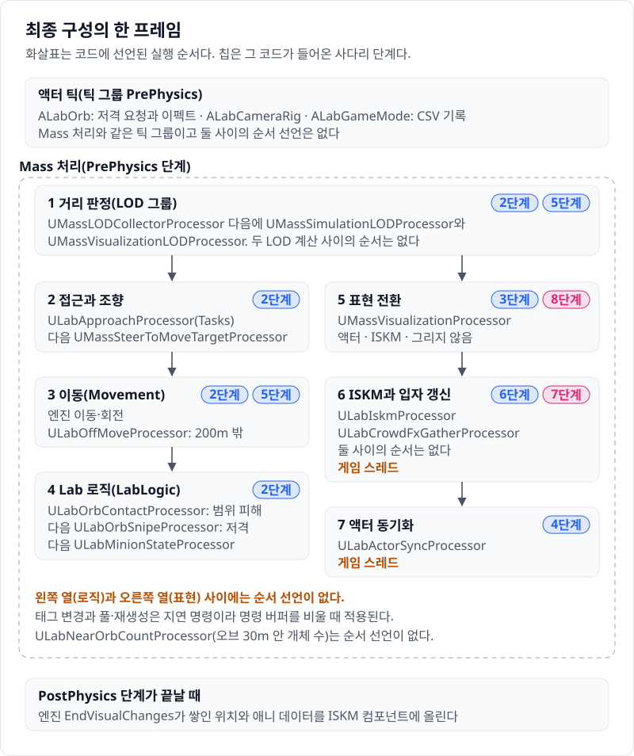

# 코드 투어: 최종 구성의 한 프레임

이 문서는 최종 구성(사다리 8단계, 실행 인자 `-LabStage=M5 -LabVariant=q4final`)으로 실행했을 때 한 프레임에 무엇이 어떤 순서로 도는지를 코드에서 읽어 정리한다. 이 저장소의 코드를 처음 여는 UE 개발자를 위한 안내서다. 모든 단계가 한 빌드에 들어 있어 실행 변형이 50개가 넘지만, 최종 구성에서 실제로 켜지는 것은 이 문서에 적은 것뿐이다. 순서는 프로세서가 선언한 그룹과 `ExecuteAfter`·`ExecuteBefore`에서 읽었다. 선언만으로 순서가 정해지지 않는 곳은 "정해져 있지 않다"고 적었다. 엔진 동작의 근거(파일과 줄)는 [engine-notes.md](../Reference/engine-notes.md)에 있다.

## 요약과 읽는 순서

미니언 1만은 모두 Mass 엔티티다. 오브를 향해 걷는 이동은 엔진 조향·이동 프로세서가 맡고, 카메라에서 200m 밖은 Lab 프로세서가 틱 간격마다 한 번에 옮긴다. 피해·저격·상태 전환은 Lab 로직 프로세서 네 개가 한다. 표현은 엔진의 표현 LOD가 카메라 거리로 고른다. 0\~40m는 액터(최대 1,000), 40\~200m는 ISKM 인스턴스(80m 밖은 그림자 끔), 200m 밖은 그리지 않고 Niagara 입자가 엔티티 자리에 걷는 모습을 그린다. Lab 표현 프로세서 셋이 각자 액터, ISKM, 입자에 그 프레임의 상태를 넣는다. 죽은 엔티티는 파괴하지 않고 풀에 넣었다가 맵 가장자리에서 다시 쓴다.

처음 읽을 때는 이 넷이면 된다.

1. [LabConfig.h](../../Source/HordeOptLab/LabConfig.h): 실행 인자가 설정이 되는 곳. `FLabConfig`의 `UsesIskm()`·`UsesSimLod()` 같은 함수가 무엇이 켜지는지를 정한다.
2. [HordeOptLab.cpp](../../Source/HordeOptLab/HordeOptLab.cpp): 게임 모듈 시작 때 단계에 따라 프로세서 등록을 켜고 끄는 곳.
3. [LabCrowdSubsystem.cpp](../../Source/HordeOptLab/LabCrowdSubsystem.cpp): 엔티티 구성(Trait과 표현 LOD 밴드)을 코드로 만들고, 스폰·재생성·풀을 다루는 곳.
4. [LabMassProcessors.cpp](../../Source/HordeOptLab/LabMassProcessors.cpp): 접근, 200m 밖 이동, 피해, 저격, 상태 타이머.

표현 쪽은 그다음에 [LabIskmProcessor.cpp](../../Source/HordeOptLab/LabIskmProcessor.cpp), [LabActorSyncProcessor.cpp](../../Source/HordeOptLab/LabActorSyncProcessor.cpp), [LabCrowdFxProcessor.cpp](../../Source/HordeOptLab/LabCrowdFxProcessor.cpp)를 읽는다.

## 한 프레임의 흐름

Lab 프로세서는 모두 기본 처리 단계인 PrePhysics에 등록된다(`UMassProcessor::ProcessingPhase` 기본값). 엔진은 이 단계를 틱 그룹 `TG_PrePhysics`의 틱 함수로 돌리고, 그 안에서 프로세서를 의존성 순서대로 실행한다. 선언이 없는 프로세서 쌍은 병렬로 돌거나 프레임마다 순서가 바뀔 수 있다(engine-notes 13절).

### Mass PrePhysics 안의 선언 순서

| 차례 | 프로세서(그룹) | 선언 |
| --- | --- | --- |
| 1 | `UMassLODCollectorProcessor`(LODCollector) | `SyncWorldToMass` 뒤 |
| 2 | `UMassSimulationLODProcessor`, `UMassVisualizationLODProcessor`(LOD) | 둘 다 LODCollector 뒤. 둘 사이는 정해져 있지 않다 |
| 3 | `ULabApproachProcessor`(Tasks) | LOD 뒤 |
| 4 | `UMassSteerToMoveTargetProcessor`(그룹 없음) | Tasks 뒤, Avoidance 앞 |
| 5 | `UMassApplyForceProcessor`(ApplyForces) | Avoidance 뒤 |
| 6 | `UMassApplyMovementProcessor`(Movement) | ApplyForces 뒤 |
| 6 | `UMassSmoothOrientationProcessor`, `ULabOffMoveProcessor`(Movement) | 같은 그룹. 셋 사이는 정해져 있지 않다 |
| 7 | `ULabOrbContactProcessor`(LabLogic) | Movement 뒤, LOD 뒤 |
| 8 | `ULabOrbSnipeProcessor`(LabLogic) | 범위 피해 뒤 |
| 9 | `ULabMinionStateProcessor`(LabLogic) | 저격 뒤 |
| 10 | `ULabDamageGenProcessor` → `ULabDamageApplyProcessor`(LabLogic) | 상태 타이머 뒤. 최종 구성에서는 일하지 않는다 |
| 11 | `UMassVisualizationProcessor`(Representation.VisualizationProcessing) | LOD 뒤 |
| 12 | `ULabIskmProcessor`, `ULabCrowdFxGatherProcessor`(Representation) | VisualizationProcessing 뒤. 둘 사이는 정해져 있지 않다 |
| 13 | `ULabActorSyncProcessor`(그룹 없음) | Representation 뒤 |
| — | `ULabNearOrbCountProcessor`(그룹 없음) | 선언 없음. 언제 도는지 정해져 있지 않다 |

Avoidance 그룹과 `SyncWorldToMass` 그룹에는 최종 구성의 엔티티를 도는 프로세서가 없다(회피 Trait을 붙이지 않는다). 두 이름은 순서의 기준점으로만 쓰인다.

### 순서가 정해져 있지 않은 곳

- **로직과 표현 사이.** 7\~10(LabLogic)과 11\~13(표현)을 잇는 선언이 없다. 로직이 상태를 쓰고(`FLabAnimStateFragment` 쓰기) 표현이 읽지만, 이 겹침은 청크 단위의 접근 충돌일 뿐 프로세서 전체의 선후를 만들지 않는다(engine-notes 13절). 표현이 같은 프레임 로직보다 먼저 돌면 상태 변화가 한 프레임 늦게 보인다. 선언을 넣은 변형은 2만 개체에서 0.4\~0.7ms 느려 넣지 않았다(`LabExplicitLogicOrder()`, [LabMassProcessors.h](../../Source/HordeOptLab/LabMassProcessors.h)).
- **액터 동기화와 표현 프로세서.** `ULabActorSyncProcessor`는 `ExecuteAfter(Representation)`을 선언한다. 의존성 해결기는 이 이름을 하위 그룹까지 펼치지만 실행 큐는 그룹 이름이 정확히 같은 프로세서만 기다린다(engine-notes 13절). 그래서 실행 때는 그룹이 정확히 `Representation`인 12의 두 프로세서를 기다리고, 그 둘이 11 뒤라 결과적으로 11 뒤에 온다.
- **오브 틱과 Mass 처리.** `ALabOrb`, `ALabCameraRig`, `ALabGameMode`의 액터 틱은 틱 그룹을 바꾸지 않아 기본값 `TG_PrePhysics`이고, Mass PrePhysics 틱 함수와 같은 그룹이다. 둘 사이의 선후 선언은 없다. 엔진은 Mass PrePhysics 틱 함수를 높은 우선순위로 올리지만(`mass.MakePrePhysicsTickFunctionHighPriority` 기본 1) 이것은 선후 보장이 아니다. 오브가 올린 저격 요청은 원자 변수에 남아 그 프레임이나 다음 프레임의 저격 프로세서가 한 번만 가져간다.

### 스폰과 재생성

- **시작.** `ALabGameMode::StartPlay`가 스포너 `ALabCrowdSpawner`, 오브 `ALabOrb`, 카메라 `ALabCameraRig`를 만들고, 배경 무리 Niagara 컴포넌트를 켠 뒤(`SetupCrowdFx`) `ALabCrowdSpawner::SpawnInitial`을 부른다([LabGameMode.cpp](../../Source/HordeOptLab/LabGameMode.cpp)). 스포너는 시드 스트림에서 반지름 [8m, 500m]과 각도를 뽑고, ISKM 에셋을 읽은 뒤 `ULabCrowdSubsystem::Activate`로 종류별 EntityConfig를 만들고 `SpawnEntities`로 엔티티를 만든다([LabCrowdSpawner.cpp](../../Source/HordeOptLab/LabCrowdSpawner.cpp)). 2단계 Mass 로직부터 같은 길이다.
- **재생성.** 사망이 끝난 엔티티는 상태 타이머(아래 "오브의 피해와 저격")가 지연 명령으로 `ULabCrowdSubsystem::RecycleAndRespawn`에 넘긴다. 이 함수는 엔티티를 종류별 풀에 넣고 `RequestRespawn` → `ALabCrowdSpawner::RespawnEntities`로 맵 가장자리 고리 [490m, 500m]의 위치와 새 일련번호를 받는다. `SpawnEntities`가 같은 종류의 풀 엔티티를 먼저 꺼내 `ReinitPooledEntity`로 위치·체력·상태를 다시 넣고, 모자랄 때만 새로 만든다. 쓰이지 않고 남은 엔티티는 그리는 거리 밖에 세워 두고 `FLabPooledTag`를 붙인다. 5단계 Simulation LOD에서 들어온 엔티티 풀이다(파괴하면 ISKM 트랙이 남는 엔진 문제의 우회, engine-notes 3절).

### 이동

- **접근.** `ULabApproachProcessor`가 걷는 엔티티마다 `FMassMoveTargetFragment`를 오브 쪽으로 채운다. 실제 이동은 엔진의 `UMassSteerToMoveTargetProcessor`(조향), `UMassApplyMovementProcessor`(이동), `UMassSmoothOrientationProcessor`(회전)가 한다. 2단계 Mass 로직부터 같다. 5단계 Simulation LOD부터 접근은 청크 필터(`ShouldTickChunkThisFrame`)를 걸어 80\~200m 청크는 0.5초 간격으로만 돈다.
- **200m 밖.** 카메라에서 200m 밖은 Simulation LOD가 Off라 엔진 이동·조향이 돌지 않는다. `ULabOffMoveProcessor`가 틱 간격(1초)이 온 청크만 마지막으로 옮긴 뒤 흐른 시간 × 걷는 속도만큼 오브 쪽으로 곧게 옮긴다. Off에 들어오는 순간은 관찰자 `ULabOffMoveEnterObserver`가 지연 명령 플러시 때 받아 마지막 이동 시각을 맞춘다. 5단계 Simulation LOD에서 들어왔다. 엔진이 Off 엔티티를 이동 목표로 순간 이동시키는 `UMassOffLODNavigationProcessor`는 등록하지 않는다([HordeOptLab.cpp](../../Source/HordeOptLab/HordeOptLab.cpp)).

### 거리 판정과 표현 전환

- **거리 판정.** `UMassLODCollectorProcessor`가 카메라까지의 거리와 시야를 모으고, `UMassSimulationLODProcessor`(로직 간격: 80m, 200m)와 `UMassVisualizationLODProcessor`(표현: 40m, 80m, 200m)가 각자 LOD를 정한다. 표현 LOD 밴드와 상한은 `ULabCrowdSubsystem::BuildEntityConfig`가 Trait에 넣고, Simulation LOD 값은 `ULabSimulationLODTrait` 생성자가 넣는다([LabMassTraits.cpp](../../Source/HordeOptLab/LabMassTraits.cpp)). 엔진의 LOD 수집·표현 LOD·표현 프로세서는 기본으로 꺼져 있어 [Config/DefaultMass.ini](../../Config/DefaultMass.ini)에서 켠다.
- **표현 전환.** `UMassVisualizationProcessor`가 LOD에 따라 표현을 바꾼다. High는 액터, Medium·Low는 ISKM 인스턴스, Off는 없음이다. 액터를 붙이고 떼는 일, 액터 풀, 인스턴스 추가·제거는 엔진이 한다. 3단계 ISM + VAT에서 밴드와 200m 밖 지우기가 들어왔고, 8단계 품질 올리기에서 액터 거리가 40m, 상한이 1,000이 됐다(`FLabQuality`).

### 액터 하이드레이션

- **액터 클래스.** High 밴드의 엔티티는 `ALabMinionMassActorBudget`(대형은 `ALabMinionMassActorBudgetLarge`)이 된다. 메시가 `USkeletalMeshComponentBudgeted`라 Animation Budget Allocator가 애니 갱신을 예산 안에서 건너뛴다([LabMinion.h](../../Source/HordeOptLab/LabMinion.h)). 4단계 액터 하이드레이션에서 들어왔다.
- **전환 대책.** `ULabActorManagement`([LabActorSyncProcessor.h](../../Source/HordeOptLab/LabActorSyncProcessor.h))가 액터의 포즈가 준비될 때까지 엔진에 "준비 안 됨"을 알려 그동안 인스턴스를 계속 그리게 하고, 액터를 옮길 때 캡슐 반높이를 더하며, 액터가 붙을 때 `FLabActorTag`를 지연 명령으로 붙인다.
- **동기화.** `ULabActorSyncProcessor`(게임 스레드)가 `FLabActorTag`가 있는 엔티티만 돌며 액터 위치, AnimBP 상태와 시작 시각, 사망 색(커스텀 프리미티브 데이터), 화면 크기 중요도(`SetComponentSignificance`)를 넣는다. 엔진은 액터를 붙이는 순간에만 위치를 맞추기 때문이다. 4단계 액터 하이드레이션에서 들어왔다.

### ISKM 갱신

`ULabIskmProcessor`(게임 스레드)가 ISKM으로 그리는 엔티티마다 위치(`UpdateMeshTransform`), 애니 데이터, 사망 색을 한 반복에서 쌓는다. 표현 상태가 `FLabIskmTrackFragment`에 적어 둔 값과 다를 때만 트랙의 `SetAutoPlayData`를 직접 부른다. 80m를 넘어 그림자 없는 컴포넌트로 옮겨 간 프레임에도 트랙을 다시 쓴다. 쌓은 데이터는 PostPhysics 단계가 끝날 때 엔진의 `UMassVisualizationComponent::EndVisualChanges`가 컴포넌트에 올린다(`UMassRepresentationSubsystem`이 PrePhysics 시작에 `BeginVisualChanges`, PostPhysics 끝에 `EndVisualChanges`를 부른다). 6단계 ISKM에서 들어왔다. 엔진의 ISKM 갱신 프로세서 `UMassUpdateInstancedSkinnedMeshProcessor`는 ini에서 끈다.

고정 바운드는 오브 틱이 부르는 `ULabCrowdSubsystem::ExcludeVisualsFromLumen`이 ISKM 컴포넌트를 찾은 첫 틱에 `SetPrimitiveBoundsOverride`로 넣는다(6단계 ISKM). 80m 밖 그림자 끔은 메시 설명자를 LOD 중요도 범위로 둘로 나눠 만든다(`BuildEntityConfig`, 8단계 품질 올리기).

### 입자 갱신

`ULabCrowdFxGatherProcessor`(게임 스레드)가 그려지지 않는(표현 None) 걷는 엔티티의 위치, 그 위치에 있던 시각, 걷기 위상을 종류별 배열로 모아 Niagara 사용자 변수 `User.LabSmallRecs`·`User.LabLargeRecs`에 넣는다(`UNiagaraDataInterfaceArrayFunctionLibrary::SetNiagaraArrayVector4`). 입자는 GPU에서 그 위치부터 오브 쪽으로 외삽해 걷는다. 맵 밖(500\~1,000m)은 엔티티와 무관한 입자가 채운다. 컴포넌트는 `ALabGameMode::SetupCrowdFx`가 시작 때 한 번 켜고 넣는다. 7단계 Niagara 배경 무리에서 들어왔다.

### 오브의 피해와 저격

- **오브 틱.** `ALabOrb::TickMass`가 오브 위치와 카메라 시야를 `ULabCrowdSubsystem`에 쓰고, 지난 처리의 저격 대상과 번개 대상을 읽어 이펙트를 그리고, 2초마다 `PendingSnipeTick`을 올린다([LabOrb.cpp](../../Source/HordeOptLab/LabOrb.cpp)).
- **범위 피해.** `ULabOrbContactProcessor`가 오브 8m 안 엔티티의 체력을 깎고, 0 이하면 상태를 사망으로 바꾸고(`FLabAnimStateFragment::Set`) `FLabDeadTag`를 붙이고 `FMassCodeDrivenMovementTag`를 떼어 멈춘다. 5단계부터 80m 밖 청크는 틱 간격마다만 돌고 건너뛴 시간은 엔진 누적 델타로 보상한다.
- **저격.** `ULabOrbSnipeProcessor`가 저격 요청이 있을 때만 화면 안의 산 엔티티를 거리 구간별로 골라(`TLabSnipeSelector`, [LabSnipe.h](../../Source/HordeOptLab/LabSnipe.h)) 피격 상태와 `FLabHitTag`를 지연 명령으로 넣는다.
- **상태 타이머.** `ULabMinionStateProcessor`가 피격·사망 엔티티의 남은 시간을 절대 시각으로 판정한다. 피격이 끝나면 사망으로, 사망이 끝나면 풀과 재생성으로 넘긴다. 청크 필터를 걸지 않아 매 프레임 돈다.

모두 2단계 Mass 로직에서 들어왔다. 태그 변경은 지연 명령이라 그 처리의 명령 버퍼가 플러시될 때 아키타입이 바뀐다. 표현은 태그가 아니라 `FLabAnimStateFragment`를 읽어 플러시를 기다리지 않는다.

### 측정 기록

- **프레임 CSV.** `ALabGameMode::TickBench`가 `-LabBench` 실행에서 워밍업 15초 뒤 CSV 프로파일러를 60초 켜고 끈다. `ALabGameMode::Tick`이 `Lab/Alive`·`Lab/Deaths`·`Lab/Near30`을 남긴다.
- **프로세서 스탯.** 프로세서가 자기 수치를 `CSV_CUSTOM_STAT`·`CSV_SCOPED_TIMING_STAT`으로 남긴다(예: 접근의 `Lab/SimBand*`, ISKM의 `Lab/IskmTracks`, 입자의 `Lab/CrowdRecs`). `ULabNearOrbCountProcessor`는 오브 30m 안 엔티티 수를 세어 `Lab/Near30`의 값을 만든다.
- **HUD.** `ALabHud`는 `-LabHud`나 F1로 켜는 상태 오버레이다. 측정 실행에서는 켜지 않는다.

## 엔티티의 Fragment와 Tag

종류(소형, 대형)마다 EntityConfig가 하나씩이고, 붙는 Trait은 `ULabMinionTrait`, `ULabMovementTrait`, `UMassSteeringTrait`, `UMassSmoothOrientationTrait`, `UMassLODCollectorTrait`, `ULabSimulationLODTrait`, `UMassMovableVisualizationTrait`이다(`ULabCrowdSubsystem::BuildEntityConfig`). Lab 프래그먼트와 태그는 [LabMassTypes.h](../../Source/HordeOptLab/LabMassTypes.h)에 있다.

| 이름 | 붙이는 곳 | 쓰는 프로세서 |
| --- | --- | --- |
| `FTransformFragment` | `ULabMinionTrait` | 이동(쓰기), Lab 로직·표현·LOD(읽기), `ULabOffMoveProcessor`(쓰기) |
| `FAgentRadiusFragment` | `ULabMinionTrait` | 엔진 이동·조향 Trait이 요구한다 |
| `FMassActorFragment` | `ULabMinionTrait` | 엔진 표현, `ULabActorSyncProcessor` |
| `FLabMinionFragment` | `ULabMinionTrait` | 범위 피해, 저격, 상태 타이머 |
| `FLabHealthFragment` | `ULabMinionTrait` | 범위 피해(쓰기), 저격(읽기) |
| `FLabAnimStateFragment` | `ULabMinionTrait` | 로직(쓰기), ISKM·액터 동기화·입자(읽기) |
| `FLabUnitTypeParams`(공유) | `ULabMinionTrait` | 종류·속도·바운드 반경. 접근, 저격, 표현 |
| `FLabOffMoveFragment` | `ULabMinionTrait`(Off 이동을 쓸 때) | `ULabOffMoveProcessor`, 관찰자, 입자 |
| `FLabIskmTrackFragment` | `ULabMinionTrait`(ISKM을 쓸 때) | `ULabIskmProcessor` |
| `FLabMinionTag` | `ULabMinionTrait` | Lab 프로세서 전부가 거른다 |
| `FMassVelocityFragment`, `FMassForceFragment`, `FMassDesiredMovementFragment` | `ULabMovementTrait`(엔진 `UMassMovementTrait`) | 엔진 이동·조향, `ULabOffMoveProcessor` |
| `FMassCodeDrivenMovementTag` | `ULabMovementTrait` | 엔진 이동. 떼면 멈춘다 |
| `FMassMoveTargetFragment` 외 조향 프래그먼트 | `UMassSteeringTrait` | `ULabApproachProcessor`(쓰기), 엔진 조향·회전 |
| `FMassViewerInfoFragment` | `UMassLODCollectorTrait` | LOD 수집과 두 LOD 계산 |
| `FMassSimulationLODFragment`, 가변 틱 프래그먼트, `FMassOffLODTag` 등 LOD 태그 | `ULabSimulationLODTrait` | 청크 필터를 쓰는 Lab 프로세서, `ULabOffMoveProcessor` |
| `FMassRepresentationFragment`, `FMassRepresentationLODFragment` | `UMassMovableVisualizationTrait` | 엔진 표현, ISKM, 액터 동기화, 입자 |
| `FLabHitTag`, `FLabDeadTag` | 저격, 범위 피해, 상태 타이머 | 로직 쿼리가 걷는 엔티티만 고른다 |
| `FLabActorTag` | `ULabActorManagement` | `ULabActorSyncProcessor`만 이 아키타입을 돈다 |
| `FLabPooledTag` | `ULabCrowdSubsystem::RecycleAndRespawn` | 상태 타이머·입자·30m 계수가 뺀다 |

## 실행 인자에서 설정까지

1. `FLabConfig::Get()`([LabConfig.cpp](../../Source/HordeOptLab/LabConfig.cpp))이 처음 불릴 때 명령줄을 한 번 읽어 정적 값으로 둔다. `-LabStage=M5`는 `ELabStage::M5`, `-LabVariant=q4final`은 `ELabVariant::Q4Final`이 된다.
2. 같은 함수 안에서 변형이 기본값을 정한다. `q4final`은 배경 무리 켬(`bCrowdFx`), 액터 상한 1,000과 전환 거리 40m(`FLabQuality::Q4FinalActorCap`, `Q4FinalHydrateM`), 원거리 그림자 끔(`bFarShadow` 거짓)이다. M5 단계라 엔티티 풀이 켜지고(`bEntityPool`), M3 이상 단계라 화면 크기 Budget이 켜진다(`bScreenSigBudget`). 인자(`-LabActorCap=` 등)를 주면 인자가 이기고 `Overrides`에 남는다.
3. 판정 함수가 나머지를 정한다. `UsesIskm()`(M5이고 VAT 변형이 아님), `UsesSimLod()`(M4 이상), `SimLod().bOffMove`(M5면 참), `UsesHydration()`(M3 이상), `CullsFar()`(M3 이상), `IskmParams().bFixedBounds`(`m5bounds`·`q2crowd`·`q4final`), `UsesCrowdFxEntity()`.
4. 게임 모듈 시작(`FLabGameModule::StartupModule`, [HordeOptLab.cpp](../../Source/HordeOptLab/HordeOptLab.cpp))이 이 함수들로 프로세서 CDO의 `bAutoRegisterWithProcessingPhases`를 바꾼다. 최종 구성에서는 `ULabIskmProcessor`, `ULabActorSyncProcessor`, `ULabOffMoveProcessor`, `ULabCrowdFxGatherProcessor`가 켜지고 `UMassUpdateISMProcessor`, `ULabVatISMProcessor`, `UMassOffLODNavigationProcessor`가 꺼진다. 관찰자 `ULabOffMoveEnterObserver`는 자기 생성자에서 `bAutoRegisterWithObserverRegistry`를 같은 조건으로 정한다.
5. 엔티티 구성(`BuildEntityConfig`), 쿼리 구성(`ConfigureQueries`의 `UsesSimLod()` 분기), 게임 모드(`ALabGameMode::StartPlay`의 `SetupCrowdFx`, `ApplyVariantCVars`의 `a.Budget.Enabled`)가 같은 설정을 읽는다.

로그 줄 `lab_config`(`FLabConfig::ToLogString`)와 CSV 메타데이터 `LabTech*`가 실행이 실제로 켠 기법을 남긴다.

## 최종 구성에서는 돌지 않는 코드

| 코드 | 쓰는 곳 | 최종 구성에서 |
| --- | --- | --- |
| `ALabMinion`과 하위 클래스(`ALabMinionStatic`, `ALabMinionPawn`, `ALabMinionBudget` 등) | 1단계 액터 군중 | 만들지 않는다(M0 단계 전용) |
| `ALabOrb::Tick`의 액터 분기, `ALabOrb::Snipe` | 1단계 | Mass가 켜져 있으면 `TickMass`로 간다 |
| `UMassUpdateISMProcessor` | 2단계 정적 메시 ISM | 등록하지 않는다 |
| `ULabVatISMProcessor`([LabVatProcessor.cpp](../../Source/HordeOptLab/LabVatProcessor.cpp)) | 3\~5단계 VAT | 등록하지 않는다 |
| `ULabDamageGenProcessor`, `ULabDamageApplyProcessor` | 피해 적용 방식 실험 변형 | 등록되지만 변형이 아니라 첫 분기에서 돌아간다. 이벤트 엔티티가 없다 |
| `UMassOffLODNavigationProcessor`(엔진) | 4단계까지 | 등록하지 않는다 |
| `ALabMinionMassActorLow` | 저품질 액터 실험 변형 | 만들지 않는다 |
| `UMassObstacleAvoidanceTrait`, `UMassNavigationObstacleTrait` | 회피 실험 변형 | 붙이지 않는다 |
| `LabUseOldQueries()`, `LabExplicitLogicOrder()` 분기 | 진단 변형 | 거짓이라 기본 쿼리와 선언을 쓴다 |
| `-LabBandFloor`, `LabLogScreenEvent`, `-LabSimLodLog` 등 | 개발 진단 | Test 빌드에는 코드가 없다(`#if !UE_BUILD_TEST`) |
| `UMassConsumeInstancedSkinnedMeshAnimationProcessor`(엔진) | 엔진 ISKM 경로 | 요구하는 `FMassRepresentationAnimationFragment`가 엔티티에 없다 |

`ELabVariant`의 나머지 값과 `FLabConfig::SimLod()`의 다른 분기는 지난 실험을 같은 빌드에서 다시 재려고 남긴 것이다. 단계를 실행 모드로 두는 이유는 [ADR-0004](../Decisions/0004-stages-as-run-modes.md)에 있다.
