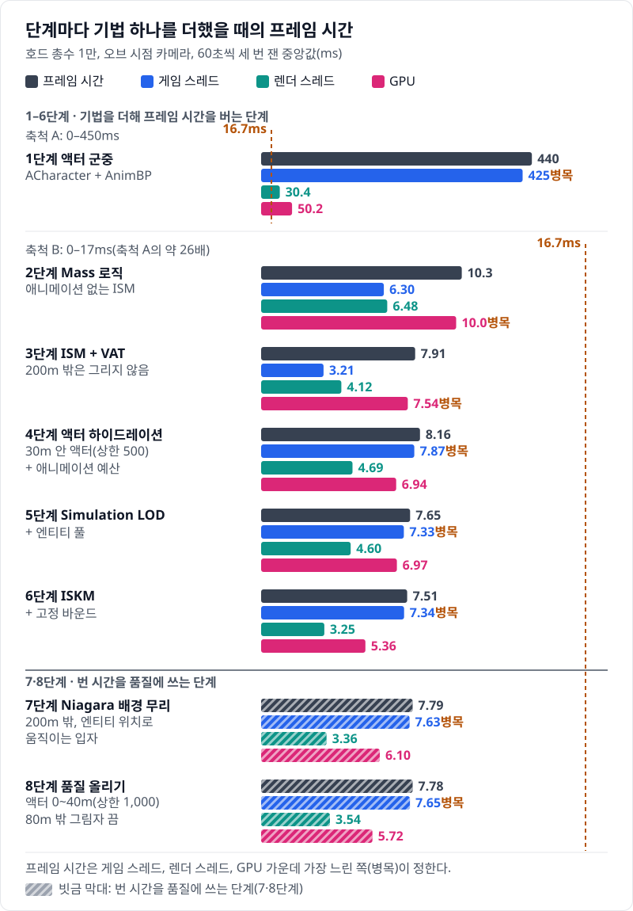
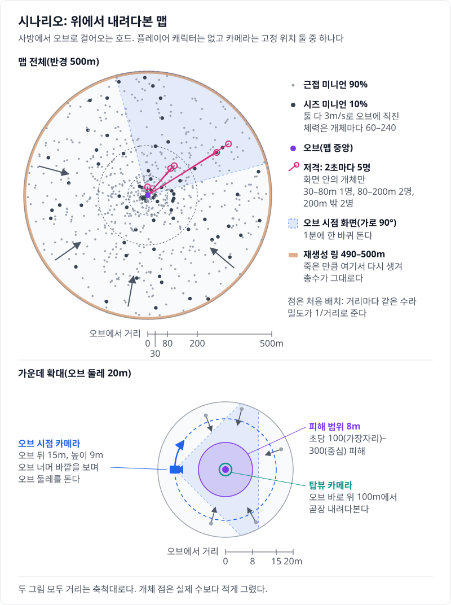
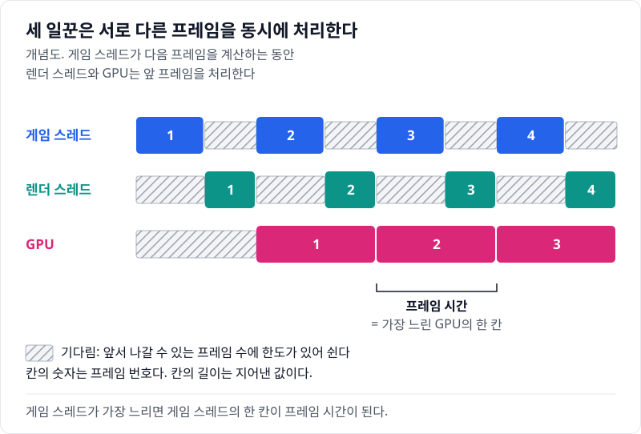
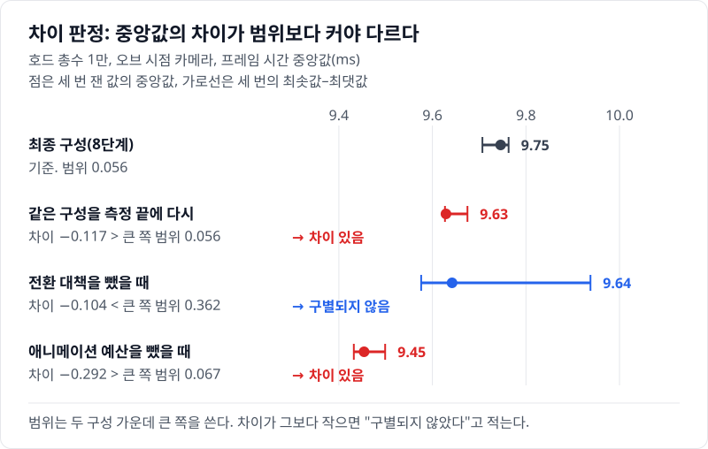
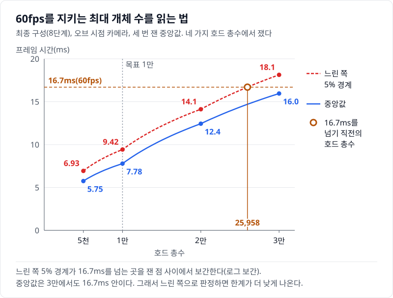
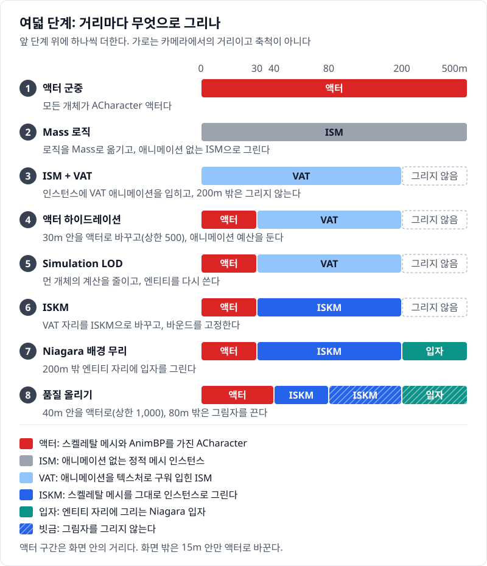

# 00 호드 1만을 60fps로 — 목표 사양과 재는 법

## 요약

`ACharacter` 액터로 만든 호드는 60fps를 지키며 774개까지만 돈다. 같은 호드를 UE 5.8의 Mass로 다시 만들고, 최적화 기법을 한 단계에 하나씩 더했다. 단계마다 같은 시나리오를 같은 방법으로 다시 쟀고, 최종 구성은 호드 총수 1만에서 프레임 시간 중앙값이 7.78ms다.



막대 넷은 프레임 시간, 게임 스레드, 렌더 스레드, GPU 시간이다. 프레임 시간은 셋 가운데 가장 느린 쪽이 정한다. 아래 "측정 방법"이 이 네 값을 재고 읽는 법을 설명한다.

수치의 근거는 [측정 기록](measurements.md)에 있다.

> **시나리오.** 플레이어는 움직이지 않는다. 맵 중앙의 오브(Orb)를 향해 개체가 사방에서 걸어오고, 오브는 가까운 개체를 지우고 먼 개체를 주기적으로 쏜다. 모든 거리에서 생성·피격·사망·표현 전환이 계속 일어나게 하는 벤치마크 장치다.

## 배경 지식

### Test 구성

UE는 같은 코드를 Development, Test, Shipping 구성으로 빌드한다. Development는 `check()`, 디버그 드로우, 통계 수집 코드를 넣은 개발용 구성이다. Test는 이 코드를 빼서 Shipping에 가깝게 돌고, 프로파일링 도구는 남긴다. Shipping은 프로파일링 도구까지 뺀다. 이 연재의 수치는 모두 Test 구성으로 쿡한 패키지에서 잰다.

### CSV 프로파일러

CSV 프로파일러는 프레임마다 지표 값을 CSV 파일에 한 줄씩 쓰는 엔진 도구다. 엔진은 프레임 시간, 게임 스레드, 렌더 스레드, GPU 시간을 기본으로 쓴다. 이 프로젝트는 거리별 개체 수, 초당 사망 수 같은 값을 더한다. 게임이 측정 구간에만 기록을 켜고, 스크립트가 CSV를 모아 중앙값과 범위를 낸다.

### Unreal Insights

Unreal Insights는 엔진이 남긴 트레이스를 시간 축으로 펼쳐 보는 도구다. 스레드마다 어떤 함수가 언제 얼마나 돌았는지를 타이머 단위로 보인다. 이 연재는 "어디에 시간을 쓰나"를 Insights로 보고, "얼마인가"는 CSV로 잰다. 트레이스를 남기는 실행은 따로 돌리고 수치 비교에 쓰지 않는다.

## 목적: 액터로는 1천도 못 버티는 호드를 1만으로

출발점은 액터 군중의 한계다. `ACharacter`와 AnimBP로 만든 개체는 60fps에서 774개가 한계이고, 원인은 [01번 글](../01-actor-baseline/README.md)에 있다. 이 연재는 같은 호드를 Mass로 다시 만들고, 기법 하나가 프레임의 어디를 얼마나 줄이는지 단계마다 보인다. 남기려는 것은 기법의 이름이 아니라 "어느 스레드의 몇 ms"다.

호드는 도시 군중과 부하의 모양이 다르다. 개체가 한 점으로 모여든다. 오브 30m 안은 넓이로 맵의 0.36%이고, 그 안에 개체의 6%가 있다. 호드 총수 1만에서는 초당 62개가 죽고, 같은 수가 맵 가장자리에서 다시 생긴다. 그래서 가까운 개체를 무엇으로 그릴지와 생성·사망 처리가 설계의 중심이 된다.

## 목표 사양: 호드 총수 1만을 60fps로

60fps는 한 프레임에 16.7ms까지 쓸 수 있다는 뜻이다. 호드 총수는 맵에 살아 있는 개체의 수이고, 실행 내내 그 수를 유지한다. 주 지표는 1만에서의 프레임 시간이고, 보조 지표는 60fps를 지키는 최대 개체 수다. 1만은 처음에 정한 값이고, 마지막 글에서 최종 측정을 보고 다시 본다.

## 시나리오: 평지 한 장에서 바뀌는 것은 기법뿐이다



시나리오는 장애물이 없는 반경 500m 평지다. 개체는 사방에서 3m/s로 가운데 오브를 향해 곧장 걷는다. 개체의 90%는 근접 미니언, 10%는 시즈 미니언이고, 체력은 개체마다 다르다. 오브는 8m 안의 개체에 피해를 준다. 또 2초마다 화면 안의 먼 개체 5개를 저격한다.

죽은 개체는 맵 가장자리에서 다시 생긴다. 처음 배치는 오래 돌린 뒤의 분포와 같아서 15초 뒤부터 바로 잴 수 있다. 처음 배치, 다시 생기는 순서, 저격 대상, 체력은 고정 시드로 정한다. 건물과 길을 두지 않은 것은 기법 하나의 비용만 드러나게 하려는 것이다. 단계 사이에 초당 사망 수와 오브 30m 안 개체 수가 3% 안인지도 조건마다 검사하고, 최종 측정은 모두 통과했다.

카메라는 둘이다. 오브 시점 카메라는 오브 뒤 15m, 높이 9m에서 오브 너머를 본다. 이 카메라는 1분에 한 바퀴 돈다. 탑뷰 카메라는 오브 위 100m에서 내려다본다. 본문의 수치는 따로 적지 않으면 오브 시점 카메라의 값이다.

## 측정 방법

### 같은 패키지에서 세 번 재고 중앙값을 쓴다

Test 구성 패키지 하나로 모든 단계를 잰다. 단계는 같은 빌드 안의 실행 모드이고, 실행 인자로 고른다. 실행마다 프로세스를 새로 띄우고, 15초 뒤부터 60초를 기록한다. 같은 조건을 세 번 돌려 중앙값과 범위(최솟값\~최댓값)를 적는다.

화면은 2560×1440 창 모드, 스케일러빌리티 Epic이다. 수직 동기화와 프레임 상한을 끄고 동적 해상도를 꺼서, 프레임 시간이 모니터 주사율에 묶이지 않는다. 측정 PC는 Ryzen 9 5950X, RTX 4090이다.

### 네 가지 시간: 가장 느린 쪽이 프레임 시간을 정한다

프레임 시간은 한 프레임이 시작해 다음 프레임이 시작할 때까지의 실제 시간이다. 게임 스레드는 게임 로직과 액터 틱을, 렌더 스레드는 그릴 명령의 준비를, GPU는 그리기를 맡는다. 세 스레드의 시간은 각자 그 프레임에 일한 시간이다. 엔진은 게임 스레드 시간에서 쉰 시간을 뺀다.

`Engine/Source/Runtime/Engine/Private/UnrealClient.cpp`, `FViewport::Draw`

```cpp
uint32 ThreadTime	= CurrentTime - Lastimestamp;
// add any stalls via sleep or fevent
GGameThreadTime		= (ThreadTime > GameThread.Waits) ? (ThreadTime - GameThread.Waits) : ThreadTime;
```

`Waits`는 지난 프레임 뒤로 잠들거나 이벤트를 기다린 시간이다. 그래서 다른 스레드를 기다리며 잠든 시간은 게임 스레드 시간에 들어가지 않는다.

게임 스레드, 렌더 스레드, GPU 세 일꾼은 서로 다른 프레임을 동시에 처리한다. 다만 앞서 나갈 수 있는 거리에 한도가 있다.

`Engine/Source/Runtime/RenderCore/Private/RenderingThread.cpp`, `FFrameEndSync`

```cpp
struct FRenderThreadFence
{
	// Legacy game code assumes the game thread will never get further than 1 frame ahead of the render thread.
	// This fence is used to sync the game thread with the N-1 render thread frame.
	FRenderCommandFence Fence;
	// ...
	~FRenderThreadFence()
	{
		Fence.Wait(true);
	}
};
// ...
// Additional fences to await. These sync with either the RHI thread or swapchain,
// and are used to prevent the game thread running too far ahead of presented frames.
```

게임 스레드는 렌더 스레드보다 한 프레임까지만 앞서고, 화면에 나간 프레임보다 너무 앞서지도 않는다. 그래서 한 일꾼이 느리면 나머지가 기다리고, 프레임 시간은 가장 느린 일꾼에 맞춰진다. 다만 프레임 시간은 셋 가운데 가장 긴 값보다 조금 길다. 게임 스레드가 워커나 렌더 스레드를 기다린 시간은 게임 스레드 시간에서 빠지고 프레임 시간에는 남는다.



요약 그림의 3단계와 4단계가 그 예다. 3단계는 GPU가 7.54ms로 가장 느리고, 프레임 시간은 7.91ms다. 4단계에서 게임 스레드는 3.21ms에서 7.87ms가 된다. 그런데 프레임 시간은 0.249ms만 는다. 가장 느린 쪽이 GPU에서 게임 스레드로 바뀌었을 뿐, 그 길이는 비슷하다.

그래서 스레드 하나만 보면 기법의 값을 잘못 읽는다. 이 연재는 네 값을 늘 함께 보인다.

### 중앙값과 느린 쪽 5% 경계

프레임 시간은 프레임마다 다르다. 최종 구성은 호드 총수 1만에서 측정 구간 동안 약 7,500프레임을 그린다. 중앙값은 절반의 프레임이 그보다 빠른 값이고, 느린 쪽 5% 경계는 95%의 프레임이 그 안에 드는 값이다. 두 값은 실행마다 구하고, 세 실행의 중앙값을 적는다. 스레드별 시간은 서로 기다린 몫이 섞여 경계값을 읽기 어려우므로 중앙값만 쓴다.

### 차이 판정: 범위보다 큰 차이만 차이로 적는다

두 구성은 중앙값의 차이가 두 범위 가운데 큰 쪽보다 클 때만 다르다고 적는다. 그보다 작으면 "구별되지 않았다"고 적는다. 최종 구성에서 기법 하나만 끈 실행은 "빼 보기"라 부른다.



같은 최종 구성을 측정 끝에 다시 재면 0.023ms 차이로 구별되지 않는다. 애니메이션 예산을 빼면 프레임 시간이 1.75ms 길어지고, 이는 범위보다 훨씬 크다.

### 60fps를 지키는 최대 개체 수

60fps를 지키는 최대 개체 수는 느린 쪽 5% 경계가 16.7ms를 넘기 직전의 호드 총수다. 단계마다 호드 총수 네 가지에서 재고, 16.7ms를 사이에 둔 두 점 사이를 보간한다. 2\~8단계는 5천\~3만, 1단계는 500\~1만에서 잰다.



최종 구성은 약 2만 6,000이다. 중앙값으로 판정하면 3만에서도 16.7ms 안이다. 그래도 느린 쪽으로 판정하는 이유는 중앙값 16.7ms가 "프레임의 절반은 더 느리다"는 뜻이기 때문이다.

### 수치를 흔든 것과 막는 장치

세 실행이 서로 같아도 수치가 틀릴 수 있다. 개발 중의 측정에서 다음 일이 있었다.

- 모니터를 끈 채 PC를 오래 비워 두자, 뒤에 잰 조건이 모두 느려졌다.
- Chrome이 떠 있으면 일정한 주기로 프레임이 튀었다.
- 게임 창이 뒤에 가 있으면 게임 스레드 시간이 길게 나왔다.

지금 러너는 Chrome이나 에디터가 떠 있으면 시작하지 않고, 게임 창이 앞에 있는지 2초마다 확인한다. 측정이 끝나면 주기적으로 튀는 프레임을 찾고, 최종 측정에서는 0건이었다. 끝에는 최종 구성을 한 번 더 재서 처음 값과 견준다.

같은 구성을 다른 날 다시 재도 값이 조금 달라진다. 앞선 측정과 견주면, 구성을 바꾸지 않은 2\~6단계의 프레임 시간 중앙값이 0.09\~0.62ms 길었다. 원인은 확인하지 않았다. 그래서 비교는 한 번에 연달아 잰 값끼리만 한다.

### HUD 읽는 법


단계별 화면의 왼쪽 위 판이 HUD다. 위에서부터 단계와 바꾼 것, 최근 1초의 평균 프레임 시간, 세 스레드의 시간이 나온다. 프레임 시간은 16.7ms 안이면 초록, 33.3ms까지 주황, 넘으면 빨강이다. 그 아래는 표현별 개체 수와 그 표현이 맡는 카메라 거리, 최근 5초의 프레임 시간 막대다. 글의 수치는 HUD를 끈 측정 실행의 값이다.

## 여덟 단계의 지도

사다리는 1단계 액터 군중에서 시작해 한 단계에 기법 하나씩을 더한다. 2·3·5·6단계는 프레임 시간을 벌고, 4·7·8단계는 번 시간을 품질에 쓴다. 한 단계가 짝을 이루는 두 가지를 함께 더하면, 그 몫은 빼 보기로 가른다.



- **1단계 액터 군중.** 모든 개체가 `ACharacter` 액터다. [01 목표 사양을 액터로 돌리면 — URO와 Budget을 켜도 남는 것](../01-actor-baseline/README.md)
- **2단계 Mass 로직.** 로직을 Mass로 옮기고 애니메이션 없는 ISM으로 그린다. [02 로직을 Mass로 — 액터마다 돌던 틱이 Processor 몇 개가 된다](../02-mass-logic/README.md)
- **3단계 ISM + VAT.** 인스턴스에 VAT 애니메이션을 입히고 200m 밖은 그리지 않는다. [03 먼 개체에 애니메이션을 붙이고 더 빨라졌다 — ISM + VAT와 200m 밖 지우기](../03-ism-vat/README.md)
- **4단계 액터 하이드레이션.** 화면 안 30m를 액터로 바꾸고 애니메이션 예산을 둔다. [04 가까운 개체를 진짜 액터로 — 하이드레이션과 애니메이션 예산](../04-hydration-anim-budget/README.md)
- **5단계 Simulation LOD.** 200m 밖 이동을 가볍게 하고 엔티티를 다시 쓴다. [05 먼 개체를 엔진 이동에서 빼자 게임 스레드가 줄었다 — Simulation LOD와 엔티티 풀](../05-simulation-lod-entity-pool/README.md)
- **6단계 ISKM.** 30\~200m를 ISKM으로 그리고 바운드를 고정한다. [06 GPU 시간은 23% 줄고 프레임 시간은 거의 그대로였다 — ISKM과 고정 바운드](../06-iskm/README.md)
- **7단계 Niagara 배경 무리.** 200m 밖 엔티티 자리에 입자를 그린다. [07 지평선까지 이어진 호드에 0.279ms — 엔티티가 움직이는 Niagara 배경 무리](../07-niagara-crowd/README.md)
- **8단계 품질 올리기.** 액터 구간과 상한을 늘리고 80m 밖 그림자를 끈다. [08 품질 올리기 — 남은 예산을 액터 수와 전환 거리에 쓰기](../08-quality/README.md)
- **총괄.** 사다리, 빼 보기, 최대 개체 수를 모아 목표 사양을 다시 본다. [09 440ms에서 7.78ms로, 그리고 남은 7.28ms — 사다리, 빼 보기, 목표 총수](../09-summary/README.md)

빼 보기는 반대 방향의 측정이다. 사다리는 기법을 더한 순서대로의 효과를, 빼 보기는 최종 구성 안에서 그 기법이 맡은 몫을 보인다. 빼 보기는 열 가지이고, 모두 같은 조건에서 잰다.

## 한 문장으로

목표 사양과 시나리오와 재는 법을 하나로 고정해 두면, 기법 하나가 어느 스레드의 몇 ms를 바꾸는지가 드러난다.

- 프레임 시간은 가장 느린 쪽이 정한다. 스레드 하나만 보면 기법의 값을 잘못 읽는다.
- 세 실행이 서로 같아도 환경이 수치를 흔든다. 러너의 검사와 끝의 재측정이 이것을 잡는다.
- 한계: 값은 측정 PC 한 대와 평지 시나리오 하나에서 나왔다. 장애물, 경로 탐색, 근접 공격 판정은 없다.

[다음 글](../01-actor-baseline/README.md)에서는 1단계 액터 군중이 1만에서 어디에 시간을 쓰는지 본다.
