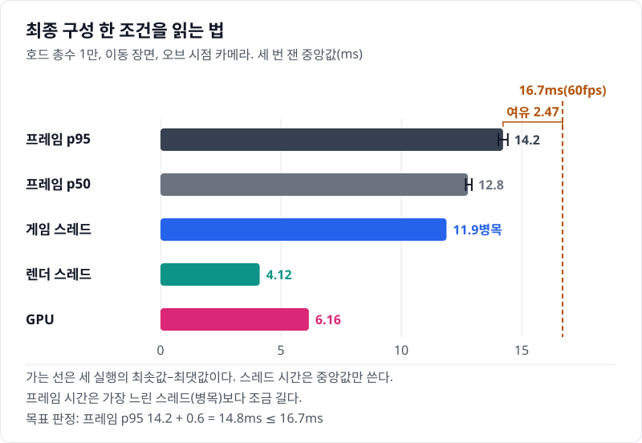
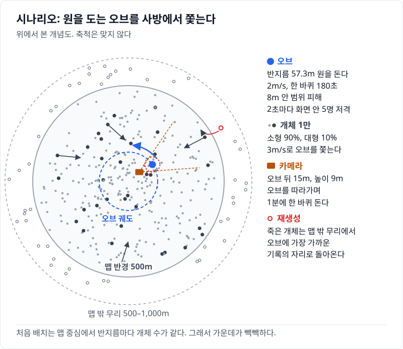
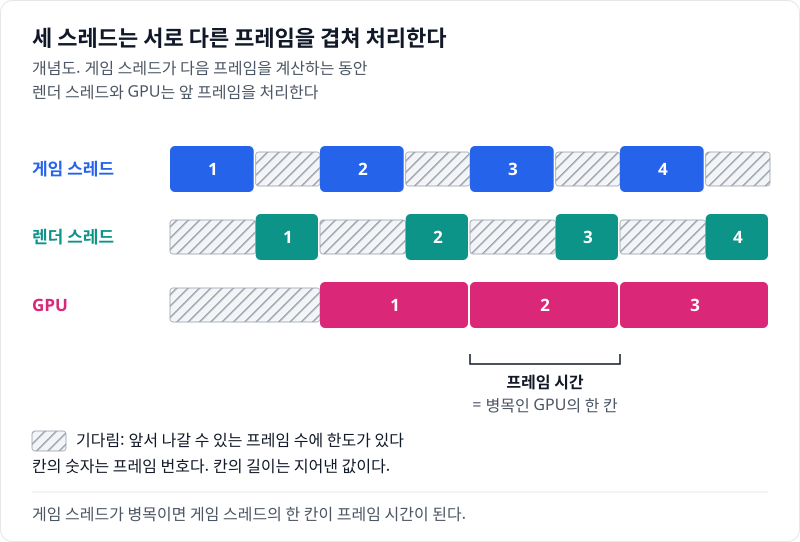
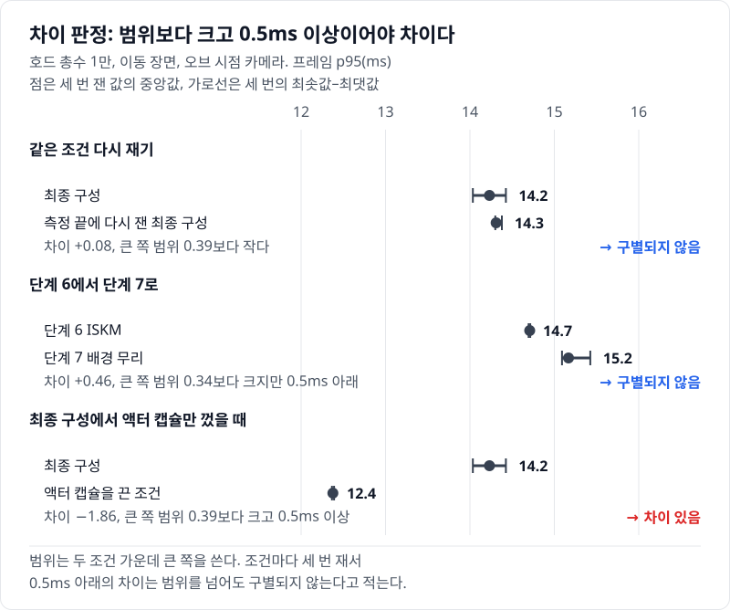
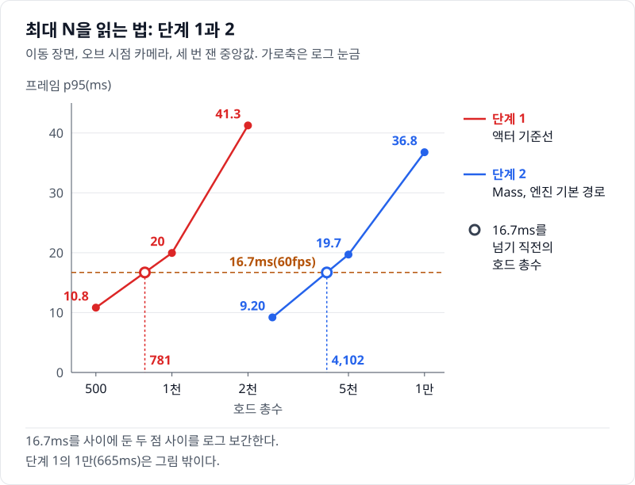
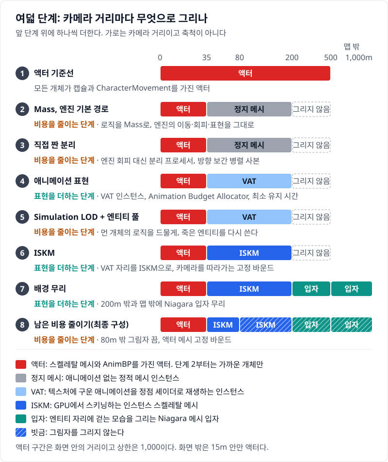

# 00 호드 1만을 60fps로: 목표 사양과 재는 법

## 요약

목표는 호드 1만을 60fps로 돌리는 것이다. 같은 호드를 여덟 단계로 다시 만들었고, 모든 단계가 같은 일 넷을 한다. 단계마다 Test 패키지에서 같은 조건을 세 번 재고, 측정 창 프레임 시간의 95번째 백분위수(프레임 p95)로 판정한다. 최종 구성은 1만에서 프레임 p95가 14.2ms다. 16.7ms까지의 여유는 2.47ms다.




왼쪽 위 HUD의 숫자는 측정값이 아니다. 수치의 근거는 [측정 기록](measurements.md)에 있다.

> **시나리오.** 오브(Orb)가 맵 중심 둘레의 원 궤도를 2m/s로 돈다. 호드 1만이 오브를 쫓아 사방에서 걸어오고, 오브는 가까운 개체를 지우고 먼 개체를 주기적으로 쏜다. 모든 거리에서 생성·피격·사망·표현 전환이 계속 일어나게 하는 벤치마크 장치다.

## 배경 지식

### Test 구성

Development 구성은 `check()`, 디버그 드로우, 통계 수집 코드를 넣은 개발용 빌드다. Test 구성은 이 코드를 빼서 Shipping에 가깝게 돌고, CSV 프로파일러와 트레이스는 남긴다. 이 연재의 수치는 모두 Test 구성으로 쿡한 패키지에서 잰다.

### CSV 프로파일러

CSV 프로파일러는 프레임마다 지표 값을 CSV 파일에 한 줄씩 쓰는 엔진 도구다. 엔진은 프레임 시간과 세 스레드의 시간을 쓰고, 이 프로젝트는 초당 사망 수, 겹친 쌍 같은 값을 더한다. 게임이 측정 창에만 기록을 켜고, 스크립트가 CSV를 모아 중앙값과 범위를 낸다.

### Unreal Insights

Unreal Insights는 엔진이 남긴 트레이스를 시간 축으로 펼쳐, 스레드마다 어떤 함수가 언제 얼마나 돌았는지 보이는 도구다. 이 연재는 어디에 시간을 쓰는지를 Insights로 보고, 얼마인지는 CSV로 잰다. 트레이스를 남기는 실행은 수치 비교에 쓰지 않는다.

## 목표 사양: 호드 1만의 프레임 p95를 16.7ms 안으로

60fps는 한 프레임에 16.7ms까지 쓸 수 있다는 뜻이다. 호드 총수는 맵에 살아 있는 개체의 수이고, 실행 내내 1만을 유지한다. 목표 판정은 최종 구성의 프레임 p95에 0.6ms를 더해도 16.7ms 안인지 본다. 0.6ms는 실행 하나가 중앙값보다 길게 나올 수 있는 폭이다. 최종 구성은 14.8ms로 판정을 통과했다.

## 시나리오: 원을 도는 오브를 사방에서 쫓는다



맵은 장애물이 없는 반경 500m 평지다. 개체의 90%는 근접 미니언, 10%는 시즈 미니언이다. 모두 3m/s로 오브를 향해 걷는다. 오브는 맵 중심 둘레 반지름 57.3m의 원을 2m/s로 돈다. 한 바퀴는 180초다. 오브는 8m 안의 개체에 피해를 주고, 2초마다 화면 안의 먼 개체를 쏜다.

죽은 개체는 맵 밖 무리에서 오브에 가장 가까운 기록의 자리로 돌아와, 호드 총수는 늘 1만이다. 맵 밖 무리는 맵 중심 500\~1,000m에서 코드가 굴리는 기록이다. 배치, 재생성 순서, 저격 대상, 체력은 고정 시드로 정한다.

오브가 움직이면 개체가 거리 구간을 두 방향으로 넘나든다. 개체를 무엇으로 그릴지(표현)는 카메라 거리로 정하므로, 표현 전환도 두 방향으로 일어난다. 고정된 목표에서만 통하는 기법은 이 장면에서 드러난다.

오브 시점 카메라는 오브 뒤 15m에서 오브를 따라가며 1분에 한 바퀴 돈다. 본문의 수치는 따로 적지 않으면 이 카메라의 값이다.

## 모든 단계가 같은 일 넷을 한다

1. 움직이는 오브를 쫓는다.
2. 서로 겹치지 않는다. 몸통 반지름의 합보다 가까운 이웃을 밀어낸다.
3. 가까운 개체, 곧 액터로 그리는 개체는 캡슐 콜리전을 가진다.
4. 피해를 받고 죽는다. 범위 피해, 저격, 사망, 재생성이 같다.

단계는 같은 일을 더 싸게 하는 방법만 바꾼다. 일을 덜어 낸 단계가 빨라 보이는 것을 막는 규칙이다.

## 동등성 검사: 같은 일을 하는지 조건마다 확인한다

동등성 검사는 단계 사이가 같은 일을 하는지 보는 검사다. 조건마다 아래를 본다.

- 살아 있는 총수가 1만 그대로인가.
- 초당 사망과 오브 30m 안 개체 수가 단계 3\~8의 기준과 1% 안인가.
- 겹친 쌍(몸통이 겹친 개체 쌍의 수)이 단계 3\~8 중앙값의 절반에서 두 배 사이인가.
- 오브가 2초마다 액터 하나에 쏘는 라인 트레이스가 캡슐을 맞히는가.
- 2초 안에 같은 거리 경계를 되넘는 왕복 전환이 단계 4부터 초당 0.5 이하인가.

단계 3\~8은 1만에서 해당 항목을 모두 통과했다. 초당 사망과 30m 안 개체 수는 기준과 0.2% 안이었다. 단계 1과 2는 초당 사망이나 30m 안 개체 수가 기준과 1% 넘게 달라 값만 보고한다. 까닭은 01과 02에서 본다.

## 측정 방법

### 같은 패키지에서 세 번 재고 중앙값을 쓴다

단계는 Test 패키지 하나 안의 실행 모드이고, 실행 인자 하나로 고른다. 실행마다 프로세스를 새로 띄우고, 워밍업 60초 뒤 180초를 기록한다. 180초는 오브가 한 바퀴 도는 시간이다. 같은 조건을 세 번 재고 중앙값과 범위(최솟값\~최댓값)를 적는다. 측정 PC는 Ryzen 9 5950X와 RTX 4090이다.

### 프레임 p50과 프레임 p95

프레임 시간은 한 프레임이 시작해 다음 프레임이 시작할 때까지 흐른 실제 시간이다. 프레임 p50과 프레임 p95는 한 실행의 측정 창에서 프레임 시간의 50번째, 95번째 백분위수다. 최종 구성은 측정 창에 약 1만 4천 프레임을 그린다. 프레임 p95는 그 가운데 가장 느린 약 700프레임이 시작되는 경계다. 프레임 p50이 16.7ms면 프레임의 절반이 그보다 느려서, 판정에는 프레임 p95를 쓴다.

16.7ms까지의 여유는 16.7ms에서 프레임 p95를 뺀 값이다. 단계 3\~8과 최종 구성은 1만에서의 프레임 p95와 이 여유로 적는다.

### 가장 느린 스레드가 프레임 시간을 정한다

게임 스레드는 게임 로직을, 렌더 스레드는 그릴 명령의 준비를, GPU는 그리기를 맡는다. 세 스레드는 서로 다른 프레임을 겹쳐 처리하고, 앞서 나갈 수 있는 프레임 수에 한도가 있다. 그래서 프레임 시간은 셋 가운데 가장 느린 쪽, 곧 병목에 맞춰진다. 스레드 시간은 기다린 몫이 섞이므로 중앙값만 쓴다.



엔진은 게임 스레드 시간에서 기다린 시간을 뺀다.

`Engine/Source/Runtime/Engine/Private/UnrealClient.cpp`, `FViewport::Draw`

```cpp
uint32 ThreadTime	= CurrentTime - Lastimestamp;
// add any stalls via sleep or fevent
GGameThreadTime		= (ThreadTime > GameThread.Waits) ? (ThreadTime - GameThread.Waits) : ThreadTime;
```

`Waits`는 잠들거나 이벤트를 기다린 시간이다. 그래서 프레임 시간은 병목의 시간보다 조금 길다. 최종 구성은 게임 스레드가 11.9ms, 프레임 p50이 12.8ms다. 게임 스레드가 작업자 스레드를 기다린 시간도 빠지므로, [단계 2](../02-mass-engine-path/README.md)는 프레임이 세 스레드보다 길다.

### 차이 판정: 범위보다 크고 0.5ms 이상이어야 차이다

두 조건의 중앙값 차이가 두 범위 가운데 큰 쪽보다 클 때만 차이로 적는다. 그보다 작으면 "구별되지 않는다"고 적는다. 0.5ms 아래를 가르려면 다섯 번은 재야 하므로, 세 번 잰 이번 측정에서는 0.5ms 아래를 모두 구별되지 않는다고 적는다.



단계 6과 7의 차이 0.46ms는 범위를 넘지만 0.5ms 아래라 구별되지 않는다. 최종 구성에서 액터 캡슐만 끄면 1.86ms 짧아져 차이가 있다.

### 최대 N은 단계 1과 2에만 쓴다

최대 N은 프레임 p95가 16.7ms를 넘기 직전의 호드 총수다. 16.7ms를 사이에 둔 두 총수 사이를 로그 보간한다. 1만에서 60fps를 지키지 못하는 단계 1과 2에만 쓴다. 단계 1은 약 780, 단계 2는 약 4,100이다.



### 수치를 흔드는 것과 막는 장치

러너는 에디터, 빌드 도구, 브라우저가 떠 있으면 시작하지 않는다. 게임 창이 앞에 없던 실행은 버리고 다시 잰다. 주기적으로 튀는 프레임이 있는 실행은 없었다. 마지막에는 최종 구성을 세 번 더 잰다(같은 조건 다시 재기). 처음 값과 0.5ms 넘게 다르면 측정 전체를 참고로만 쓰는데, 이번 차이는 0.08ms였다.

### 측정의 한계

- 오브가 원점에 서 있는 정지 장면에서는 캡슐 트레이스가 약 1.7% 빗나간다. 트레이스 시작점이 캡슐의 정면 평면 위에 놓이면 엔진의 라인 트레이스가 캡슐을 놓친다. 측정 장치의 결함이라 정지 장면의 빗나감은 보고만 한다.
- 겹친 쌍은 프레임 시간을 따라 는다. 프레임 사이에 개체가 걸어 들어온 거리를 분리가 한 번에 고치기 때문이다. 그래서 프레임 시간이 크게 다른 조건끼리는 겹친 쌍을 견주지 않는다.
- 값은 측정 PC 한 대와 평지 시나리오 하나에서 나왔다.

## 여덟 단계의 지도: 비용을 줄이는 단계와 표현을 더하는 단계

사다리는 한 단계마다 앞 단계 위에 기법 한 벌을 더한다. 비용을 줄이는 단계(2, 3, 5, 8)는 같은 일을 더 싸게 하고, 표현을 더하는 단계(4, 6, 7)는 먼 개체의 표현을 더한다. 단계 2부터 하이드레이션(Hydration, 가까운 엔티티에만 진짜 액터를 붙이는 일)을 쓴다. 단계 8이 최종 구성이다.



기법별 기여는 최종 구성에서 기법 하나만 끄고 같은 조건으로 잰 차이다(조건 표의 이름은 `ablation`). 사다리가 더한 순서의 효과를 보인다면, 기법별 기여는 최종 구성 안에서 그 기법의 몫을 보인다. 기법별 기여는 정지 장면에서도 재지만, 워밍업이 달라 이동 장면과 직접 견주지 않는다.

- [01 액터 기준선](../01-actor-baseline/README.md): 단계 1
- [02 Mass, 엔진 기본 경로](../02-mass-engine-path/README.md): 단계 2
- [03 직접 짠 분리](../03-separation/README.md): 단계 3
- [04 표현을 더하는 단계](../04-quality-by-distance/README.md): 단계 4, 6, 7
- [05 비용을 줄이는 단계와 기법별 기여](../05-cost-cuts-and-contributions/README.md): 단계 5, 8
- [06 엔진에서 찾은 문제](../06-engine-findings/README.md)
- [07 요약](../07-summary/README.md)

## 한 문장으로

목표와 장면과 재는 법을 하나로 묶어 두면, 같은 일을 하는 기법 하나가 어느 스레드의 몇 ms를 바꾸는지가 드러난다.

- 같은 일을 하는지는 동등성 검사가 조건마다 확인한다.
- 프레임 시간은 가장 느린 스레드가 정한다. 스레드 하나만 보면 기법의 값을 잘못 읽는다.
- 0.5ms 아래의 차이는 구별되지 않는다.

[다음 글](../01-actor-baseline/README.md)에서는 단계 1 액터 기준선이 어디에 시간을 쓰는지 본다.
