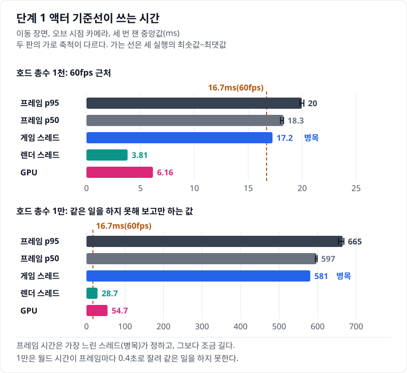
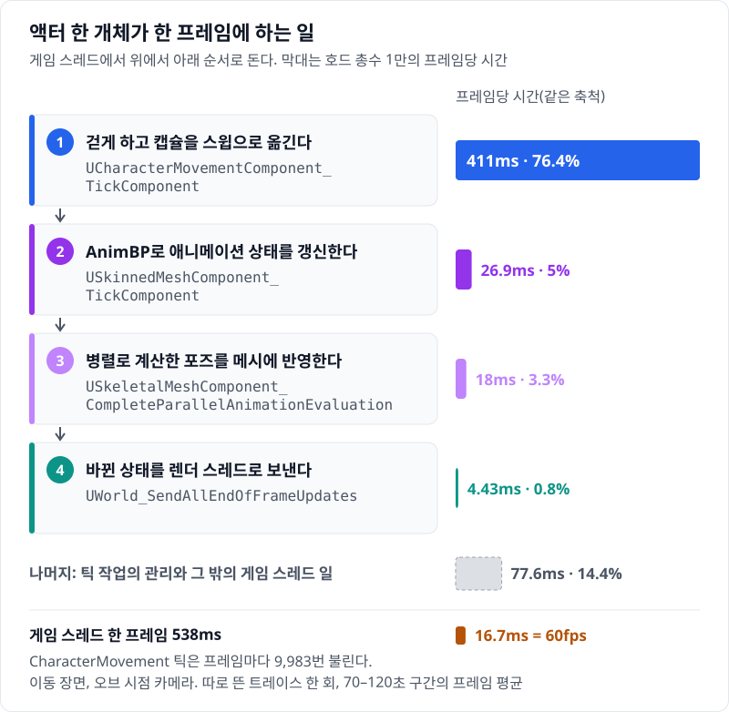
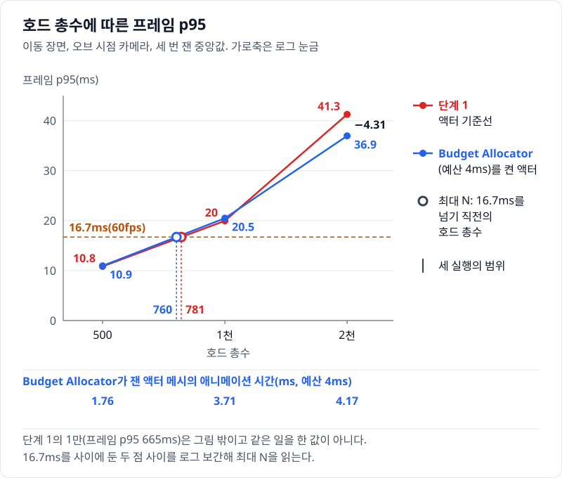
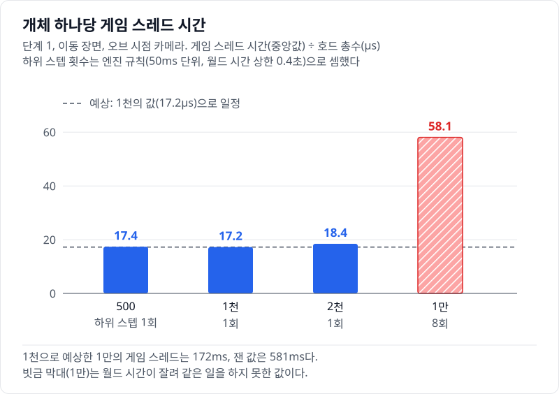

# 01 액터 기준선: 캡슐과 이동 컴포넌트를 가진 액터는 약 780에서 60fps를 넘는다

## 요약

단계 1은 모든 개체가 캡슐과 CharacterMovement를 가진 `ACharacter` 액터다. 호드 총수 1만에서 프레임 p50(프레임 시간의 중앙값)은 597ms이고, 병목은 게임 스레드다. 60fps를 지키는 최대 N은 약 780이다. Animation Budget Allocator만 켠 액터(예산 4ms)도 약 760이다. 트레이스에서 게임 스레드 시간의 약 4분의 3은 CharacterMovement의 틱이 쓴다.



프레임 시간은 게임 스레드, 렌더 스레드, GPU 가운데 가장 느린 쪽이 정한다. 그 쪽을 병목이라 부른다. 최대 N은 프레임 p95(느린 쪽 5%의 경계)가 16.7ms를 넘기 직전의 호드 총수다. 지표의 자세한 설명은 [목표 사양과 재는 법](../00-goals-and-method/README.md)에 있다.


*단계 1 화면. HUD 숫자는 측정값이 아니다.*

수치의 근거는 [측정 기록](measurements.md)에 있다.

> **시나리오.** 오브(Orb)가 맵 중심 둘레의 원 궤도를 2m/s로 돈다. 호드 1만이 오브를 쫓아 사방에서 걸어오고, 오브는 가까운 개체를 지우고 먼 개체를 주기적으로 쏜다. 모든 거리에서 생성·피격·사망·표현 전환이 계속 일어나게 하는 벤치마크 장치다.

## 배경 지식

### CharacterMovement

`UCharacterMovementComponent`는 `ACharacter`에 붙는 이동 컴포넌트다. 틱마다 속도를 셈하고 캡슐을 바닥을 따라 스윕으로 옮긴 뒤 바닥을 다시 찾는다. 한 틱에 흐른 시간이 50ms보다 길면 시간을 나눠 이 계산을 여러 번 한다. 나눈 한 번을 하위 스텝이라 부른다. 단계 1은 하위 스텝 설정을 엔진 기본값으로 둔다. 바꾼 것은 걷는 속도(3m/s), 진행 방향 보기, 컨트롤러 없이 이동하기 셋이다. 액터 틱은 오브 쪽 입력만 준다.

### 캡슐끼리 막기

단계 1의 겹침 방지는 엔진이 캐릭터에 주는 보통의 수단이다. 캡슐이 Pawn 채널을 막아, 스윕이 다른 캡슐에 닿으면 이동이 표면을 따라 미끄러진다. 시작부터 겹쳐 있으면 겹친 깊이만큼 밀어낸다. 캡슐 반지름은 몸통 반지름과 같게 두어 막힌 두 개체를 겹친 쌍으로 세지 않는다.

### Animation Budget Allocator

Animation Budget Allocator는 스켈레탈 메시의 애니메이션에 쓰는 게임 스레드 시간에 프레임당 예산을 두는 엔진 플러그인이다. 수요가 예산 안이면 모든 메시를 매 프레임 갱신한다. 넘으면 중요도가 낮은 메시부터 갱신 간격을 늘린다. 비교 조건은 액터 메시를 `USkeletalMeshComponentBudgeted`로 바꾸고 예산을 4ms로 두었다. 중요도는 몸통 반지름을 카메라 거리로 나눈 값이다.

## 원리: 액터 한 개체가 한 프레임에 하는 일

액터 기준선의 비용은 개체 하나가 한 프레임에 하는 일의 합이다. 개체마다 컴포넌트가 게임 스레드에서 차례로 틱한다. 아래 그림의 칸은 호드 총수 1만의 트레이스에서 이름을 확인한 타이머다. 막대는 그 타이머가 쓴 프레임당 시간이다.



CharacterMovement는 프레임이 길수록 일을 더 한다. 한 틱의 시간을 나눠 계산하기 때문이다. 나누는 규칙은 다음 함수가 정한다.

`Engine/Source/Runtime/Engine/Private/Components/CharacterMovementComponent.cpp`, `UCharacterMovementComponent::GetSimulationTimeStep`

```cpp
if (RemainingTime > MaxSimulationTimeStep)
{
	if (Iterations < MaxSimulationIterations)
	{
		// Subdivide moves to be no longer than MaxSimulationTimeStep seconds
		RemainingTime = FMath::Min(MaxSimulationTimeStep, RemainingTime * 0.5f);
	}
	// ...
```

기본값은 `MaxSimulationTimeStep` 0.05초, `MaxSimulationIterations` 8이다. 남은 시간이 50ms보다 길면 남은 시간의 절반과 50ms 가운데 짧은 쪽만 이번 스텝에 쓴다.

같은 파일, `UCharacterMovementComponent::PhysWalking`

```cpp
while ( (remainingTime >= MIN_TICK_TIME) && (Iterations < MaxSimulationIterations) && CharacterOwner // ...
{
	Iterations++;
	// ...
	const float timeTick = GetSimulationTimeStep(remainingTime, Iterations);
	remainingTime -= timeTick;
	// ...
		MoveAlongFloor(MoveVelocity, timeTick, &StepDownResult);
	// ...
		FindFloor(UpdatedComponent->GetComponentLocation(), CurrentFloor, bZeroDelta, NULL);
	// ...
}
```

`while`가 하위 스텝을 여덟 번까지 돌린다. 스텝마다 `MoveAlongFloor`가 캡슐을 스윕으로 옮기고, `FindFloor`가 바닥을 다시 찾는다.

1만에서는 프레임이 0.4초를 넘는다. 엔진은 한 프레임에 넘기는 월드 시간을 0.4초(`MaxUndilatedFrameTime`)로 자른다. 그래서 1만에서는 한 틱이 50ms씩 여덟 번의 하위 스텝으로 나뉜다.

**예상.** 프레임이 50ms 안이면 하위 스텝은 한 번이라, 비용이 호드 총수에 비례할 것이다. 1천의 게임 스레드 시간(중앙값)은 17.2ms다. 열 배 하면 172ms다. 1만은 하위 스텝이 여덟 번이라 이보다 클 것이다.

## 문제: 1만에서 게임 스레드는 CharacterMovement의 틱이 쓴다

1만의 트레이스에서 게임 스레드 한 프레임은 538ms다. 그 가운데 411ms를 CharacterMovement의 틱이 쓴다. 이 틱은 프레임마다 9,983번 불려 개체마다 한 번꼴이다. 애니메이션 쪽 두 타이머(스켈레탈 메시 틱과 포즈 반영)는 합쳐 44.9ms다. 트레이스는 측정과 따로 돌린 실행이라 비율만 읽는다.


1만의 값은 같은 일을 한 값이 아니다. 월드 시간이 프레임마다 0.4초로 잘려, 측정 창에 451프레임만 그린다. 동등성 검사(단계 사이가 같은 일을 하는지 보는 검사)에서 초당 사망은 32.8로, 기준보다 45% 적다. 그래서 1만의 단계 1은 보고만 한다.

## 결과: 최대 N은 약 780이고, Budget Allocator는 이 한계를 옮기지 못한다



호드 총수 1천에서 이미 프레임 p95가 20ms다. 16.7ms를 사이에 둔 두 점을 로그 보간하면 최대 N은 약 780이다. 세 점은 프레임이 0.4초보다 훨씬 짧아 월드 시간이 잘리지 않는다.

### 개체당 비용은 2천까지만 일정하다



게임 스레드 시간(중앙값)을 호드 총수로 나누면 개체 하나의 시간이 나온다. 2천까지는 18µs 안팎으로 평평하다. 이 구간은 프레임이 50ms 안이라 하위 스텝이 한 번이다. 1만은 58.1µs다. 게임 스레드도 예상한 172ms 대신 581ms가 걸렸다.

하위 스텝이 는다는 예상과 같은 쪽이다. 다만 1만은 같은 일을 한 값이 아니고 하위 스텝을 끈 실행으로 가르지도 않았다.

### Budget Allocator만 켠 액터

비교 조건은 같은 액터에서 메시만 `USkeletalMeshComponentBudgeted`로 바꾸고 예산을 4ms로 둔 것이다. URO(Update Rate Optimization)는 메시의 화면 크기로 애니메이션 갱신 간격을 늘리는 엔진 기능이다. 엔진은 Budget Allocator에 메시를 등록할 때 그 메시의 URO를 끈다.

`Engine/Plugins/Runtime/AnimationBudgetAllocator/Source/AnimationBudgetAllocator/Private/AnimationBudgetAllocator.cpp`, `FAnimationBudgetAllocator::RegisterComponent`

```cpp
const bool bIsCurrentlyEnabled = FAnimationBudgetAllocator::bCachedEnabled && bEnabled;
if (bIsCurrentlyEnabled)
{
	InComponent->bEnableUpdateRateOptimizations = false;
	InComponent->EnableExternalTickRateControl(true);
}
```

Budget Allocator가 켜져 있으면 메시의 URO를 끄고 갱신을 직접 맡는다. 단계 1의 기본 메시도 URO를 켜지 않는다. 엔진 기본값이 끔이다. 그래서 두 조건의 차이는 Budget Allocator와, 그에 넘길 중요도를 액터 틱마다 셈하는 일이다.

Budget Allocator는 2천에서만 프레임을 줄였다. 프레임 p95가 41.3ms에서 36.9ms가 됐다. 1천에서는 오히려 0.52ms 길다. 그래서 최대 N은 약 760이다.

까닭은 예산에 닿는 총수에 있다. Budget Allocator가 잰 액터 메시의 애니메이션 시간은 1천에서 3.71ms다. 2천에서는 4.17ms로 예산에 닿는다. 예산 안에서는 매 프레임 갱신하는 메시 수가 수요 전체가 된다.

같은 파일, `FAnimationBudgetAllocator::CalculateWorkDistributionAndQueue`

```cpp
const float WorkUnitsExcess = FMath::Max(0.0f, TotalIdealWorkUnits - WorkUnitBudget);
const float WorkUnitsToRunInFull = FMath::Clamp(WorkUnitBudget - (WorkUnitsExcess * Parameters.AlwaysTickFalloffAggression), (float)NumComponentsToNotSkip, (float)TotalIdealWorkUnits);
```

수요 `TotalIdealWorkUnits`가 예산 `WorkUnitBudget` 안이면 넘친 몫이 0이다. 그러면 매 프레임 갱신하는 수가 수요와 같다. 최대 N이 정해지는 500\~1천에서 Budget Allocator가 잰 애니메이션 시간은 예산 4ms 아래였다. 엔진 식대로라면 모든 메시를 매 프레임 갱신한다. 갱신 수를 직접 세지는 않았다.

## 한 문장으로

액터 기준선의 게임 스레드는 CharacterMovement가 쓰고, Budget Allocator는 예산에 닿기 전에는 일을 줄이지 않는다.

- 1만의 단계 1은 월드 시간이 잘리고 초당 사망이 적어 같은 일을 하지 않는다. 단계 1은 최대 N으로 견준다.
- 개체당 비용은 2천까지만 일정했다. 1만의 증가를 하위 스텝 하나로 가르지는 않았다.
- 트레이스는 1만 한 회다. 2천에서 CharacterMovement의 비중은 보지 않았다.

[다음 글](../02-mass-engine-path/README.md)에서는 같은 일을 Mass로 옮긴다. 가까운 개체만 액터로 남고, CharacterMovement의 틱은 없어진다. 여덟 단계의 결과는 [07 요약](../07-summary/README.md)에 모았다.
