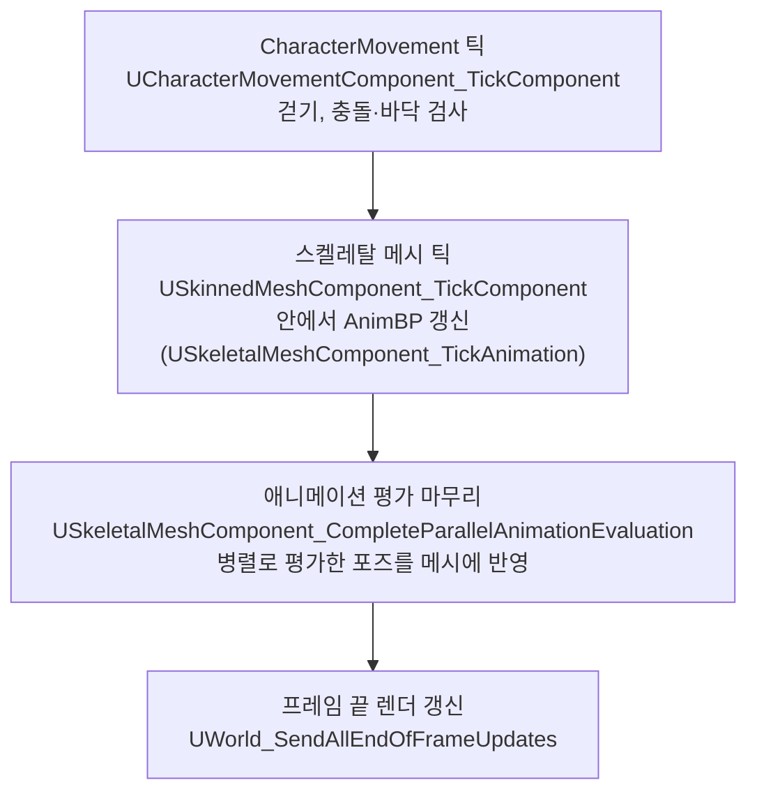
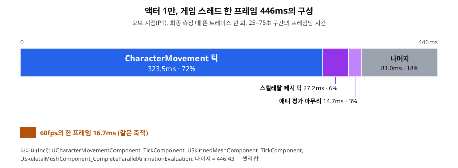

# 01 목표 사양을 액터로 돌리면 — URO와 Budget을 켜도 남는 것

## 요약

호드 1만을 `ACharacter` 액터와 AnimBP로 돌리면 프레임 시간이 441ms다. 60fps의 한 프레임인 16.7ms의 26.5배다. 시간의 대부분은 애니메이션이 아니라 이동 컴포넌트가 쓴다. 그래서 애니메이션을 줄이는 URO와 Animation Budget Allocator를 덧대도 프레임은 400ms대에 남는다.

| 구성(호드 1만, 오브 시점) | 프레임 p50 | 프레임 p95 | Game p50 |
| --- | --- | --- | --- |
| 액터 군중 | 441ms | 466ms | 427ms |
| + URO | 422ms | 449ms | 408ms |
| + Animation Budget Allocator(예산 2ms) | 401ms | 424ms | 386ms |

화면 왼쪽 위 HUD의 프레임 시간에는 녹화 부하가 섞여 있어 표의 값보다 높다. 수치의 근거는 [측정 기록](measurements.md)에 있다.

> **시나리오.** 플레이어는 움직이지 않는다. 맵 중앙의 오브를 향해 개체가 사방에서 걸어오고, 오브는 가까운 개체를 지우고 먼 개체를 주기적으로 쏜다. 모든 거리에서 생성·피격·사망·표현 전환이 계속 일어나게 하는 벤치마크 장치다.

**쓰인 것**

| 이름 | 한 줄 설명 | 이 글에서 한 일 |
| --- | --- | --- |
| 프레임 시간 p50·p95, Game p50 | 60초 측정 동안 프레임 시간의 중앙값과 느린 쪽 5% 경계. Game은 게임 스레드가 일한 시간이다 | 개체 수마다 세 번 재고 중앙값을 적었다 |
| N@16.7ms | 프레임 p95가 16.7ms 안에 드는 최대 개체 수 | 액터 군중의 한계를 797로 구했다 |
| CharacterMovement | `ACharacter`의 이동 컴포넌트 `UCharacterMovementComponent`. 매 틱 개체를 걷게 하고 충돌과 바닥을 검사한다 | 기본 설정 그대로 두고 트레이스에서 비용을 읽었다 |
| URO | Update Rate Optimization. 스켈레탈 메시가 거리에 따라 애니메이션 갱신을 건너뛰게 한다 | 메시의 `bEnableUpdateRateOptimizations`를 켜고 거리 단계는 엔진 기본값으로 두었다 |
| Animation Budget Allocator | 애니메이션에 쓰는 게임 스레드 시간에 예산을 두고, 중요도가 낮은 메시부터 갱신을 건너뛰게 한다 | 메시를 `USkeletalMeshComponentBudgeted`로 바꾸고 예산을 2ms로 두었다. 중요도는 오브에서의 거리 단계로 주었다 |

## 원리: 한 프레임에 액터 한 개체가 하는 일

액터 군중의 비용은 개체 하나가 한 프레임에 하는 일의 합이다. 개체마다 컴포넌트 몇 개가 게임 스레드에서 차례로 틱한다. 아래 도식은 1만 실행의 트레이스에서 이름을 확인한 타이머만 적었다.

이 가운데 CharacterMovement는 프레임이 길어지면 일을 더 한다. CharacterMovement는 지난 프레임 뒤에 흐른 시간만큼 개체를 옮긴다. 한 번에 계산하는 시간은 50ms까지다. 흐른 시간이 더 길면 한 틱 안에서 시간을 나눠 여러 번 계산한다. 나눌 때는 남은 시간의 절반과 50ms 중 짧은 쪽을 쓴다. 60ms면 30ms씩 두 번이다. 이 한 번 한 번을 하위 스텝이라 부른다. 하위 스텝마다 충돌과 바닥을 다시 검사하므로, 개체가 벽을 뚫거나 바닥을 놓치지 않는다.

하위 스텝의 상한은 여덟 번이다. 1만에서는 프레임이 0.4초를 넘는다. 엔진은 한 틱에 넘기는 시간을 0.4초로 자른다. CharacterMovement는 그 0.4초를 50ms씩 여덟 번에 나눠 계산한다. 이미 느린 프레임에서 정확도를 지키려고 계산을 더 하는 셈이다.

**예상.** 프레임이 50ms 안이면 하위 스텝은 한 번이다. 그 구간에서는 비용이 개체 수에 비례할 것이다. 1천의 Game p50을 1만으로 늘리면 166ms다. 1만에서는 하위 스텝이 여덟 번이 되므로 실제 값은 이보다 클 것이다.

## 문제: 1만에서 시간은 이동 컴포넌트가 쓴다

1만의 게임 스레드 한 프레임은 446ms이고, 그중 323ms가 CharacterMovement의 틱이다. 72.5%다. 애니메이션 쪽 타이머 두 개는 합쳐 41.9ms다. 값은 최종 측정 때 따로 뜬 트레이스 한 회에서 읽었다.

Unreal Insights에서 한 프레임만 골라도 거의 같은 비율이 나온다. 아래 스크린샷은 프레임 하나를 선택하고 Timers 창에서 CharacterMovement로 거른 화면이다. 프레임 하나 447.88ms 중 321.66ms가 CharacterMovement 틱이다(71.8%).

그림과 아래 표의 값은 이 한 프레임이 아니라 다른 트레이스의 구간 평균이다. 두 값의 차이는 2ms 안쪽이다.

| 타이머(구간 평균, 직렬 실행 트레이스, 프레임당) | 시간 |
| --- | --- |
| `FEngineLoop::Tick`(한 프레임 전체) | 446ms |
| `UCharacterMovementComponent_TickComponent` | 323ms |
| `USkinnedMeshComponent_TickComponent` | 27.2ms |
| `USkeletalMeshComponent_CompleteParallelAnimationEvaluation` | 14.7ms |

개체 하나로 나누면 CharacterMovement가 한 프레임에 32.3µs를 쓴다. 개체당 Game 시간도 같은 방향을 보인다. 프레임이 50ms 안인 500\~2천에서는 17µs 안팎으로 평평하다. 하위 스텝이 여덟 번인 1만에서는 42.7µs다. 2천에서 1만으로 개체 수는 5배인데 Game 시간은 12.3배다.

| 호드 총수 | 프레임 p50 | 하위 스텝 | 개체당 Game 시간 |
| --- | --- | --- | --- |
| 500 | 9.03ms | 1회 | 17.0µs |
| 1,000 | 17.5ms | 1회 | 16.6µs |
| 2,000 | 36.4ms | 1회 | 17.3µs |
| 10,000 | 441ms | 8회 | 42.7µs |

## 결과: 액터 군중은 797에서 막히고, URO와 Budget은 벽을 옮기지 못한다

액터 군중이 60fps를 지키는 최대 개체 수는 797이다. 1천에서 이미 프레임 p95가 19.7ms다. 목표 사양 1만은 이 한계의 12.5배다. 1만의 프레임 시간 441ms는 1초에 2.27장이다.

애니메이션을 줄이는 기법 두 개를 따로 덧대 1만에서 다시 쟀다. URO는 프레임 p50을 19.2ms 줄였다(4.35%). Animation Budget Allocator는 40.7ms 줄였다(9.22%). 둘 다 세 회차 범위를 넘는 차이지만, 프레임은 여전히 400ms대다.

| 1만 오브 시점 | 프레임 p50 | 변화 | Game p50 | 변화 |
| --- | --- | --- | --- | --- |
| 액터 군중 | 441ms | | 427ms | |
| + URO | 422ms | −19.2ms | 408ms | −19.3ms |
| + Animation Budget Allocator | 401ms | −40.7ms | 386ms | −41.4ms |

두 기법이 못 넘는 이유는 트레이스가 보인다. 애니메이션 쪽 게임 스레드 타이머는 합쳐 41.9ms다. 애니메이션을 통째로 지워도 남는 시간은 약 404ms다. Budget이 줄인 Game 시간 41.4ms는 이 몫과 크기가 비슷하다. 다만 Budget 실행의 트레이스는 뜨지 않아 무엇이 줄었는지는 확인하지 않았다. URO가 Budget의 절반쯤만 줄인 이유도 확인하지 않았다.

앞 마일스톤에서도 같은 방향을 보았다. 애니메이션을 정적 메시로 바꾼 액터와 CharacterMovement 틱만 끈 액터를 따로 쟀다. 각 변형은 자기 비용 하나만 뺐다. 액터마다 도는 컴포넌트 틱과 렌더 갱신은 남았고, 한계는 조금만 올랐다. 이 두 변형은 최종 측정에 없어 수치를 적지 않는다.

## 한 문장으로

액터 1만의 벽은 애니메이션이 아니라 이동 컴포넌트이고, 프레임이 느려질수록 그 이동 컴포넌트가 정확도를 지키려고 계산을 더 해서 더 느려진다.

- 개체당 비용은 프레임이 50ms 안인 구간에서만 일정했다. 액터 군중의 한계를 개체당 비용으로 어림하면 큰 N에서 틀린다.
- 애니메이션 기법은 애니메이션 몫만 줄인다. 1만에서 그 몫은 게임 스레드의 약 9%다.
- 한계: 하위 스텝을 끄고 다시 잰 실험은 없다. 원인은 엔진 소스와 트레이스로 설명했다.

다음 글에서는 같은 로직을 Mass로 옮긴다. 이동 컴포넌트와 액터마다 도는 틱이 함께 사라진다.
