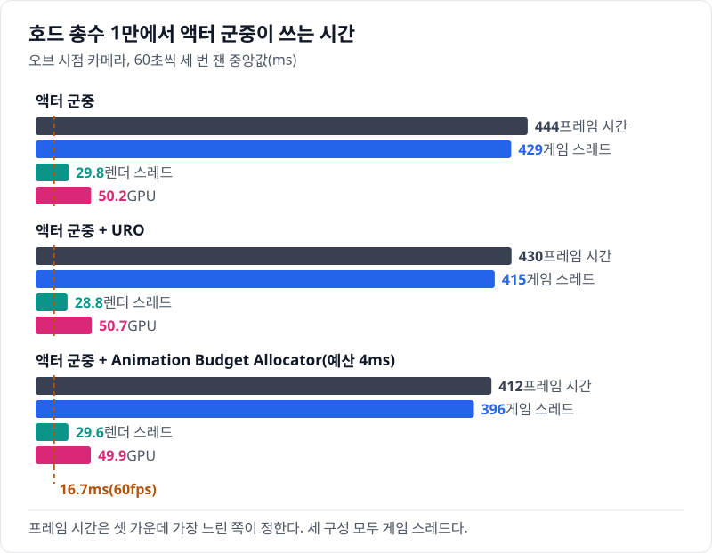
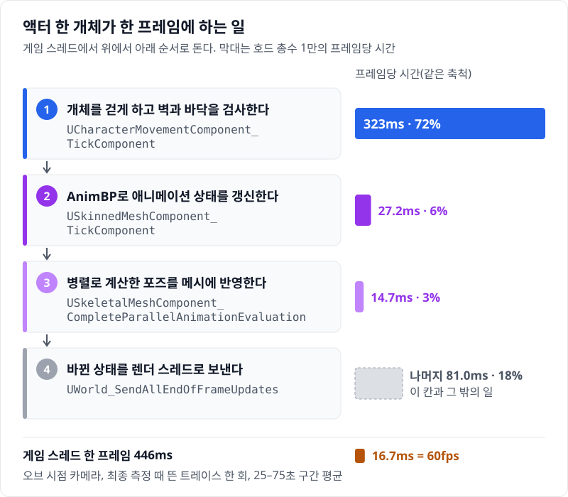
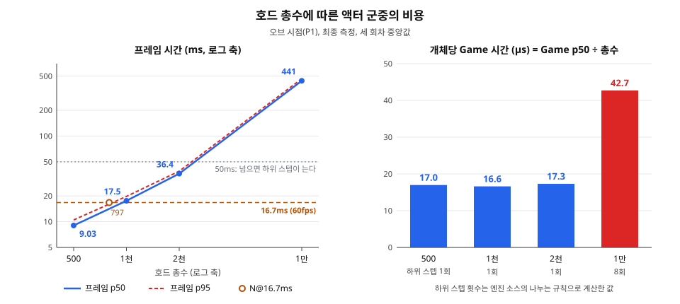
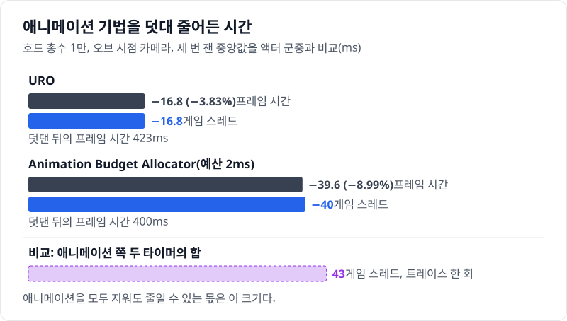

# 01 목표 사양을 액터로 돌리면 — URO와 Budget을 켜도 남는 것

## 요약

호드 1만을 `ACharacter` 액터와 AnimBP로 돌리면 프레임 시간이 440ms다. 60fps의 한 프레임인 16.7ms의 26.4배다. 시간의 대부분은 애니메이션이 아니라 이동 컴포넌트가 쓴다. 그래서 애니메이션을 줄이는 URO와 Animation Budget Allocator를 덧대도 프레임은 400ms대에 남는다.



프레임 시간은 한 프레임이 걸린 시간이다. 게임 스레드, 렌더 스레드, GPU는 각자 그 프레임에 일한 시간을 따로 잰다. 프레임 시간은 셋 가운데 가장 느린 쪽이 정하고, 이 구성에서는 게임 스레드가 가장 느리다. 지표의 자세한 설명은 00번 글에 둔다.


수치의 근거는 [측정 기록](measurements.md)에 있다.

> **시나리오.** 플레이어는 움직이지 않는다. 맵 중앙의 오브를 향해 개체가 사방에서 걸어오고, 오브는 가까운 개체를 지우고 먼 개체를 주기적으로 쏜다. 모든 거리에서 생성·피격·사망·표현 전환이 계속 일어나게 하는 벤치마크 장치다.

## 배경 지식

### CharacterMovement

`UCharacterMovementComponent`는 `ACharacter`에 붙는 이동 컴포넌트다. 매 틱 속도를 계산해 캡슐을 바닥을 따라 옮기고, 옮긴 뒤 바닥을 다시 찾는다. 한 틱에 흐른 시간이 길면 그 시간을 나눠 이 계산을 여러 번 한다. 이 글에서는 설정을 바꾸지 않았다.

### URO

URO(Update Rate Optimization)는 스켈레탈 메시가 애니메이션을 몇 프레임에 한 번 갱신할지 정하는 기능이다. 엔진 기본값은 메시 LOD가 쓰는 화면 크기로 간격을 정한다. 화면 크기가 0.24를 넘으면 매 프레임, 0.12를 넘으면 두 프레임에 한 번, 그보다 작으면 세 프레임에 한 번 갱신한다. 화면에 그려지지 않은 메시는 네 프레임에 한 번이다. 이 글에서는 메시의 `bEnableUpdateRateOptimizations`만 켜고 간격은 기본값으로 두었다.

### Animation Budget Allocator

Animation Budget Allocator는 애니메이션에 쓰는 게임 스레드 시간에 프레임당 예산을 둔다. 할당기는 메시 하나의 평균 갱신 시간으로 예산 안에 드는 메시 수를 구한다. 중요도가 큰 메시부터 그 수만큼 매 프레임 갱신하고, 나머지는 갱신 간격을 늘린다. 이 글에서는 메시를 `USkeletalMeshComponentBudgeted`로 바꾸고 예산을 2ms로 두었다. 중요도는 Significance Manager가 카메라와의 거리로 준다. 가까울수록 크고, 250m 밖은 0이다.

## 원리: 한 프레임에 액터 한 개체가 하는 일

액터 군중의 비용은 개체 하나가 한 프레임에 하는 일의 합이다. 개체마다 컴포넌트가 게임 스레드에서 차례로 틱한다. 아래 그림의 칸은 1만 실행의 트레이스에서 이름을 확인한 타이머다. 막대는 그 타이머가 1만에서 쓴 프레임당 시간이다.



이 가운데 CharacterMovement는 프레임이 길어지면 일을 더 한다. 지난 틱 뒤에 흐른 시간을 한 번에 계산하지 않고 나눠 계산하기 때문이다. 나눈 한 번을 하위 스텝이라 부른다. 나누는 규칙은 다음 함수가 정한다.

`Engine/Source/Runtime/Engine/Private/Components/CharacterMovementComponent.cpp`, `UCharacterMovementComponent::GetSimulationTimeStep`

```cpp
float UCharacterMovementComponent::GetSimulationTimeStep(float RemainingTime, int32 Iterations) const
{
	if (RemainingTime > MaxSimulationTimeStep)
	{
		if (Iterations < MaxSimulationIterations)
		{
			RemainingTime = FMath::Min(MaxSimulationTimeStep, RemainingTime * 0.5f);
		}
		// ...
	}
	return FMath::Max(MIN_TICK_TIME, RemainingTime);
}
```

`MaxSimulationTimeStep`의 기본값은 0.05초이고 `MaxSimulationIterations`는 8이다. 남은 시간이 50ms보다 길면 남은 시간의 절반과 50ms 중 짧은 쪽만 이번 스텝에 쓴다. 60ms면 30ms씩 두 번이다.

같은 파일, `UCharacterMovementComponent::PhysWalking`

```cpp
	float remainingTime = deltaTime;
	// ...
	while ( (remainingTime >= MIN_TICK_TIME) && (Iterations < MaxSimulationIterations) && CharacterOwner // ...
	{
		Iterations++;
		// ...
		const float timeTick = GetSimulationTimeStep(remainingTime, Iterations);
		remainingTime -= timeTick;
		// ...
			MoveAlongFloor(MoveVelocity, timeTick, &StepDownResult);
		// ...
			FindFloor(UpdatedComponent->GetComponentLocation(), CurrentFloor, bZeroDelta, NULL);
		// ...
	}
```

`while` 조건이 하위 스텝을 최대 여덟 번 돌린다. 스텝마다 `MoveAlongFloor`가 캡슐을 옮기고 `FindFloor`가 바닥을 다시 찾는다. 그래서 스텝 수만큼 충돌 검사가 는다.

1만에서는 프레임이 0.4초를 넘는다. 엔진은 한 틱에 넘기는 월드 시간을 0.4초로 자른다.

`Engine/Source/Runtime/Engine/Private/WorldSettings.cpp`, `AWorldSettings::FixupDeltaSeconds`

```cpp
float AWorldSettings::FixupDeltaSeconds(float DeltaSeconds, float RealDeltaSeconds)
{
	// ...
	return FMath::Clamp(DeltaSeconds, MinFrameTime, MaxFrameTime);
}
```

`MaxFrameTime`은 `BaseGame.ini`의 `MaxUndilatedFrameTime=0.4`에서 온다. 그래서 1만의 CharacterMovement는 0.4초를 50ms씩 여덟 번에 나눠 계산한다. 이미 느린 프레임에서 정확도를 지키려고 계산을 더 하는 셈이다.

**예상.** 프레임이 50ms 안이면 하위 스텝은 한 번이고, 비용은 개체 수에 비례할 것이다. 1천의 게임 스레드 시간은 17.0ms이고, 이것을 열 배 하면 170ms다. 1만에서는 하위 스텝이 여덟 번이므로 실제 값은 이보다 클 것이다.

## 문제: 1만에서 시간은 이동 컴포넌트가 쓴다

1만에서 게임 스레드 한 프레임은 446ms이고, 그중 322ms를 CharacterMovement 틱이 쓴다. 72.2%다. 애니메이션 쪽 두 타이머는 합쳐 43.0ms다. 이 값은 따로 뜬 트레이스 한 회의 구간 평균이고, 위 그림의 막대가 이 값이다. 개체 하나로 나누면 CharacterMovement가 한 프레임에 32.2µs를 쓴다.

Unreal Insights에서 프레임 하나만 골라도 비율은 같다. 아래 스크린샷은 1만 실행의 트레이스에서 프레임 하나를 고르고, Timers 창을 CharacterMovement로 거른 화면이다.


왼쪽 빨간 상자가 고른 프레임이고, 길이는 448ms다. 오른쪽 빨간 상자에서 그 프레임의 CharacterMovement 틱은 합쳐 322ms(71.8%)다. 같은 타이머는 그 프레임에 10,048번 불렸다. 개체마다 거의 한 번씩 부른 셈이다.

## 결과: 액터 군중은 774에서 막히고, URO와 Budget은 벽을 옮기지 못한다

액터 군중이 60fps를 지키는 최대 개체 수는 774다. 프레임 시간의 느린 쪽 5% 경계가 16.7ms 안에 드는 가장 큰 호드 총수를 잰 개체 수 사이에서 보간했다. 1천에서 이미 그 경계가 20.0ms다. 목표 사양 1만은 이 한계의 12.9배다.



그래프 아래쪽 막대는 개체당 비용이 일정하지 않음을 보인다. 프레임이 50ms 안인 500\~2천에서는 개체당 게임 스레드 시간이 17µs 안팎으로 평평하다. 하위 스텝이 여덟 번인 1만에서는 42.5µs다. 2천에서 1만으로 개체 수는 5배인데 게임 스레드 시간은 12.2배다. 실제 값 425ms는 예상한 170ms보다 크다.

애니메이션을 줄이는 기법 두 개를 따로 덧대 1만에서 다시 쟀다. URO는 프레임 시간을 16.8ms(3.83%) 줄였다. Animation Budget Allocator는 39.6ms(8.99%) 줄였다. 두 변화 모두 세 회차의 흔들림보다 크다. 그래도 프레임은 400ms대에 남는다.



두 기법이 벽을 못 넘는 이유는 애니메이션의 몫이 작기 때문이다. 애니메이션 쪽 두 타이머는 합쳐 43.0ms이고, 애니메이션을 통째로 지워도 약 403ms가 남는다. Budget이 줄인 게임 스레드 시간 40.0ms는 이 몫과 크기가 비슷하다.

다만 Budget 실행의 트레이스는 뜨지 않아 무엇이 줄었는지는 확인하지 않았다. URO가 Budget의 절반쯤만 줄인 이유도 확인하지 않았다.

앞 마일스톤에서도 같은 방향을 보았다. 애니메이션을 정적 메시로 바꾼 액터와 CharacterMovement 틱만 끈 액터를 따로 쟀다. 각 변형은 자기 비용 하나만 뺐다. 액터마다 도는 컴포넌트 틱과 렌더 갱신은 남았고, 한계는 조금만 올랐다. 이 두 변형은 최종 측정에 없어 수치를 적지 않는다.

## 한 문장으로

액터 1만의 벽은 애니메이션이 아니라 이동 컴포넌트이고, 프레임이 느려질수록 그 이동 컴포넌트가 정확도를 지키려고 계산을 더 해서 더 느려진다.

- 개체당 비용은 프레임이 50ms 안인 구간에서만 일정했다. 액터 군중의 한계를 개체당 비용으로 어림하면 큰 개체 수에서 틀린다.
- 애니메이션 기법은 애니메이션 몫만 줄인다. 1만에서 그 몫은 게임 스레드의 9.64%다.
- 한계: 하위 스텝을 끄고 다시 잰 실험은 없다. 원인은 엔진 소스와 트레이스로 설명했다.

다음 글에서는 같은 로직을 Mass로 옮긴다. 이동 컴포넌트와 액터마다 도는 틱이 함께 사라진다.
