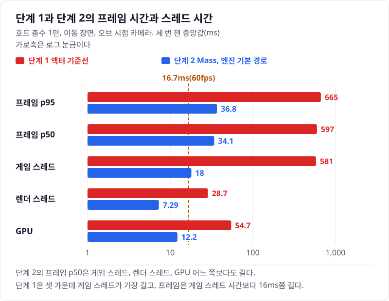
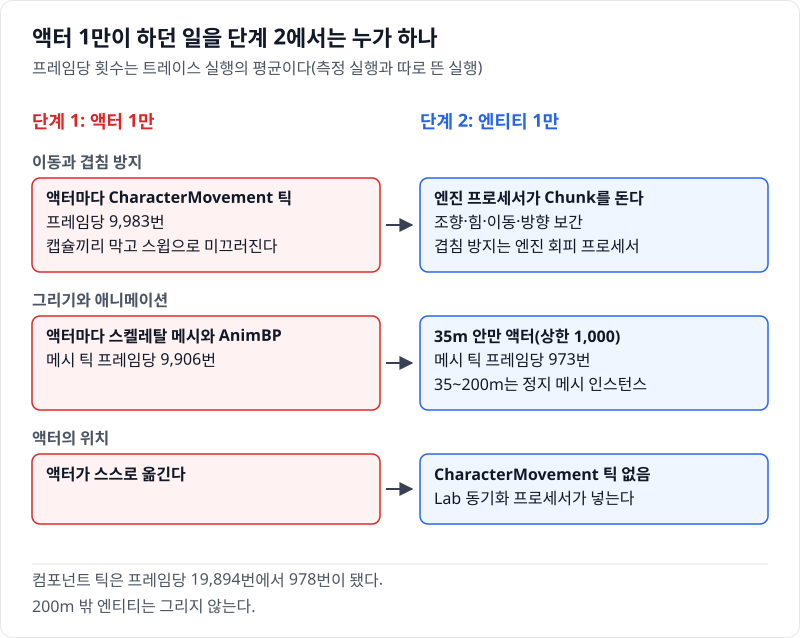
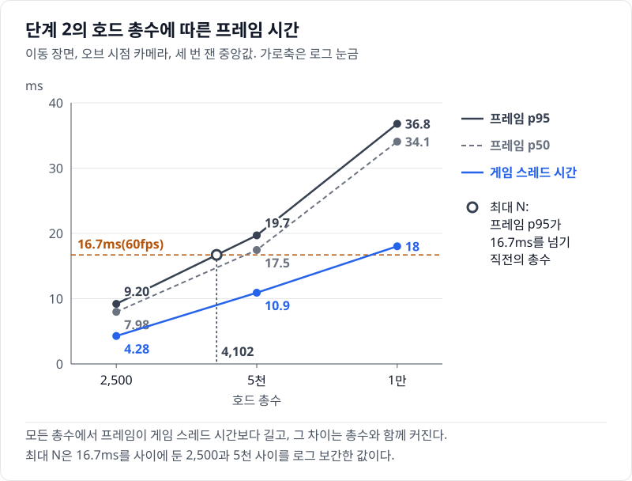
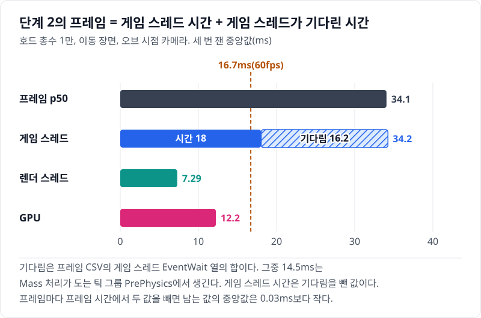
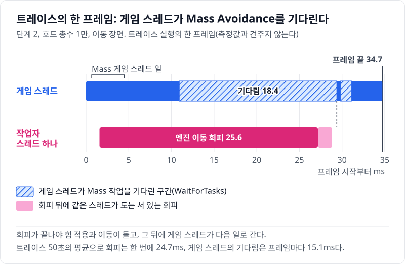
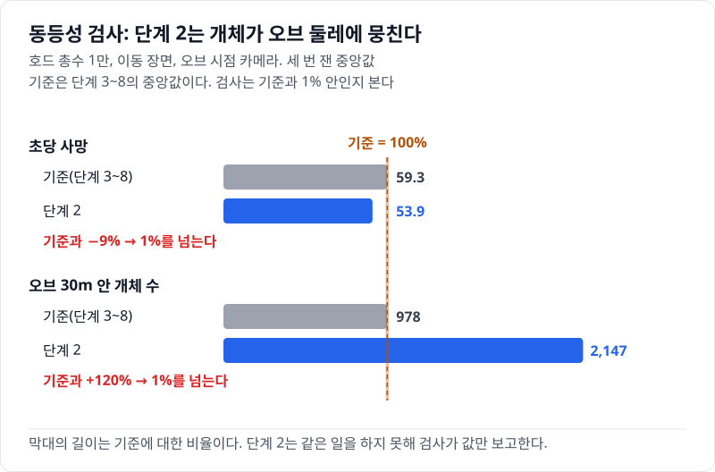

# 02 Mass, 엔진 기본 경로: 597ms가 34.1ms로, 남은 병목은 엔진 회피

## 요약

액터 1만을 Mass 엔티티로 옮기고, 엔진의 이동·회피·표현 프로세서(Processor)와 하이드레이션 액터를 그대로 썼다. 같은 총수에서 프레임 p50(프레임 시간의 중앙값)은 597ms에서 34.1ms로 줄었다. 60fps를 지키는 최대 N은 약 780에서 약 4,100이 됐고, 목표 총수에는 아직 멀다. 남은 시간은 작업자 스레드 하나에서 도는 엔진 회피 프로세서가 쓰고, 게임 스레드는 그동안 기다린다. 이 기다림은 게임 스레드 시간에 들지 않아서, 프레임이 세 스레드 시간보다 길다.




왼쪽 위 HUD의 숫자는 측정값이 아니다. 수치의 근거는 [측정 기록](measurements.md)에 있다.

> **시나리오.** 오브(Orb)가 맵 중심 둘레의 원 궤도를 2m/s로 돈다. 호드 1만이 오브를 쫓아 사방에서 걸어오고, 오브는 가까운 개체를 지우고 먼 개체를 주기적으로 쏜다. 모든 거리에서 생성·피격·사망·표현 전환이 계속 일어나게 하는 벤치마크 장치다.

## 배경 지식

### Mass Entity

Mass는 개체를 엔티티로 두고, 엔티티의 데이터를 Fragment라는 작은 구조체로 나눈다. Fragment 구성이 같은 엔티티는 한 Archetype에 모이고, 메모리의 Chunk에 연달아 놓인다. 프로세서는 쿼리로 고른 Chunk를 한꺼번에 돈다. 액터마다 도는 틱이 없다. 단계 2는 미니언 1만을 엔티티로 만들고, 엔티티 구성(Trait)을 코드로 붙인다.

### 하이드레이션

표현 LOD(Representation LOD)는 개체를 무엇으로 그릴지 카메라 거리로 고르는 일이다. 하이드레이션(Hydration, 가까운 엔티티에만 진짜 액터를 붙이는 일)은 그 가운데 가까운 칸이다. 엔진의 표현 프로세서가 가까운 개체에 액터를 붙이고, 멀어지면 뗀다. 단계 2부터 화면 안 35m 안을 액터로 그리고, 액터는 최대 1,000개다. 200m까지는 정지 메시 인스턴스로 그리고, 그 밖은 그리지 않는다.

### 엔진 회피

엔진 회피(`UMassMovingAvoidanceProcessor`)는 가까운 이웃을 비키는 가속을 조향 힘에 더하는 엔진 프로세서다. 이웃은 장애물 격자에서 찾는다. 위치를 직접 떼어 놓지 않고 속도를 바꾼다. 단계 2는 엔진 회피 Trait 둘을 엔진 기본 파라미터로 붙인다.

## 문제: 액터 1만은 이동 컴포넌트에 프레임을 쓴다

[01번 글](../01-actor-baseline/README.md)의 단계 1은 개체마다 액터 하나다. 액터마다 CharacterMovement가 틱하며 캡슐을 스윕해 옮기고, 스켈레탈 메시와 AnimBP가 따로 틱한다. 단계 1의 트레이스에서 CharacterMovement는 프레임마다 9,983번 틱했다. 이 틱이 게임 스레드에서 프레임의 76.4%를 썼다.

## 원리: 액터마다 돌던 틱을 Chunk를 도는 프로세서로 바꾼다

단계 2에서 개체 1만은 엔티티이고, 이동은 엔진 프로세서 몇 개가 Chunk 단위로 한다. 조향, 힘 적용, 이동, 방향 보간이 그 프로세서다. 액터는 35m 안 개체에만 붙는다. 이 액터는 CharacterMovement 틱 없이 메시만 틱하고, 위치는 Lab 동기화 프로세서가 넣는다.



예상: 이동 컴포넌트의 몫만 없어져도 프레임은 4분의 1 아래가 된다(1 − 0.764 = 0.236).

## 바꾼 것: 개체를 액터에서 Mass 엔티티로

단계 2는 실행 인자 `-LabStage=2`로 고른다. 이 단계가 바꾼 묶음은 "개체를 액터에서 엔티티로"다. 이동, 겹침 방지, 그리는 방법이 그 안에서 함께 바뀐다. 엔티티 구성은 실행 때 코드로 만든다.

`Source/HordeOptLab/LabCrowdSubsystem.cpp`, `ULabCrowdSubsystem::BuildEntityConfig`

```cpp
AddLabTrait<ULabMovementTrait>(*EntityConfig);
AddLabTrait<UMassSteeringTrait>(*EntityConfig);
AddLabTrait<UMassSmoothOrientationTrait>(*EntityConfig);
// ...
if (FLabConfig::Get().UsesAvoidance())
{
	// ...
	AddLabTrait<UMassObstacleAvoidanceTrait>(*EntityConfig);
	// ...
	AddLabTrait<UMassNavigationObstacleTrait>(*EntityConfig);
}
```

위 세 줄이 엔진의 이동, 조향, 방향 보간을 붙인다. 아래 블록이 엔진 회피를 붙이고, 이 조건은 단계 2에서만 참이다. 그리기는 엔진의 표현 프로세서와 정지 메시 인스턴스 갱신 프로세서(`UMassUpdateISMProcessor`)가 맡는다.

## 결과: 프레임은 줄었지만, 게임 스레드가 엔진 회피를 기다린다

### 최대 N은 약 4,100이다

호드 총수 1만에서 프레임 p50은 34.1ms다. 프레임 p95(느린 쪽 5%의 경계)는 36.8ms다. 둘 다 16.7ms 밖이다. 프레임 p50은 단계 1의 5.70%로, 예상한 23.6%보다 작다. 메시 틱과 드로우 콜도 함께 줄었다.

최대 N은 프레임 p95가 16.7ms를 넘기 직전의 호드 총수다([00번 글](../00-goals-and-method/README.md)). 단계 2는 약 4,100이고, 단계 1은 약 780이었다.



### 프레임이 세 스레드 시간보다 길다

[00번 글](../00-goals-and-method/README.md)은 프레임 시간이 게임 스레드, 렌더 스레드, GPU 가운데 가장 느린 쪽에 맞춰진다고 했다. 단계 2는 이 설명과 맞지 않는다. 프레임 p50 34.1ms는 게임 스레드 시간 18ms보다 길고, 렌더 스레드와 GPU는 더 짧다.

모자란 몫은 게임 스레드가 기다린 시간이다. 엔진은 게임 스레드 시간에서 이벤트를 기다린 시간을 뺀다. 프레임 CSV는 그 기다림을 틱 그룹마다 따로 적는다. 단계 2의 게임 스레드는 프레임마다 16.2ms를 기다렸고, 그중 14.5ms가 Mass 처리 단계(PrePhysics)에서다.



`Engine/Source/Runtime/Engine/Private/LevelTick.cpp`, `UWorld::Tick`

```cpp
CSV_SCOPED_SET_WAIT_STAT(PrePhysics);
RunTickGroup(TG_PrePhysics);
```

`Engine/Source/Runtime/Core/Private/Windows/WindowsPlatformProcess.cpp`, `FEventWin::Wait`

```cpp
CSV_SCOPED_WAIT(WaitTime);
// ...
UE::Stats::FThreadIdleStats::FScopeIdle Scope( bIgnoreThreadIdleStats );
```

틱 그룹 PrePhysics를 도는 동안 생긴 이벤트 기다림은 CSV의 `EventWait/PrePhysics`에 쌓인다. 같은 기다림을 `FScopeIdle`이 유휴 시간으로 센다. 게임 스레드 시간은 이 유휴 시간을 뺀 값이다. 프레임마다 프레임 시간에서 두 값을 빼면, 남는 값의 중앙값은 0.03ms보다 작다.

### 게임 스레드는 작업자 스레드 하나의 엔진 회피를 기다린다

트레이스로 한 프레임을 펼치면 기다리는 대상이 보인다. 그 프레임에서 Mass 처리 단계가 시작되자 엔진 회피가 작업자 스레드 하나에서 25.6ms를 돌았다. 게임 스레드는 자기 일을 끝낸 뒤 회피가 끝날 때까지 18.4ms를 기다렸다. 렌더 스레드도 프레임의 대부분을 게임 스레드를 기다리며 보낸다.




회피는 프레임마다 한 번 돈다. 트레이스 50초의 평균으로 회피 한 번은 24.7ms다. 같은 동안 게임 스레드는 프레임마다 15.1ms를 기다렸다. 모든 프로세서를 게임 스레드에서 차례로 돌린 트레이스에서도 회피는 23.5ms다. 이것은 Mass 프로세서 시간의 80.7%이고, 기다림이 아니라 일의 양이다.

`Engine/Plugins/AI/MassAI/Source/MassNavigation/Private/MassAvoidanceProcessors.cpp`, `UMassMovingAvoidanceProcessor`

```cpp
EntityQuery.AddTagRequirement<FMassMediumLODTag>(EMassFragmentPresence::None);
EntityQuery.AddTagRequirement<FMassLowLODTag>(EMassFragmentPresence::None);
EntityQuery.AddTagRequirement<FMassOffLODTag>(EMassFragmentPresence::None);
// ...
EntityQuery.ForEachEntityChunk(Context, [FallbackLogOwner = this, &EntityManager, DebugDrawWorld, CurrentTime, DeltaTime](FMassExecutionContext& Context)
```

`ForEachEntityChunk`는 Chunk를 한 스레드에서 차례로 돈다. 병렬 순회(`ParallelForEachEntityChunk`)가 아니다. 쿼리는 Simulation LOD 태그(Medium·Low·Off)가 붙은 엔티티를 뺀다. 단계 2에는 이 태그가 없어서 1만 전부가 이 순회를 돈다.

그래서 단계 2의 병목은 세 스레드 가운데 하나가 아니다. 프레임을 정한 것은 게임 스레드가 기다린 작업자 스레드의 엔진 회피다.

### 개체가 오브 둘레에 뭉쳐 같은 일을 하지 못한다

엔진 회피를 켠 단계 2에서는 개체가 오브 둘레에 쌓인다. 오브 30m 안 개체 수는 평균 2,147이다. 기준인 단계 3\~8의 2.20배다. 초당 사망은 53.9로 기준보다 9% 적다. 겹친 쌍(몸통이 겹친 개체 쌍의 수)은 평균 12,442다.



동등성 검사([00번 글](../00-goals-and-method/README.md))는 초당 사망과 30m 안 개체 수가 기준과 1% 안인지 본다. 단계 2는 두 항목이 모두 1%를 넘어, 같은 일을 하지 못했다. 검사는 엔진 회피를 그대로 쓴 단계 2를 처음부터 값만 보고하는 조건으로 둔다.

뭉침은 비용도 바꾼다. 35m 안 액터는 평균 971개로 상한에 붙어 있다. 그래서 단계 2의 시간에는 회피의 비용과 뭉침이 늘린 액터의 비용이 함께 들어 있다.

엔진 회피의 파라미터 셋을 세게 바꾼 한 벌도 따로 쟀다. 다른 측정이라 참고로만 적는다. 겹친 쌍은 75.9% 줄었지만, 초당 사망이 36.8% 더 줄었다. 프레임 p95는 5.49ms 늘었다. 그래서 단계 2는 엔진 기본 파라미터 그대로 둔다.

## 한 문장으로

액터를 Mass로 옮기면 이동 틱은 사라지지만, 한 스레드에서 도는 엔진 회피가 새 병목이 된다.

- 게임 스레드 시간은 기다린 시간을 뺀다. 프레임이 세 스레드보다 길면, 게임 스레드가 기다린 작업자 스레드를 본다.
- 엔진 회피를 기본 파라미터로 쓰면 개체가 오브 둘레에 쌓여 같은 일을 하지 못한다. 왜 쌓이는지는 가르지 않았다.
- 단계 2의 시간에는 회피의 비용과 늘어난 액터의 비용이 섞여 있다.

[다음 글](../03-separation/README.md)은 엔진 회피를 직접 짠 분리 프로세서로 바꾼다. 여덟 단계의 결과는 [07 요약](../07-summary/README.md)에 모았다.
