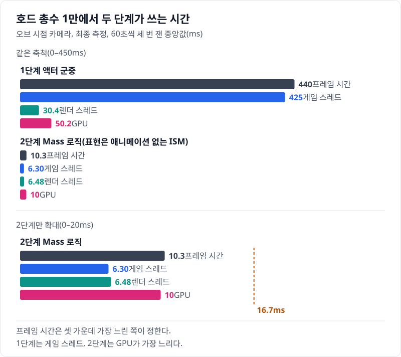
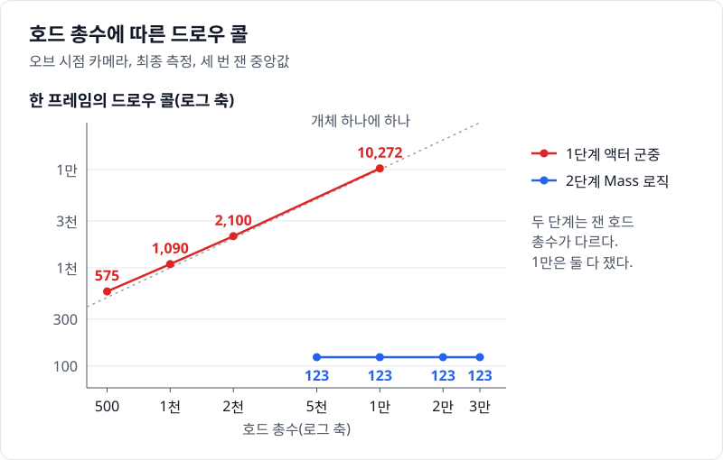
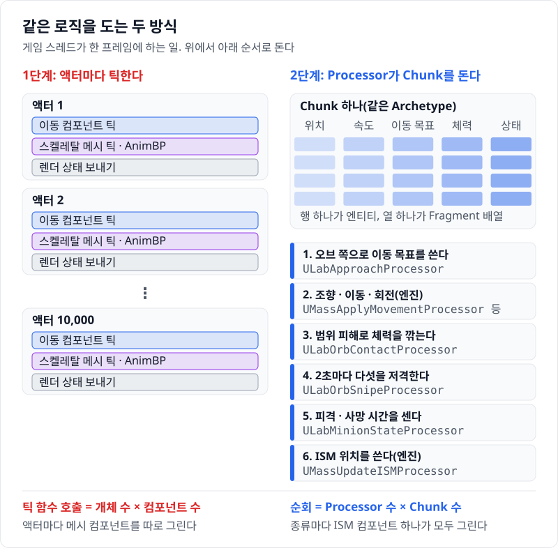
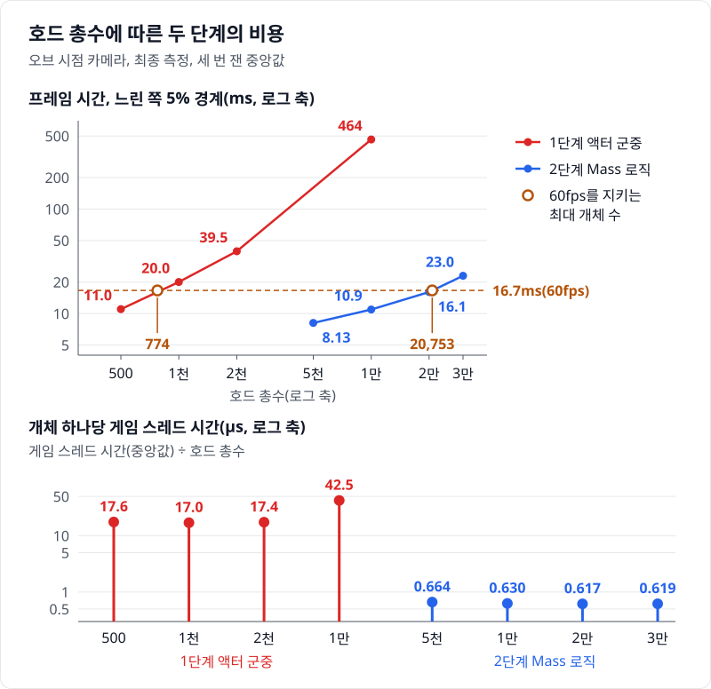

# 02 로직을 Mass로 — 액터마다 돌던 틱이 Processor 몇 개가 된다

## 요약

액터 군중의 이동·피해·사망 로직을 Mass Entity의 Fragment와 Processor로 옮겼다. 표현은 애니메이션 없는 ISM 하나로 바꿨다. 호드 총수 1만에서 프레임 시간이 444ms에서 10.2ms로 준다. 이제 프레임을 정하는 쪽은 게임 스레드가 아니라 GPU다.



프레임 시간은 한 프레임이 걸린 시간이다. 게임 스레드, 렌더 스레드, GPU는 각자 그 프레임에 일한 시간을 따로 잰다. 프레임 시간은 셋 가운데 가장 느린 쪽이 정한다. 지표의 자세한 설명은 [00번 글](../00-goals-and-method/README.md)에 둔다.


수치의 근거는 [측정 기록](measurements.md)에 있다.

> **시나리오.** 플레이어는 움직이지 않는다. 맵 중앙의 오브(Orb)를 향해 개체가 사방에서 걸어오고, 오브는 가까운 개체를 지우고 먼 개체를 주기적으로 쏜다. 모든 거리에서 생성·피격·사망·표현 전환이 계속 일어나게 하는 벤치마크 장치다.

## 배경 지식

### Mass Entity와 Fragment

Mass는 UE5에 들어 있는 ECS(Entity Component System) 프레임워크다. 엔티티는 번호일 뿐이고, 데이터는 Fragment라는 작은 구조체에 나눠 둔다. 같은 Fragment 조합을 가진 엔티티는 같은 Archetype에 속한다. Archetype은 메모리를 Chunk라는 덩어리로 나누고, Chunk 안에 Fragment마다 배열을 하나씩 둔다. 이 단계에서는 체력, 상태 타이머, 표현 상태를 Fragment로 만들었다.

### Processor

Processor는 읽고 쓸 Fragment를 쿼리로 선언하고, 쿼리에 맞는 Chunk를 차례로 돌며 배열을 처리하는 클래스다. 엔진은 그룹과 `ExecuteBefore`·`ExecuteAfter` 선언으로 만든 의존성 순서대로 Processor를 실행하고, 자원이 겹치지 않는 Processor는 워커 스레드에 나눠 준다. 개체마다 틱 함수를 부르지 않는다. 이 단계에서는 접근, 범위 피해, 저격, 상태 타이머를 Processor 넷으로 만들고 이동은 엔진 Processor에 맡겼다.

### Trait과 ISM 표현

Trait은 엔티티 구성에 붙이는 묶음이다. Trait 하나가 필요한 Fragment를 엔티티에 붙이고, 그 Fragment를 도는 Processor가 일하게 한다. `UMassMovableVisualizationTrait`은 움직이는 엔티티를 ISM(Instanced Static Mesh) 인스턴스로 그리게 한다. ISM은 같은 메시를 위치만 바꿔 한꺼번에 그리는 컴포넌트다. 이 단계에서는 거리와 상관없이 모든 엔티티를 같은 ISM으로 그렸다.

## 문제: 1단계는 개체 수만큼 틱하고 개체 수만큼 그린다

1단계의 게임 스레드 시간은 호드 총수 1만에서 429ms다. [01번 글](../01-actor-baseline/README.md)에서 보았듯 그 대부분은 액터마다 도는 이동 컴포넌트의 틱이다. 개체 하나로 나누면 프레임이 50ms 안일 때 17\~18µs다. 1만에서는 42.9µs다. CharacterMovement가 긴 프레임을 여러 번에 나눠 계산하기 때문이다(하위 스텝).

렌더링 쪽도 개체 수를 따라간다. 드로우 콜은 CPU가 GPU에 보내는 그리기 명령 하나다. 1단계는 액터마다 메시 컴포넌트를 따로 그려 드로우 콜이 개체 하나에 하나꼴이다. 1만에서 드로우 콜은 10,272개다. 그때 렌더 스레드는 29.8ms, GPU는 50.2ms를 쓴다.



그래서 로직만 옮겨서는 60fps에 닿지 않는다. 게임 스레드의 일이 모두 사라져도 GPU 50.2ms가 남는다. 이 단계에서 표현도 함께 바꾼 이유다.

## 원리: Processor가 같은 모양의 데이터를 Chunk째 돈다

액터 군중에서 엔진은 프레임마다 액터의 컴포넌트마다 틱 함수를 부른다. 호출 수는 개체 수 × 컴포넌트 수다.

Mass에서 엔티티는 Fragment 배열의 한 행이다. Processor 하나가 쿼리에 맞는 Chunk를 차례로 돌고, Chunk 안에서는 배열을 앞에서부터 읽는다. 함수를 부르는 횟수는 Processor 수와 Chunk 수가 정한다.



이동 계산도 다르다. CharacterMovement와 달리 Mass의 이동 Processor는 긴 프레임을 나누지 않는다. 대신 한 번에 넘기는 시간을 0.1초로 자른다.

`Engine/Plugins/Runtime/MassGameplay/Source/MassMovement/Private/MassMovementProcessors.cpp`, `UMassApplyMovementProcessor::Execute`

```cpp
	// Clamp max delta time to avoid force explosion on large time steps (i.e. during initialization).
	const float DeltaTime = FMath::Min(0.1f, Context.GetDeltaTimeSeconds());

	EntityQuery.ForEachEntityChunk(Context, [this, DeltaTime](FMassExecutionContext& Context)
	{
		// ...
		for (FMassExecutionContext::FEntityIterator EntityIt = Context.CreateEntityIterator(); EntityIt; ++EntityIt)
		{
			// ...
			Velocity.Value = MovementList[EntityIt].DesiredVelocity;
			// ...
			CurrentLocation += Velocity.Value * DeltaTime;
			CurrentTransform.SetTranslation(CurrentLocation);
		}
	});
```

`ForEachEntityChunk`가 Chunk를 하나씩 넘기고, 안쪽 `for`가 그 Chunk의 엔티티를 돈다. 엔진 주석은 0.1초 상한이 큰 시간 간격에서 힘이 폭주하지 않게 하는 장치라고 적는다. 그래서 개체 하나의 이동 비용은 프레임 시간과 상관없이 같다. 대가로 프레임이 0.1초를 넘으면 엔티티가 실제 시간보다 덜 움직인다.

**예상.** 게임 스레드에서는 개체마다 도는 틱이 사라진다. 개체당 비용은 배열 몇 개를 한 번씩 도는 값으로 줄 것이다. 드로우 콜은 개체 수를 따라가지 않을 것이다. 다만 1단계의 GPU 50.2ms는 60fps 한 프레임의 3.01배다. 그리는 방식을 바꾸지 않으면 이 시간은 그대로 남는다.

## 바꾼 것: 로직은 Fragment와 Processor로, 표현은 ISM 하나로

이 단계는 변수 둘을 함께 바꾼다. 로직이 사는 곳(액터 → 엔티티)과 표현(애니메이션 있는 스켈레탈 메시 → 애니메이션 없는 ISM)이다. 최종 측정에는 둘을 따로 바꾼 조건이 없어, 아래 결과는 두 변화의 합이다. 스폰 위치, 오브의 피해 식, 저격 규칙은 그대로다.

**엔티티.** `ULabMinionTrait`이 엔티티에 붙이는 Fragment는 다음과 같다.

[`Source/HordeOptLab/LabMassTraits.cpp`](../../Source/HordeOptLab/LabMassTraits.cpp), `ULabMinionTrait::BuildTemplate`

```cpp
	BuildContext.AddFragment<FTransformFragment>();
	BuildContext.AddFragment_GetRef<FAgentRadiusFragment>().Radius = 40.f;
	BuildContext.AddFragment<FMassActorFragment>();
	BuildContext.AddFragment<FLabMinionFragment>();
	BuildContext.AddFragment<FLabHealthFragment>();
	BuildContext.AddFragment<FLabAnimStateFragment>();
	BuildContext.AddTag<FLabMinionTag>();
	// ...
	BuildContext.AddConstSharedFragment(EntityManager.GetOrCreateConstSharedFragment(Params));
```

Lab Fragment는 [`LabMassTypes.h`](../../Source/HordeOptLab/LabMassTypes.h)에 있다.

- `FLabHealthFragment`: 체력.
- `FLabMinionFragment`: 저격 대상을 고르는 일련번호, 상태의 남은 시간.
- `FLabAnimStateFragment`: 표현이 읽는 상태와 시작 시각.
- `FLabUnitTypeParams`: 종류마다 같은 값(이동 속도 등)을 Chunk에 한 번만 두는 공유 Fragment.

**Processor.** `ULabApproachProcessor`가 이동 목표를 오브 쪽으로 채운다. 엔진의 조향·이동·회전 Processor가 엔티티를 옮긴다. 범위 피해는 `ULabOrbContactProcessor`가 1단계 오브와 같은 식으로 준다.

[`Source/HordeOptLab/LabMassProcessors.cpp`](../../Source/HordeOptLab/LabMassProcessors.cpp), `ULabOrbContactProcessor::Execute`

```cpp
		const TArrayView<FLabHealthFragment> Healths = Context.GetMutableFragmentView<FLabHealthFragment>();
		// ...
		for (FMassExecutionContext::FEntityIterator It = Context.CreateEntityIterator(); It; ++It)
		{
			// ...
			Health.Health -= FMath::Lerp(FLabScenario::ZoneDpsEdge, FLabScenario::ZoneDpsCenter, Closeness) * DeltaSeconds;
			if (Health.Health <= 0.f)
			{
				// ...
				AnimStates[It].Set(ELabMinionState::Dead, Now);
				Context.Defer().AddTag<FLabDeadTag>(Entity);
				StopMoving(Context, Entity);
				// ...
			}
		}
```

`Healths`는 `ForEachEntityChunk`가 넘긴 Chunk의 체력 배열이다. 체력이 0 아래인 엔티티는 상태를 사망으로 바꾸고 `FLabDeadTag`를 받는다. `StopMoving`이 `FMassCodeDrivenMovementTag`를 떼면 엔진 이동 Processor가 그 엔티티를 더 옮기지 않는다. 저격은 `ULabOrbSnipeProcessor`가, 피격·사망 시간은 `ULabMinionStateProcessor`가 맡는다. 사망이 끝난 엔티티는 지우고 맵 가장자리에 새로 만든다.

**표현.** 모든 엔티티를 스켈레탈 메시의 기본 자세로 구운 정적 메시 하나로 그린다.

[`Source/HordeOptLab/LabCrowdSubsystem.cpp`](../../Source/HordeOptLab/LabCrowdSubsystem.cpp), `ULabCrowdSubsystem::BuildEntityConfig`

```cpp
	UMassMovableVisualizationTrait* Visual = AddLabTrait<UMassMovableVisualizationTrait>(*EntityConfig);
	FMassStaticMeshInstanceVisualizationMeshDesc& MeshDesc = Visual->StaticMeshInstanceDesc.Meshes.AddDefaulted_GetRef();
	MeshDesc.Mesh = Mesh;
	// ...
	MeshDesc.bCastShadows = true;
	for (int32 LOD = 0; LOD < EMassLOD::Max; ++LOD)
	{
		Visual->Params.LODRepresentation[LOD] = EMassRepresentationType::StaticMeshInstance;
		Visual->LODParams.BaseLODDistance[LOD] = LOD == 0 ? 0.f : 1.e7f;
		Visual->LODParams.VisibleLODDistance[LOD] = LOD == 0 ? 0.f : 1.e7f;
		Visual->LODParams.LODMaxCount[LOD] = MAX_int32;
	}
```

표현 LOD는 카메라 거리에 따라 무엇으로 그릴지 고르는 단계다. `for` 문이 네 단계를 모두 같은 ISM으로 두고, 경계를 맵 밖으로 민다.

엔진 기본값 둘을 바꿨다. Mass ISM의 그림자는 기본으로 꺼져 있어, 1단계와 맞추려고 `bCastShadows`를 켰다. 표현에 필요한 Processor 셋(카메라 거리 수집, 표현 LOD 계산, 표현 전환)도 기본으로 꺼져 있다. 셋이 없으면 아무것도 그려지지 않아 [`Config/DefaultMass.ini`](../../Config/DefaultMass.ini)에서 켰다. 미니언 표현은 모든 단계에서 Lumen 장면에서 뺀다(`LabExcludeFromLumen`). 넣은 채로 돌린 시험 실행에서 GPU 시간이 크게 늘었다.

## 결과: 1만이 10.2ms가 되고, 병목이 GPU로 옮겨 간다

아래 값은 호드 총수 1만, 오브 시점 카메라에서 세 번 잰 중앙값이다. 프레임 시간은 444ms에서 10.2ms로 준다. 43.6분의 1이다. 게임 스레드는 429ms에서 6.24ms가 되어 68.8분의 1이다. 렌더 스레드는 29.8ms에서 6.40ms가 된다. GPU는 50.2ms에서 9.90ms가 되고, 이제 셋 가운데 가장 느리다.



아래쪽 그림이 예상과 실제다. 2단계의 개체당 게임 스레드 시간은 5천에서 3만까지 0.61\~0.66µs로 평평하다. 1만에서는 0.624µs다. 1단계가 하위 스텝 없이 쓰던 17.0µs의 27분의 1이다.

60fps를 지키는 최대 개체 수는 프레임 시간의 느린 쪽 5% 경계가 16.7ms 안에 드는 가장 큰 호드 총수다. 2단계의 값은 약 2만이고, 1단계 766의 25.5배다. 잰 네 호드 총수 모두에서 GPU가 가장 느리다.

두 단계가 같은 일을 하는지는 사망 수로 확인했다. 1만에서 초당 사망은 1단계 62.2, 2단계 62다. 2단계의 프레임은 0.1초보다 훨씬 짧아 이동 시간의 상한에 걸리지 않는다.

게임 스레드에는 Processor의 순회와, 쌓아 둔 ISM 위치를 컴포넌트에 올리는 일이 남는다.

Processor를 한 스레드에 차례로 돌린 트레이스(Unreal Insights, 호드 총수 1만)에서 게임 스레드의 프레임 평균을 읽었다. 이 트레이스는 병렬 처리를 끈 실행이라 위의 6.24ms와 견주지 않는다. 게임 스레드의 한 프레임은 평균 9.98ms이고, 그 안에서 Mass 처리 단계(PrePhysics)가 3.11ms, ISM 위치를 컴포넌트에 올리는 `EndVisualChanges`가 2.48ms다. Processor 가운데 가장 긴 것은 `UMassSmoothOrientationProcessor`로 0.950ms이고, 그다음이 `UMassSteerToMoveTargetProcessor`의 0.443ms다. ISM 위치를 쌓는 `UMassUpdateISMProcessor`는 0.576ms다. 캐릭터 이동 컴포넌트의 틱 타이머(`UCharacterMovementComponent_TickComponent`)는 이 트레이스에 없다.


위 문단의 값은 이 합계를 고른 구간의 프레임 수로 나눈 값이다. 15.58초를 5,008로 나누면 3.11ms다.

화면에서는 품질을 잃었다. 개체는 걷는 동작 없이 한 자세로 움직인다. 피격과 사망 때는 그 자리에 멈춰 섰다가 사라진다. 이 단계는 이 품질을 내주고 시간을 벌었다.

## 한 문장으로

로직을 Mass로 옮기자 개체당 게임 스레드 비용이 27분의 1로 줄었다. 이 값에는 배열 순회의 이득과, 충돌 검사·애니메이션·액터마다의 컴포넌트 갱신이 없어진 몫이 함께 들어 있다.

- 이 단계는 로직과 표현을 함께 바꿨다. 줄어든 시간을 둘로 나눌 조건은 최종 측정에 없다.
- Mass의 이동 비용은 프레임 시간과 상관없이 같다. 대신 프레임이 0.1초를 넘으면 개체가 덜 움직인다.
- 한계: 병렬 처리를 끈 조건은 최종 측정에 없다. 병렬 처리가 번 몫은 재지 않았다.

[다음 글](../03-ism-vat/README.md)에서는 같은 인스턴스에 애니메이션을 붙이고, 200m 밖 개체는 그리지 않는다. 버린 품질 하나를 되찾으면서 남은 GPU 시간을 줄이는 단계다.
