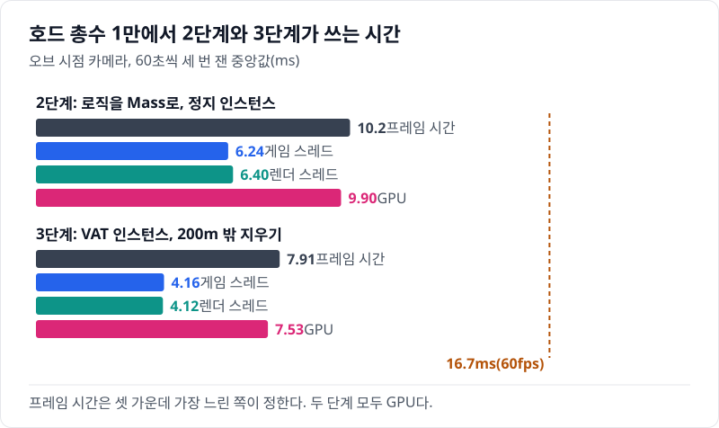
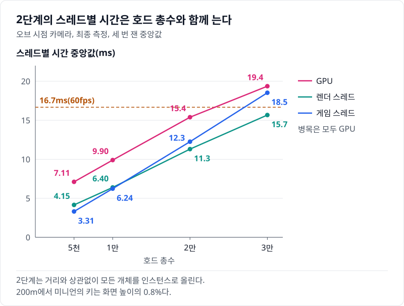
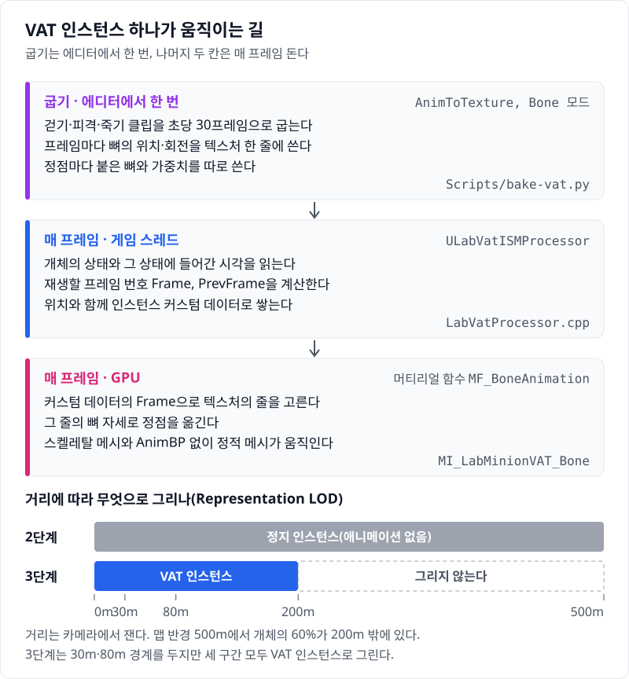
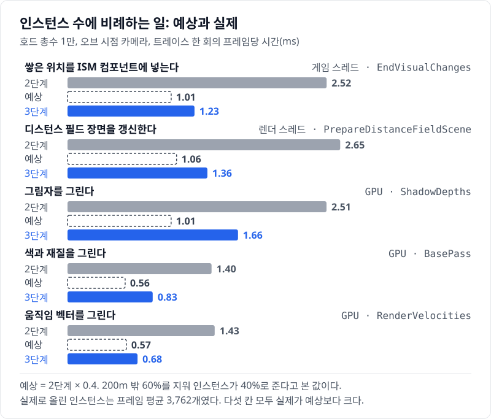
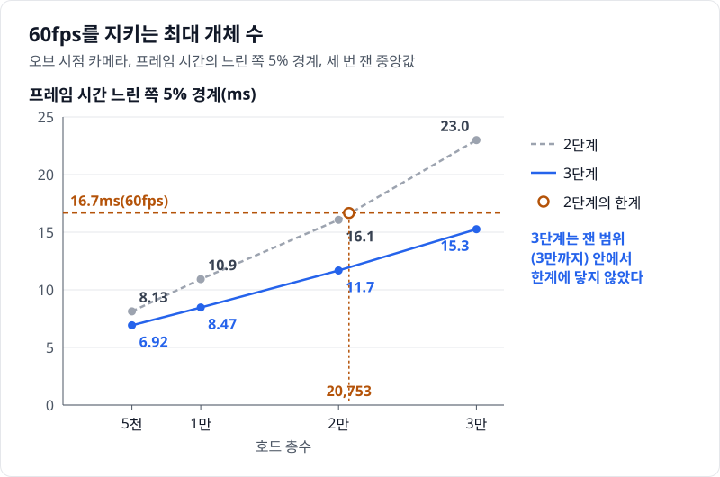

# 03 먼 개체에 애니메이션을 붙이고 더 빨라졌다 — ISM + VAT와 200m 밖 지우기

## 요약

3단계는 2단계의 정지 인스턴스에 걷기·피격·죽기 애니메이션을 붙이고, 200m 밖 개체를 그리지 않는다. 값은 모두 호드 총수 1만, 오브 시점 카메라에서 잰 것이다. 프레임 시간이 10.3ms에서 7.91ms로 줄었다. 애니메이션이 생겼는데도 빨라진 것은 한 프레임에 올리는 인스턴스가 1만에서 평균 3,761개로 줄었기 때문이다. 호드 총수 3만에서도 프레임 시간의 느린 쪽 5% 경계가 15.3ms로 60fps 안이다.



프레임 시간은 게임 스레드, 렌더 스레드, GPU 가운데 가장 느린 쪽이 정한다. 두 단계 모두 GPU가 가장 느리다. 지표의 자세한 설명은 [00번 글](../00-goals-and-method/README.md)에 둔다.


수치의 근거는 [측정 기록](measurements.md)에 있다.

> **시나리오.** 플레이어는 움직이지 않는다. 맵 중앙의 오브를 향해 개체가 사방에서 걸어오고, 오브는 가까운 개체를 지우고 먼 개체를 주기적으로 쏜다. 모든 거리에서 생성·피격·사망·표현 전환이 계속 일어나게 하는 벤치마크 장치다.

## 배경 지식

### VAT

VAT(Vertex Animation Texture)는 애니메이션을 텍스처에 구워 두고 머티리얼이 정점을 옮겨 재생하는 기법이다. 스켈레탈 메시와 AnimBP 없이 정적 메시가 움직인다. 엔진 플러그인 AnimToTexture가 굽기를 맡는다. Bone 모드는 프레임마다 뼈의 위치·회전을 텍스처 한 줄에 쓰고, 정점마다 붙은 뼈와 가중치를 따로 쓴다. 이 글에서는 미니언의 걷기·피격·죽기를 Bone 모드, 초당 30프레임으로 구웠다.

### 인스턴스 커스텀 데이터

ISM(Instanced Static Mesh)은 같은 메시를 여러 위치에 한 번에 그리는 컴포넌트다. 인스턴스마다 위치 말고 float 값을 몇 개 더 붙일 수 있고, 이것이 커스텀 데이터다. 머티리얼은 이 값을 읽어 인스턴스마다 다르게 그린다. 이 글에서는 인스턴스마다 재생할 프레임 번호 두 개를 넣었다.

### Representation LOD

Representation LOD(표현 LOD)는 카메라와의 거리로 개체를 무엇으로 그릴지 정하는 Mass 기능이다. 거리를 High·Medium·Low·Off 네 구간으로 나누고 구간마다 표현(액터, 인스턴스, 없음)을 고른다. 경계에는 10% 히스테리시스가 있어 경계에 선 개체의 표현이 오가지 않는다. 이 글에서는 200m 밖 Off 구간을 "없음"으로 두었다. 200m 안의 세 구간은 모두 VAT 인스턴스다.

## 문제: 2단계는 보이지 않을 만큼 먼 개체까지 매 프레임 그린다

[02번 글](../02-mass-logic/README.md)에서는 로직을 Mass로 옮기고 모든 개체를 애니메이션 없는 정지 인스턴스로 그렸다. 호드 총수 1만에서 프레임 시간을 정하는 것은 GPU 10.0ms다. 게임 스레드는 6.30ms, 렌더 스레드는 6.48ms다. 세 값 모두 호드 총수와 함께 직선으로 는다.



2단계는 거리와 상관없이 모든 개체를 인스턴스로 올린다. 맵 반경은 500m이고, 개체는 오브에서의 거리마다 고르게 퍼져 있다. 그래서 개체의 60%가 200m 밖에 있다. 200m에서 미니언의 키는 화면 높이의 0.4%다.

그래도 인스턴스 하나는 위치 갱신, 그림자, 디스턴스 필드 갱신의 몫을 똑같이 낸다. 화면에서는 1만이 모두 같은 자세로 바닥을 미끄러진다.

## 원리: 애니메이션은 커스텀 데이터 두 개로, 먼 개체는 지운다

3단계는 두 가지를 한다. 남은 인스턴스에 애니메이션을 붙이고, 200m 밖 인스턴스를 없앤다. 아래 그림의 위 세 칸이 애니메이션의 길이고, 맨 아래가 거리 구간이다.



애니메이션이 더하는 일은 두 군데다. 게임 스레드는 인스턴스마다 float 두 개를 더 쌓는다. GPU는 정점마다 텍스처를 읽어 자세를 계산한다. 거리 구간은 다음 코드가 정한다.

`Source/HordeOptLab/LabCrowdSubsystem.cpp`, `ULabCrowdSubsystem::BuildEntityConfig`

```cpp
const float Bands[EMassLOD::Max] = { 0.f, HydrateCm, 8000.f, FLabConfig::Get().RepOffCm() };
// ...
for (int32 LOD = 0; LOD < EMassLOD::Max; ++LOD)
{
	Visual->LODParams.BaseLODDistance[LOD] = Bands[LOD];
	Visual->LODParams.VisibleLODDistance[LOD] = Bands[LOD];
	// ...
}
// ...
Visual->Params.LODRepresentation[EMassLOD::Off] = EMassRepresentationType::None;
```

`Bands`는 구간이 시작하는 거리(cm)이고, 3단계에서 Off 구간은 200m에서 시작한다. 마지막 줄이 Off 구간을 "없음"으로 둔다. 나머지 세 구간은 2단계와 같은 인스턴스 표현 그대로다.

**예상.** 그리는 인스턴스는 200m 안의 40%로 준다. 인스턴스 수에 비례하는 일도 40%로 줄 것이다. 2단계의 그림자 그리기는 GPU 2.51ms다. 그 40%인 1.01ms가 예상이다. VAT가 더하는 일이 있으므로 실제 값은 이보다 클 것이다.

## 바꾼 것: 메시, ISM 갱신 프로세서, Off 구간

2단계에서 세 가지를 바꿨다.

- **메시와 머티리얼.** 정지 메시를 `Scripts/bake-vat.py`가 구운 VAT 메시 `SM_LabMinionVAT_Bone`으로 바꿨다. 대형은 `SM_LabMinionLargeVAT_Bone`이다. 머티리얼은 AnimToTexture의 머티리얼 함수 `MF_BoneAnimation`을 거친다. 자동 재생은 껐다. 자동 재생은 클립을 되풀이하므로 한 번 도는 피격·죽기가 끝에서 첫 자세로 튈 수 있다. 죽기 클립 동안에는 색이 진홍으로 바뀐다.
- **ISM 갱신 프로세서.** 게임 모듈이 시작할 때 엔진의 `UMassUpdateISMProcessor` 등록을 끄고 `ULabVatISMProcessor`를 켠다([HordeOptLab.cpp](../../Source/HordeOptLab/HordeOptLab.cpp)). 새 프로세서는 엔진 프로세서를 상속해 한 반복에서 위치와 커스텀 데이터를 함께 쓴다. 엔진은 커스텀 데이터가 위치와 같은 순서로 쌓였다고 보고 읽기 때문이다.
- **Off 구간.** 위 코드처럼 200m 밖을 "없음"으로 두었다.

`Source/HordeOptLab/LabVatProcessor.cpp`, `ULabVatISMProcessor::Execute`

```cpp
UpdateISMTransform(Context.GetEntity(EntityIt), ISMInfo[ISMInfoIndex], TransformFragment.GetTransform(), Representation.PrevTransform,
	RepresentationLOD.LODSignificance, Representation.PrevLODSignificance);
// ...
const FLabAnimStateFragment& Anim = AnimStates[EntityIt];
State = Anim.State;
T = Now - Anim.StateStartTime;
// ...
const FLabVatClip& Clip = State == ELabMinionState::Dead ? Clips.Death : State == ELabMinionState::Hit ? Clips.Hit : Clips.Walk;
const bool bLoop = State == ELabMinionState::Walk;
FLabVatFrameData Data;
// ...
Data.Frame = ClipFrame(Clip, T * Rate, Clips.SampleRate, bLoop);
Data.PrevFrame = ClipFrame(Clip, (T - DeltaSeconds) * Rate, Clips.SampleRate, bLoop);
// ...
ISMInfo[ISMInfoIndex].AddBatchedCustomData<FLabVatFrameData>(Data, RepresentationLOD.LODSignificance, Representation.PrevLODSignificance);
```

첫 줄이 위치를 쌓고 마지막 줄이 프레임 번호를 쌓는다. 그 사이에서 상태(걷기·피격·죽기)로 클립을 고르고, 상태에 들어간 뒤 흐른 시간을 클립 안의 프레임으로 바꾼다. `Rate`는 죽기 클립의 길이를 로직의 사망 시간에 맞추는 배율이다.

이 단계에서 바뀐 변수는 둘이다. 표현(정지 인스턴스 → VAT 인스턴스)과 200m 밖 지우기다. 다음 단계부터는 200m 밖을 늘 지우므로 사다리는 그 결정을 이 단계에 넣었다. 둘을 따로 잰 값은 최종 측정에 없다. 로직 프로세서, 그림자, 시나리오는 2단계와 같다.

## 결과: 애니메이션을 붙이고도 프레임이 2.39ms 줄었다

호드 총수 1만에서 프레임 시간은 2.39ms 줄었다. 2단계의 23.2%다. 게임 스레드는 3.10ms, GPU는 2.49ms 줄었다. 병목은 그대로 GPU다. 한 프레임에 올린 인스턴스는 평균 3,761개다. 1만의 37.6%로, 예상과 비슷하다.



위 그림은 각 단계를 따로 뜬 트레이스에서 읽은 값이다. 그림자 그리기는 예상 1.01ms, 실제 1.66ms다. 차이는 VAT가 더한 일과 인스턴스 수에 비례하지 않는 몫이다. 둘을 가르지는 않았다.

60fps를 지키는 최대 개체 수는 2단계가 20,753이다. 프레임 시간의 느린 쪽 5% 경계가 16.7ms에 닿는 호드 총수를, 잰 개체 수 사이에서 보간한 값이다. 3단계는 잰 가장 큰 호드 총수 3만에서도 그 경계가 15.3ms라 한계에 닿지 않았다.



남은 비용은 여전히 GPU다. 3단계의 GPU 시간도 호드 총수와 함께 는다. 3만에서는 13.6ms다.

### 화면: 죽는 VAT 인스턴스의 그림자가 바닥에 남았다

화면에서는 개체가 걷고, 저격당하면 움찔한 뒤 쓰러진다. 그런데 처음 구운 VAT 메시에서는 쓰러지는 개체의 칼날 그림자가 바닥에 남았다. 원인은 메시의 바운드였다. Virtual Shadow Map은 캐시한 그림자를 물체의 바운드 안쪽에서만 지운다. AnimToTexture는 Bone 모드에서 바운드를 뼈 위치의 범위로만 넓힌다.

`Engine/Plugins/Experimental/AnimToTexture/Source/AnimToTextureEditor/Private/AnimToTextureBPLibrary.cpp`, `UAnimToTextureBPLibrary::AnimationToTexture`

```cpp
		SetBoundsExtensions(DataAsset->GetStaticMesh(), (FVector)DataAsset->VertexMinBBox, (FVector)DataAsset->VertexSizeBBox);
	// ...
			SetBoundsExtensions(DataAsset->GetStaticMesh(), (FVector)DataAsset->BoneMinBBox, (FVector)DataAsset->BoneSizeBBox);
```

첫 줄이 Vertex 모드, 둘째 줄이 Bone 모드의 바운드다. 손뼈에서 멀리 뻗은 칼날 끝은 뼈 위치의 상자 밖으로 나갔다. 그 상자는 칼날이 떨어지는 쪽이 204cm 모자랐다.

이 동작을 다룬 공개 이슈는 찾지 못했다. 굽기 스크립트가 Vertex 모드를 먼저 구워 모든 프레임의 정점 범위를 얻고, Bone 메시의 바운드를 그 범위로 넓힌다.

`Scripts/bake-vat.py`, `bake`

```python
if mode == "Vertex":
    VERTEX_BBOX.append((da.get_editor_property("vertex_min_b_box"), da.get_editor_property("vertex_size_b_box")))
elif VERTEX_BBOX and not os.environ.get("LAB_VAT_TIGHT"):
    vmin, vsize = VERTEX_BBOX[0]
    # ...
    new_max = unreal.Vector(max(base_max.x, vmin.x + vsize.x), max(base_max.y, vmin.y + vsize.y), max(base_max.z, vmin.z + vsize.z))
    new_min = unreal.Vector(min(base_min.x, vmin.x), min(base_min.y, vmin.y), min(base_min.z, vmin.z))
    sm.set_editor_property("positive_bounds_extension", unreal.Vector(new_max.x - base_max.x, new_max.y - base_max.y, new_max.z - base_max.z))
    sm.set_editor_property("negative_bounds_extension", unreal.Vector(base_min.x - new_min.x, base_min.y - new_min.y, base_min.z - new_min.z))
```

`base_min`과 `base_max`는 엔진이 넓히기 전의 메시 상자다. 새 상자는 그 상자와 정점 범위를 모두 덮는다. 위 측정은 이 수정 뒤의 메시로 쟀다.

## 틀렸던 가설: VAT 비용의 자리를 두 번 잘못 짚었다

처음에는 VAT가 GPU를 늘릴 것으로 보았다. 셰이더가 정점마다 텍스처를 읽기 때문이다. 그런데 표현만 VAT로 바꾼 앞선 실험에서 오브 시점 카메라의 GPU 시간은 그대로였다. 늘어난 것은 게임 스레드였다.

두 번째 설명은 게임 스레드가 인스턴스마다 커스텀 데이터를 쓰는 비용이었다. 다음 단계에서 VAT 프로세서가 느려졌을 때 안쪽을 나눠 쟀다. 반복 안의 위치·커스텀 데이터 쓰기는 그대로였다. 늘어난 시간은 첫 청크 전에 다른 프로세서가 쥔 데이터를 기다리는 스핀 대기였다. Mass의 병렬 처리를 끄면 이 대기가 사라졌다.

고친 설명에서는 VAT 프로세서의 게임 스레드 시간을 쓰기보다 기다림이 크게 정한다. 병렬 처리를 끈 트레이스에서 VAT 프로세서는 0.458ms다(호드 총수 1만). 2단계의 엔진 ISM 프로세서 0.573ms보다 작다. GPU 비용은 있지만 오브 시점에서는 지운 인스턴스의 몫에 가려진다. 먼 개체가 화면에 없는 탑뷰 카메라에서는 GPU 시간이 6.51ms에서 7.20ms로 늘었다.

## 한 문장으로

먼 개체에 애니메이션을 붙이는 비용보다, 화면 높이의 0.4%도 안 되는 개체를 그리지 않아 버는 시간이 더 컸다.

- 3단계는 두 변수를 함께 바꿨다. VAT만의 비용과 200m 밖 지우기만의 이득은 최종 측정에서 따로 재지 않았다.
- 셰이더로 정점을 옮기는 기법은 바운드를 직접 챙겨야 한다. 엔진은 메시가 셰이더로 움직이는 범위를 모른다.
- 병렬 Mass에서 프로세서의 시간은 일과 기다림을 섞는다. 원인을 짚으려면 병렬 처리를 끄고 다시 잰다.

[다음 글](../04-hydration-anim-budget/README.md)에서는 30m 안의 개체를 AnimBP 액터로 바꾼다. 가까운 개체의 움직임을 액터에 맡기면 액터의 비용이 돌아온다.
