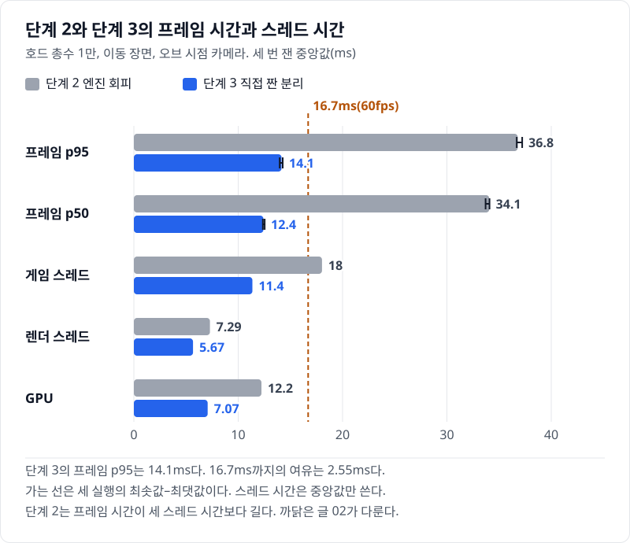
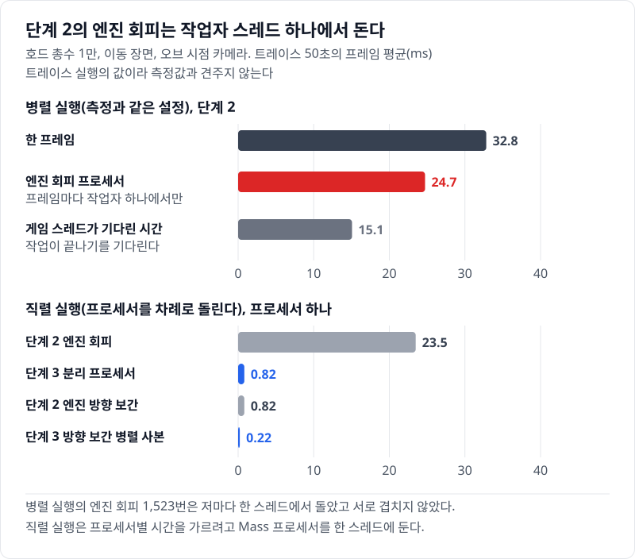
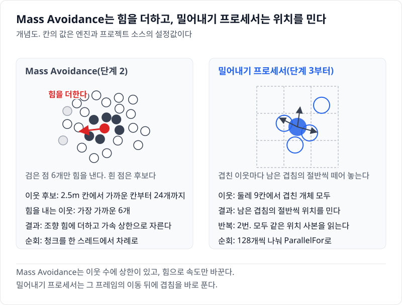
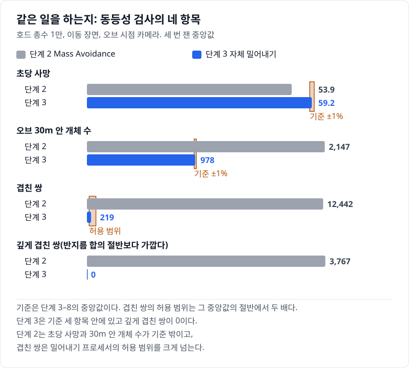
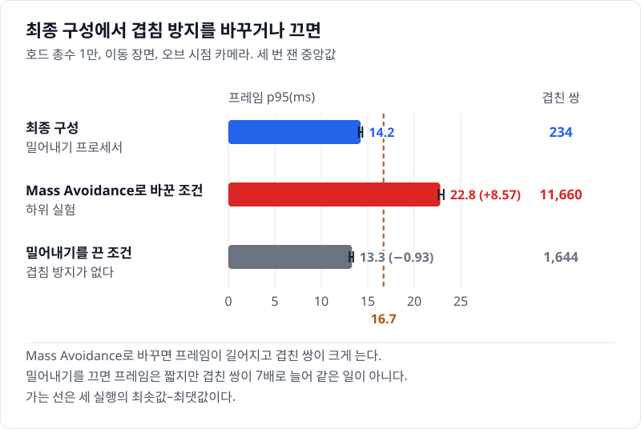

# 03 자체 밀어내기: 엔진 회피를 밀어내기 프로세서로 바꿔 처음으로 16.7ms 안에

## 요약

단계 3은 엔진 회피 프로세서를 직접 짠 밀어내기 프로세서로 바꾸고 엔진의 방향 보간 프로세서를 같은 계산의 병렬 사본으로 바꿨다. 단계 2에서는 작업자 스레드 하나가 엔진 회피를 도는 동안 게임 스레드가 기다렸다. 프레임 p50(프레임 시간의 중앙값)은 34.1ms에서 12.4ms가 됐다. 프레임 p95(느린 쪽 5%의 경계)는 14.1ms로, 사다리에서 처음 16.7ms 안에 든다. 깊게 겹친 쌍(몸통 반지름 합의 절반보다 가까운 개체 쌍의 수)은 3,767에서 0이 되어 같은 일을 더 잘 하면서 빨라졌다.




왼쪽 위 HUD의 숫자는 측정값이 아니다. 수치의 근거는 [측정 기록](measurements.md)에 있다.

> **시나리오.** 오브(Orb)가 맵 중심 둘레의 원 궤도를 2m/s로 돈다. 호드 1만이 오브를 쫓아 사방에서 걸어오고, 오브는 가까운 개체를 지우고 먼 개체를 주기적으로 쏜다. 모든 거리에서 생성·피격·사망·표현 전환이 계속 일어나게 하는 벤치마크 장치다.

## 배경 지식

### 엔진 회피

엔진 회피는 MassAI 플러그인의 `UMassMovingAvoidanceProcessor`가 하는 일이다. 개체마다 장애물 격자에서 가까운 이웃을 찾고 부딪칠 이웃에게서 멀어지는 힘을 조향 힘에 더한다. 힘은 이동 프로세서가 쓰는 속도를 바꿀 뿐이고 위치를 직접 옮기지 않는다. 단계 2는 이 프로세서를 엔진 기본 파라미터로 켰다.

### 위치를 직접 고치는 밀어내기

밀어내기는 겹친 두 개체를 서로 반대로 밀어 겹침을 푸는 일이다. 군중 시뮬레이션에서는 separation이라 부른다. `ULabSeparationProcessor`는 그 프레임의 이동이 끝난 위치를 모아 공간 해시 격자로 이웃을 찾고 위치를 고친다. 모든 개체가 같은 위치 사본을 읽고 새 배열에 쓰는 Jacobi 방식이라, 어느 스레드가 어느 개체를 맡아도 결과가 같다. 단계 3부터 모든 단계가 이 프로세서를 쓴다.

### 한 스레드 순회와 청크 병렬 순회

Mass 쿼리의 `ForEachEntityChunk`는 맞는 Chunk를 한 스레드에서 차례로 돈다. `ParallelForEachEntityChunk`는 Chunk마다 작업을 띄워 작업자 스레드에 나눈다. 개체마다 자기 Fragment만 쓰면 둘의 결과는 같다. 엔진 회피와 엔진 방향 보간은 앞쪽을 쓴다.

> Mass의 Fragment, Processor, Chunk는 [Mass, 엔진 기본 경로](../02-mass-engine-path/README.md)가 설명한다.

## 문제: 엔진 회피가 작업자 하나에서 프레임의 4분의 3을 쓴다

[Mass, 엔진 기본 경로](../02-mass-engine-path/README.md)에서 본 대로 단계 2의 병목은 엔진 회피다. 프레임 p50은 34.1ms인데 게임 스레드 시간(중앙값)은 18ms다. 트레이스를 열면 엔진 회피 프로세서가 프레임마다 작업자 스레드 하나에서 평균 24.7ms를 돈다. 한 프레임은 평균 32.8ms이고, 게임 스레드는 그동안 작업이 끝나기를 기다린다.




표시한 행의 합계를 불린 횟수로 나누면 단계 2의 엔진 회피는 프레임당 23.5ms, 단계 3의 밀어내기 프로세서는 0.82ms다.

게임 스레드가 기다린 시간은 프레임당 15.1ms다. 단계 2의 프레임 p50이 게임 스레드 시간보다 긴 까닭은 [Mass, 엔진 기본 경로](../02-mass-engine-path/README.md)가 자세히 다룬다.

엔진 회피가 한 스레드에 묶이는 자리는 순회 한 줄이다.

`Engine/Plugins/AI/MassAI/Source/MassNavigation/Private/MassAvoidanceProcessors.cpp`, `UMassMovingAvoidanceProcessor::Execute`

```cpp
EntityQuery.ForEachEntityChunk(Context, [FallbackLogOwner = this, &EntityManager, DebugDrawWorld, CurrentTime, DeltaTime](FMassExecutionContext& Context)
{
	// ...
	for (FMassExecutionContext::FEntityIterator EntityIt = Context.CreateEntityIterator(); EntityIt; ++EntityIt)
	{
		// ...
		UE::MassAvoidance::FindCloseObstacles(AgentLocation, MovingAvoidanceParams.ObstacleDetectionDistance,
			AvoidanceObstacleGrid, CloseEntities, UE::MassAvoidance::MaxObstacleResults);
		// ...
			constexpr int32 MaxColliders = 6;
		// ...
		Force.Value = UE::MassNavigation::ClampVector(SteeringForce, MaxSteerAccel); // Assume unit mass
```

첫 줄이 `ForEachEntityChunk`라 모든 Chunk를 한 스레드에서 차례로 돈다. 단계 2에는 Simulation LOD가 없어 1만 개체가 모두 이 순회에 든다. 개체마다 이웃 후보를 24개까지 모으고, 가까운 6개만 힘을 낸다. 끝 줄이 합친 힘을 가속 상한으로 자른다.

엔진 회피는 겹침도 막지 못한다. 단계 2의 겹친 쌍(몸통이 겹친 개체 쌍의 수)은 12,442다. 개체가 오브 둘레에 뭉쳐 오브 30m 안 개체도 기준의 두 배를 넘는다.

## 원리: 위치를 직접 밀고, 이웃 계산을 스레드에 나눈다

밀어내기 프로세서는 엔진 회피와 두 곳이 다르다. 하나는 힘이 아니라 위치를 고친다는 것이다. 그 프레임의 이동이 끝난 뒤 겹친 쌍을 바로 떼어 놓으므로, 뒤에서 미는 조향이 세도 깊은 겹침이 쌓이지 않는다. 다른 하나는 이웃 계산을 128개씩 묶어 작업자 스레드에 나눈다는 것이다. 이웃 수에도 상한을 두지 않는다.



예상: 엔진 회피를 빼면 게임 스레드의 기다림이 사라진다. 그러면 프레임 p50은 게임 스레드 시간인 18ms 근처까지 줄 것이다.

## 바꾼 것: 회피를 밀어내기 프로세서로, 방향 보간을 병렬 사본으로

단계 3부터 엔티티에 엔진 회피 Trait을 붙이지 않는다([LabCrowdSubsystem.cpp](../../Source/HordeOptLab/LabCrowdSubsystem.cpp)). 대신 게임 모듈이 `ULabSeparationProcessor`를 등록한다([HordeOptLab.cpp](../../Source/HordeOptLab/HordeOptLab.cpp)). 밀어내기 프로세서는 엔진 이동 프로세서 뒤에 돈다. 풀이는 Mass를 모르는 계산부에 있다.

[`Source/HordeOptLab/LabSeparation.h`](../../Source/HordeOptLab/LabSeparation.h), `FLabSeparationSolver::Solve`

```cpp
for (int32 Iter = 0; Iter < FMath::Max(Params.Iterations, 1); ++Iter)
{
	Build();
	ParallelFor(NumBatches, [this, &Params, Num](int32 Batch)
	{
		const int32 End = FMath::Min(Num, (Batch + 1) * BatchSize);
		for (int32 I = Batch * BatchSize; I < End; ++I)
		{
			const FVector2f Delta = Resolve(I, Params);
			Next[I] = Pos[I] + Delta;
			Push[I] += Delta;
		}
	}, Flags);
	Swap(Pos, Next);
}
```

`Build`가 해시 격자를 한 스레드에서 만들고, `ParallelFor`가 128개씩 묶은 개체의 밀 양을 나눠 셈한다. 모두 `Pos`를 읽고 `Next`에 쓰므로 결과가 스레드 수에 묶이지 않는다. 반복은 2번이고, 떼어 놓는 거리는 몸통 반지름 합의 1.2배다. 쌍의 겹친 깊이는 몸통 넓이에 반비례해 나눠, 대형이 소형을 더 민다.

방향 보간은 엔진 프로세서를 끄고 같은 쿼리와 식의 사본을 켰다. 다른 곳은 순회 한 줄이다.

`Engine/Plugins/AI/MassAI/Source/MassNavigation/Private/MassSmoothOrientationProcessors.cpp`, `UMassSmoothOrientationProcessor::Execute`

```cpp
HighResEntityQuery.ForEachEntityChunk(Context, [this, DeltaTime](FMassExecutionContext& Context)
```

[`Source/HordeOptLab/LabSmoothOrientation.cpp`](../../Source/HordeOptLab/LabSmoothOrientation.cpp), `ULabSmoothOrientationProcessor::Execute`

```cpp
HighResEntityQuery.ParallelForEachEntityChunk(Context, HighRes);
LowResEntityQuery_Conditional.ParallelForEachEntityChunk(Context, LowRes);
```

개체마다 자기 회전과 바라는 방향만 쓰므로 병렬로 돌려도 결과가 같다. 개발 빌드 검사에서 엔진 프로세서와 같은 프레임의 결과를 비트 단위로 견줘 다른 값이 없었다.

단계 3에서 바뀐 변수는 둘이다. 그래서 단계 2와 3의 차이에는 두 몫이 섞인다. 방향 보간 사본만 바꾼 비교는 최종 구성에서 따로 쟀고, 프레임 p95는 구별되지 않았다(참고, 다른 측정). 측정한 코드는 [측정에 쓴 커밋](https://github.com/hon454/unreal-horde-optimization-lab/tree/v2-full4)에 있다.

## 결과: 프레임 p50 12.4ms, 같은 일을 한다

단계 3은 예상보다 더 줄었다. 프레임 p50은 12.4ms이고 프레임 p95는 14.1ms다. 16.7ms까지의 여유는 2.55ms다. 직렬 트레이스에서 밀어내기 프로세서는 프레임당 0.82ms를 쓴다. 방향 보간은 0.82ms에서 0.22ms가 됐다.

회피를 바꾸는 사이에 장면도 바뀌었다. 오브 30m 안 개체 수는 2,147에서 978로 줄었다. 액터로 그리는 개체도 평균 971에서 577로 줄었다. 게임 스레드 시간(중앙값)은 18ms에서 11.4ms가 됐다. GPU 시간도 12.2ms에서 7.07ms로 줄었다. 그래서 단계 3이 버는 시간에는 회피 구현의 차이와 뭉침이 풀린 장면의 차이가 함께 담긴다.

같은 일을 하는지는 [목표 사양과 재는 법](../00-goals-and-method/README.md)의 동등성 검사로 본다. 단계 3의 초당 사망과 오브 30m 안 개체 수는 기준과 0.1% 안이다. 겹친 쌍 219는 허용 범위 안이다. 단계 2는 초당 사망이 9% 적고, 30m 안 개체 수와 겹친 쌍이 기준을 크게 넘는다.



겹친 쌍은 프레임 시간이 길수록 늘어, 두 단계의 값을 그대로 견줄 수는 없다. 깊게 겹친 쌍은 이 영향을 덜 받는다. 몸통 반지름 합의 절반보다 가까운 쌍이라, 문턱이 가장 작은 소형끼리도 40cm다. 단계 2의 한 프레임 동안 개체가 걸어 들어오는 거리는 약 10cm다. 깊게 겹친 쌍은 단계 3이 0이고 단계 2가 3,767이다.

### 최종 구성에서 바꾸거나 끄면

최종 구성에서도 엔진 회피는 더 비싸고 일을 못 한다. 밀어내기 프로세서를 엔진 회피로 바꾸는 하위 실험은 프레임 p95가 8.57ms 길다. 깊게 겹친 쌍은 0에서 3,529가 된다. 밀어내기를 끈 조건은 프레임 p95가 0.93ms 짧다. 그러나 겹친 쌍이 1,644로 늘어 같은 일이 아니다.



### 한계 둘

표현 프로세서와 밀어내기 프로세서 사이에는 순서 선언이 없다. 그래서 표현이 밀어내기 전 위치를 읽는 프레임과 밀어내기 뒤 위치를 읽는 프레임이 섞인다. 최종 구성의 트레이스에서 엔진 표현 프로세서는 약 10%의 프레임에서 밀어내기가 끝나기 전에 돌았다. 밀어내기가 옮기는 거리는 옮긴 개체 하나당 프레임 평균 0.67cm다. 이 판에서는 고치지 않았다.

겹친 쌍은 프레임 시간이 길수록 는다. 밀어내기는 프레임마다 한 번 위치를 고치고, 그 사이에 개체가 서로에게 걸어 들어오기 때문이다. 그래서 프레임 시간이 크게 다른 조건끼리는 겹친 쌍을 견주지 않는다.

## 틀렸던 가설: 밀어내기 풀이를 빠르게 하면 프레임이 준다

처음에는 밀어내기 풀이를 빠르게 하면 프레임이 줄 것으로 생각했다. 최종 구성의 트레이스에서 게임 스레드가 밀어내기 프로세서가 끝나기를 기다렸기 때문이다. 그래서 결과를 비트 단위로 그대로 두고 셈을 줄인 풀이를 만들었다. 칸의 해시를 반복마다 한 번만 셈하고 이웃의 위치를 칸 순서로 늘어놓은 사본에서 읽게 했다.

개발 빌드에서 재 보니 밀어내기 프로세서는 빨라지지 않았다. 해시를 한 번만 셈하자 격자 만들기는 줄었지만 반복이 그만큼 길어졌다. 칸 순 사본은 늘어놓는 쓰기가 줄인 읽기보다 컸다. 그래서 고친 풀이를 되돌렸다.

고친 설명은 이렇다. 밀어내기의 벽시계 시간은 이웃 셈의 양이 정하지 않는다. 한 스레드에서 도는 격자 만들기와, 작업자들이 `ParallelFor`에 차례로 붙는 시간이 정한다. 결과를 바꾸지 않는 한 둘은 줄지 않는다. 게임 스레드의 기다림을 줄일 후보는 그 앞에서 한 스레드로 돌던 엔진 방향 보간이다. 병렬 사본으로 바꾼 효과는 프레임 p95로 구별되지 않았다.

## 한 문장으로

엔진 회피를 위치를 직접 미는 밀어내기 프로세서로 바꾸자, 작업자 하나에 묶였던 프레임이 풀려 호드 1만이 처음으로 16.7ms 안에 들었다.

- 빠른지보다 같은 일을 하는지를 먼저 본다. 밀어내기를 끈 조건은 더 빠르지만 겹친 쌍이 7배다.
- 한 스레드로 도는 엔진 프로세서는 트레이스에서 작업자 하나의 긴 구간으로 보인다. 계산이 개체마다 독립이면 청크 병렬 사본으로 바꿀 수 있다.
- 표현과 밀어내기 사이의 순서는 아직 선언하지 않았다.

[다음 글](../04-quality-by-distance/README.md)에서는 먼 개체의 표현을 더하는 단계 4, 6, 7이 이 여유를 얼마나 쓰는지 본다. 여덟 단계의 결과는 [07 요약](../07-summary/README.md)에 모았다.
