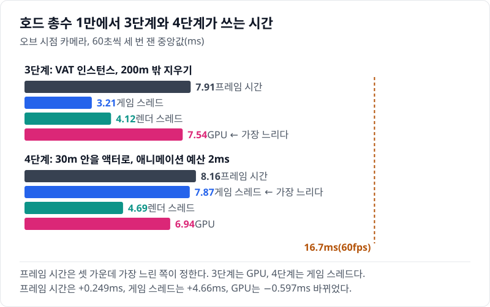
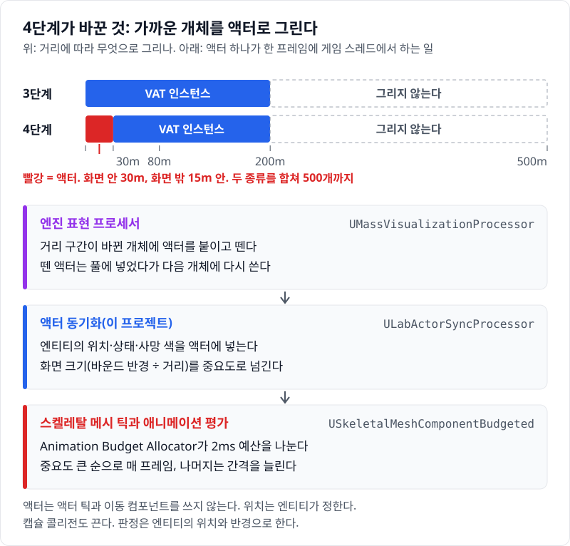
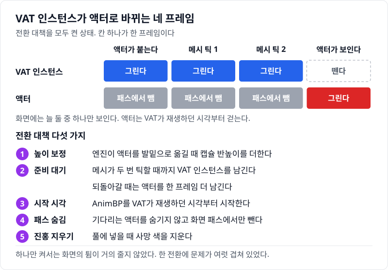
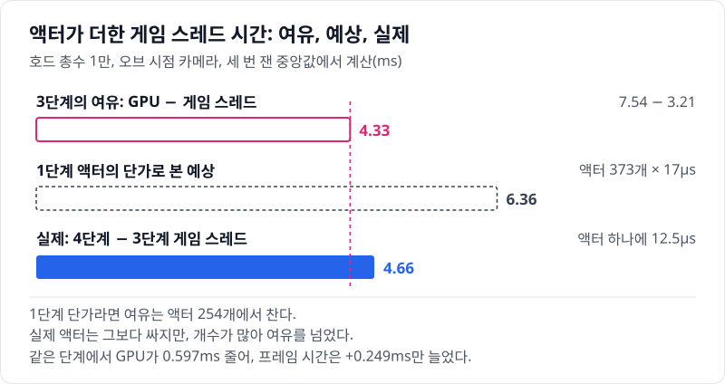
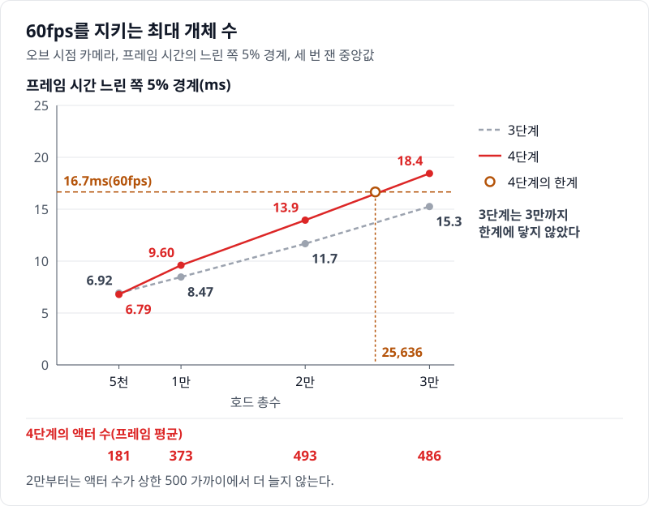
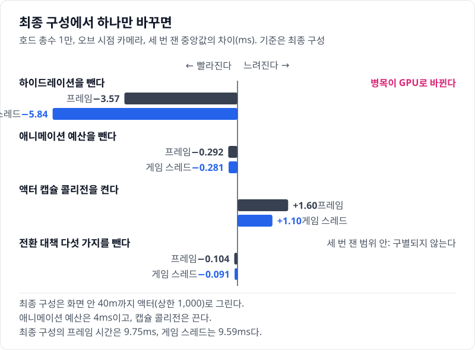

# 04 가까운 개체를 진짜 액터로 — 하이드레이션과 애니메이션 예산

## 요약

4단계는 오브 가까이의 개체를 VAT 인스턴스에서 AnimBP로 움직이는 액터로 바꾸고, 그 액터의 애니메이션을 2ms 예산 안에 묶는다. 값은 모두 호드 총수 1만, 오브 시점 카메라에서 잰 것이다. 프레임 시간은 7.91ms에서 8.16ms로 늘었다. 늘어난 것은 0.249ms다. 이 단계는 프레임 시간을 버는 단계가 아니라 가까운 개체의 품질을 사는 단계다. 게임 스레드는 3.21ms에서 7.87ms로 늘었고, 병목이 GPU에서 게임 스레드로 옮겨 갔다.



프레임 시간은 게임 스레드, 렌더 스레드, GPU 가운데 가장 느린 쪽이 정한다. 3단계는 GPU가, 4단계는 게임 스레드가 가장 느리다. 지표의 자세한 설명은 [00번 글](../00-goals-and-method/README.md)에 둔다.


수치의 근거는 [측정 기록](measurements.md)에 있다.

> **시나리오.** 플레이어는 움직이지 않는다. 맵 중앙의 오브를 향해 개체가 사방에서 걸어오고, 오브는 가까운 개체를 지우고 먼 개체를 주기적으로 쏜다. 모든 거리에서 생성·피격·사망·표현 전환이 계속 일어나게 하는 벤치마크 장치다.

## 배경 지식

### 하이드레이션

하이드레이션은 엔티티가 가까이 올 때만 진짜 액터를 붙여 그리는 일이다. Mass의 표현 프로세서가 표현 LOD High 구간에 들어온 엔티티에 액터를 붙이고, 구간을 나가면 떼어 풀에 넣는다. 로직은 계속 엔티티에 있고, 액터는 엔티티의 위치와 상태를 따라 그린다. 이 글에서는 High 구간(화면 안 30m, 화면 밖 15m)의 표현을 액터로 바꿨다. 액터 수 상한은 500으로 두었다.

### 화면 크기 중요도

Animation Budget Allocator는 [01번 글](../01-actor-baseline/README.md)에서 설명했다. 할당기는 중요도가 큰 메시부터 매 프레임 갱신하고, 중요도는 순서를 정하는 데만 쓴다. 이 글에서는 중요도를 바운드 반경 ÷ 카메라 거리로 넣었다. 같은 거리라면 대형 미니언이 소형보다 2.35배 중요하다.

### 표현 전환의 준비 대기

엔진은 기본으로 액터를 붙인 프레임에 인스턴스를 뗀다. `bWaitForActorVisualReadiness`를 켜면 액터 관리 클래스가 "준비됨"을 돌려줄 때까지 인스턴스를 남긴다. `bKeepActorExtraFrame`은 반대 방향(액터 → 인스턴스)에서 액터를 한 프레임 더 남긴다. 이 글에서는 둘 다 켜고, 메시가 두 번 틱하면 준비됨을 돌려주게 했다.

## 문제: 3단계는 가까운 개체도 VAT 인스턴스로 그린다

[03번 글](../03-ism-vat/README.md)의 3단계는 200m 안의 개체를 모두 VAT 인스턴스로 그렸다. 오브 30m 안에만 평균 627개가 있고, 카메라는 오브 뒤 15m에 있다. 플레이어가 가장 크게 보는 개체가 이 인스턴스다.

VAT 인스턴스는 미리 구운 걷기·피격·죽기 클립을 상태에 따라 바꿔 재생할 뿐이다. 클립 사이를 섞지 않고, 정점마다 뼈 넷까지만 섞는 근사다. CPU 쪽에는 뼈가 없어서 부위 판정, IK, 래그돌 같은 근거리 기능을 붙일 수 없다.

시간의 여유는 있다. 3단계의 병목은 GPU 7.54ms이고, 게임 스레드는 3.21ms다. 게임 스레드는 4.33ms를 더 써도 프레임 시간을 늘리지 않는다.

## 원리: 액터의 비용은 게임 스레드로 간다

4단계는 가까운 구간의 표현만 바꾼다. 아래 그림의 위쪽이 거리 구간이고, 아래쪽이 액터 하나가 한 프레임에 게임 스레드에서 하는 일이다.



액터는 1단계 액터와 달리 액터 틱과 이동 컴포넌트를 쓰지 않는다. 1단계에서 게임 스레드 시간의 대부분을 쓴 이동 컴포넌트가 빠진다. 남는 일은 동기화 프로세서가 엔티티의 위치와 상태를 넣는 일, 스켈레탈 메시의 틱과 애니메이션 평가다. 애니메이션 쪽은 Animation Budget Allocator가 예산을 나눈다.

`Engine/Plugins/Runtime/AnimationBudgetAllocator/Source/AnimationBudgetAllocator/Private/AnimationBudgetAllocator.cpp`, `FAnimationBudgetAllocator::CalculateWorkDistributionAndQueue`(앞 세 줄)와 `QueueSortedComponentIndices`(마지막 줄)

```cpp
			const float AvailableBudget = Parameters.BudgetInMs - ExternalAnimationTimeSpent;
			// ...
			const float WorkUnitBudget = FMath::Max(AvailableBudget / AverageWorkUnitTimeMs, (float)TotalIdealWorkUnits * Parameters.MinQuality);
			// ...
			const float WorkUnitsExcess = FMath::Max(0.0f, TotalIdealWorkUnits - WorkUnitBudget);
	// ...
		return ComponentData0.Significance > ComponentData1.Significance;
```

할당기는 예산(ms)을 메시 하나의 평균 갱신 시간으로 나눠 이번 프레임에 갱신할 메시 수를 구한다. 그 수를 넘는 몫(`WorkUnitsExcess`)이 있을 때만 갱신 간격을 늘린다. 순서는 마지막 줄의 정렬이 정한다. 중요도가 큰 메시가 먼저 매 프레임 갱신된다.

**예상.** 게임 스레드의 여유는 4.33ms다. 1단계 액터는 프레임이 짧을 때 개체 하나에 게임 스레드 17.0µs를 썼다. 그 단가면 액터 254개에서 여유가 찬다. 4단계 액터는 이동 컴포넌트가 없어 그보다 쌀 것이다. 그래도 30m 안 개체가 수백 개라 여유를 넘을 수 있고, 넘으면 병목이 게임 스레드로 옮겨 간다.

## 바꾼 것: 가까운 구간의 표현, 액터 클래스, 예산, 전환 대책

3단계에서 바꾼 것은 가까운 구간의 표현 하나다. 그 표현에 딸린 설정 셋(애니메이션 예산, 전환 대책, 캡슐 콜리전 끔)이 함께 들어온다. 설정마다의 몫은 아래 "결과"에서 최종 구성에서 하나씩 뺀 측정으로 보인다.

**표현.** 표현 LOD High의 표현을 `HighResSpawnedActor`로 바꾸고 액터 클래스를 정했다.

`Source/HordeOptLab/LabCrowdSubsystem.cpp`, `ULabCrowdSubsystem::BuildEntityConfig`

```cpp
Visual->HighResTemplateActor = bBudget ? ALabMinionMassActorBudget::StaticClass() : ALabMinionMassActor::StaticClass();
Visual->Params.LODRepresentation[EMassLOD::High] = FLabConfig::Get().UsesHydration() ? EMassRepresentationType::HighResSpawnedActor : EMassRepresentationType::StaticMeshInstance;
Visual->Params.RepresentationActorManagementClass = ULabActorManagement::StaticClass();
Visual->Params.bWaitForActorVisualReadiness = FLabConfig::Get().HasFix(FLabConfig::FixWait);
Visual->Params.bKeepActorExtraFrame = FLabConfig::Get().HasFix(FLabConfig::FixWait);
// ...
const float Bands[EMassLOD::Max] = { 0.f, HydrateCm, 8000.f, FLabConfig::Get().RepOffCm() };
const int32 MaxCounts[EMassLOD::Max] = { FLabConfig::Get().ActorCap, 5000, MAX_int32, MAX_int32 };
```

`HydrateCm`은 3,000cm(30m)이고 `ActorCap`은 500이다. 상한은 두 종류를 합친 액터 수다. 대형 미니언은 `ALabMinionMassActorBudgetLarge`를 쓴다.

**액터 클래스.** `ALabMinionMassActorBudget`은 메시를 `USkeletalMeshComponentBudgeted`로 바꾼 `ACharacter`다. 액터 틱과 이동 컴포넌트의 틱은 등록하지 않는다(`bCanEverTick = false`). 위치는 `ULabActorSyncProcessor`가 매 프레임 엔티티에서 옮겨 넣는다. 캡슐 콜리전은 `BeginPlay`에서 끈다.

`Source/HordeOptLab/LabMinion.cpp`, `ALabMinionMassActor::BeginPlay`

```cpp
const FLabConfig::EActorCollision Collision = FLabConfig::Get().ActorCollision;
if (Collision != FLabConfig::EActorCollision::On)
{
	GetCapsuleComponent()->SetShouldUpdatePhysicsVolume(false);
	GetCapsuleComponent()->SetGenerateOverlapEvents(false);
	GetCapsuleComponent()->SetCollisionEnabled(Collision == FLabConfig::EActorCollision::Off ? ECollisionEnabled::NoCollision : ECollisionEnabled::QueryOnly);
}
```

기본값은 `Off`라 캡슐이 피직스 씬에서 빠진다. 오브의 피해 판정은 엔티티의 위치로 하므로 캡슐을 쓰지 않는다.

**예산.** 동기화 프로세서가 중요도를 화면 크기로 넘기고, 게임 모드가 할당기를 켠다.

`Source/HordeOptLab/LabActorSyncProcessor.cpp`, `ULabActorSyncProcessor::Execute`

```cpp
if (USkeletalMeshComponentBudgeted* Budgeted = Cast<USkeletalMeshComponentBudgeted>(SkelMesh))
{
	Budgeted->SetComponentSignificance(TypeParams.BoundRadius / FMath::Max(FVector::Dist(Xf.GetLocation(), CameraLocation), 1.f));
}
```

`Source/HordeOptLab/LabGameMode.cpp`, `ALabGameMode::ApplyVariantCVars`

```cpp
LabSetCVar(TEXT("a.Budget.Enabled"), TEXT("1"));
LabSetCVar(TEXT("a.Budget.BudgetMs"), *FString::SanitizeFloat(FLabScenario::BudgetMs));
// ...
if (IAnimationBudgetAllocator* Allocator = IAnimationBudgetAllocator::Get(GetWorld()))
{
	Allocator->SetEnabled(true);
}
```

`a.Budget.Enabled`의 기본값은 0이고 예산 기본값은 1ms다. `FLabScenario::BudgetMs`는 2ms다. 월드마다 만들어지는 할당기는 꺼진 채 시작하므로 마지막 줄이 필요하다.

**전환 대책.** 처음에는 인스턴스가 액터로 바뀌는 순간이 화면에서 튀었다. 원인 둘은 엔진의 기본 동작이었다.

`Engine/Plugins/Runtime/MassGameplay/Source/MassActors/Private/MassActorSpawnerSubsystem.cpp`, `UMassActorSpawnerSubsystem`(풀에서 액터를 꺼내는 곳)

```cpp
				PooledActor->SetActorHiddenInGame(false);
				PooledActor->SetActorTransform(Args.Request.Transform, false, nullptr, ETeleportType::ResetPhysics);
				// ...
				IMassActorPoolableInterface::Execute_PrepareForGame(PooledActor);
```

같은 플러그인의 `MassRepresentation/Private/MassRepresentationProcessor.cpp` `UMassRepresentationProcessor::UpdateRepresentation`(첫 줄)과 `MassRepresentationActorManagement.cpp` `UMassRepresentationActorManagement::TeleportActor`(마지막 줄)

```cpp
							RepresentationActorManagement->TeleportActor(TransformFragment.GetTransform(), *NewActor, Context.Defer());
				// ...
				Actor.SetActorTransform(Transform, /*bSweep*/false, /*OutSweepHitResult*/nullptr, ETeleportType::TeleportPhysics);
```

엔진 풀은 액터를 꺼내자마자 보이게 한다. 애니메이션이 평가되기 전의 자세가 보일 수 있다. 또 엔진은 액터를 붙일 때 엔티티의 변환으로 옮긴다. 엔티티의 원점은 발밑이고 액터의 원점은 캡슐 중심이다. 그래서 소형 액터는 그 프레임에 88cm 가라앉았다가 다음 프레임에 올라왔고, 모션 블러가 그 움직임을 세로 줄무늬로 그렸다. 두 동작을 다룬 공개 이슈는 찾지 못했다. 이 레포는 액터 관리 클래스와 액터에서 고쳤다.

`Source/HordeOptLab/LabActorSyncProcessor.cpp`, `ULabActorManagement::TeleportActor`

```cpp
void ULabActorManagement::TeleportActor(const FTransform& Transform, AActor& Actor, FMassCommandBuffer& CommandBuffer) const
{
	FTransform Lifted = Transform;
	// ...
	if (const ACharacter* Character = Cast<ACharacter>(&Actor); Character && FLabConfig::Get().HasFix(FLabConfig::FixLift))
	{
		Lifted.AddToTranslation(FVector(0.f, 0.f, Character->GetCapsuleComponent()->GetScaledCapsuleHalfHeight()));
	}
	Super::TeleportActor(Lifted, Actor, CommandBuffer);
}
```

`Source/HordeOptLab/LabMinion.cpp`, `ALabMinionMassActor::HideUntilPoseReady`

```cpp
void ALabMinionMassActor::HideUntilPoseReady()
{
	bPoseReady = false;
	PendingReadyFrames = 0;
	// ...
	SetActorHiddenInGame(false);
	USkeletalMeshComponent* SkelMesh = GetMesh();
	SkelMesh->SetRenderInMainPass(false);
	SkelMesh->SetRenderInDepthPass(false);
	SkelMesh->SetCastShadow(false);
}
```

첫 블록은 엔진이 옮기는 위치에 캡슐 반높이를 더한다. 둘째 블록은 기다리는 액터를 숨기지 않고 화면 패스와 그림자에서만 뺀다. 액터를 숨기면 렌더 프록시가 장면에서 빠진다. 다시 보일 때 지난번 위치가 "이전 프레임"으로 쓰여 모션 블러가 번진다. 대책은 이 둘을 포함해 다섯 가지다.



대책은 하나만 켜서는 화면의 튐이 거의 줄지 않았다. 한 전환에 문제가 여럿 겹쳐 있어서, 하나를 고쳐도 남은 문제가 같은 프레임에서 튀었다. 그래서 다섯 가지를 모두 켜 두고, 하나씩 끄며 크기를 쟀다. 가장 큰 것은 높이 보정이었다.

## 결과: 프레임은 0.249ms 늘고, 병목이 게임 스레드로 옮겨 갔다

4단계는 프레임 평균 373개의 액터를 그렸다. 게임 스레드는 4.66ms 늘었다. 액터 하나에 12.5µs다. 1단계 단가로 본 예상 6.36ms보다 작지만, 여유 4.33ms는 넘었다.



같은 단계에서 GPU 시간은 0.597ms 줄었다. 그래서 게임 스레드가 GPU를 넘어서고도 프레임 시간은 0.249ms만 늘었다. GPU가 줄어든 원인은 가르지 않았다. 렌더 스레드는 0.573ms 늘었다. 액터는 메시마다 따로 그려서 드로우 콜이 123에서 1,321이 됐다.

트레이스에서 게임 스레드의 프레임 평균을 읽었다(Unreal Insights, 호드 총수 1만, Processor를 한 스레드에 돌린 실행이라 위의 측정값과 견주지 않는다). 4단계에서 스켈레탈 메시 틱(`USkinnedMeshComponent_TickComponent`)은 프레임당 1.05ms를 쓰고 257번 불린다. 애니메이션 평가를 마치는 일(`USkeletalMeshComponent_CompleteParallelAnimationEvaluation`)은 0.828ms, 액터 동기화 Processor(`ULabActorSyncProcessor`)는 0.510ms다. 3단계에서 게임 스레드가 렌더 스레드를 기다리던 `Sync_RenderingThread`는 2.75ms였고, 4단계에서는 0.005ms로 사라진다. 엔진 틱(`Tick_Engine`)은 3단계의 4.68ms에서 4단계의 8.37ms로 늘었다.

60fps를 지키는 최대 개체 수는 3단계가 잰 범위 3만 안에서 한계에 닿지 않았다. 4단계는 25,636이다. 프레임 시간의 느린 쪽 5% 경계가 16.7ms에 닿는 호드 총수를, 잰 개체 수 사이에서 보간한 값이다. 이 단계가 품질을 사는 대신 내는 값이다.



액터 수는 2만부터 상한 500 가까이에서 멈춘다. 그 뒤로 액터의 비용은 호드 총수와 함께 늘지 않는다. 호드 총수 5천에서는 병목이 GPU라 4단계의 프레임 시간이 3단계보다 짧다.

1만에서 애니메이션 예산은 거의 일하지 않는다. 대형 액터의 애니메이션 갱신 가운데 건너뛴 비율은 1.29%다. 2만에서는 49.5%다. 예산을 넘는 몫이 생길 때만 할당기가 간격을 늘리기 때문이다.

### 최종 구성에서 하나씩 빼면

최종 구성은 화면 안 40m까지 액터로 그리고 상한을 1,000으로 둔다([08번 글](../08-quality/README.md)). 이 구성에서 4단계의 설정을 하나씩 빼거나 바꿔 다시 쟀다.



하이드레이션을 빼면 프레임 시간이 1.59ms 줄고 병목이 GPU로 바뀐다. 게임 스레드는 3.85ms 준다. 액터 평균 458개로 나누면 하나에 8.41µs다. 애니메이션 예산을 빼면 프레임 시간이 1.75ms 는다. 액터가 많은 최종 구성에서는 예산이 일을 하고 있다는 뜻이다.

캡슐 콜리전을 켜면 프레임 시간이 2.01ms, 게임 스레드가 1.54ms 는다. 전환 대책 다섯 가지를 빼도 프레임 시간은 0.017ms 차이로, 세 번 잰 범위 안이다. 전환 대책은 프레임 시간이 아니라 화면에서만 차이가 난다.

## 한 문장으로

가까운 개체를 진짜 액터로 바꾼 값은 프레임 0.249ms로 보였지만, 게임 스레드는 두 배 넘게 늘었다.

- 하이드레이션의 비용은 액터 수가 정한다. 상한에 걸리면 호드 총수가 늘어도 액터의 비용은 그대로다.
- 애니메이션 예산은 예산을 넘을 때만 일한다. 4단계 1만에서는 거의 쉬었고, 액터가 더 많은 최종 구성에서 빼면 프레임이 1.75ms 늘었다.
- 한계: 4단계에서 예산만 끈 측정은 없다. 예산과 콜리전의 몫은 액터 상한과 전환 거리가 다른 최종 구성에서 쟀다.

[다음 글](../05-simulation-lod-entity-pool/README.md)에서는 거리마다 로직을 덜 자주 돌린다(Simulation LOD). 200m 밖의 이동을 자체 프로세서로 바꾸고, 죽은 엔티티를 지우지 않고 다시 쓴다.
