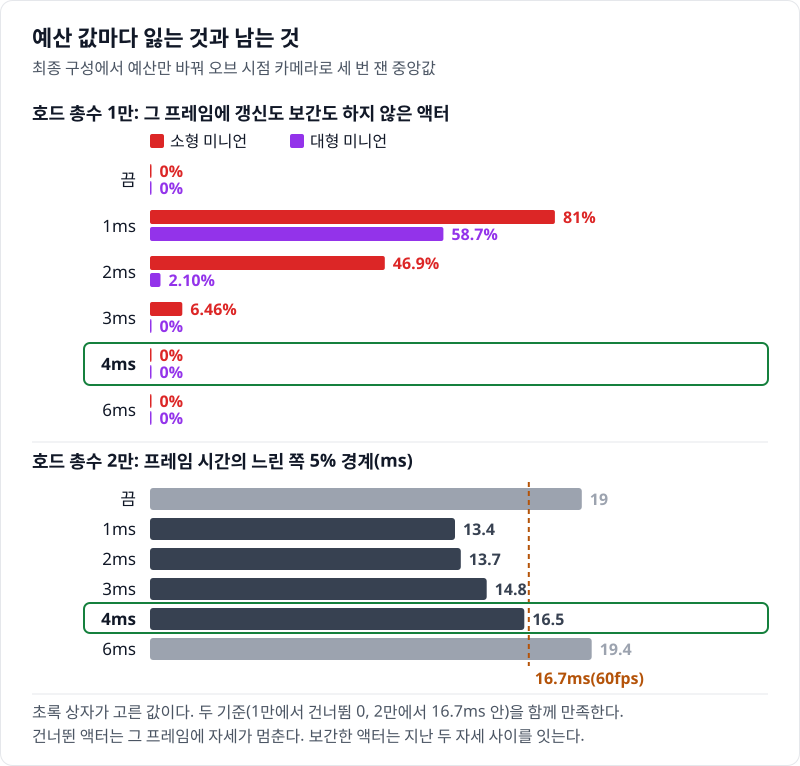

# 04 가까운 개체를 진짜 액터로: 하이드레이션과 애니메이션 예산

## 요약

4단계는 오브 가까이의 개체를 VAT 인스턴스에서 AnimBP로 움직이는 액터로 바꾸고, 그 액터의 애니메이션을 4ms 예산 안에 묶는다. 값은 모두 호드 총수 1만, 오브 시점 카메라에서 잰 것이다. 프레임 시간은 7.91ms에서 9.42ms로 1.51ms 늘었다. 이 단계는 프레임 시간을 내주고 가까운 개체의 품질을 산다. 게임 스레드는 4.16ms에서 9.14ms로 늘었고, 병목이 GPU에서 게임 스레드로 옮겨 갔다.


프레임 시간은 게임 스레드, 렌더 스레드, GPU 가운데 가장 느린 쪽이 정한다. 3단계는 GPU가, 4단계는 게임 스레드가 가장 느리다. 지표의 자세한 설명은 [00번 글](../00-goals-and-method/README.md)에 둔다.


수치의 근거는 [측정 기록](measurements.md)에 있다.

> **시나리오.** 플레이어는 움직이지 않는다. 맵 중앙의 오브(Orb)를 향해 개체가 사방에서 걸어오고, 오브는 가까운 개체를 지우고 먼 개체를 주기적으로 쏜다. 모든 거리에서 생성·피격·사망·표현 전환이 계속 일어나게 하는 벤치마크 장치다.

## 배경 지식

### 하이드레이션

하이드레이션(Hydration)은 엔티티가 가까이 올 때만 진짜 액터를 붙여 그리는 일이다. Mass의 표현 프로세서가 표현 LOD High 구간에 들어온 엔티티에 액터를 붙이고, 구간을 나가면 떼어 풀에 넣는다. 로직은 계속 엔티티에 있고, 액터는 엔티티의 위치와 상태를 따라 그린다. 4단계는 High 구간(화면 안 30m, 화면 밖 15m)의 표현을 액터로 바꿨다. 액터 수 상한은 500으로 두었다.

### 화면 크기 중요도

Animation Budget Allocator는 [01번 글](../01-actor-baseline/README.md)에서 설명했다. 할당기는 중요도(Significance)가 큰 메시부터 매 프레임 갱신하고, 중요도는 순서를 정하는 데만 쓴다. 4단계는 중요도를 바운드 반경 ÷ 카메라 거리, 곧 화면에서 보이는 크기로 넣었다. 같은 거리라면 대형 미니언이 소형보다 2.35배 중요하다. 엔진의 Significance Manager는 쓰지 않고 Mass의 동기화 Processor가 이 값을 직접 넣는다.

### 표현 전환의 준비 대기

엔진은 기본으로 액터를 붙인 프레임에 인스턴스를 뗀다. `bWaitForActorVisualReadiness`를 켜면 액터 관리 클래스가 "준비됨"을 돌려줄 때까지 인스턴스를 남긴다. `bKeepActorExtraFrame`은 반대 방향(액터 → 인스턴스)에서 액터를 한 프레임 더 남긴다. 4단계는 둘 다 켜고, 메시가 두 번 틱하면 준비됨을 돌려주게 했다.

## 문제: 3단계는 가까운 개체도 VAT 인스턴스로 그린다

[03번 글](../03-ism-vat/README.md)의 3단계는 200m 안의 개체를 모두 VAT 인스턴스로 그렸다. 오브 30m 안에만 평균 627개가 있고, 카메라는 오브 뒤 15m에 있다. 플레이어가 가장 크게 보는 개체가 이 인스턴스다.

VAT 인스턴스는 미리 구운 걷기·피격·죽기 클립을 상태에 따라 바꿔 재생할 뿐이다. 클립 사이를 섞지 않고, 정점마다 뼈 넷까지만 섞는 근사다. CPU 쪽에는 뼈가 없어서 부위 판정, IK, 래그돌 같은 근거리 기능을 붙일 수 없다.

시간의 여유는 있다. 3단계의 병목은 GPU 7.53ms이고, 게임 스레드는 4.16ms다. 게임 스레드는 3.37ms를 더 써도 프레임 시간을 늘리지 않는다.

## 원리: 액터의 비용은 게임 스레드로 간다

4단계는 가까운 구간의 표현만 바꾼다. 아래 그림의 위쪽이 거리 구간이고, 아래쪽이 액터 하나가 한 프레임에 게임 스레드에서 하는 일이다.


엔티티에 액터가 붙을 때 로직을 누가 갖는지는 두 갈래다. 하나는 로직을 엔티티에 두고, 액터는 엔티티의 위치와 상태를 받아 그리기만 하는 방식이다. 엔진은 이 액터를 퍼핏(puppet)이라 부른다. 다른 하나는 액터의 AI와 CharacterMovement가 개체를 움직이고, 엔티티가 액터의 위치를 받아 가는 방식이다. 엔진은 변환기(Translator)에 단 태그로 엔티티와 액터 사이의 복사 방향을 정한다.

`Engine/Plugins/Runtime/MassGameplay/Source/MassActors/Public/MassAgentComponent.h`, `EAgentComponentState`

```cpp
enum class EAgentComponentState : uint8
{
	// ...
	// States of actors needing mass entity creation
	EntityPendingCreation, // Actor waiting for entity creation
	EntityCreated, // Actor with a created entity
	// ...
	// States are for Actor driven by Mass (puppet) needing fragments initialization
	PuppetPendingInitialization, // Puppet actor queued for fragments initialization
	PuppetInitialized, // Puppet actor with all initialized fragments
	// ...
```

엔진은 Mass에 등록된 액터의 상태를 두 묶음으로 나눈다. 위 묶음은 액터가 먼저 있고 자기를 대표하는 엔티티를 만드는 쪽이다. 아래 묶음은 Mass가 움직이는 퍼핏 쪽이다.

4단계는 퍼핏 방식을 쓴다. 단계끼리 비교하려면 모든 단계에서 로직이 같아야 하기 때문이다. 반대 방식은 이동을 CharacterMovement에 넘겨, 1단계에서 게임 스레드 시간의 대부분을 쓴 비용을 다시 치른다. 또 액터를 붙이고 뗄 때마다 엔티티와 액터가 상태를 주고받아 둘의 상태가 어긋나기 쉽다.

그래서 4단계의 액터는 1단계 액터와 달리 액터 틱과 이동 컴포넌트를 쓰지 않는다. 남는 일은 동기화 프로세서가 엔티티의 위치와 상태를 넣는 일, 스켈레탈 메시의 틱과 애니메이션 평가다. 애니메이션 쪽은 Animation Budget Allocator가 예산을 나눈다.

`Engine/Plugins/Runtime/AnimationBudgetAllocator/Source/AnimationBudgetAllocator/Private/AnimationBudgetAllocator.cpp`, `FAnimationBudgetAllocator::CalculateWorkDistributionAndQueue`(앞 세 줄)와 `QueueSortedComponentIndices`(마지막 줄)

```cpp
			const float AvailableBudget = Parameters.BudgetInMs - ExternalAnimationTimeSpent;
			// ...
			const float WorkUnitBudget = FMath::Max(AvailableBudget / AverageWorkUnitTimeMs, (float)TotalIdealWorkUnits * Parameters.MinQuality);
			// ...
			const float WorkUnitsExcess = FMath::Max(0.0f, TotalIdealWorkUnits - WorkUnitBudget);
	// ...
		return ComponentData0.Significance > ComponentData1.Significance;
```

할당기는 예산(ms)을 메시 하나의 평균 갱신 시간으로 나눠 이번 프레임에 갱신할 메시 수를 구한다. 수요는 최근 1초 안에 화면에 그려진 메시다. 수요가 그 수를 넘는 몫(`WorkUnitsExcess`)이 있을 때만 갱신 간격을 늘린다. 순서는 마지막 줄의 정렬이 정한다. 할당기는 중요도가 큰 메시, 곧 화면에서 큰 메시부터 매 프레임 갱신한다.

넘는 몫이 있으면 매 프레임 갱신하는 수가 그 몫의 0.8배만큼 준다. 남은 예산으로 다음 순위의 메시 일부를 보간(interpolation)한다. 보간은 갱신하지 않는 프레임에 지난 두 자세 사이를 이어 그리는 일이다. 나머지 메시는 2\~10프레임에 한 번만 갱신하고, 그 사이 프레임은 건너뛴다. 건너뛴 프레임에는 자세가 멈춘다. 같은 거리라면 소형이 대형보다 순위가 낮아 건너뜀이 소형에 먼저 몰린다.

**예상.** 게임 스레드의 여유는 3.37ms다. 1단계 액터는 프레임이 짧을 때 개체 하나에 게임 스레드 17µs를 썼다. 그 단가면 액터 198개에서 여유가 찬다. 4단계 액터는 이동 컴포넌트가 없어 그보다 쌀 것이다. 그래도 30m 안 개체가 수백 개라 여유를 넘을 수 있고, 넘으면 병목이 게임 스레드로 옮겨 간다.

## 바꾼 것: 가까운 구간의 표현, 액터 클래스, 예산, 전환 대책

3단계에서 바꾼 것은 가까운 구간의 표현 하나다. 그 표현에 딸린 설정 셋(애니메이션 예산, 전환 대책, 캡슐 콜리전 끔)이 함께 들어온다. 설정마다의 몫은 아래 "결과"에서 최종 구성에서 하나씩 뺀 측정으로 보인다.

**표현.** 표현 LOD High의 표현을 `HighResSpawnedActor`로 바꾸고 액터 클래스를 정했다.

`Source/HordeOptLab/LabCrowdSubsystem.cpp`, `ULabCrowdSubsystem::BuildEntityConfig`

```cpp
Visual->HighResTemplateActor = bBudget ? ALabMinionMassActorBudget::StaticClass() : ALabMinionMassActor::StaticClass();
Visual->Params.LODRepresentation[EMassLOD::High] = FLabConfig::Get().UsesHydration() ? EMassRepresentationType::HighResSpawnedActor : EMassRepresentationType::StaticMeshInstance;
Visual->Params.RepresentationActorManagementClass = ULabActorManagement::StaticClass();
Visual->Params.bWaitForActorVisualReadiness = FLabConfig::Get().HasFix(FLabConfig::FixWait);
Visual->Params.bKeepActorExtraFrame = FLabConfig::Get().HasFix(FLabConfig::FixWait);
// ...
const float Bands[EMassLOD::Max] = { 0.f, HydrateCm, 8000.f, FLabConfig::Get().RepOffCm() };
const int32 MaxCounts[EMassLOD::Max] = { FLabConfig::Get().ActorCap, 5000, MAX_int32, MAX_int32 };
```

`HydrateCm`은 3,000cm(30m)이고 `ActorCap`은 500이다. 상한은 두 종류를 합친 액터 수다. 대형 미니언은 `ALabMinionMassActorBudgetLarge`를 쓴다.

**액터 클래스.** `ALabMinionMassActorBudget`은 메시를 `USkeletalMeshComponentBudgeted`로 바꾼 `ACharacter`다. 액터 틱과 이동 컴포넌트의 틱은 등록하지 않는다(`bCanEverTick = false`). 위치는 `ULabActorSyncProcessor`가 매 프레임 엔티티에서 옮겨 넣는다. 캡슐 콜리전은 `BeginPlay`에서 끈다.

**저품질 액터 단계는 두지 않았다.** 엔진의 군중 기본 구성은 고품질 액터와 VAT 인스턴스 사이에 저품질 액터(`LowResSpawnedActor`) 단계를 하나 더 둔다(`Engine/Plugins/AI/MassCrowd/Source/MassCrowd/Private/MassCrowdVisualizationTrait.cpp:16-38`, 고품질 0\~5m 최대 10명, 저품질 5\~10m 최대 20명). 몸과 얼굴 메시가 여러 벌인 캐릭터라면 한 명을 가볍게 바꿀 때 줄어드는 몫이 크다. 이 레포의 미니언은 메시 하나짜리라 그 몫이 작다. 액터마다 도는 위치 동기화와 애니메이션 갱신은 가벼운 액터에도 그대로 남는다. 그래서 같은 액터 안에서 애니메이션 예산으로 비용을 줄였다. 단계를 더 두면 전환 지점이 둘이 되고 액터 클래스와 풀도 두 벌이 된다.

`Source/HordeOptLab/LabMinion.cpp`, `ALabMinionMassActor::BeginPlay`

```cpp
const FLabConfig::EActorCollision Collision = FLabConfig::Get().ActorCollision;
if (Collision != FLabConfig::EActorCollision::On)
{
	GetCapsuleComponent()->SetShouldUpdatePhysicsVolume(false);
	GetCapsuleComponent()->SetGenerateOverlapEvents(false);
	GetCapsuleComponent()->SetCollisionEnabled(Collision == FLabConfig::EActorCollision::Off ? ECollisionEnabled::NoCollision : ECollisionEnabled::QueryOnly);
}
```

기본값은 `Off`라 캡슐이 피직스 씬에서 빠진다. 오브의 피해 판정은 엔티티의 위치로 하므로 캡슐을 쓰지 않는다.

**예산.** 동기화 프로세서가 중요도를 화면 크기로 넘기고, 게임 모드가 할당기를 켠다.

`Source/HordeOptLab/LabActorSyncProcessor.cpp`, `ULabActorSyncProcessor::Execute`

```cpp
if (USkeletalMeshComponentBudgeted* Budgeted = Cast<USkeletalMeshComponentBudgeted>(SkelMesh))
{
	Budgeted->SetComponentSignificance(TypeParams.BoundRadius / FMath::Max(FVector::Dist(Xf.GetLocation(), CameraLocation), 1.f));
}
```

`Source/HordeOptLab/LabGameMode.cpp`, `ALabGameMode::ApplyVariantCVars`

```cpp
LabSetCVar(TEXT("a.Budget.Enabled"), TEXT("1"));
const float BudgetMs = FLabConfig::Get().BudgetMs > 0.f ? FLabConfig::Get().BudgetMs : FLabScenario::BudgetMs;
LabSetCVar(TEXT("a.Budget.BudgetMs"), *FString::SanitizeFloat(BudgetMs));
// ...
if (IAnimationBudgetAllocator* Allocator = IAnimationBudgetAllocator::Get(GetWorld()))
{
	Allocator->SetEnabled(true);
}
```

`a.Budget.Enabled`의 기본값은 0이고 예산 기본값은 1ms다. `FLabScenario::BudgetMs`는 4ms다. 이 값을 고른 과정은 아래 "예산을 어떻게 정했나"에 있다. 월드마다 만들어지는 할당기는 꺼진 채 시작하므로 마지막 줄이 필요하다.

**중요도를 넣는 곳.** 엔진에는 중요도를 계산하는 Significance Manager가 있다. 오브젝트가 자기와 중요도 함수를 매니저에 등록하고, 게임이 시점을 넘기면 매니저가 등록된 오브젝트마다 그 함수를 부른다. 최종 구성은 이 매니저를 쓰지 않는다. 위 코드처럼 `ULabActorSyncProcessor`가 바운드 반경 ÷ 카메라 거리를 계산해 `SetComponentSignificance`로 할당기에 바로 넣는다.

이유는 셋이다. 첫째, 액터는 가까운 엔티티에만 붙었다가 떨어진다. 매니저를 쓰면 액터가 붙고 뗄 때마다 등록과 해제가 일어난다. 둘째, 위치와 카메라는 Mass가 이미 갖고 있고, 동기화 Processor는 위치를 넣으려고 그 엔티티를 어차피 돈다. 셋째, Mass의 표현 LOD가 계산한 중요도(`LODSignificance`)를 바꿔 넣는 방법은 거리만 본다. 같은 거리의 대형과 소형이 같은 값을 받아, 예산이 모자랄 때 대형도 소형과 똑같이 밀린다. 매니저는 1단계 액터 호드에 예산만 건 하위 실험에서만 쓴다.

**전환 대책.** 처음에는 인스턴스가 액터로 바뀌는 순간이 화면에서 튀었다. 원인 둘은 엔진의 기본 동작이었다.

`Engine/Plugins/Runtime/MassGameplay/Source/MassActors/Private/MassActorSpawnerSubsystem.cpp`, `UMassActorSpawnerSubsystem`(풀에서 액터를 꺼내는 곳)

```cpp
				PooledActor->SetActorHiddenInGame(false);
				PooledActor->SetActorTransform(Args.Request.Transform, false, nullptr, ETeleportType::ResetPhysics);
				// ...
				IMassActorPoolableInterface::Execute_PrepareForGame(PooledActor);
```

같은 플러그인의 `MassRepresentation/Private/MassRepresentationProcessor.cpp` `UMassRepresentationProcessor::UpdateRepresentation`(첫 줄)과 `MassRepresentationActorManagement.cpp` `UMassRepresentationActorManagement::TeleportActor`(마지막 줄)

```cpp
							RepresentationActorManagement->TeleportActor(TransformFragment.GetTransform(), *NewActor, Context.Defer());
				// ...
				Actor.SetActorTransform(Transform, /*bSweep*/false, /*OutSweepHitResult*/nullptr, ETeleportType::TeleportPhysics);
```

엔진 풀은 액터를 꺼내자마자 보이게 한다. 애니메이션이 평가되기 전의 자세가 보일 수 있다. 또 엔진은 액터를 붙일 때 엔티티의 변환으로 옮긴다. 엔티티의 원점은 발밑이고 액터의 원점은 캡슐 중심이다. 그래서 소형 액터는 그 프레임에 88cm 가라앉았다가 다음 프레임에 올라왔고, 모션 블러가 그 움직임을 세로 줄무늬로 그렸다. 두 동작을 다룬 공개 이슈는 찾지 못했다. 이 레포는 액터 관리 클래스와 액터에서 고쳤다.

`Source/HordeOptLab/LabActorSyncProcessor.cpp`, `ULabActorManagement::TeleportActor`

```cpp
void ULabActorManagement::TeleportActor(const FTransform& Transform, AActor& Actor, FMassCommandBuffer& CommandBuffer) const
{
	FTransform Lifted = Transform;
	// ...
	if (const ACharacter* Character = Cast<ACharacter>(&Actor); Character && FLabConfig::Get().HasFix(FLabConfig::FixLift))
	{
		Lifted.AddToTranslation(FVector(0.f, 0.f, Character->GetCapsuleComponent()->GetScaledCapsuleHalfHeight()));
	}
	Super::TeleportActor(Lifted, Actor, CommandBuffer);
}
```

`Source/HordeOptLab/LabMinion.cpp`, `ALabMinionMassActor::HideUntilPoseReady`

```cpp
void ALabMinionMassActor::HideUntilPoseReady()
{
	bPoseReady = false;
	PendingReadyFrames = 0;
	// ...
	SetActorHiddenInGame(false);
	USkeletalMeshComponent* SkelMesh = GetMesh();
	SkelMesh->SetRenderInMainPass(false);
	SkelMesh->SetRenderInDepthPass(false);
	SkelMesh->SetCastShadow(false);
}
```

첫 블록은 엔진이 옮기는 위치에 캡슐 반높이를 더한다. 둘째 블록은 기다리는 액터를 숨기지 않고 화면 패스와 그림자에서만 뺀다. 액터를 숨기면 렌더 프록시가 장면에서 빠진다. 다시 보일 때 지난번 위치가 "이전 프레임"으로 쓰여 모션 블러가 번진다. 대책은 이 둘을 포함해 다섯 가지다.


대책은 하나만 켜서는 화면의 튐이 거의 줄지 않았다. 한 전환에 문제가 여럿 겹쳐 있어서, 하나를 고쳐도 남은 문제가 같은 프레임에서 튀었다. 그래서 다섯 가지를 모두 켜 두고, 하나씩 끄며 크기를 쟀다. 가장 큰 것은 높이 보정이었다.

## 결과: 프레임은 1.51ms 늘고, 병목이 게임 스레드로 옮겨 갔다

4단계는 프레임 평균 373개의 액터를 그렸다. 게임 스레드는 4.98ms 늘었다. 액터 하나에 13.4µs다. 1단계 단가로 본 예상 6.34ms보다 작지만, 여유 3.37ms는 넘었다.


같은 단계에서 GPU 시간은 0.603ms 줄었다. 그래도 게임 스레드가 GPU를 넘어서서 프레임 시간은 1.51ms 늘었다. GPU가 줄어든 원인은 가르지 않았다. 렌더 스레드는 0.695ms 늘었다. 액터는 메시마다 따로 그려서 드로우 콜이 123에서 1,320이 됐다.

트레이스에서 게임 스레드의 프레임 평균을 읽었다(Unreal Insights, 호드 총수 1만, Processor를 한 스레드에 돌린 실행이라 위의 측정값과 견주지 않는다). 4단계에서 스켈레탈 메시 틱(`USkinnedMeshComponent_TickComponent`)은 프레임당 1.57ms를 쓰고 371번 불린다. 액터 프레임 평균 373개와 거의 같은 횟수다. 애니메이션 평가를 마치는 일(`USkeletalMeshComponent_CompleteParallelAnimationEvaluation`)은 1.11ms, 액터 동기화 Processor(`ULabActorSyncProcessor`)는 0.489ms다. 3단계에서 게임 스레드가 렌더 스레드를 기다리던 `Sync_RenderingThread`는 2.73ms였고, 4단계에서는 0.004ms로 사라진다. 엔진 틱(`Tick_Engine`)은 3단계의 4.65ms에서 4단계의 9.41ms로 늘었다.


위 문단의 값은 이 합계를 고른 구간의 프레임 수로 나눈 값이다. 7.96초를 5,071로 나누면 1.57ms이고, 1,879,220번을 5,071로 나누면 371번이다.

60fps를 지키는 최대 개체 수는 3단계가 잰 범위 3만 안에서 한계에 닿지 않았다. 4단계는 약 2만이다. 프레임 시간의 느린 쪽 5% 경계가 16.7ms에 닿는 호드 총수를, 잰 개체 수 사이에서 보간한 값이다.


액터 수는 2만부터 상한 500 가까이에서 멈춘다. 그 뒤로 액터 수는 호드 총수와 함께 늘지 않는다. 호드 총수 5천에서는 병목이 GPU라 4단계의 프레임 시간이 3단계보다 짧다.

1만에서 예산 대상 애니메이션은 프레임당 2.99ms로 예산 4ms보다 작다. 넘는 몫이 없으니 할당기는 간격을 늘리지 않는다. 그 프레임에 갱신도 보간도 하지 않은 액터는 대형 0%, 소형 0.02%다. 2만에서도 예산 대상 애니메이션이 4ms에 닿을 뿐이고, 소형의 0.19%만 건너뛴다.

### 최종 구성에서 하나씩 빼면

최종 구성은 화면 안 40m까지 액터로 그리고 상한을 1,000으로 둔다([08번 글](../08-quality/README.md)). 이 구성에서 4단계의 설정을 하나씩 빼거나 바꿔 다시 쟀다.


하이드레이션을 빼면 프레임 시간이 3.57ms 줄고 병목이 GPU로 바뀐다. 게임 스레드는 5.84ms 준다. 액터 평균 457개로 나누면 하나에 12.8µs다. 애니메이션 예산을 빼면 프레임 시간이 오히려 0.292ms 준다. 호드 총수 1만에서는 4ms 예산이 애니메이션을 하나도 건너뛰지 않아 덜어 줄 몫이 없다. 예산을 빼면 줄어드는 0.292ms의 내역은 가르지 않았다.

캡슐 콜리전을 켜면 프레임 시간이 1.60ms, 게임 스레드가 1.10ms 는다. 전환 대책 다섯 가지를 빼도 프레임 시간은 0.104ms 차이로, 세 번 잰 범위 안이다. 전환 대책의 효과는 화면에서만 보인다.

## 예산을 어떻게 정했나: 두 기준을 함께 만족하는 값

**예산이 정하는 것.** 예산은 할당기가 한 프레임에 애니메이션에 쓰는 게임 스레드 시간이다. 할당기는 메시마다 두 구간만 센다. 게임 스레드의 메시 틱과, 워커 스레드가 끝낸 애니메이션 평가를 게임 스레드에서 마무리하는 일이다. 워커 스레드의 평가 시간은 세지 않는다. 최종 구성에서 메시 하나는 이 두 구간에 약 0.007ms를 쓴다. 호드 총수 1만에서 화면 안 액터 364개가 실제로 쓰는 시간은 약 3.2ms다.

**고른 기준.** 기준은 둘이다. 하나는 목표 사양인 호드 총수 1만에서 액터 구간의 건너뜀이 예산을 끈 실행과 구별되지 않는 것이다. 다른 하나는 호드 총수 2만에서 프레임 시간의 느린 쪽 5% 경계가 16.7ms 안에 남는 것이다. 두 기준을 함께 만족하는 값을 골랐다. 최종 구성에서 예산만 끔, 1, 2, 3, 4, 6ms로 바꿔 쟀다.



**고른 값과 대가.** 4ms를 골랐다. 두 기준을 함께 만족하는 값은 4ms 하나였다. 대가는 프레임 시간이다. 호드 총수 1만에서 4ms의 프레임 시간은 2ms보다 1.66ms 길다. 2ms는 건너뛰는 만큼 시간을 덜 쓰기 때문이다. 호드 총수 2만에서 4ms의 경계는 16.5ms로, 16.7ms까지 0.23ms 남는다.

**버린 값.** 2ms에서는 1만에서도 소형 액터의 46.9%가 프레임 평균으로 자세가 멈춰 있다. 목표 사양에서 품질을 깎는 값이다. 3ms는 대형은 건너뛰지 않지만 소형의 6.46%가 건너뛴다. 6ms는 1만에서 4ms와 같고, 2만에서 경계가 19.4ms로 16.7ms를 넘는다. 예산을 끄면 1만에서는 4ms와 건너뜀이 같지만, 2만에서 경계가 19ms다. 호드가 목표 사양을 넘을 때 프레임 시간을 누르는 장치가 없어진다. 1ms는 두 종류 모두 절반 넘게 건너뛴다.

**순서가 일하는 곳.** 4ms에서는 호드 총수 1만의 건너뜀이 0이라, 중요도의 순서가 결과를 바꾸지 않는다. 순서가 일하는 것은 예산이 누르는 2만이다. 최종 구성의 2만에서는 소형의 42.1%가 건너뛰고, 대형은 0.36%만 건너뛴다. 할당기가 화면에서 큰 메시를 먼저 갱신하기 때문이다.

**실무에서 더 고려할 수 있는 부분.** 이 레포의 중요도는 화면 크기 하나다. 실제 게임은 순서에 더 많은 정보를 섞는 일이 흔하다. 아래 항목은 엔진 기능이 아닌 일반적인 실무 관행이다.

- 상태: 피격, 사망, 공격 중인 개체는 동작이 크게 바뀌어 멈춘 자세가 눈에 띈다.
- 화면 중앙과의 각도: 화면 가장자리보다 시선이 머무는 중앙이 먼저다.
- 가려짐: 엔진은 최근 1초 안에 그려졌는지만 본다. 다른 개체에 가려진 개체를 낮출 수 있다.
- 플레이어와의 관계: 플레이어를 노리거나 공격하는 개체를 높인다.
- 종류별 가중치: 같은 크기라도 정예나 우두머리를 높인다.
- 떨림 방지 이력: 순위 경계에서 갱신 간격이 프레임마다 바뀌지 않게, 직전 순위를 조금 남긴다.

이 레포는 사망이나 피격 중인 액터가 얼마나 건너뛰는지는 재지 않았다.

## 한 문장으로

가까운 개체를 진짜 액터로 바꾸면 게임 스레드가 두 배 넘게 늘고, 프레임 시간을 정하는 쪽이 GPU에서 게임 스레드로 바뀐다.

- 하이드레이션의 비용은 액터 수가 정한다. 상한에 걸리면 호드 총수가 늘어도 액터 수는 그대로다.
- 애니메이션 예산은 넘는 몫이 있을 때만 일한다. 4ms는 호드 총수 1만에서 아무것도 건너뛰지 않고, 2만에서 프레임 시간을 누른다.
- 한계: 4단계에서 예산만 끈 측정은 없다. 예산과 콜리전의 몫, 예산 값의 비교는 액터 상한과 전환 거리가 다른 최종 구성에서 쟀다. 저품질 액터 단계를 넣은 구성은 재지 않았다.

[다음 글](../05-simulation-lod-entity-pool/README.md)에서는 거리마다 로직을 덜 자주 돌린다(Simulation LOD). 200m 밖의 이동을 자체 프로세서로 바꾸고, 죽은 엔티티를 지우지 않고 다시 쓴다.
