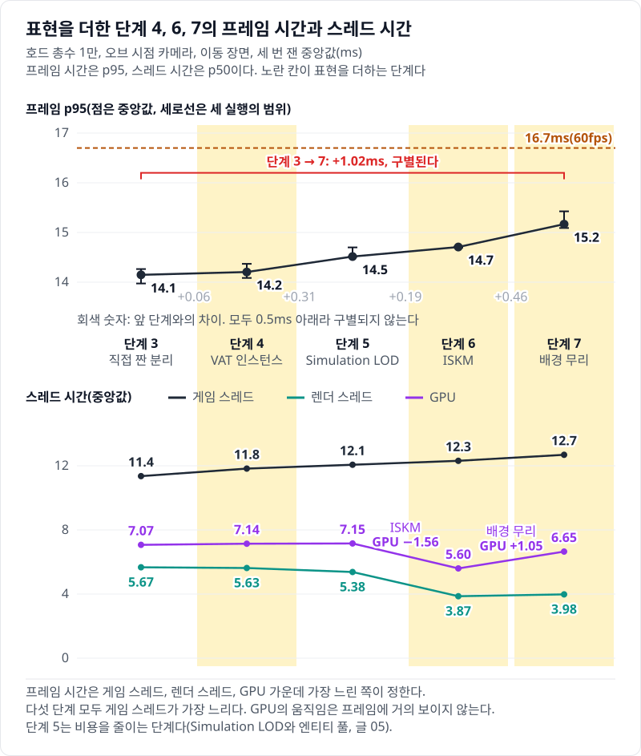
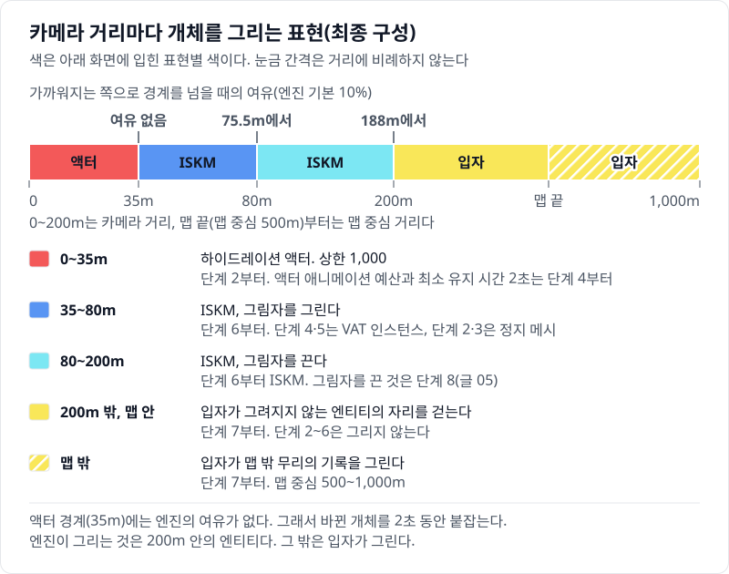

# 04 거리별 품질: 먼 개체의 표현 셋을 프레임 p95 약 1ms에 샀다

## 요약

단계 4는 35m 밖 개체를 VAT 인스턴스로 걷게 했고, 단계 6은 같은 자리를 ISKM으로 바꿨다. 단계 7은 그리지 않던 200m 밖을 Niagara 입자로 채웠다. 호드 총수 1만에서 단계마다의 프레임 p95(느린 쪽 5%의 경계) 차이는 구별되지 않는다. 단계 3에서 7까지 모으면 1.02ms 늘어, 거리별 품질을 약 1ms에 샀다. GPU 시간은 ISKM에서 1.56ms 줄고 배경 무리에서 1.05ms 늘었지만, 병목인 게임 스레드에 가려 프레임에는 거의 드러나지 않는다.



프레임 시간은 게임 스레드, 렌더 스레드, GPU 가운데 가장 느린 쪽이 정하고, 그 쪽을 병목이라 부른다. 구별되지 않는다는 것은 중앙값의 차이가 0.5ms 아래이거나 두 조건의 범위보다 작다는 뜻이다. 자세한 설명은 [00번 글](../00-goals-and-method/README.md)에 있다.


왼쪽 위 HUD의 숫자는 측정값이 아니다. 수치의 근거는 [측정 기록](measurements.md)에 있다.

> **시나리오.** 오브(Orb)가 맵 중심 둘레의 원 궤도를 2m/s로 돈다. 호드 1만이 오브를 쫓아 사방에서 걸어오고, 오브는 가까운 개체를 지우고 먼 개체를 주기적으로 쏜다. 모든 거리에서 생성·피격·사망·표현 전환이 계속 일어나게 하는 벤치마크 장치다.

## 배경 지식

### VAT

VAT(Vertex Animation Texture)는 애니메이션을 텍스처에 구워 두고 정점 셰이더가 재생하는 기법이다. 이 레포는 엔진의 AnimToTexture 플러그인으로 뼈의 프레임별 위치와 회전을 텍스처에 굽는다. 메시는 스태틱 메시라 인스턴스로 모아 그릴 수 있다. 게임 스레드의 VAT 프로세서가 인스턴스마다 이번 프레임 번호를 커스텀 데이터로 넘기면, 머티리얼이 그 프레임의 뼈로 정점을 옮긴다. 단계 4와 5는 35\~200m를 이 VAT 인스턴스로 그린다.

### ISKM

ISKM(Instanced Skinned Mesh)은 스켈레탈 메시를 인스턴스로 모아 그리고 GPU에서 스키닝하는 엔진 컴포넌트다. 애니메이션은 AnimSequence에서 뽑은 뼈 변환 데이터로 재생하고, AnimBP는 없다. 인스턴스마다 재생할 클립과 시작 시각을 트랙에 한 번 적으면 엔진이 재생을 이어 간다. 단계 6부터 35\~200m를 ISKM으로 그린다. 트랙은 [06번 글](../06-engine-findings/README.md)이 자세히 다룬다.

### Niagara 메시 입자

Niagara 메시 렌더러는 입자 하나마다 스태틱 메시 하나를 그리고, 입자의 위치는 GPU 시뮬레이션이 정한다. 이 레포는 그려지지 않는 엔티티의 위치를 매 프레임 배열로 넘기고, 이미터가 원소마다 입자를 그 프레임에만 만든다. 메시는 원본의 LOD4로 구운 VAT 메시다. Niagara가 인스턴스 커스텀 데이터 0번을 입자 번호로 쓰므로, 걷기 프레임은 Dynamic Parameter로 넘긴다.

## 문제: 단계 3의 먼 개체는 정지 메시이고, 200m 밖은 비어 있다

[03번 글](../03-separation/README.md)의 단계 3은 35m 안 개체를 액터로, 그 밖을 정지 메시 인스턴스로 그린다. 정지 메시는 애니메이션이 없어 같은 자세로 미끄러진다. 200m 밖은 엔진이 그리지 않아 지평선 앞이 빈다.

단계 3의 프레임 p95는 14.1ms다. 16.7ms까지 여유는 2.55ms다. 병목은 게임 스레드(11.4ms)이고 GPU는 7.07ms다.

## 원리: 카메라 거리마다 표현을 하나씩 맡긴다

엔진의 표현 LOD(Representation LOD)는 카메라 거리 구간마다 개체를 무엇으로 그릴지 정한다. 이 레포는 구간을 세 거리에서 나누고, 가까운 구간일수록 비싸고 정확한 표현을 쓴다. 가장 가까운 구간은 하이드레이션(Hydration, 가까운 엔티티에만 진짜 액터를 붙이는 일) 액터다.




색과 거리 구간은 바로 위 그림과 같다. 80m 밖 그림자는 단계 8이 껐다([05번 글](../05-cost-cuts-and-contributions/README.md)). 이 화면은 Development 빌드에서 색을 입혀 찍었고 측정값이 아니다. 구간은 엔티티 구성을 만드는 코드가 정한다.

[`Source/HordeOptLab/LabCrowdSubsystem.cpp`](../../Source/HordeOptLab/LabCrowdSubsystem.cpp), `ULabCrowdSubsystem::BuildEntityConfig`

```cpp
const float Bands[EMassLOD::Max] = { 0.f, HydrateCm, 8000.f, FLabConfig::Get().RepOffCm() };
const int32 MaxCounts[EMassLOD::Max] = { FLabConfig::Get().ActorCap, 5000, MAX_int32, MAX_int32 };
// ...
Visual->Params.LODRepresentation[EMassLOD::Off] = EMassRepresentationType::None;
```

첫 줄은 네 구간이 시작하는 거리(cm)이고, `HydrateCm`은 35m, `RepOffCm`은 200m다. 둘째 줄의 첫 값이 액터 상한 1,000이다. 끝 줄 때문에 엔진은 200m 밖을 그리지 않는다.

예상: 단계 3의 GPU 시간은 게임 스레드보다 4.29ms 짧다. 표현이 GPU에 싣는 비용은 이 차이를 넘기 전까지 프레임 시간에 보이지 않을 것이다. 게임 스레드에 싣는 비용은 그대로 프레임에 더해질 것이다.

## 바꾼 것

### 단계 4: VAT 인스턴스, 액터 애니메이션 예산, 최소 유지 시간

단계 4는 네 가지를 함께 켠다.

1. 35\~200m의 정지 메시를 VAT 인스턴스로 바꿨다. 갱신은 `ULabVatISMProcessor`가 맡는다.
2. 액터 메시를 `USkeletalMeshComponentBudgeted`로 바꿨다. Animation Budget Allocator의 예산은 4ms로 두고, 화면 크기를 중요도로 넘긴다.
3. 바뀐 개체가 2초 안에 바로 전의 표현으로 돌아가지 못하게 붙잡는다(최소 유지 시간).
4. 전환 대책 다섯을 켰다. 액터의 포즈가 준비될 때까지 인스턴스를 그리는 일처럼, 전환 순간의 화면 튐을 막는 일이다.


단계 4와 5는 표현이 같아, 같은 방식으로 찍은 단계 5 화면을 실었다. 단계 4의 움직이는 화면은 [step4-vat-budget.webp](../../Docs/figures/steps/step4-vat-budget.webp)다.

최소 유지 시간을 둔 까닭은 엔진이 개체가 가까운 구간으로 들어올 때만 경계에 여유를 두기 때문이다.

`Engine/Plugins/Runtime/MassGameplay/Source/MassLOD/Public/MassLODCalculator.h`, `TMassLODCalculator::ComputeLODFromSettings`

```cpp
for (; LODDistIdx > 0; LODDistIdx--)
{
	if (DistanceToViewerSq >= AdjustedLODDistanceSq[LODDistIdx])
	{
		// ...
		if (PrevLOD != EMassLOD::Max && (PrevLOD - (EMassLOD::Type)LODDistIdx) == 1)
		{
			// ...
			float HysteresisDistance = FMath::Lerp(AdjustedLODDistance[LODDistIdx], AdjustedLODDistance[LODDistIdx + 1], 1.f - BufferHysteresisOnDistanceRatio);
			if (DistanceToViewerSq >= FMath::Square(HysteresisDistance))
			{
				// Keep old
				LODDistIdx = PrevLOD;
```

한 칸 가까운 구간으로 들어오는 개체는 그 구간 폭의 10%만큼 더 와야 바뀐다. 그래서 200m 경계는 188m에서 넘는다. 반복이 `LODDistIdx > 0`에서 멈춰, 액터 구간(High, 0번)에는 이 여유가 없다. 그래서 액터 경계 근처의 개체는 액터와 인스턴스 사이를 짧게 오갈 수 있다.

Lab 프로세서가 엔진이 표현을 바꾸기 전에 그런 개체를 붙잡는다.

[`Source/HordeOptLab/LabMassProcessors.cpp`](../../Source/HordeOptLab/LabMassProcessors.cpp), `ULabRepHoldProcessor::Execute`

```cpp
const bool bReverse = Last && Now - Last->Time < HoldSec && Last->From == Wanted && Last->To == Current;
// ...
if (Current == 0)
{
	// 액터 → 인스턴스(또는 없음)를 막는다: 이번 프레임도 High로 남긴다
	HeldDemotions.Add({ &L, uint8(L.LOD), Key });
	L.LOD = EMassLOD::High;
	// ...
}
else
{
	// ...
	L.LOD = EMassLOD::Type(Restore);
}
```

`bReverse`는 2초 안에 바로 전의 표현으로 돌아가려는 개체다. 액터였던 개체는 High로 남기고, 인스턴스였던 개체는 지난 LOD로 되돌린다. 이 단계의 변수 넷 각각의 몫은 최종 구성에서 하나씩 끈 조건이 가른다([05번 글](../05-cost-cuts-and-contributions/README.md)).

### 단계 6: 35\~200m를 ISKM으로

단계 6은 35\~200m의 VAT 인스턴스를 ISKM으로 바꿨다. `ULabIskmProcessor`가 개체마다 위치와 사망 색을 매 프레임 넘기고, 상태가 바뀐 개체의 트랙만 다시 쓴다.

ISKM 컴포넌트에는 카메라를 따라 옮기는 고정 바운드 상자를 넣었다. 엔진은 상자가 없으면 바운드를 셈할 때 인스턴스를 모두 돈다. 최종 구성에서 이 상자를 끈 조건은 프레임 p95가 0.66ms 길다.

ISKM의 엔진 문제 셋을 피하려고 트랙 미리 늘리기, 가산 클립 복제, 엔티티 풀을 넣었다. 원인과 코드는 [06번 글](../06-engine-findings/README.md)에 있다.

### 단계 7: 200m 밖을 배경 무리로

단계 7은 200m 밖 개체를 Niagara 메시 입자로 그린다. `ULabCrowdFxGatherProcessor`가 엔진이 그리지 않는 걷는 엔티티의 자리, 시각, 걷기 위상을 모아 Niagara에 넘긴다.

[`Source/HordeOptLab/LabCrowdFxProcessor.cpp`](../../Source/HordeOptLab/LabCrowdFxProcessor.cpp), `ULabCrowdFxGatherProcessor::Execute`

```cpp
if (Representations[It].CurrentRepresentation != EMassRepresentationType::None)
{
	++Drawn;
	continue;
}
// ...
const FVector Location = Transforms[It].GetTransform().GetLocation();
// ...
Out.Emplace(float(Location.X), float(Location.Y), T0, -Anim.StateStartTime);
// ...
UNiagaraDataInterfaceArrayFunctionLibrary::SetNiagaraArrayVector4(Fx, SmallName, TConstArrayView<FVector4f>(Recs[LabUnitSmall]));
```

입자는 GPU에서 받은 자리부터 오브 쪽으로 걸은 자리를 셈한다. 200m 밖 엔티티는 1초마다만 옮겨지므로, 그 사이를 입자가 메운다. 맵 밖(맵 중심 500\~1,000m)은 맵 밖 무리의 기록을 같은 배열 뒤에 붙여 그린다.

## 결과: 단계마다는 구별되지 않고, 모으면 1.02ms다

단계 4의 차이는 +0.06ms, 단계 6은 +0.19ms다. 단계 7은 +0.46ms로 범위를 넘지만 0.5ms 아래라 구별되지 않는다. 사이의 단계 5도 +0.31ms로 구별되지 않는다.

단계 3과 7을 견주면 프레임 p95가 1.02ms 늘었고, 이 차이는 구별된다. 이 값에는 비용을 줄이려던 단계 5의 몫도 들어 있다. 단계 5의 몫만 따로 뺄 수는 없다. 단계 7의 프레임 p95는 15.2ms다. 16.7ms까지 여유는 1.53ms다.

GPU 시간은 프레임과 따로 움직였다. ISKM이 GPU 시간을 7.15ms에서 5.60ms로 줄였다. 같은 단계에서 렌더 스레드도 5.38ms에서 3.87ms로 줄었다. 배경 무리는 GPU 시간을 6.65ms로 다시 늘렸다. 셋 다 구별되는 차이다.

병목은 다섯 단계 모두 게임 스레드다. GPU는 어느 단계에서도 게임 스레드보다 4ms 넘게 짧다. 그래서 GPU의 움직임은 프레임 시간에 거의 드러나지 않았다. 게임 스레드는 단계 3에서 7까지 1.33ms 늘었다.

화면에서는 35\~200m 개체가 걷고, 단계 7부터 지평선 앞까지 무리가 찬다. 단계 8은 80m 밖 그림자를 끄고 액터 메시 바운드를 고정해 프레임 p95를 0.94ms 되찾는다([05번 글](../05-cost-cuts-and-contributions/README.md)).

### 프레임에는 보이지 않는 이점

최소 유지 시간의 이점은 왕복 전환에서 보인다. 왕복 전환은 2초 안에 같은 경계를 반대로 되넘은 수다. 최종 구성에서 이 규칙만 끄면 왕복 전환이 초당 4.34건 생긴다. 모두 액터 경계에서 났고, 규칙을 켜면 0건이다. 프레임 p95의 차이는 구별되지 않는다.

액터 애니메이션 예산은 상한으로 일한다. 단계 4에서 액터 메시의 애니메이션 시간은 4.03ms로 예산에 닿는다. 이때 Budget Allocator는 소형 액터를 프레임의 7.02%에서 갱신도 보간도 하지 않는다. 최종 구성에서는 이 시간이 2.71ms라 예산 아래다. 그래서 예산을 끈 조건의 프레임 p95는 구별되지 않는다.

전환 대책 다섯은 전환 순간의 화면을 고치는 일이고, 이 측정에는 그것을 세는 지표가 없다. 끈 조건의 프레임 p95는 최종 구성과 같다.

## 한 문장으로

거리별로 표현을 셋 더하는 데 프레임 p95 약 1ms를 썼고, GPU에 실린 비용은 병목인 게임 스레드에 가려 프레임에 거의 드러나지 않았다.

- 표현의 비용은 어느 스레드에 실리는지가 정한다. GPU에 실리는 표현은 GPU가 병목이 되기 전까지 프레임에 보이지 않는다.
- 최소 유지 시간과 Budget Allocator의 이점은 프레임 시간이 아니라 왕복 전환과 건너뛴 갱신 같은 지표에서 보인다.
- 단계 3에서 7까지 늘어난 게임 스레드 시간이 어느 프로세서의 몫인지는 트레이스로 가르지 않았다.

[다음 글](../05-cost-cuts-and-contributions/README.md)에서는 비용을 줄이는 단계 5와 8, 그리고 최종 구성에서 기법을 하나씩 끈 기여를 본다.
