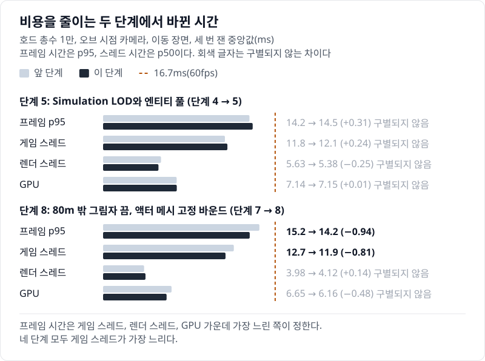
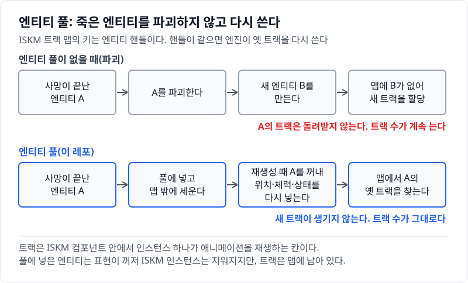
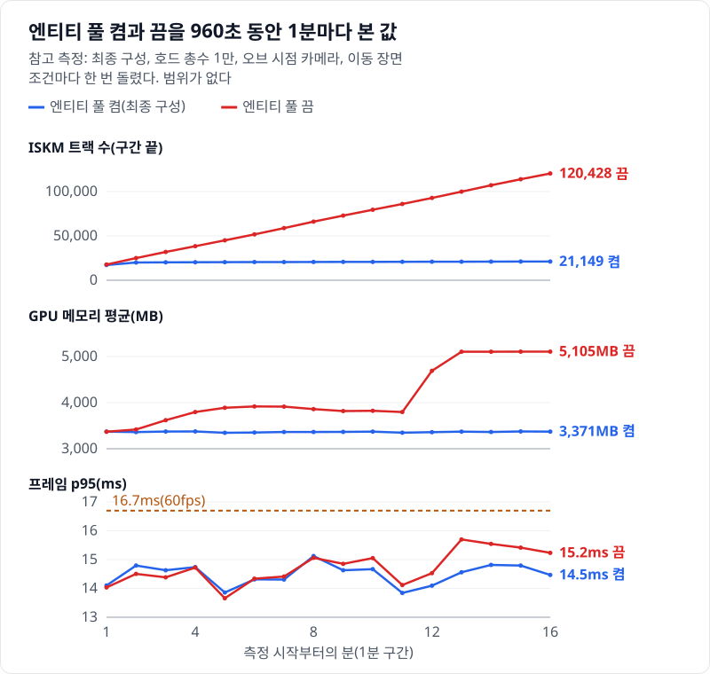

# 05 비용을 줄이는 단계와 기법별 기여: 최종 구성의 큰 비용은 가까운 액터에 있다

## 요약

단계 8은 액터 메시의 바운드를 고정하고 80m 밖 인스턴스의 그림자를 껐다. 호드 총수 1만에서 게임 스레드가 줄어 프레임 p95(느린 쪽 5%의 경계)가 0.94ms 줄었다. 단계 5는 Simulation LOD와 엔티티 풀을 넣었지만 프레임 p95가 0.31ms 늘었고, 이 차이는 구별되지 않았다. 최종 구성에서 기법을 하나씩 끄면 가장 큰 비용은 가까운 개체의 액터이고, 가장 큰 절약은 200m 밖을 그리지 않는 일이다. 최종 구성의 프레임 p95는 14.2ms이고 16.7ms까지의 여유는 2.47ms다.



프레임 시간은 게임 스레드, 렌더 스레드, GPU 가운데 가장 느린 쪽이 정한다. 그 쪽을 병목이라 부른다. 구별되지 않는다는 것은 중앙값의 차이가 0.5ms 아래이거나 두 조건의 범위 가운데 큰 쪽을 넘지 않는다는 뜻이다. 지표의 자세한 설명은 [목표 사양과 재는 법](../00-goals-and-method/README.md)에 있다.


*단계 8 화면. HUD 숫자는 측정값이 아니다.*

수치의 근거는 [측정 기록](measurements.md)에 있다.

> **시나리오.** 오브(Orb)가 맵 중심 둘레의 원 궤도를 2m/s로 돈다. 호드 1만이 오브를 쫓아 사방에서 걸어오고, 오브는 가까운 개체를 지우고 먼 개체를 주기적으로 쏜다. 모든 거리에서 생성·피격·사망·표현 전환이 계속 일어나게 하는 벤치마크 장치다.

## 배경 지식

### Simulation LOD

Simulation LOD는 카메라와의 거리로 개체의 로직을 얼마나 자주 돌릴지 정하는 Mass 기능이다. 엔진은 거리 등급마다 LOD 태그를 붙이고 등급마다 틱 간격을 둔다. 간격을 따르는 것은 청크 필터 `ShouldTickChunkThisFrame`을 건 프로세서뿐이다. 엔진의 이동·조향 프로세서는 가장 먼 Off 등급의 개체를 쿼리에서 뺀다.

### 스켈레탈 메시의 바운드

바운드는 메시를 감싸는 상자와 구다. 엔진은 화면 컬링과 메시 LOD 고르기에 바운드를 쓴다. 스켈레탈 메시는 애니메이션을 갱신할 때마다 피직스 에셋의 바디별 상자로 바운드를 다시 셈한다. `bComponentUseFixedSkelBounds`를 켜면 메시 에셋에 저장된 바운드에 루트 뼈의 이동만 더한다.

## 단계 5: Simulation LOD와 엔티티 풀은 프레임 시간을 줄이지 못했다

[거리별 품질](../04-quality-by-distance/README.md)의 단계 4는 게임 스레드가 병목이다. 단계 5는 두 기법을 함께 넣었다.

첫째는 Simulation LOD다. 80m 안의 개체는 지금처럼 매 프레임 돈다. 그 밖에서 200m까지는 자체 로직인 접근과 범위 피해만 0.5초 간격으로 돈다. 200m 밖은 Off 등급이라 엔진 이동·조향에서 빠지고, 자체 프로세서가 1초 간격으로 그 개체를 오브 쪽으로 옮긴다. 둘째는 엔티티 풀이고 아래 절에서 따로 다룬다.

호드 총수 1만에서 프레임 p95가 0.31ms 늘었다. 이 차이는 0.5ms 아래라 구별되지 않는다. 단계 5는 비용을 줄이려던 단계지만 잰 값으로는 줄지 않았다. 최종 구성에서 하나씩 꺼도 같다. Simulation LOD를 끈 조건은 0.24ms 짧고, 엔티티 풀을 끈 조건은 0.01ms 길다. 둘 다 구별되지 않는다.

## 단계 8: 액터 메시의 바운드를 고정해 게임 스레드를 줄였다

단계 6과 7이 ISKM과 배경 무리를 더해, 단계 7의 프레임 p95는 15.2ms가 되었다. 단계 8은 변수 둘을 함께 바꿨다. 하나씩의 몫은 기법별 기여(최종 구성에서 기법 하나만 끄고 잰 차이)가 가른다. 프레임 시간을 줄인 쪽은 액터 메시의 바운드 고정이다.

`Source/HordeOptLab/LabMinion.cpp`, `ALabMinionMassActor::BeginPlay`

```cpp
SkelMesh->bComponentUseFixedSkelBounds = FLabConfig::Get().bFixedSkelBounds;
if (FLabConfig::Get().bFixedSkelBounds)
{
	SkelMesh->SetBoundsScale(FLabQuality::FixedSkelBoundsScale);
}
```

첫 줄이 고정 바운드를 켠다. 넷째 줄이 바운드를 1.1배로 키운다. 메시 에셋의 바운드가 피직스 에셋으로 셈한 바운드보다 작아서다.

결과는 프레임 p95가 0.94ms 줄어 14.2ms다. 준 것은 게임 스레드로, 12.7ms에서 11.9ms가 되었다. GPU 시간도 0.48ms 줄었지만, 0.5ms 아래라 구별되지 않는다.

기법별 기여로 나누면 거의 다 고정 바운드의 몫이다. 액터 메시 고정 바운드를 끈 조건은 프레임 p95가 0.98ms 길다. 그 조건에서는 액터 메시의 애니메이션 시간도 2.71ms에서 3.63ms로 는다. 엔진은 이 시간 안에서 애니메이션을 마무리하며 바운드를 다시 셈한다.

단계 8이 바꾼 다른 변수는 그림자다. 80m 밖 ISKM 인스턴스와 200m 밖 입자의 그림자를 껐다. 그림자를 다시 켠 조건은 프레임 p95가 0.07ms, GPU 시간이 0.48ms 길고, 둘 다 구별되지 않는다. 병목이 게임 스레드라서 GPU 시간은 프레임 시간을 정하지 않는다.

## 기법별 기여: 최종 구성에서 하나씩 껐을 때

기법별 기여는 최종 구성에서 기법 하나만 끄고 같은 조건으로 세 번 잰 값과 최종 구성의 차이다. 끄면 프레임이 길어지는 기법은 시간을 줄이고, 짧아지는 기법은 시간을 쓴다.


가장 큰 비용은 가까운 개체의 액터다. 하이드레이션(Hydration, 가까운 엔티티에만 진짜 액터를 붙이는 일)을 끈 조건은 프레임 p95가 6.98ms 짧다. 게임 스레드가 5.23ms로 줄어, 병목이 GPU(6.21ms)로 바뀐다. 이 조건은 액터가 없어 캡슐, 액터 애니메이션 예산, 액터 메시 고정 바운드도 함께 빠지므로 참고 값이다. 액터 애니메이션 예산은 액터 메시를 `USkeletalMeshComponentBudgeted`로 바꾸고 예산을 4ms로 둔 것이다.

액터 캡슐만 끈 조건도 1.86ms 짧다. 두 조건은 모든 단계가 하는 일인 가까운 개체의 캡슐 콜리전을 뺀다. 그래서 최종 구성은 둘을 켠 채 둔다. ISKM과 배경 무리를 끈 조건도 다른 것이 함께 빠지는 참고 값이다(그림 아래 글).

가장 큰 절약은 200m 밖을 그리지 않는 일이다. 이 일을 끄면 200m 밖 엔티티가 맵 끝까지 ISKM으로 그려진다. 그러면 프레임 p95가 3.54ms 길어진다. 게임 스레드가 11.9ms에서 15.1ms로 는다.

분리 프로세서를 엔진 회피로 바꾼 하위 실험은 8.57ms 길다. 이 차이는 [직접 짠 분리](../03-separation/README.md)가 다룬다.

나머지 열 행은 구별되지 않는다. 그중 둘은 다른 값으로 이점이 보인다. 최소 유지 시간은 바뀐 표현을 2초 동안 붙잡는 규칙이다. 이 규칙을 끄면 왕복 전환(2초 안에 같은 경계를 되넘은 수)이 초당 4.34건 생긴다. 엔티티 풀은 다음 절에서 본다.

## 엔티티 풀: 죽은 엔티티를 지우지 않고 다시 쓴다

엔티티 풀은 죽은 개체의 엔티티를 파괴하지 않고 종류별 풀에 넣었다가, 재생성 때 다시 쓰는 방식이다. 이 레포가 풀을 쓰는 까닭은 ISKM의 애니메이션 트랙이다. ISKM(Instanced Skinned Mesh)은 GPU에서 스키닝하는 인스턴스 스켈레탈 메시이고 단계 6부터 35\~200m를 그린다.

트랙은 인스턴스 하나의 재생 상태를 담는 칸이다. 엔진은 엔티티가 ISKM 컴포넌트에 처음 들 때 트랙을 하나 잡는다. 그런데 움직이는 엔티티를 파괴하면 그 트랙을 돌려받지 않는다. 풀은 엔티티를 파괴하지 않으므로 같은 핸들이 옛 트랙을 다시 쓴다.



문제는 엔진 코드의 두 곳에 있다.

`Engine/Plugins/Runtime/MassGameplay/Source/MassRepresentation/Private/MassVisualizationComponent.cpp`, `UMassVisualizationComponent::EndVisualChanges`

```cpp
auto TrackElementId = TrackMap.FindOrAddId(EntityHandlesWithPendingUpdates[IDIndex], 0, bAlreadyPresent);
// ...
		TrackId = TrackMap.GetByElementId(TrackElementId).Value = ASTPDI->AllocateTrack();
// ...
// Collect unwanted items & remove
for (TConstSetBitIterator<> BitIt(Unprocessed); BitIt; ++BitIt)
{
	// ...
		SharedIdMap.RemoveByElementId(ElementId);
		RemovedInstancedSkinnedMeshInstanceIds.Add(InstanceId);
	// ...
}
InstancedSkinnedMeshComponent->RemoveInstances(RemovedInstancedSkinnedMeshInstanceIds);
```

첫 줄은 엔티티 핸들을 키로 트랙 맵을 찾는다. 맵에 없을 때만 셋째 줄이 트랙을 새로 잡는다. 아래 반복은 이번 프레임에 갱신되지 않은 움직이는 인스턴스를 지운다. 이 반복은 인스턴스 맵만 비우고 트랙 맵은 건드리지 않는다.

트랙을 돌려받는 `DeallocateTrack`은 정지 표현 엔티티를 지우는 경로에서만 불린다. 그래서 움직이는 엔티티를 파괴하면 트랙이 남는다. 같은 문제를 다룬 [Epic 개발자 포럼 글](https://forums.unrealengine.com/t/mass-crowds-using-skinnedmeshinstance-leak-gpu-memory-every-wave-of-spawned-and-killed-entities-permanently-grows-the-animation-track-pool-5-8/2742508)이 있다. 원인 코드는 [엔진을 고치지 않고 피한 문제 다섯](../06-engine-findings/README.md)에서 자세히 본다.

이 레포는 상태 프로세서가 사망이 끝난 엔티티를 풀로 넘기고, 재생성이 풀의 엔티티를 먼저 꺼낸다.

`Source/HordeOptLab/LabCrowdSubsystem.cpp`, `ULabCrowdSubsystem::SpawnEntities`

```cpp
const int32 NumReuse = bPool ? FMath::Min(EntityPool[Type].Num(), Indices.Num()) : 0;
for (int32 k = 0; k < NumReuse; ++k)
{
	const int32 i = Indices[k];
	const FMassEntityHandle Entity = EntityPool[Type].Pop(EAllowShrinking::No);
	ReinitPooledEntity(EntityManager, Entity, Locations[i], Serials[i]);
	// ...
	Reused.Add(Entity);
}
```

풀에 모자란 수만 새로 만든다. 단계 5에서는 35\~200m가 아직 VAT 인스턴스라 트랙이 없다. 풀이 막는 누수는 단계 6에서 ISKM을 넣은 뒤에 생긴다.

워밍업과 측정을 합친 한 실행은 240초다. 실행이 끝날 때 ISKM 트랙은 풀을 켜면 20,215개, 끄면 30,797개다. 그래도 프레임 p95의 차이는 0.01ms로 구별되지 않는다. 그래서 같은 최종 구성을 풀 켬과 풀 끔으로 960초씩 한 번 더 돌렸다.



풀을 끄면 ISKM 트랙이 분당 약 6,850개씩 늘어 마지막 구간에 120,428개다. 풀을 켜면 3분 구간 뒤로 분당 약 70개만 는다. 풀을 끈 실행은 GPU 메모리가 12분 구간에서 계단처럼 뛰어 5,110MB가 된다. 13분 구간부터는 풀을 끈 실행의 프레임 p95가 매 구간 0.6ms 넘게 높다.

렌더러는 인스턴스가 없는 트랙도 매 프레임 평가한다. 풀을 끈 실행의 GPU 시간(중앙값)은 첫 구간 6.08ms, 마지막 구간 7.22ms다.

## 한 문장으로

비용을 줄이는 단계 5와 8에서 프레임 시간을 줄인 것은 액터 메시 고정 바운드이고, 엔티티 풀의 이점은 긴 실행에서 보인다.

- 단계 5가 프레임 시간을 줄이지 못한 원인은 가르지 않았다.
- 하이드레이션, ISKM, 배경 무리를 끈 조건은 다른 것이 함께 빠져서 기법 하나의 몫이 아니다.
- 긴 실행은 조건마다 한 번이라 범위가 없다.

[다음 글](../06-engine-findings/README.md)에서는 ISKM 트랙 누수를 비롯해 엔진에서 찾은 문제와 이 레포의 우회를 다룬다. 여덟 단계의 결과는 [07 요약](../07-summary/README.md)에 모았다.
