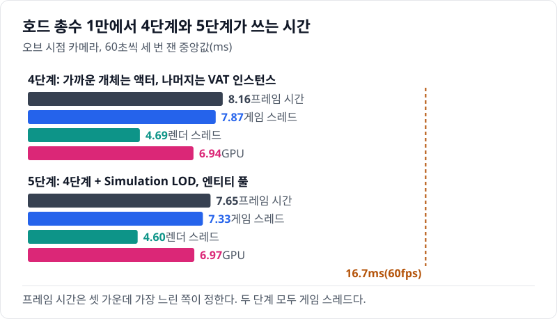
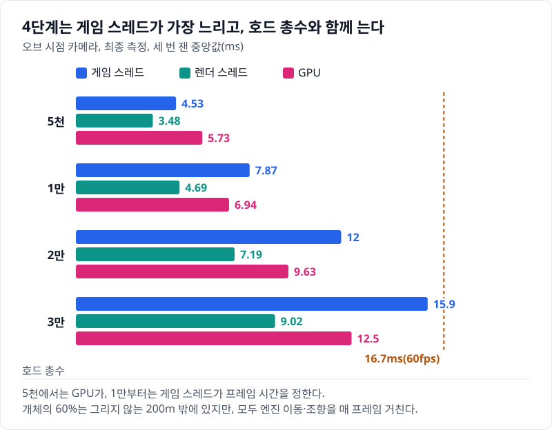
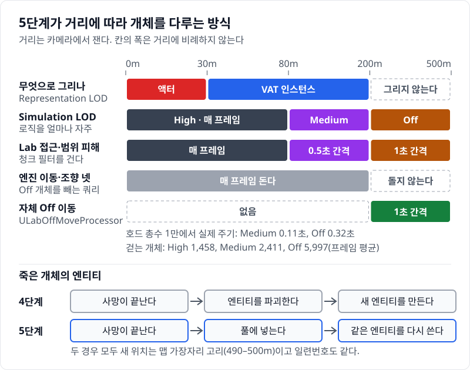
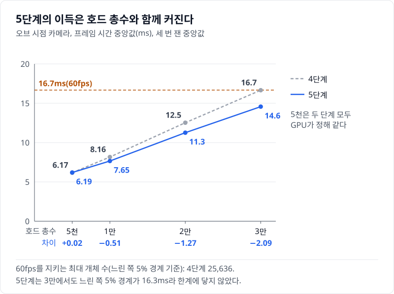
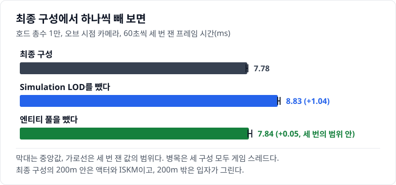
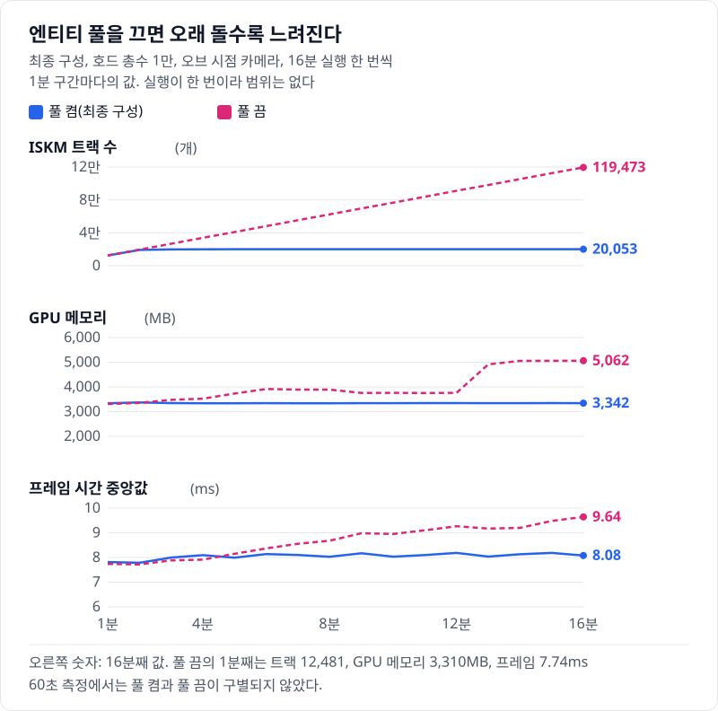

# 05 먼 개체를 엔진 이동에서 빼자 게임 스레드가 줄었다: Simulation LOD와 엔티티 풀

## 요약

5단계는 카메라에서 먼 개체의 로직을 덜 자주 돌리고, 200m 밖 개체는 엔진 이동·조향 대신 자체 Processor로 옮긴다. 그리고 죽은 개체의 엔티티를 파괴하지 않고 풀에 두었다가 다시 쓴다. 호드 총수 1만, 오브 시점 카메라에서 프레임 시간이 9.42ms에서 8.57ms로 줄었다. 준 것은 게임 스레드다. 60fps를 지키는 최대 개체 수는 약 2만에서 약 2만 3천으로 늘었다.



프레임 시간은 게임 스레드, 렌더 스레드, GPU 가운데 가장 느린 쪽이 정한다. 두 단계 모두 게임 스레드가 가장 느리다. 지표의 자세한 설명은 [00번 글](../00-goals-and-method/README.md)에 둔다.

엔티티 풀의 효과는 60초 측정에서 보이지 않는다. 16분 동안 돌린 실행에서 풀을 끄면 프레임 시간이 계속 늘었다.


수치의 근거는 [측정 기록](measurements.md)에 있다.

> **시나리오.** 플레이어는 움직이지 않는다. 맵 중앙의 오브(Orb)를 향해 개체가 사방에서 걸어오고, 오브는 가까운 개체를 지우고 먼 개체를 주기적으로 쏜다. 모든 거리에서 생성·피격·사망·표현 전환이 계속 일어나게 하는 벤치마크 장치다.

## 배경 지식

### Simulation LOD

Simulation LOD는 카메라와의 거리로 개체의 로직을 얼마나 자주 돌릴지 정하는 Mass 기능이다. 표현 LOD처럼 High·Medium·Low·Off 네 등급을 매긴다. 등급을 매기는 것은 엔진 Processor `UMassSimulationLODProcessor`다. 엔진은 등급마다 LOD 태그를 붙이고, 등급마다 틱 간격을 둘 수 있게 한다. 5단계는 80m와 200m를 경계로 둔다.

### 가변 틱과 청크 필터

Mass는 같은 태그를 가진 엔티티를 같은 청크에 모은다. 가변 틱을 켜면 엔진이 청크마다 "이번 프레임에 돈다"는 값을 정한다. Processor가 쿼리에 청크 필터 `ShouldTickChunkThisFrame`를 걸어야 그 값을 따른다. 필터를 걸지 않은 Processor는 Simulation LOD를 켜도 매 프레임 모든 청크를 돈다.

### 엔티티 풀

엔티티 풀은 죽은 개체의 엔티티를 파괴하지 않고 모아 두었다가 새 개체에 다시 쓰는 방식이다. 엔티티 핸들이 그대로 남으므로, 핸들을 키로 쓰는 엔진 자료도 그대로 다시 쓰인다. 5단계는 위치·체력·상태만 다시 넣는다.

## 문제: 4단계는 게임 스레드가 프레임을 정하고, 그리지 않는 개체도 매 프레임 옮긴다

[04번 글](../04-hydration-anim-budget/README.md)에서는 30m 안의 개체를 AnimBP 액터로 바꿨다. 호드 총수 1만에서 게임 스레드가 9.14ms로 GPU 6.93ms보다 길다. 렌더 스레드는 4.82ms다. 게임 스레드는 호드 총수와 함께 늘어 3만에서 18.2ms다.



개체의 60%는 200m 밖에 있고, 3단계부터 그 개체는 그리지 않는다. 그래도 걷는 개체는 모두 엔진의 조향·힘 적용·이동·회전 Processor 넷을 매 프레임 거친다.

## 원리: 먼 개체는 덜 자주 생각하고, 200m 밖은 엔진 이동에서 뺀다

5단계는 거리를 셋으로 나눈다. 80m 안은 지금처럼 매 프레임 돈다. 80\~200m는 자체 로직(접근, 범위 피해)만 0.5초 간격으로 돈다. 200m 밖은 Off 등급이다.



엔진은 Off 개체에 `FMassOffLODTag`를 붙인다. 엔진의 힘 적용·이동·조향 Processor는 이 태그를 가진 개체를 쿼리에서 뺀다. 회전 Processor는 틱이 온 청크만 따로 처리한다. 그래서 200m 밖 개체는 넷을 매 프레임 거치지 않는다. 대신 자체 Processor가 간격(1초)마다 한 번 그 개체를 오브 쪽으로 옮긴다.

엔진에도 Off 개체를 옮기는 Processor `UMassOffLODNavigationProcessor`가 있다. 그러나 이 Processor는 개체를 이동 목표의 중심으로 순간 이동시킨다. 이 시나리오의 이동 목표는 오브다. 그래서 등록하지 않았다.

`Source/HordeOptLab/LabMassProcessors.cpp`, `ULabOffMoveProcessor`

```cpp
EntityQuery.AddTagRequirement<FMassOffLODTag>(EMassFragmentPresence::All);
LabUseVariableTick(EntityQuery);
// ...
double& LastMove = OffMoves[It].LastMoveTime;
const float Seconds = LastMove > 0. ? float(Now - LastMove) : FrameDelta;
LastMove = Now;
// ...
FVector ToOrb = Orb - Transform.GetLocation();
ToOrb.Z = 0.;
const double Distance = ToOrb.Length();
// ...
const FVector Direction = ToOrb / Distance;
Transform.AddToTranslation(Direction * FMath::Min(double(Speed * Seconds), Distance));
Movements[It].DesiredVelocity = Direction * Speed;
```

첫 두 줄이 Off 개체만, 그리고 틱이 온 청크만 고른다. 나머지는 마지막으로 옮긴 뒤 흐른 시간 × 걷는 속도만큼 오브 쪽으로 곧게 옮긴다.

**예상.** 호드 총수 1만에서 걷는 개체는 프레임 평균 9,866이다. 그 가운데 5,997이 200m 밖이다. 엔진 이동·조향이 처리하는 개체는 3,869로, 39%가 된다. 그 넷의 비용도 39% 근처로 줄 것이다.

## 바꾼 것: Simulation LOD Trait, 청크 필터, Off 이동 Processor, 엔티티 풀

4단계에서 네 가지를 바꿨다. 엔티티 구성에 `ULabSimulationLODTrait`을 붙였다. 자체 접근·범위 피해 Processor의 쿼리에 청크 필터를 걸었다. 저격과 피격·사망 타이머에는 걸지 않았다. 게임 모듈이 `ULabOffMoveProcessor`를 등록하고 `UMassOffLODNavigationProcessor`를 등록하지 않는다([HordeOptLab.cpp](../../Source/HordeOptLab/HordeOptLab.cpp)). 엔티티 풀의 코드는 아래 "엔티티 풀" 절에 있다.

`Source/HordeOptLab/LabMassTraits.cpp`, `ULabSimulationLODTrait::ULabSimulationLODTrait`

```cpp
Params.LODDistance[EMassLOD::Medium] = FLabSimLod::MediumDistance;
Params.LODDistance[EMassLOD::Low] = FLabSimLod::LowDistance;
// ...
bEnableVariableTicking = true;
// ...
VariableTickParams.TickRates[EMassLOD::Medium] = Sim.TickMedium;
// ...
VariableTickParams.TickRates[EMassLOD::Off] = Sim.TickLow;
```

`MediumDistance`는 80m, `LowDistance`는 200m다. 200m 밖은 Low 대신 Off이고, 간격은 Medium 0.5초, Off 1초다.

`Source/HordeOptLab/LabMassProcessors.cpp`, `LabUseVariableTick`

```cpp
Query.AddChunkRequirement<FMassSimulationVariableTickChunkFragment>(EMassFragmentAccess::ReadOnly, EMassFragmentPresence::Optional);
Query.SetChunkFilter(&FMassSimulationVariableTickChunkFragment::ShouldTickChunkThisFrame);
```

이 함수를 부른 쿼리만 간격을 따른다. 이 쿼리를 쓰는 Processor는 엔진 LOD 그룹 뒤에 돌도록 실행 순서를 지정했다. 지정하지 않으면 한 주기를 통째로 건너뛸 수 있다.

간격은 개체가 스스로 하는 갱신인 접근과 범위 피해에만 걸었다. 저격은 오브가 대상을 고르는 질의이고, 피격·사망 타이머는 사건으로 시작된 짧은 상태다. 이 둘은 매 프레임 돈다.

앞선 변형은 피격·사망 타이머에도 간격을 걸었다. 그러자 80m 밖에서 저격당한 개체가 피격의 마지막 자세로 멈춰 서 있다가 늦게 사망으로 넘어갔다. 상태 Processor가 틱이 온 프레임에만 피격이 끝났는지 보므로, 피격 클립이 끝나도 다음 틱까지 기다렸다.

이 단계에서 바뀐 변수는 둘이다. Simulation LOD(Off 이동 포함)와 엔티티 풀이다. 풀만 뺀 사다리 단계는 최종 측정에 없다. 표현, 그림자, 시나리오는 4단계와 같다.

## 결과: 게임 스레드가 0.883ms 줄었고, 이득은 호드 총수와 함께 커졌다

호드 총수 1만에서 프레임 시간은 0.852ms 줄었다. 게임 스레드가 0.883ms 줄었다. GPU는 6.93ms에서 6.97ms로 세 번 잰 범위 안이다. 병목은 그대로 게임 스레드다.

이득은 호드 총수와 함께 커진다. 2만에서는 1.49ms 줄었다. 3만에서는 2.01ms 줄었다. 5천에서는 두 단계 모두 GPU가 프레임을 정해 차이가 없다. 60fps를 지키는 최대 개체 수는 4단계가 약 2만, 5단계가 약 2만 3천이다.



Unreal Insights로 트레이스에서 게임 스레드의 프레임 평균을 읽었다. 호드 총수 1만에서 Processor를 한 스레드에 돌린 실행이라, 위의 측정값과 견주지 않는다.

엔진 이동·조향 Processor 넷(`UMassApplyForceProcessor`, `UMassApplyMovementProcessor`, `UMassSteerToMoveTargetProcessor`, `UMassSmoothOrientationProcessor`)의 합은 4단계에서 프레임당 1.70ms였고, 5단계에서 0.748ms다. 5단계의 합은 4단계의 44.1%다. 처리하는 개체는 39%로 줄었으니, 시간은 예상보다 조금 덜 줄었다. 200m 밖을 움직이는 `LabOffMoveProcessor`는 0.008ms다.


위 값은 구간 합계를 구간의 프레임 수로 나눈 것이다.

설정한 간격과 실제로 도는 주기는 달랐다. 호드 총수 1만에서 잰 값이다. Medium 간격은 0.5초로 두었지만, 실제로는 0.113초마다 돌았다. Off 간격은 1초로 두었지만, 실제로는 0.328초마다 돌았다. 엔진은 엔티티가 드나든 청크를 간격과 상관없이 다음 프레임에 돌린다.

`Engine/Plugins/Runtime/MassGameplay/Source/MassLOD/Public/MassLODTickRateController.h`, `TMassLODTickRateController`

```cpp
bShouldTickThisFrame = TimeUntilNextTick <= 0.0f || LastChunkSerialModificationNumber != NewChunkSerialModificationNumber;
```

뒤 조건이 "청크에 엔티티가 들어오거나 나갔다"다. 이 호드에서는 개체가 계속 죽고 생기며 거리 등급을 넘는다. 그래서 설정한 간격은 상한일 뿐이다.

최종 구성에서 Simulation LOD만 빼도 같은 방향이다. 호드 총수 1만에서 프레임 시간이 0.754ms 길어진다. 엔티티 풀만 빼면 0.070ms 차이로, 세 번 잰 범위 안이다.



화면에서 달라진 점은 없다. 자체 Processor가 Off 개체를 평균 0.328초마다 약 0.984m씩 한 번에 옮긴다. 이 거리에서는 개체를 그리지 않는다.

### 엔티티 풀: 16분 동안 돌린 실행에서만 보인다

엔티티 풀은 엔진의 트랙 누수를 피하려고 넣었다. 엔진은 ISKM의 애니메이션 트랙을 엔티티마다 할당하고, 파괴된 움직이는 엔티티의 트랙을 돌려받지 않는다. ISKM(Instanced Skinned Mesh)은 스켈레탈 메시를 인스턴스로 그리는 엔진 컴포넌트다. [06번 글](../06-iskm/README.md)에서 30\~200m를 ISKM으로 바꾼다.

`Engine/Plugins/Runtime/MassGameplay/Source/MassRepresentation/Private/MassVisualizationComponent.cpp`, `UMassVisualizationComponent::EndVisualChanges`

```cpp
auto TrackElementId = TrackMap.FindOrAddId(EntityHandlesWithPendingUpdates[IDIndex], 0, bAlreadyPresent);
// ...
else
{
	TrackId = TrackMap.GetByElementId(TrackElementId).Value = ASTPDI->AllocateTrack();
	ASTPDI->SetAutoPlayData(TrackId, 0, InstanceAnimationData[IDIndex]);
}
// ...
// Collect unwanted items & remove
// ...
SharedIdMap.RemoveByElementId(ElementId);
RemovedInstancedSkinnedMeshInstanceIds.Add(InstanceId);
// ...
InstancedSkinnedMeshComponent->RemoveInstances(RemovedInstancedSkinnedMeshInstanceIds);
```

트랙 맵의 키는 엔티티 핸들이다. 핸들이 맵에 없으면 트랙을 새로 할당한다. 움직이는 엔티티가 갱신되지 않으면 인스턴스는 지우지만 트랙 맵은 그대로 둔다.

같은 파일, `UMassVisualizationComponent::ProcessRemovesForComponent`

```cpp
Experimental::FHashElementId TrackElementId = SharedTrackMap.FindId(MassInstanceId);
if (TrackElementId.IsValid())
{
	// ...
	ASTPDI->DeallocateTrack(SharedTrackMap.GetByElementId(TrackElementId).Value);
	// ...
	SharedTrackMap.RemoveByElementId(TrackElementId);
```

트랙을 돌려받는 곳은 이 함수뿐이다. 이 함수에 엔티티를 넘기는 것은 정지 표현의 전환 Processor뿐이다. 같은 문제를 다룬 글이 [Epic 개발자 포럼](https://forums.unrealengine.com/t/mass-crowds-using-skinnedmeshinstance-leak-gpu-memory-every-wave-of-spawned-and-killed-entities-permanently-grows-the-animation-track-pool-5-8/2742508)에 있다. 여기서 든 근거는 위의 엔진 소스다.

이 레포는 죽은 엔티티를 파괴하지 않는다. 상태 Processor가 사망이 끝난 엔티티를 풀로 넘기고, 재생성이 풀의 엔티티를 먼저 꺼낸다.

`Source/HordeOptLab/LabMassProcessors.cpp`, `ULabMinionStateProcessor::Execute`

```cpp
if (Finished.Num() > 0 && FLabConfig::Get().bEntityPool)
{
	// ...
	Context.Defer().PushCommand<FMassDeferredCreateCommand>([WeakCrowd, Finished = MoveTemp(Finished)](FMassEntityManager&)
	{
		if (ULabCrowdSubsystem* C = WeakCrowd.Get())
		{
			C->RecycleAndRespawn(Finished);
		}
	});
}
else if (Finished.Num() > 0)
{
	// ...
	Context.Defer().DestroyEntities(MoveTemp(Finished));
```

`Source/HordeOptLab/LabCrowdSubsystem.cpp`, `ULabCrowdSubsystem::SpawnEntities`

```cpp
const int32 NumReuse = bPool ? FMath::Min(EntityPool[Type].Num(), Indices.Num()) : 0;
for (int32 k = 0; k < NumReuse; ++k)
{
	const int32 i = Indices[k];
	const FMassEntityHandle Entity = EntityPool[Type].Pop(EAllowShrinking::No);
	ReinitPooledEntity(EntityManager, Entity, Locations[i], Serials[i]);
	Reused.Add(Entity);
}
```

다시 쓰는 엔티티는 같은 핸들이므로 트랙 맵에서 기존 트랙을 찾는다. 다시 쓰이지 않은 엔티티는 맵 밖 먼 곳에 세워 두어 그리지 않는다.

5단계의 30\~200m는 아직 VAT 인스턴스라 트랙이 없다. 5단계의 풀에는 막을 누수가 없다. 풀을 이 단계에 넣은 것은 다음 단계에서 표현 하나만 바꾸기 위해서다. 그래서 풀의 효과는 ISKM을 쓰는 최종 구성으로 16분 동안 돌린 실행에서 보았다. 풀 켬과 풀 끔을 한 번씩 돌렸으므로 범위는 없다.



풀을 켜면 ISKM 트랙이 3분 무렵 약 2만에 닿는다. 그 뒤로는 20,053에서 멈춰 있다. GPU 메모리는 약 3.34GB로 평평하다. 프레임 시간 중앙값은 처음 1분 7.81ms, 마지막 1분 8.08ms다.

풀을 끄면 트랙이 분당 약 7,130개씩 늘었다. 마지막 1분에는 119,473이다. GPU 메모리는 3.31GB에서 5.06GB가 되었다. 프레임 시간 중앙값은 7.74ms에서 9.64ms로 늘었다. 게임 스레드와 GPU가 함께 늘었다.

확인하지 않은 것이 둘 있다. 풀을 켰을 때 트랙이 호드 총수의 약 두 배에서 멈추는 이유와, 풀을 껐을 때 13분째에 GPU 메모리가 계단처럼 뛰는 이유다. 9분 시점의 화면에서는 풀 끔과 풀 켬이 눈으로 구별되지 않았다([풀 끔](../../Measurements/Pool1/shots/chk3-pooloff-9min.jpg), [풀 켬](../../Measurements/Pool1/shots/chk3-poolon-9min.jpg), [확대](../../Measurements/Pool1/shots/chk3-zoom-9min-off-top-on-bottom.jpg)).

## 틀렸던 가설: Simulation LOD를 켜면 게임 스레드가 줄 줄 알았다

처음에는 Simulation LOD를 켜고 자체 로직에 틱 간격을 걸면 먼 개체의 비용이 준다고 보았다. 그런데 틱 간격만 건 앞선 변형은 프레임 시간이 줄지 않았다. 간격을 바꿔도 결과는 같았다.

트레이스로 나눠 보니 이유가 셋이었다. 간격을 건 자체 로직은 처음부터 작은 몫이었다. 거리를 계산하는 LOD Processor가 그만큼 비용을 더했다. 큰 몫은 엔진 이동·조향이었고, 이 넷은 청크 필터를 쓰지 않아 매 프레임 돌았다.

Simulation LOD는 등급과 틱 간격을 정할 뿐이다. 그 값을 읽어 처리를 건너뛰는 Processor가 있어야 프레임이 준다. 200m 밖을 Off로 두어 엔진 이동·조향에서 빼자 게임 스레드가 줄었다.

## 한 문장으로

Simulation LOD의 효과는 LOD 태그를 읽는 Processor에서만 나온다. 자체 로직에 간격을 준 것으로는 프레임이 줄지 않았고, 줄인 것은 먼 개체를 엔진 이동·조향에서 뺀 일이었다.

- 5단계는 두 변수를 함께 바꿨다. 엔티티 풀만의 몫은 따로 재지 않았다.
- 시간에 따라 쌓이는 비용은 60초 측정으로 보이지 않는다. 16분 실행은 한 번씩이라 범위가 없다.
- 탑뷰 카메라에서는 5단계의 게임 스레드가 2.65ms에서 3.11ms로 오히려 늘었다. 프레임은 GPU가 정해 같다. 원인은 가르지 않았다.

[다음 글](../06-iskm/README.md)에서는 30\~200m의 VAT 인스턴스를 ISKM으로 바꾼다. 엔티티 풀이 막는 트랙 누수가 그 단계부터 실제로 생긴다.
