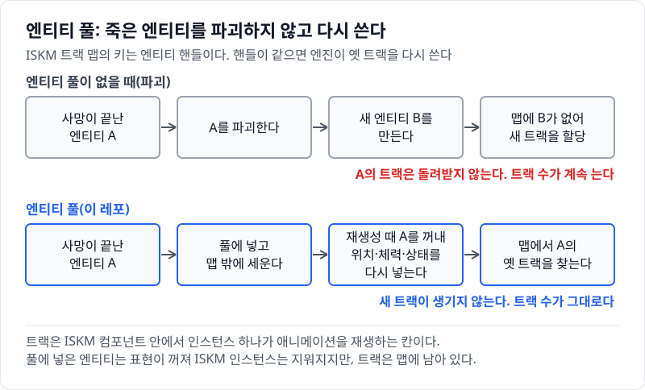
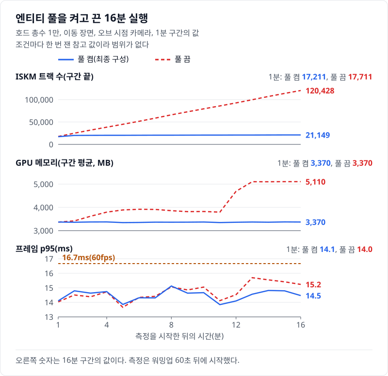
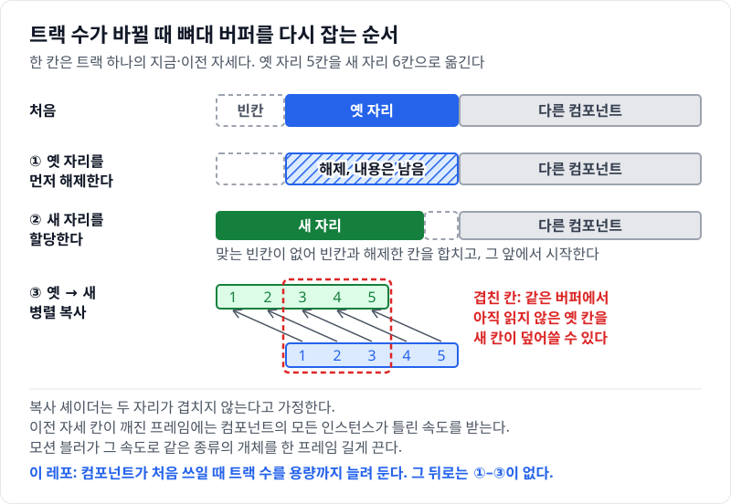
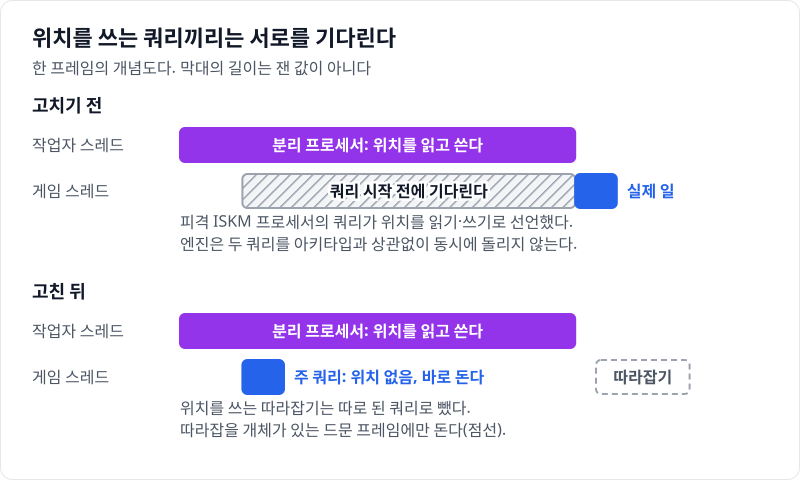
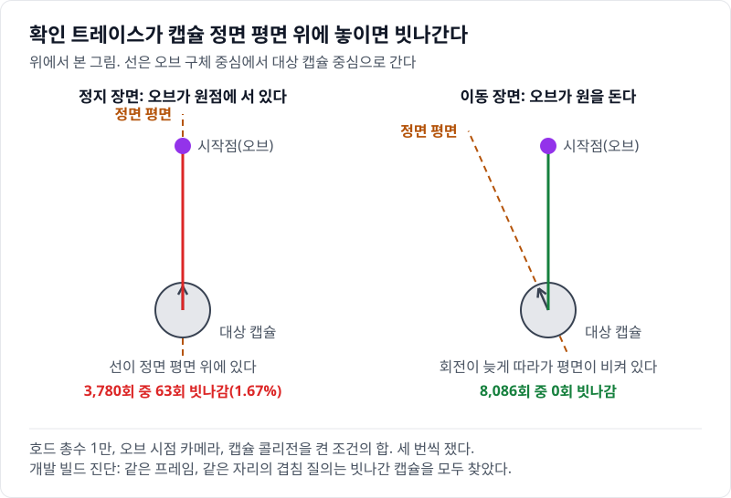

# 06 엔진을 고치지 않고 피한 문제 다섯: ISKM 트랙, Mass 쿼리, Chaos 트레이스

## 요약

호드를 Mass와 ISKM으로 만들면서 UE 5.8.4 엔진의 문제 다섯을 찾았다. 셋은 ISKM의 애니메이션 트랙에서, 하나는 Mass의 병렬 처리 큐에서, 하나는 Chaos 라인 트레이스에서 나왔다. 이 레포는 엔진 소스를 고치지 않고 게임 코드와 에셋, 검사 규칙에서 모두 피했다. 가장 큰 것은 트랙 누수다. 엔티티 풀 없이 16분을 돌리면 ISKM 트랙이 12만 개를 넘는다.


수치의 근거와 엔진 소스 위치는 [측정 기록](measurements.md)에 있다.

> **시나리오.** 오브(Orb)가 맵 중심 둘레의 원 궤도를 2m/s로 돈다. 호드 1만이 오브를 쫓아 사방에서 걸어오고, 오브는 가까운 개체를 지우고 먼 개체를 주기적으로 쏜다. 모든 거리에서 생성·피격·사망·표현 전환이 계속 일어나게 하는 벤치마크 장치다.

## 배경 지식

### ISKM의 트랙

ISKM(Instanced Skinned Mesh)은 스켈레탈 메시를 인스턴스로 모아 그리고 GPU에서 스키닝하는 컴포넌트다. 단계 6부터 카메라 35\~200m의 개체를 ISKM으로 그린다([04번 글](../04-quality-by-distance/README.md)). 인스턴스가 재생할 애니메이션은 트랙에 담긴다. 트랙은 컴포넌트마다 만드는 트랙 제공자 인스턴스(`UAnimSequenceTransformProviderDataInstance`) 안의 재생 칸이고, 클립 번호와 시작 시각을 가진다. Mass는 엔티티가 컴포넌트에 처음 들어올 때 트랙을 만들어 엔티티 핸들을 키로 트랙 맵에 적고, 렌더러는 트랙 수만큼 뼈대 버퍼를 잡는다.

### Mass 병렬 처리 큐

Mass는 프로세서(Processor)를 게임 스레드와 작업자 스레드에 나눠 돌린다. 프로세서의 쿼리는 어떤 Fragment를 읽고 쓰는지 선언한다. 처리 큐는 이 선언을 보고 부딪히는 쿼리를 동시에 돌리지 않는다. 부딪히는 쿼리가 돌고 있으면 다른 쪽은 시작하기 전에 기다린다.

### 가산 애니메이션

가산(additive) 클립은 전체 자세가 아니라 기준 자세와의 차이를 담는다. 재생하는 쪽이 기준 자세를 만들고 차이를 더해야 자세가 된다. 이 프로젝트의 피격 클립 `HitReact_Front`가 가산 클립이다.

## 1. 움직이는 엔티티를 파괴하면 ISKM 트랙이 남는다

단계 5부터 쓰는 엔티티 풀([05번 글](../05-cost-cuts-and-contributions/README.md))을 끄면 ISKM 트랙 수가 계속 는다. 호드 총수 1만, 오브 시점 카메라로 최종 구성을 4분씩 돌렸다. 끝날 무렵 트랙은 풀을 켜면 20,215개, 끄면 30,797개다. 프레임 p95(느린 쪽 5%의 경계, [00번 글](../00-goals-and-method/README.md))는 둘이 구별되지 않는다.

`Engine/Plugins/Runtime/MassGameplay/Source/MassRepresentation/Private/MassVisualizationComponent.cpp`, `UMassVisualizationComponent::EndVisualChanges`

```cpp
auto TrackElementId = TrackMap.FindOrAddId(EntityHandlesWithPendingUpdates[IDIndex], 0, bAlreadyPresent);
// ...
TrackId = TrackMap.GetByElementId(TrackElementId).Value = ASTPDI->AllocateTrack();
// ...
SharedIdMap.RemoveByElementId(ElementId);
RemovedInstancedSkinnedMeshInstanceIds.Add(InstanceId);
// ...
InstancedSkinnedMeshComponent->RemoveInstances(RemovedInstancedSkinnedMeshInstanceIds);
```

엔진은 엔티티 핸들이 트랙 맵에 없으면 트랙을 할당한다. 아래 세 줄은 이번 프레임에 갱신되지 않은 엔티티의 인스턴스만 지우고 트랙은 둔다. 트랙을 돌려받는 `ProcessRemovesForComponent`에 엔티티를 넣는 쪽은 움직이지 않는 개체의 경로뿐이다. 그래서 움직이는 엔티티를 파괴하면 트랙이 활성인 채 남는다.

남은 트랙도 렌더러가 매 프레임 평가하고, 뼈대 버퍼도 트랙 수만큼 커진다. 같은 문제가 [Epic 개발자 포럼](https://forums.unrealengine.com/t/mass-crowds-using-skinnedmeshinstance-leak-gpu-memory-every-wave-of-spawned-and-killed-entities-permanently-grows-the-animation-track-pool-5-8/2742508)에도 올라와 있다.

이 레포는 죽은 개체의 엔티티를 파괴하지 않는다. 엔티티 풀은 사망이 끝난 엔티티를 종류별 목록에 넣어 두었다가 재생성 때 새로 만들지 않고 꺼내 쓰는 방식이다. 꺼낸 엔티티에는 위치, 일련번호, 체력, 걷기 상태를 다시 넣고 속도를 0으로 되돌린다. 핸들이 같으므로 엔진은 트랙 맵에서 옛 트랙을 찾아 다시 쓴다. 바로 쓰이지 않은 엔티티는 맵 밖 먼 곳에 세워 두어 그리지 않는다.



`Source/HordeOptLab/LabCrowdSubsystem.cpp`, `ULabCrowdSubsystem::SpawnEntities`

```cpp
const int32 NumReuse = bPool ? FMath::Min(EntityPool[Type].Num(), Indices.Num()) : 0;
for (int32 k = 0; k < NumReuse; ++k)
{
	const int32 i = Indices[k];
	const FMassEntityHandle Entity = EntityPool[Type].Pop(EAllowShrinking::No);
	ReinitPooledEntity(EntityManager, Entity, Locations[i], Serials[i]);
	// ...
	Reused.Add(Entity);
}
```

상태 프로세서는 사망이 끝난 엔티티를 파괴하지 않고 `RecycleAndRespawn`에 넘긴다.

풀에서 나온 엔티티에는 함정이 하나 더 있다. 엔진은 트랙이 있으면 클립 번호가 바뀔 때만 다시 써서, 개체가 지난 생의 재생 위치로 걷는다. 이 레포는 상태나 시작 시각이 바뀐 프레임에 `SetAutoPlayData`를 직접 부른다.

차이는 긴 실행에서 보인다. 16분씩 한 번 돌리면 풀을 끈 쪽은 트랙이 120,428개가 된다. GPU 메모리는 3,370MB에서 5,110MB로 는다. 풀을 켠 쪽은 트랙이 3분 뒤 2만 남짓에서 분당 70개쯤만 늘어 16분에 21,149개이고, GPU 메모리가 평평하다.



프레임 p95는 12분까지 같은 구간끼리 차이가 0.5ms 아래다. 끝의 네 구간은 풀을 끈 쪽이 0.62\~1.14ms 높았다. 조건마다 한 번 잰 참고 값이라 범위는 없다.

## 2. 트랙 수가 늘 때 ISKM 무리가 한 프레임 번쩍인다

카메라에서 35\~200m의 ISKM 개체가 가끔 한 프레임 동안 세로로 길게 끌린다. 개체 하나가 아니라 같은 종류의 개체 전체가 함께 끌린다. 모션 블러가 틀린 속도를 그린 결과다. 트랙 수가 느는 동안에만 나고, 모든 개체가 트랙을 가진 뒤에는 멈춘다.


원인은 트랙 수가 바뀔 때 렌더러가 뼈대 버퍼를 다시 잡는 순서다. 트랙 수는 트랙 풀의 끝 번호이고, 빈 번호가 없을 때 Mass가 트랙을 만들면 는다.

`Engine/Source/Runtime/Renderer/Private/Skinning/SkinningSceneExtension.cpp`, `FSkinningSceneExtension::FUpdater::PostMeshUpdate`의 `AllocSpaceForPrimitive`

```cpp
const uint32 TransformNeededSize = Data.UniqueAnimationCount * Data.MaxTransformCount * 2u; // Current and Previous
// ...
SceneData->TransformAllocator.Free(Data.TransformBufferOffset, Data.TransformBufferCount);
// ...
Data.TransformBufferOffset = TransformNeededSize > 0 ? SceneData->TransformAllocator.Allocate(TransformNeededSize) : INDEX_NONE;
```

`Engine/Shaders/Private/Skinning/CopyPreviousTransforms.usf`

```hlsl
//   USE_STAGING_BUFFER=0: Read/write same UAV (realloc — allocate-before-free guarantees no overlap)
```

렌더러는 옛 자리를 먼저 해제하고 새 자리를 할당한다. `FSpanAllocator`는 맞는 빈 구간이 없으면 해제한 구간을 이웃 빈 구간과 합쳐 다시 찾는다. 그래서 새 자리가 옛 자리와 겹치는 앞쪽에서 시작할 수 있다. 옛 내용을 새 자리로 옮기는 셰이더는 같은 버퍼를 병렬로 읽고 쓴다. 셰이더 주석은 할당이 해제보다 먼저라 겹치지 않는다고 가정하지만, 실제 순서는 반대다. 알려진 이슈는 찾지 못했다.



이 레포는 트랙 수가 바뀌지 않게 한다.

`Source/HordeOptLab/LabIskmProcessor.cpp`, `LabReserveTracks`

```cpp
TArray<int32> Temp;
while (int32(Provider->GetUniqueAnimationCount()) < Capacity)
{
	Temp.Add(Provider->AllocateTrack());
}
for (const int32 TrackIndex : Temp)
{
	Provider->DeallocateTrack(TrackIndex);
}
```

컴포넌트가 처음 쓰이는 프레임에 트랙을 용량만큼 할당했다가 모두 해제한다. 트랙 풀의 끝 번호는 남고, 엔진의 다음 할당은 빈 번호를 다시 쓴다. 용량은 종류의 개체 수에 10%와 64를 더한 값이고, 200m 밖 피격 개체의 컴포넌트는 64다.


고친 뒤 같은 프레임에서 끌림이 사라졌다. 트랙 예약을 끈 조건의 프레임 p95는 최종 구성과 구별되지 않는다. 두 우회는 함께 있어야 한다. 엔티티 풀을 끈 조건은 트랙이 30,797개로, 예약한 용량의 합 22,384를 넘는다. 넘은 컴포넌트에서는 트랙 수가 다시 바뀌어 재할당이 일어난다.

## 3. ISKM 트랙 제공자는 가산 클립을 기준 자세에 더하지 않는다

200m 밖에서 저격당한 개체가 피격 동안 사라졌다. 모든 ISKM이 피격 클립을 재생하게 하자 거리와 상관없이 같은 일이 생겼다. 소형은 보이지 않았고 대형은 누운 모양이 되었다.


`Engine/Source/Runtime/Renderer/Private/Skinning/AnimSequenceTransformProvider.cpp`, `FAnimSequenceTransformProvider::UploadSequences`

```cpp
PlatformCompressedData.BoneCompressionCodec->DecompressPose(DecompressionContext, TrackToBoneIndexMap, TrackToBoneIndexMap, TrackToBoneIndexMap, AnimLocalPosesView);
// ...
Transform.SetTransform(FTransform3f(AnimLocalPoses[AnimBoneIndex]));
WriteBoneTransform(DstFloat4s, AnimCompactBoneIndex, Transform);
```

트랙 제공자는 압축을 푼 지역 자세를 그대로 뼈 변환으로 올린다. 가산 클립이면 이 값은 기준 자세와의 차이다. 이 경로에는 차이를 기준 자세에 더하는 단계가 없어 뼈가 원점 근처로 모인다. 액터의 단일 노드 재생은 기준 자세에 차이를 더하므로(`FAnimationRuntime::AccumulateAdditivePose`) 같은 클립이 액터에서는 맞다.

이 레포의 에셋 스크립트는 가산 클립을 복제해 가산 종류를 끄고, 그 복제본을 ISKM 트랙 제공자에 넣는다.

`Scripts/create-iskm.py`, `provider_clip`

```python
if kind == unreal.AdditiveAnimationType.AAT_NONE:
    return anim
# ...
    full = eal.duplicate_asset(src_path, path)
# ...
full.set_editor_property("additive_anim_type", unreal.AdditiveAnimationType.AAT_NONE)  # PostEditChange가 다시 압축한다
```

엔진은 원본 애니메이션 데이터를 늘 전체 자세로 두고 가산 값은 압축할 때 만든다. 그래서 가산 종류를 끈 복제본은 기준 자세에 차이를 더한 전체 자세로 압축된다. 고친 뒤에는 모든 거리의 개체가 피격 자세로 보인다.

## 4. 위치를 쓰겠다고 선언한 쿼리는 게임 스레드를 묶는다

200m 밖 피격 개체를 ISKM으로 올리는 게임 스레드 프로세서가 하는 일보다 오래 걸렸다. 트레이스에서 이 프로세서는 작업자 스레드의 분리 프로세서가 끝나는 순간에 함께 끝났다. 위치는 드물게만 고치는데 기다림은 매 프레임 생겼다.

두 쿼리가 모두 `FTransformFragment`를 읽기·쓰기로 선언한 탓이다.

`Engine/Source/Runtime/MassEntity/Private/MassProcessingQueueTypes.cpp`, `FQueuedProcessor::InitCrossChunkWriteContention`

```cpp
// direct vs direct fragment access is promoted to global contention if we're executing in-line
if (UE::Mass::Tweakables::bForceInlineProcessorExecution)
{
	if (DataA.DirectWritesElements.HasAny(DataB.DirectReadsElements)
		|| DataB.DirectWritesElements.HasAny(DataA.DirectReadsElements))
	{
		ContentionMatrix.SetMutual(QueryInfos[MyQueryIndex].ChunkGlobalContentionIndex, Other.QueryInfos[OtherQueryIndex].ChunkGlobalContentionIndex);
```

`mass.ForceInlineProcessorExecution`의 기본값은 참이다. 이때 한 쿼리의 직접 쓰기가 다른 쿼리의 직접 읽기와 겹치면, 엔진은 두 쿼리를 전역 충돌로 묶는다. 읽기·쓰기 선언은 읽기와 쓰기 양쪽에 든다. 두 쿼리가 다루는 아키타입이 겹치는지는 보지 않는다. 묶인 쿼리는 상대가 끝날 때까지 시작하지 못해서, 게임 스레드가 분리 프로세서를 기다렸다.



이 레포는 위치를 쓰는 일을 따로 된 쿼리로 뺐다.

`Source/HordeOptLab/LabMassProcessors.cpp`, `ULabFarHitIskmProcessor::ConfigureQueries`와 `Execute`

```cpp
EntityQuery.AddRequirement<FMassRepresentationLODFragment>(EMassFragmentAccess::ReadWrite);
// ...
CatchUpQuery.AddRequirement<FTransformFragment>(EMassFragmentAccess::ReadWrite);
// ...
if (CatchUps.Num() > 0)
{
	CatchUpQuery.ForEachEntityChunk(Context, [&](FMassExecutionContext& Context)
	// ...
```

주 쿼리는 위치를 요구하지 않고, 따라잡기 쿼리는 위치를 옮길 개체가 있는 프레임에만 돈다. 개발 빌드 진단에서 이 프로세서의 실행 시간은 거의 0이 되었다.

## 5. Chaos 라인 트레이스가 캡슐 정면 평면 위의 선을 놓친다

동등성 검사는 단계 사이가 같은 일을 하는지 본다. 그 하나로 오브가 2초마다 대상 액터의 캡슐에 라인 트레이스를 쏴, 캡슐이 그려진 자리에 있는지 확인한다. 정지 장면(오브가 원점에 서 있는 장면)에서 이 트레이스가 약 1.7% 빗나갔다. 이동 장면에서는 한 번도 빗나가지 않았다.



정지 장면에서는 모든 미니언이 오브 중심을 바라본다. 그래서 트레이스 시작점인 오브 구체 중심이 캡슐의 정면 평면 위에 놓인다. 정면 평면은 캡슐의 정면 축과 연직축이 이루는 평면이다. 빗나간 순간에도 같은 자리의 겹침 질의는 캡슐을 찾았다. 시작점을 옆으로 조금만 비켜도 빗나감이 없었다.

브로드페이즈를 거치지 않고 바디에 바로 쏜 트레이스도 놓쳤다. 이 경로의 캡슐 레이캐스트는 `Chaos::Raycasts::RayCapsule`이다. 그 안의 어느 분기가 놓치는지는 찾지 못했다.

이 레포는 정지 장면의 캡슐 빗나감을 기능 실패로 세지 않고 보고만 한다. 고치는 방법은 트레이스의 시작점이나 끝점을 정면 평면에서 몇 cm 비키는 것이다. 이 트레이스는 세기만 하고 대상, 피해, 사망을 바꾸지 않아 프레임 수치에 영향이 없다.

## 한 문장으로

엔진에서 찾은 문제 다섯은 모두 엔진 소스를 고치지 않고 게임 코드, 에셋, 검사 규칙에서 피할 수 있었다.

- 증상이 개체 하나가 아니라 컴포넌트 전체에 나면, 인스턴스 데이터보다 컴포넌트가 함께 쓰는 버퍼와 트랙 풀을 먼저 본다.
- 엔티티 풀의 이득은 4분 실행의 프레임 p95에 보이지 않았다. 트랙 수와 긴 실행에서만 보였다.
- 캡슐 트레이스를 놓치는 Chaos 안의 분기는 찾지 못했다.

[다음 글](../07-summary/README.md)은 여덟 단계의 결과를 모아 정리한다.
