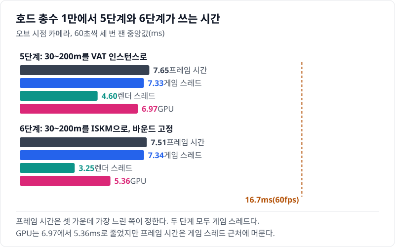
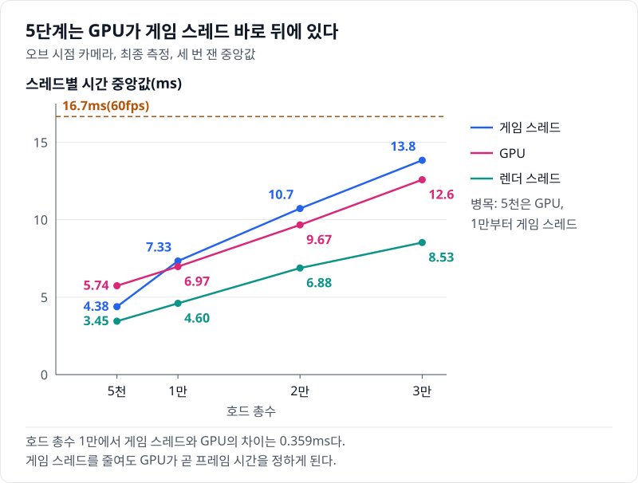
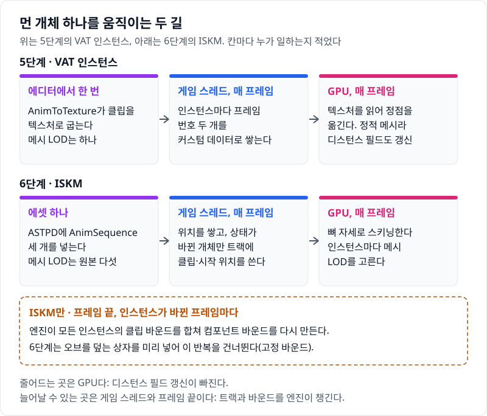
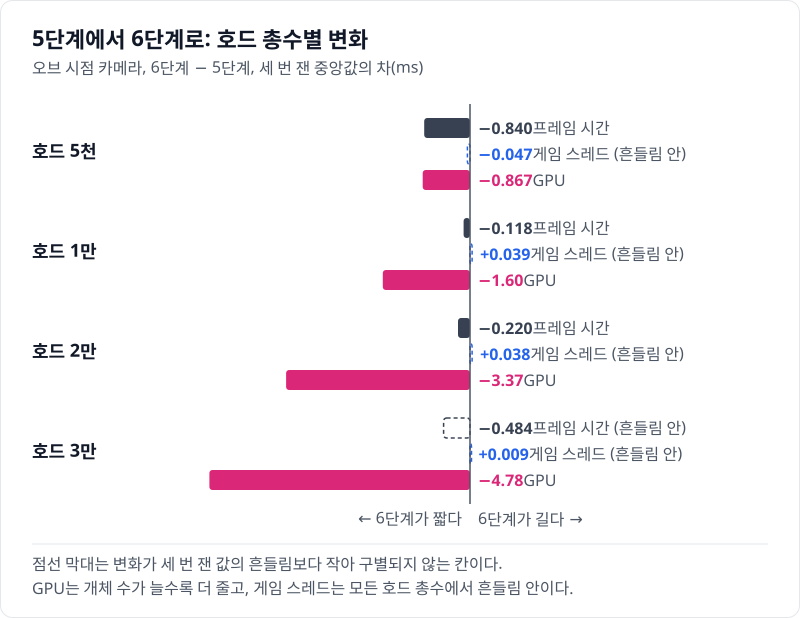
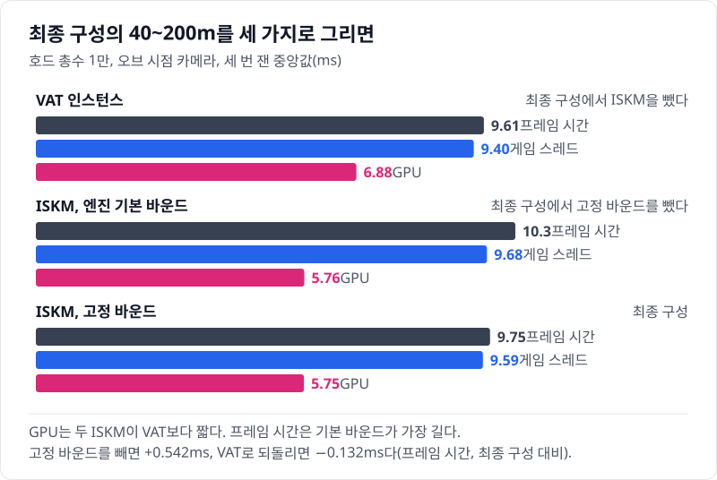

# 06 GPU 시간은 23% 줄고 프레임 시간은 거의 그대로였다: ISKM과 고정 바운드

## 요약

6단계는 30\~200m 개체를 VAT 인스턴스에서 ISKM으로 바꾸고, ISKM 컴포넌트의 바운드를 고정한다. 값은 모두 호드 총수 1만, 오브 시점 카메라에서 잰 것이다. GPU 시간은 22.9% 줄어 5.37ms가 됐다. 프레임 시간은 8.57ms에서 8.45ms로 조금만 줄었다. 병목인 게임 스레드가 그대로(8.29ms)였기 때문이다.



프레임 시간은 게임 스레드, 렌더 스레드, GPU 가운데 가장 느린 쪽이 정한다. 두 단계 모두 게임 스레드가 가장 느리다. 지표의 자세한 설명은 [00번 글](../00-goals-and-method/README.md)에 둔다.


수치의 근거는 [측정 기록](measurements.md)에 있다.

> **시나리오.** 플레이어는 움직이지 않는다. 맵 중앙의 오브(Orb)를 향해 개체가 사방에서 걸어오고, 오브는 가까운 개체를 지우고 먼 개체를 주기적으로 쏜다. 모든 거리에서 생성·피격·사망·표현 전환이 계속 일어나게 하는 벤치마크 장치다.

## 배경 지식

### ISKM

ISKM(Instanced Skinned Mesh)은 스켈레탈 메시 하나를 여러 위치에 한 번에 그리는 컴포넌트다. 클래스는 `UInstancedSkinnedMeshComponent`다. ISM처럼 인스턴스를 한 컴포넌트에 모으고, GPU가 정점을 뼈 자세로 스키닝한다. AnimBP는 없고, 원본 메시의 메시 LOD를 GPU가 인스턴스마다 고른다. 6단계는 30\~200m의 VAT 인스턴스를 ISKM으로 바꿨다.

### ASTPD와 트랙

ASTPD(`UAnimSequenceTransformProviderData`)는 ISKM이 재생할 AnimSequence 목록을 담는 에셋이다. 트랙은 ASTPD 안에서 인스턴스 하나에 배정되는 재생 칸이다. 트랙에 클립 번호, 시작 위치, 재생 속도, 블렌드 시간을 넣으면 엔진이 월드 시간으로 재생 위치를 계산한다. 블렌드 시간을 주면 앞 클립과 섞어 바꾼다. 6단계는 걷기·피격·죽기 세 클립을 넣고 블렌드 시간을 0으로 두었다.

### 컴포넌트 바운드

바운드는 컴포넌트 전체를 감싸는 상자다. 렌더러는 이 상자로 컴포넌트를 컬링하고 그림자 대상을 고른다. ISKM은 인스턴스가 바뀐 프레임마다 모든 인스턴스의 클립 바운드를 합쳐 이 상자를 다시 만든다. 상자를 미리 주면 엔진은 그 계산을 건너뛴다.

## 문제: 5단계는 GPU가 게임 스레드 바로 뒤에 있다

5단계([05번 글](../05-simulation-lod-entity-pool/README.md))에서는 200m 밖 이동을 자체 프로세서로 바꾸고 엔티티 풀을 넣었다. 호드 총수 1만에서 프레임 시간을 정하는 것은 게임 스레드 8.25ms다. GPU는 6.97ms로 1.28ms 뒤에 있다. 호드 총수 5천과 탑뷰 카메라에서는 이미 GPU가 병목이다.



30\~200m의 VAT 인스턴스는 정적 메시라 디스턴스 필드 표현이 있다. 미니언을 Lumen 장면에서 뺐지만 그림자를 그리므로 디스턴스 필드 장면에는 남는다. 개체가 움직이면 렌더러가 디스턴스 필드 장면의 그 자리를 다시 올린다.

## 원리: GPU의 디스턴스 필드 일이 빠지고, 엔진은 매 프레임 바운드를 다시 만든다

아래 그림의 위가 5단계, 아래가 6단계의 길이다.



ISKM에는 디스턴스 필드 표현이 없다. 엔진은 정적 메시 프록시에서 이 표현을 켜고, 스켈레탈 메시 프록시에서는 켜지 않는다. 대신 ISKM 컴포넌트는 프레임 끝에 인스턴스 데이터를 렌더러로 보내면서 바운드를 다시 계산한다.

`Engine/Source/Runtime/Engine/Private/Components/InstancedSkinnedMeshComponent.cpp`, `SendRenderInstanceData_Concurrent`와 `Engine/Source/Runtime/Engine/Public/InstancedSkinnedMeshComponentHelper.h`, `CalcBounds`

```cpp
if (InstanceDataManager.FlushChanges(GetComponentDesc(SceneProxy->GetScene().GetShaderPlatform())))
{
	UpdateBounds();
// ...
for (int32 InstanceIndex = 0; InstanceIndex < InComponent.InstanceData.Num(); InstanceIndex++)
{
	const FSkinnedMeshInstanceData& Instance = InComponent.InstanceData[InstanceIndex];
	FRenderBounds AnimationBounds;
	if (TransformProvider->GetAnimationBounds(Instance.AnimationIndex, AnimationBounds))
	{
		BoundsBuilder += AnimationBounds.ToBox().TransformBy(FTransform(Instance.Transform) * LocalToWorld);
	}
}
```

첫 줄은 인스턴스가 하나라도 바뀐 프레임에 참이고, 걷는 호드에서는 매 프레임 참이다. 아래 반복이 인스턴스마다 클립의 바운드를 합친다. 컴포넌트의 `CalcBounds`는 미리 준 상자가 있으면 이 반복 없이 그 상자를 돌려준다.

```cpp
if (PrimitiveBoundsOverride.IsValid)
{
	return PrimitiveBoundsOverride.InverseTransformBy(GetComponentTransform().Inverse() * LocalToWorld);
}
```

**예상.** GPU 시간은 준다. 그러나 병목은 게임 스레드다. 프레임 시간은 많아야 5단계의 프레임(8.57ms)과 게임 스레드(8.25ms)의 간격인 0.317ms만큼 줄 것이다.

## 바꾼 것: 에셋, 표현 설명자, 갱신 프로세서, 컴포넌트 바운드

`Scripts/create-iskm.py`가 종류마다 스켈레탈 메시 복제본, ASTPD, 머티리얼을 만든다. ASTPD가 요구하는 대로 복제본의 LOD 다섯 개에 `bOptimizeForInstancing`을 켠다. 클립은 액터가 쓰는 AnimSequence 그대로다. 게임 모듈은 시작할 때 `ULabVatISMProcessor` 대신 `ULabIskmProcessor`를 켠다([HordeOptLab.cpp](../../Source/HordeOptLab/HordeOptLab.cpp)).

`Source/HordeOptLab/LabCrowdSubsystem.cpp`, `ULabCrowdSubsystem::BuildEntityConfig`

```cpp
FMassSkinnedMeshInstanceVisualizationMeshDesc SkinnedDesc;
SkinnedDesc.Asset = IskmMeshes.IsValidIndex(AssetType) ? IskmMeshes[AssetType].Get() : nullptr;
SkinnedDesc.TransformProvider = IskmProviders.IsValidIndex(AssetType) ? IskmProviders[AssetType].Get() : nullptr;
// ...
Visual->SkinnedMeshInstanceDesc.Meshes.Add(SkinnedDesc);
// ...
Visual->StaticMeshInstanceDesc.Meshes.Reset();
for (int32 LOD = 0; LOD < EMassLOD::Max; ++LOD)
{
	if (Visual->Params.LODRepresentation[LOD] == EMassRepresentationType::StaticMeshInstance)
	{
		Visual->Params.LODRepresentation[LOD] = EMassRepresentationType::SkinnedMeshInstance;
	}
}
```

`TransformProvider`가 ASTPD다. 마지막 반복이 정적 메시 인스턴스였던 구간을 스켈레탈 메시 인스턴스로 바꾼다. 액터 구간과 거리 경계는 5단계 그대로다.

`Source/HordeOptLab/LabIskmProcessor.cpp`, `ULabIskmProcessor::Execute`

```cpp
UMassUpdateInstancedSkinnedMeshProcessor::UpdateMeshTransform(Entity, Info, Transform, Representation.PrevTransform, LODSignificance, Representation.PrevLODSignificance);
// ...
const float T = Now - Anim.StateStartTime;
FAnimSequenceTrackAutoPlayData Data;
Data.SequenceIndex = int32(Anim.State);
// ...
Data.Position = FMath::Max(T, 0.f) * Rate;
Data.PlayRate = Rate;
Data.BlendTime = BlendTime;
Data.LoopMode = Anim.State == ELabMinionState::Walk ? EAnimSequenceTrackLoopMode::Loop : EAnimSequenceTrackLoopMode::Clamp;
Info.AddBatchedAnimationData(Entity, Data, LODSignificance, Representation.PrevLODSignificance);
```

첫 줄은 엔진 ISKM 프로세서의 위치 함수를 그대로 부른다. 클립 번호는 개체의 상태(걷기, 피격, 죽기)이고, 시작 위치는 그 상태에 들어간 뒤 흐른 시간이다. `BlendTime`은 0이다.

`Source/HordeOptLab/LabCrowdSubsystem.cpp`, `ULabCrowdSubsystem::ApplyFixedIskmBounds`

```cpp
const float HalfXY = FLabConfig::Get().DrawExtentCm() * 1.1f + FLabScenario::OrbViewBack + 1000.f;
const FBox Fixed(OrbCenter + FVector(-HalfXY, -HalfXY, -500.f), OrbCenter + FVector(HalfXY, HalfXY, 1500.f));
if (!Component.GetPrimitiveBoundsOverride().IsValid)
{
	Component.SetPrimitiveBoundsOverride(Fixed);
	Component.UpdateBounds();
}
```

상자는 오브를 중심으로 가로세로 ±245m다. 오브와 카메라 중심이 움직이지 않아 상자도 움직이지 않는다. 인스턴스별 컬링과 메시 LOD 선택은 이 상자를 쓰지 않는다.

이 단계에서 바뀐 변수는 둘이다. 표현(VAT → ISKM)과 고정 바운드다. 고정 바운드는 ISKM 컴포넌트에만 들어가므로 사다리는 둘을 한 단계에 넣었다. 둘을 가르는 값은 아래 "최종 구성에서 하나씩 빼면"에 있다.

### 엔진이 챙기지 않는 것: 트랙

Mass의 ISKM 경로에는 트랙을 다루는 빈틈이 둘 있다. 첫째 빈틈과 같은 문제를 다룬 글이 [Epic 개발자 포럼](https://forums.unrealengine.com/t/mass-crowds-using-skinnedmeshinstance-leak-gpu-memory-every-wave-of-spawned-and-killed-entities-permanently-grows-the-animation-track-pool-5-8/2742508)에 있다. 둘째 빈틈을 다룬 공개 이슈는 찾지 못했다. 두 자리 모두 엔진 소스에서 확인했다.

`Engine/Plugins/Runtime/MassGameplay/Source/MassRepresentation/Private/MassVisualizationComponent.cpp`, `UMassVisualizationComponent::EndVisualChanges`와 `ProcessRemovesForComponent`

```cpp
if (ASTPDI->GetSequenceIndex(TrackId, 0) != InstanceAnimationData[IDIndex].SequenceIndex)
{
	ASTPDI->SetAutoPlayData(TrackId, 0, InstanceAnimationData[IDIndex]);
}
// ...
TrackId = TrackMap.GetByElementId(TrackElementId).Value = ASTPDI->AllocateTrack();
// ...
ASTPDI->DeallocateTrack(SharedTrackMap.GetByElementId(TrackElementId).Value);
```

첫 빈틈은 마지막 줄이다. 엔진이 트랙을 돌려받는 곳은 이 함수 하나이고, 이 함수로 오는 경로는 움직이지 않는 개체의 것뿐이다. 그래서 움직이는 개체를 파괴하면 트랙이 남는다. 이 레포는 죽은 엔티티를 풀에 넣었다가 같은 핸들로 다시 써서 트랙도 다시 쓰게 한다([05번 글](../05-simulation-lod-entity-pool/README.md)).

`Source/HordeOptLab/LabCrowdSubsystem.cpp`, `ULabCrowdSubsystem::SpawnEntities`

```cpp
const int32 NumReuse = bPool ? FMath::Min(EntityPool[Type].Num(), Indices.Num()) : 0;
for (int32 k = 0; k < NumReuse; ++k)
{
	const int32 i = Indices[k];
	const FMassEntityHandle Entity = EntityPool[Type].Pop(EAllowShrinking::No);
	ReinitPooledEntity(EntityManager, Entity, Locations[i], Serials[i]);
	Reused.Add(Entity);
}
```

둘째 빈틈은 엔진 발췌의 첫 네 줄이다. 트랙이 이미 있으면 엔진은 클립 번호가 바뀔 때만 트랙을 다시 쓴다. 풀에서 다시 나온 개체는 지난 생과 같은 걷기 클립이라 옛 위상으로 걷는다. 최종 구성은 80m 밖 그림자를 끄려고 컴포넌트를 둘로 나누는데, 트랙은 컴포넌트마다 따로라 같은 일이 생긴다.

`Source/HordeOptLab/LabIskmProcessor.cpp`, `ULabIskmProcessor::Execute`

```cpp
const bool bRangeChanged = Info.GetLODSignificanceRangesNum() > 1 && Representation.PrevLODSignificance >= 0.f
	&& Info.GetLODSignificanceRange(Representation.PrevLODSignificance) != Info.GetLODSignificanceRange(LODSignificance);
FLabIskmTrackFragment& Track = Tracks[EntityIt];
if (bRangeChanged || Track.AppliedState != int8(Anim.State) || Track.AppliedStartTime != Anim.StateStartTime)
{
	// ...
	if (LabWriteTrack(Info, LODSignificance, Entity, Data)) { ++TrackWrites; } else { ++TrackFirst; }
	Track.AppliedState = int8(Anim.State);
	Track.AppliedStartTime = Anim.StateStartTime;
}
```

`FLabIskmTrackFragment`는 개체마다 마지막으로 쓴 상태와 시작 시각을 기억한다. 둘 중 하나가 다르거나 컴포넌트가 바뀌면 `LabWriteTrack`이 그 트랙에 `SetAutoPlayData`를 직접 부른다.

## 결과: GPU는 모든 호드 총수에서 줄고, 게임 스레드는 그대로였다

호드 총수 1만에서 GPU 시간은 1.60ms 줄었다. 프레임 시간은 0.118ms 줄어, 예상한 상한 0.317ms 안이다. 게임 스레드의 변화(+0.039ms)는 세 번 잰 값의 흔들림보다 작다.



호드 총수 3만에서는 GPU가 4.78ms 줄었고 게임 스레드는 그대로다. 병목이 게임 스레드라 3만의 프레임 시간 차이(−0.484ms)는 세 번 잰 범위 안이다. 60fps를 지키는 최대 개체 수는 5단계가 약 2만 3천, 6단계가 약 2만 4천이다. 2만과 3만에서 두 단계의 프레임 시간(느린 쪽 5% 경계)은 세 번 잰 범위 안에서 겹친다. 그래서 이 차이는 구별되지 않는다.

탑뷰 카메라에서는 GPU가 병목이라 1만의 프레임 시간이 2.34ms 줄었다.

트레이스에서 렌더 스레드의 프레임 평균을 읽었다(Unreal Insights, 호드 총수 1만, 오브 시점 카메라, 한 회). 디스턴스 필드 장면을 갱신하는 `FSceneRenderer::PrepareDistanceFieldScene`은 5단계에서 프레임당 1.47ms였고, 6단계에서는 0.0374ms다. GPU에서 디스턴스 필드를 갱신하는 `GlobalDistanceFieldUpdate`도 프레임당 0.296ms에서 0.003ms로 줄었다.


위 문단의 값은 이 합계를 고른 구간의 프레임 수로 나눈 값이다. 8.22초를 5,585로 나누면 1.47ms다.

남은 비용은 개체마다 게임 스레드가 하는 일이다. 엔진은 ISKM 인스턴스마다 트랙 맵을 찾고 재생 상태를 읽어 적는다. VAT가 쓰는 ISM 경로에는 없는 일이고, 끌 설정도 없다.

### 최종 구성에서 하나씩 빼면

최종 구성은 40\~200m를 ISKM과 고정 바운드로 그린다. 여기서 하나씩 뺀 측정이 6단계의 두 변수를 가른다.



ISKM을 VAT로 되돌리면 GPU 시간은 1.13ms 는다. 게임 스레드는 0.196ms, 프레임 시간은 0.132ms 준다. 병목이 게임 스레드라 프레임 시간만 보면 VAT가 빠르다. 고정 바운드만 빼면 프레임 시간이 0.542ms 는다. 게임 스레드의 변화(+0.086ms)는 세 번 잰 범위 안이라, 늘어난 몫은 게임 스레드 밖에 있다.

프레임 시간만 보면 VAT가 낫지만 ISKM을 남겼다. GPU 시간이 줄고, 애니메이션을 텍스처로 굽는 단계(AnimToTexture)가 없다. 원본 스켈레탈 메시의 메시 LOD 다섯 개를 쓰고, 블렌드 시간 하나로 클립 사이를 섞을 수 있다. 이 프로젝트는 VAT와 같게 블렌드 시간을 0으로 두어 블렌딩을 쓰지 않는다.

### 화면: 모션 블러가 일부 ISKM 미니언을 세로로 끈다

모션 벡터(Motion Vector)는 픽셀마다 앞 프레임부터 지금까지 화면에서 움직인 양이다. 렌더러는 정점의 지금 위치와 이전 프레임 위치(이전 변환)를 각각 화면에 투영해 그 차이를 속도 버퍼에 적는다. 모션 블러가 이 버퍼를 읽는다.

ISKM 인스턴스는 한 컴포넌트 안에서 저마다 움직인다. 엔진은 인스턴스별 이전 변환이 없으면 인스턴스가 컴포넌트와 함께만 움직였다고 본다. 그래서 Mass는 ISKM 컴포넌트에 인스턴스별 이전 변환을 저장하도록 설정한다. 이전 변환이 틀리면 렌더러는 개체가 한 프레임 사이에 멀리 옮겨 간 것으로 보고, 그 거리만큼 번지게 그린다. [04번 글](../04-hydration-anim-budget/README.md)에서 다시 보인 액터가 지난번 위치를 이전 프레임으로 써서 줄무늬로 번진 것도 같은 원리다.

개발 빌드의 연속 캡처에서 가끔 한 프레임 동안 미니언 여럿이 위아래로 길게 번졌다. 모션 블러를 끄면 사라졌다. 번진 개체는 몸 전체에 같은 세로 속도를 받았다. `ULabIskmProcessor`가 넘긴 이전 변환(`PrevTransform`)은 정상이었고, 엔진 안의 원인과 공개 이슈는 찾지 못했다. 그래서 고치지 않고 모션 블러를 엔진 기본값(켬)으로 두고 쟀다.

## 틀렸던 가설: ISKM이 GPU를 줄이면 프레임도 줄 줄 알았다

처음에는 ISKM이 GPU 시간을 줄이는 만큼 프레임 시간도 줄 것으로 보았다. 전환 순간도 VAT보다 덜 티 날 것으로 보았다. 그런데 바운드를 고정하기 전의 앞선 측정에서는 GPU가 줄었는데 프레임 시간이 오히려 늘었다. 트레이스로 보니 늘어난 시간의 큰 몫은 프레임 끝에 렌더 상태를 보내는 병렬 작업을 기다리는 시간이었다.

그 작업 안에서 ISKM 컴포넌트가 모든 인스턴스의 바운드를 다시 합친다. 상자를 미리 주자 그 기다림이 거의 사라졌고, 프레임 시간이 VAT보다 짧아졌다. 최종 측정에서도 엔진 기본 바운드의 ISKM은 VAT보다 GPU 시간이 1.12ms 짧지만 프레임 시간은 0.674ms 길다.

고친 설명에서 바운드는 원인의 일부였다. 바운드를 고정한 6단계는 모든 호드 총수에서 게임 스레드가 5단계와 같다. 6단계가 프레임 시간에서 앞서는 것은 2만까지이고, 3만에서는 차이가 흔들림 안이다. 전환 순간의 차이도 최종 측정에서는 시드 사이 흔들림 안이었다.

## 한 문장으로

ISKM은 먼 개체의 GPU 시간을 23% 줄였지만, 게임 스레드가 병목인 동안 그 이점은 GPU 여유로만 남는다.

- 6단계는 표현과 고정 바운드를 함께 바꿨다. 최종 구성에서 하나씩 뺀 측정이 둘을 가른다.
- 고정 상자는 오브와 카메라 중심이 움직이지 않는 이 시나리오라서 쓸 수 있다. 카메라가 움직이는 게임이라면 상자를 카메라와 함께 옮겨야 한다.
- 최종 구성에서 VAT로 되돌리면 게임 스레드가 0.196ms 준다. ISKM 경로가 인스턴스마다 트랙을 찾고 쓰기 때문이다.

[다음 글](../07-niagara-crowd/README.md)에서는 200m 밖의 빈 땅을 엔티티가 움직이는 Niagara 입자로 채운다. 그 비용은 이 단계에서 줄인 GPU 시간으로 낸다.
