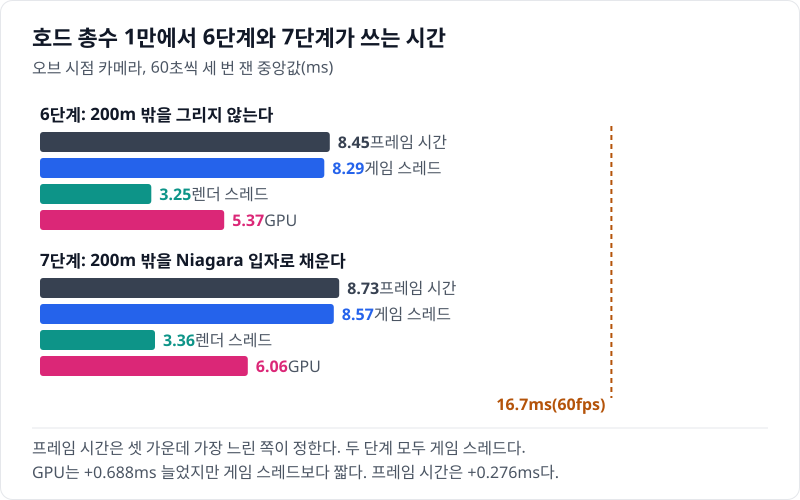
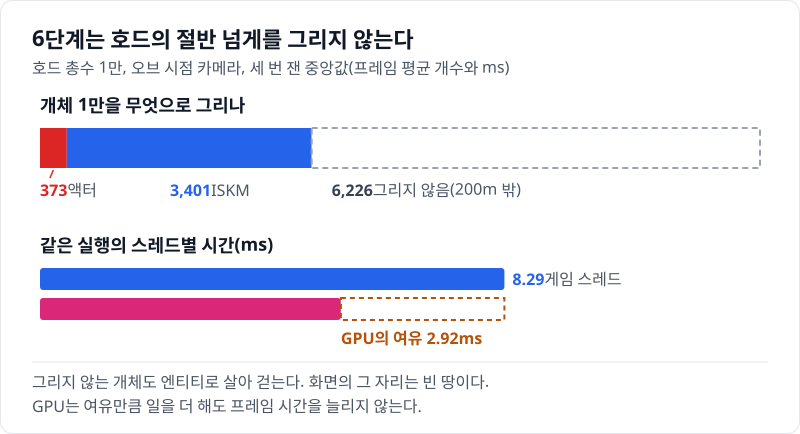
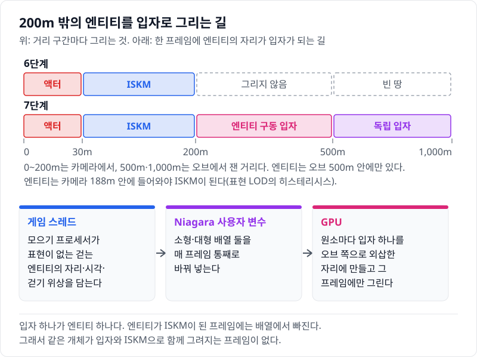
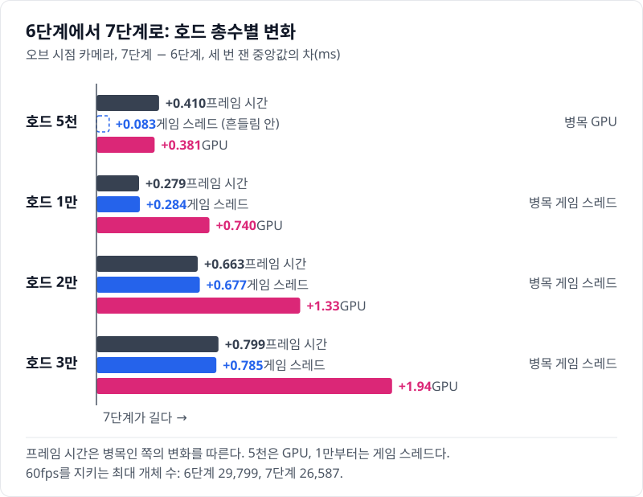
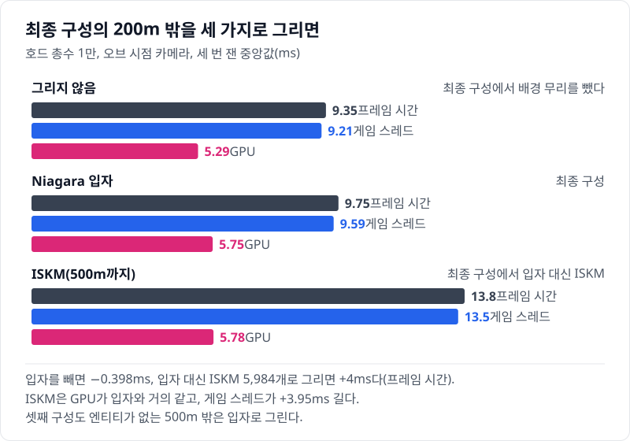

# 07 지평선까지 이어진 호드에 0.276ms: 엔티티가 움직이는 Niagara 배경 무리

## 요약

7단계는 6단계가 그리지 않던 카메라 200m 밖을 Niagara 메시 입자로 채운다. 입자는 실제 엔티티의 자리에 그리고, 엔티티가 없는 맵 밖은 엔티티와 무관한 입자가 채운다. 값은 모두 호드 총수 1만, 오브 시점 카메라에서 잰 것이다. 프레임 시간은 8.45ms에서 8.73ms로 늘었다. GPU는 0.688ms 늘었지만 게임 스레드보다 짧아, 프레임 시간은 게임 스레드를 따라 0.276ms 늘었다.



프레임 시간은 게임 스레드, 렌더 스레드, GPU 가운데 가장 느린 쪽이 정한다. 두 단계 모두 게임 스레드가 가장 느리다. 지표의 자세한 설명은 [00번 글](../00-goals-and-method/README.md)에 둔다.


수치의 근거는 [측정 기록](measurements.md)에 있다.

> **시나리오.** 플레이어는 움직이지 않는다. 맵 중앙의 오브(Orb)를 향해 개체가 사방에서 걸어오고, 오브는 가까운 개체를 지우고 먼 개체를 주기적으로 쏜다. 모든 거리에서 생성·피격·사망·표현 전환이 계속 일어나게 하는 벤치마크 장치다.

## 배경 지식

### Niagara 메시 입자

Niagara는 UE의 파티클 시스템이다. 이미터가 입자를 만들고 매 프레임 갱신하며, 렌더러가 입자를 그린다. 메시 렌더러는 입자마다 스태틱 메시 하나를 입자의 위치와 방향으로 그린다. 시뮬레이션을 GPU에서 돌리면 입자가 많아도 게임 스레드는 거의 일하지 않는다. 7단계는 VAT로 구운 미니언 메시를 입자로 그렸다.

### 배열 사용자 변수

사용자 변수는 게임 코드가 Niagara 시스템에 넣는 값이다. 형을 배열 데이터 인터페이스로 두면 C++이 배열을 통째로 넘기고, GPU 이미터의 스크립트가 원소를 읽는다. 넣는 함수는 `UNiagaraDataInterfaceArrayFunctionLibrary::SetNiagaraArrayVector4`다. 7단계는 엔티티의 자리를 매 프레임 이 배열로 넘겼다.

### 동적 머티리얼 파라미터

VAT 머티리얼은 재생할 프레임을 어디선가 받아야 한다. [03번 글](../03-ism-vat/README.md)의 ISM은 인스턴스 커스텀 데이터로 넘겼다. Niagara 메시 렌더러는 그 자리에 입자 번호를 쓰므로 같은 길을 쓸 수 없다. 대신 입자가 동적 머티리얼 파라미터 네 칸으로 시간 오프셋, 재생 속도, 재생 범위를 넘긴다. 7단계는 첫 칸에 엔티티의 걷기 위상을 넣었다.

## 문제: 6단계는 호드의 절반 넘게를 그리지 않는다

[06번 글](../06-iskm/README.md)의 6단계는 카메라 200m 안만 그린다. 그 밖의 엔티티는 표현 LOD Off라 살아서 걷지만 화면에는 없다. 프레임 평균으로 호드 1만 가운데 6,226개가 그렇다. 화면에서는 지평선 앞의 빈 땅으로 보인다.



시간의 여유는 GPU에 있다. 6단계의 병목은 게임 스레드 8.29ms이고, GPU는 5.37ms다. GPU는 2.92ms를 더 써도 프레임 시간을 늘리지 않는다.

그리는 거리를 200m보다 넓히는 길도 있었다. 그러면 먼 엔티티도 가까운 엔티티처럼 인스턴스 하나씩으로 그려서, 개체 하나의 비용이 줄지 않는다. 실제로 넓혀 보니 더 그린 개체만큼 프레임 시간이 늘었다. 지평선을 채우려면 먼 엔티티를 더 싸게 그리는 방법이 필요했다.

처음에는 엔티티와 무관한 입자를 오브 둘레에 뿌렸다. 입자와 미니언이 서로 대응하지 않아, 경계에서 개체가 사라지고 다른 자리에 새 개체가 생기는 것이 보였다. 그래서 그리지 않는 엔티티 하나하나의 자리에 입자를 그리기로 했다.

## 원리: 엔티티는 그대로 두고, 그리는 일만 GPU 입자에 맡긴다

200m 밖 엔티티는 6단계와 똑같이 걷는다. 위치는 [05번 글](../05-simulation-lod-entity-pool/README.md)의 Off 이동 프로세서가 간격마다 옮긴다. 7단계는 그 위치를 매 프레임 모아 Niagara로 넘기는 일만 더한다.



입자 하나가 엔티티 하나다. GPU 이미터는 매 프레임 배열 길이만큼 입자를 만들고, 그 프레임에만 그린 뒤 다음 프레임에 지운다. 입자는 엔티티가 마지막으로 옮겨진 자리와 시각에서 오브 쪽으로 외삽한 자리에 선다. 엔티티가 간격마다 옮겨져도 입자는 매 프레임 걷는다.

경계에서는 엔진의 표현 LOD가 엔티티를 ISKM으로 바꾼다.

`Engine/Plugins/Runtime/MassGameplay/Source/MassLOD/Public/MassLODCalculator.h`, `TMassLODCalculator::ComputeLODFromSettings`

```cpp
if (PrevLOD != EMassLOD::Max && (PrevLOD - (EMassLOD::Type)LODDistIdx) == 1)
{
	// ...
	float HysteresisDistance = FMath::Lerp(AdjustedLODDistance[LODDistIdx], AdjustedLODDistance[LODDistIdx + 1], 1.f - BufferHysteresisOnDistanceRatio);
	if (DistanceToViewerSq >= FMath::Square(HysteresisDistance))
	{
		// Keep old
		LODDistIdx = PrevLOD;
	}
}
```

한 단계 위로 오를 때만 이 검사가 돈다. Off에서 Low로 오르는 거리는 Low 경계와 Off 경계 사이의 90% 지점이다. 이 구성에서는 카메라 188m다. 모으기 프로세서는 표현이 없는 엔티티만 담는다. 그래서 엔티티가 ISKM이 된 프레임에 입자는 사라지고, 둘이 함께 그려지는 프레임은 없다.

**예상.** GPU의 여유 2.92ms 안이면 입자의 GPU 비용은 프레임 시간에 보이지 않는다. 그때 프레임 시간은 게임 스레드에 더해진 모으기만큼 는다. 모으기는 매 프레임 엔티티 1만을 모두 돈다.

## 바꾼 것: 배경 무리 스위치와 입자 메시

6단계에서 바꾼 것은 배경 무리 스위치 `-LabCrowdFx` 하나다. 7단계 변형이 이 값을 켜고, 표현·풀·애니메이션 예산은 6단계와 같다. 스위치가 켜지면 게임 모드가 Niagara 시스템을 오브 자리에 두고, 게임 모듈이 모으기 프로세서를 등록한다.

`Source/HordeOptLab/LabCrowdFxProcessor.cpp`, `ULabCrowdFxGatherProcessor::Execute`

```cpp
if (Representations[It].CurrentRepresentation != EMassRepresentationType::None)
{
	++Drawn;
	continue;
}
const FLabAnimStateFragment& Anim = AnimStates[It];
if (Anim.State != ELabMinionState::Walk)
{
	++HitDead;
	continue;
}
// ...
Out.Emplace(float(Location.X), float(Location.Y), T0, -Anim.StateStartTime);
// ...
UNiagaraDataInterfaceArrayFunctionLibrary::SetNiagaraArrayVector4(Fx, SmallName, TConstArrayView<FVector4f>(Recs[LabUnitSmall]));
```

원소는 X, Y, 그 위치에 있던 시각 `T0`, 걷기 위상이다. 프로세서는 엔진 표현 처리가 끝난 뒤 게임 스레드에서 돈다. Niagara 컴포넌트의 변수를 고치기 때문이다. 대형 미니언은 따로 배열 하나를 쓴다.

Niagara 쪽은 에셋 `NS_LabCrowd`의 엔티티 구동 이미터 둘이다. 입자의 위치는 입자가 생길 때 이 식 하나로 정한다(`Scripts/create-crowd-fx.md` 5절).

```hlsl
float3(Particles.LabRec.xy + normalize(User.LabOrbPos.xy - Particles.LabRec.xy) * User.Speed * max(User.LabNow - Particles.LabRec.z, 0.0), 0.0)
```

`LabRec`이 배열의 원소이고 `LabNow`는 지금 시각이다. 이미터는 보간 스폰을 끄고 수명을 0.001초로 둔다. 입자는 생긴 프레임에 그려지고 다음 프레임의 갱신에서 죽는다.

맵 밖 500\~1,000m는 독립 이미터 둘이 채운다. 1,000m에서 생겨 오브 쪽으로 걷다가 500m에서 사라진다. 초당 생성 수는 호드 총수 ÷ 맵 반경 × 걷는 속도라, 엔티티가 맵 가장자리로 들어오는 흐름과 같다. 호드 총수 1만에서는 1만 개가 떠 있다.

엔티티 구동 입자의 그림자는 80m 밖 그림자 스위치를 따른다. 7단계는 이 스위치가 켬이라 입자도 그림자를 그린다.

`Source/HordeOptLab/LabGameMode.cpp`, `ALabGameMode::SetupCrowdFx`

```cpp
if (Config.bCrowdFxEntity)
{
	CrowdFx->SetCastShadow(Config.bFarShadow);
}
```

엔진의 프리미티브 컴포넌트는 그림자 기본값이 꺼짐이다. 렌더러에서 그림자를 켜도 이 줄이 없으면 그림자가 없다.

### 입자 메시: 원본 스켈레탈 메시의 LOD4

처음에는 근거리 VAT 인스턴스와 같은 메시를 입자에 썼다. 원본 스켈레탈 메시의 메시 LOD0을 구운 것으로, 소형이 삼각형 9,786개다. 200m 밖의 몇 픽셀짜리 개체도 그 정점을 모두 그렸다. 입자의 GPU 비용은 대부분 이 메시를 BasePass와 속도 패스에서 두 번 그리는 정점 비용이었다.

원본의 메시 LOD4를 따로 구워 입자에만 썼다. 삼각형은 소형 586개, 대형 621개다. 스태틱 메시를 줄여 만든 메시 LOD는 정점이 VAT 굽기와 맞지 않아 모양이 깨졌다. 원본 스켈레탈 메시에서 메시 LOD를 골라 구우면 그 문제가 없다.


지평선 띠에서 LOD0과 LOD4는 구별되지 않았다. 메시를 바꾼 뒤 최종 구성의 GPU 시간이 크게 줄어, 병목이 GPU에서 게임 스레드로 옮겨 갔다. 본문의 수치는 모두 바꾼 뒤의 측정이다.

## 결과: GPU는 0.688ms 늘었고, 프레임 시간은 게임 스레드를 따라 0.276ms 늘었다

GPU는 0.688ms 늘어 여유 2.92ms 안에 머물렀다. 게임 스레드는 0.277ms, 프레임 시간은 0.276ms 늘었다. 예상대로 프레임 시간은 게임 스레드를 따랐다.

트레이스 한 회로 나누면 게임 스레드의 모으기 프로세서가 프레임마다 0.205ms를 쓴다. GPU에서는 BasePass가 0.236ms, 속도 패스가 0.242ms 늘었다. 그림자 깊이 패스는 0.267ms 늘었다. Lumen 화면 프로브 수집도 0.429ms 길게 잡혔는데, 원인은 가르지 않았다.


위 문단의 GPU 값은 이 합계를 고른 구간의 프레임 수로 나눈 값의 차이다. BasePass는 프레임당 0.247ms에서 0.483ms가 됐다.



비용은 호드 총수와 함께 커진다. 엔티티 구동 입자는 그리지 않는 엔티티 수만큼, 독립 입자는 호드 총수에 비례해 늘기 때문이다.

호드 총수 3만에서 GPU는 1.77ms 늘었다. 게임 스레드도 0.798ms 늘었다. 그래서 60fps를 지키는 최대 개체 수는 약 2만 4천에서 약 2만 2천으로 줄었다. 프레임 시간의 느린 쪽 5% 경계가 16.7ms에 닿는 호드 총수다. 호드 총수 5천은 GPU가 병목이라 프레임 시간이 GPU를 따라 0.349ms 늘었다.

화면에서는 호드가 지평선까지 이어진다. 입자와 ISKM은 같은 개체가 같은 방향으로 걸어 경계에서 빈 띠나 겹친 띠가 생기지 않는다. 다만 입자는 걷기 클립 하나만 재생하고, 메시 LOD도 하나다. 그리지 않는 거리에서 저격당한 개체는 멈추는 순간 배열에서 빠져 그 자리에서 사라진다.

### 최종 구성에서 하나씩 빼면

최종 구성도 200m 밖을 같은 입자로 그린다. 여기서 배경 무리를 빼거나, 입자 대신 ISKM으로 그려 다시 쟀다.



배경 무리를 빼면 프레임 시간이 0.398ms 준다. GPU는 0.465ms, 게임 스레드는 0.385ms 준다. 프레임 시간과 게임 스레드는 6단계에서 7단계로 갈 때(0.276ms, 0.277ms)보다 조금 더 준다. 최종 구성은 입자의 그림자를 끈다. 그래서 GPU는 6단계에서 7단계로 갈 때보다 덜 준다.

200m 밖 엔티티를 ISKM으로 그리면 프레임 시간이 4ms 는다. 프레임 평균 5,984개가 ISKM으로 더 그려지고, 게임 스레드가 3.95ms 는다. GPU의 차이(0.026ms)는 세 번 잰 범위 안이라 입자와 같다. 엔티티가 없는 500m 밖은 이 구성에서도 입자로 그린다.

먼 무리를 무엇으로 그릴지는 프레임 시간을 정하는 병목을 보고 고른다. ISKM은 [06번 글](../06-iskm/README.md)에서 본 것처럼 인스턴스마다 게임 스레드가 애니메이션 트랙을 찾아 기록한다. 입자는 엔티티의 자리를 배열에 모으는 일만 게임 스레드에 더하고, 그리는 일은 GPU가 맡는다. 그래서 게임 스레드가 병목인 동안에는 먼 무리를 입자로 그리는 편이 낫다.

## 한 문장으로

200m 밖 엔티티의 자리에 GPU 입자를 그리자 호드가 지평선까지 이어졌고, 값은 게임 스레드가 정한 프레임 0.276ms였다.

- 먼 입자의 GPU 비용은 메시의 정점 수가 정한다. 몇 픽셀짜리 개체에는 원본의 가장 낮은 메시 LOD로 충분했다.
- 같은 개체를 ISKM으로 그리면 GPU는 같고 게임 스레드가 3.95ms 길었다. 게임 스레드가 병목인 동안 먼 무리는 입자가 맞다.
- 한계: 입자는 걷기만 하고, 비용은 호드 총수와 함께 커져 최대 개체 수가 약 2만 2천으로 줄었다.

[다음 글](../08-quality/README.md)은 사다리의 마지막인 8단계, 품질 올리기다. 앞 단계들이 남긴 예산을 액터 상한과 액터로 바뀌는 거리에 쓰고, 80m 밖 그림자를 끈다.
