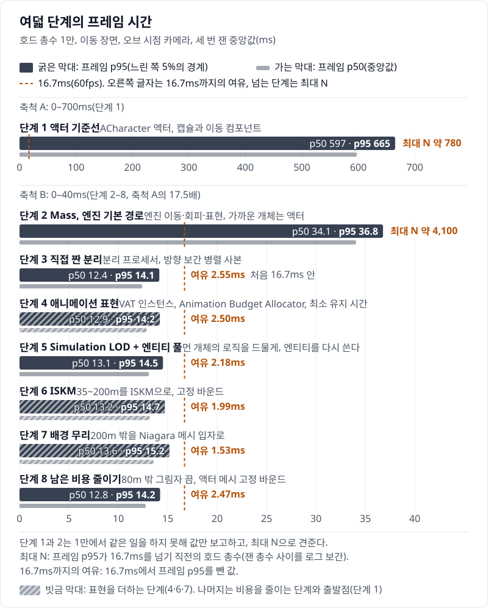
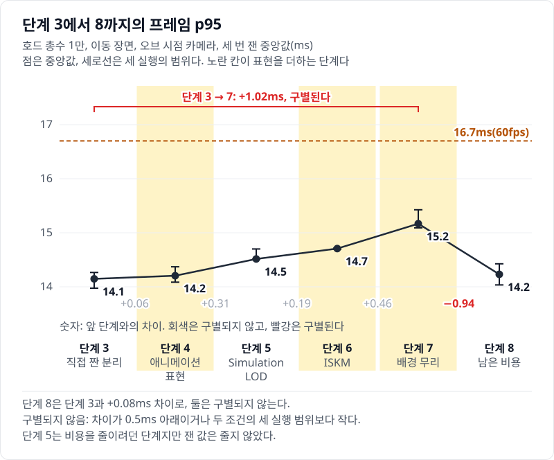
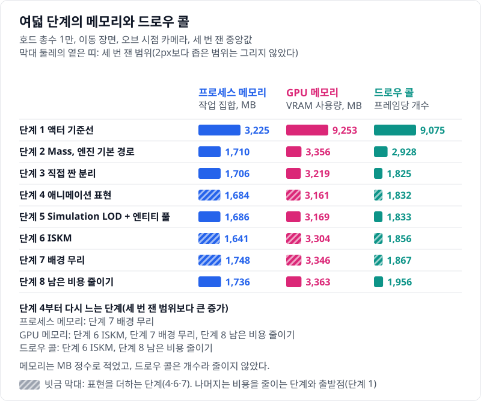

# 07 요약: 단계 3에서 16.7ms 안에 들고, 표현을 셋 더한 최종 구성도 2.47ms가 남는다

## 요약

`ACharacter` 액터로 만든 호드 1만은 프레임 p50(프레임 시간의 중앙값)이 597ms였다. 같은 호드를 Mass로 다시 만들고 같은 일을 하는 여덟 단계로 나눠 쟀다. 단계 3에서 프레임 p95(느린 쪽 5%의 경계)가 14.1ms가 되어 처음 16.7ms 안에 들었다. 단계 3에서 7까지 표현 셋을 더하는 동안 프레임 p95는 1.02ms 늘었고, 단계 8이 0.94ms를 줄였다. 최종 구성의 프레임 p95는 14.2ms이고 16.7ms까지의 여유는 2.47ms다.

수치의 근거는 [측정 기록](measurements.md)에 있다.

> **시나리오.** 오브(Orb)가 맵 중심 둘레의 원 궤도를 2m/s로 돈다. 호드 1만이 오브를 쫓아 사방에서 걸어오고, 오브는 가까운 개체를 지우고 먼 개체를 주기적으로 쏜다. 모든 거리에서 생성·피격·사망·표현 전환이 계속 일어나게 하는 벤치마크 장치다.

## 사다리: 크게 준 두 단계, 1.02ms 늘어난 단계 3\~7, 0.94ms 준 단계 8

모든 단계는 같은 일 넷을 한다. 움직이는 오브를 쫓고, 서로 겹치지 않고, 가까운 개체는 캡슐 콜리전을 갖고, 피해를 받고 죽는다. 한 단계는 앞 단계에서 기법 한 벌만 바꾼다. 같은 일을 하는지는 동등성 검사가 조건마다 본다([목표 사양과 재는 법](../00-goals-and-method/README.md)).

단계 1은 모든 개체가 캡슐과 CharacterMovement를 가진 액터다. 단계 2는 개체를 Mass 엔티티로 옮기고 엔진의 이동·회피·표현 프로세서를 그대로 썼다. 두 단계는 1만에서 같은 일을 하지 못해, 60fps를 지키는 최대 N으로 견준다. 최대 N은 프레임 p95가 16.7ms를 넘기 직전의 호드 총수다. 단계 1은 약 780, 단계 2는 약 4,100이다.

단계 3은 엔진 회피를 직접 짠 분리 프로세서로, 엔진 방향 보간을 병렬 사본으로 바꿨다. 프레임 p95가 36.8ms에서 14.1ms로 줄어 처음 16.7ms 안에 들었다. 16.7ms까지의 여유는 16.7ms에서 프레임 p95를 뺀 값이다. 단계 3의 여유는 2.55ms다. 단계 3부터는 1만에서의 프레임 p95와 이 여유로 적는다.

단계 4, 6, 7은 표현을 더하는 단계다. 35\~200m를 VAT 인스턴스로 걷게 했고, 같은 자리를 ISKM으로 바꿨고, 200m 밖을 Niagara 입자로 채웠다. 단계마다의 차이는 구별되지 않는다. 구별되지 않는다는 것은 중앙값의 차이가 0.5ms 아래이거나 두 조건의 범위 가운데 큰 쪽을 넘지 않는다는 뜻이다. 단계 3에서 7까지 모으면 1.02ms 늘었고, 이 차이는 구별된다.

비용을 줄이는 단계(2, 3, 5, 8) 가운데 단계 5는 Simulation LOD와 엔티티 풀을 넣었지만 잰 값으로는 줄지 않았다. 단계 8은 80m 밖 인스턴스의 그림자를 끄고 액터 메시의 바운드를 고정했다. 프레임 p95가 0.94ms 줄어 14.2ms가 됐고 단계 3과 구별되지 않는다. 측정 끝에 최종 구성을 세 번 더 재자 프레임 p95가 0.08ms 달랐다.

## 여덟 단계의 화면

 
 
 
 

*왼쪽 위부터 한 줄에 둘씩 단계 1\~8이다. 호드 총수 1만, 이동 장면, 오브 시점 카메라다. 화면마다 왼쪽 위에 있는 HUD의 숫자는 측정값이 아니다.*

단계 1은 모든 개체가 액터이고, 단계 2부터는 35m 안만 액터로 그린다. 단계 2부터 6까지는 200m 밖이 비어 지평선 앞에 맨바닥이 보인다. 단계 7부터는 입자가 그 자리를 채워 지평선까지 무리가 찬다.

## 자원: 드로우 콜과 메모리는 앞의 두 단계에서 크게 줄었다

드로우 콜은 단계 1의 9,075에서 단계 3의 1,825로 줄었다. 표현을 더한 최종 구성은 1,956이다. GPU 메모리는 단계 1의 9,250MB에서 단계 2의 3,360MB로 줄었다. 그 뒤로는 3,160\~3,360MB 사이에 머물렀다. 프로세스 메모리는 단계 2에서 3,220MB의 약 절반인 1,710MB가 됐다.

## 기법별 기여: 큰 비용은 가까운 액터, 큰 절약은 200m 밖을 그리지 않는 일

기법별 기여는 최종 구성에서 기법 하나만 끄고 같은 조건으로 잰 프레임 p95와 최종 구성의 차이다. 열일곱 조건과 하위 실험 하나는 [비용을 줄이는 단계와 기법별 기여](../05-cost-cuts-and-contributions/README.md)에 있다. 요점은 넷이다.

- 하이드레이션(Hydration, 가까운 엔티티에만 진짜 액터를 붙이는 일)을 끈 조건은 프레임 p95가 6.98ms 짧다. 액터 캡슐, 액터 애니메이션 예산, 액터 메시 고정 바운드가 함께 빠진 참고 값이다.
- 액터 캡슐만 끈 조건도 1.86ms 짧다. 캡슐 콜리전은 모든 단계가 하는 일이라 최종 구성은 켠 채 둔다.
- 200m 밖을 그리지 않는 일을 끈 조건은 3.54ms 길다. 기법 하나로는 가장 큰 절약이다.
- 열일곱 조건 가운데 열은 구별되지 않는다. 최소 유지 시간과 엔티티 풀의 이점은 왕복 전환과 ISKM 트랙 수에서 보인다.

엔진에서 찾은 문제 다섯은 엔진 소스를 고치지 않고 게임 코드, 에셋, 검사 규칙에서 피했다. 가장 큰 것은 움직이는 엔티티를 파괴하면 ISKM 트랙이 남는 문제이고, 우회는 엔티티 풀이다([엔진을 고치지 않고 피한 문제 다섯](../06-engine-findings/README.md)).

## 목표 총수 다시 보기: 호드 1만은 판정을 통과했다

목표 판정은 최종 구성의 프레임 p95에 0.6ms를 더해도 16.7ms 안인지 본다. 0.6ms는 실행 하나가 중앙값보다 길게 나올 수 있는 폭이다. 최종 구성은 14.8ms로 판정을 통과했다. 최종 구성이 60fps를 지키는 최대 N은 잰 두 총수의 프레임 p95를 이어 셈하면 약 1만 2천이다. 호드 2만에서는 겹침 방지가 제 기능을 하지 못해 이 셈에서 뺐다.

같은 최종 구성을 두 장면에서 참고로 더 쟀다. 오브가 원점에 서 있는 정지 장면은 프레임 p95가 11.5ms다. 오브 100m 위에서 내려다보는 탑뷰는 6.23ms다. 두 점은 워밍업이나 카메라가 달라 이동 장면의 값과 직접 견주지 않는다. 목표 판정에는 이동 장면과 오브 시점 카메라의 값만 쓴다.

## 한계

- 정지 장면에서는 오브가 2초마다 액터 캡슐에 쏘는 확인 트레이스가 약 1.7% 빗나간다. 시작점이 캡슐의 정면 평면 위에 놓이면 엔진의 라인 트레이스가 캡슐을 놓친다. 측정 장치의 결함이고, 놓치는 엔진 안의 분기는 찾지 못했다.
- 표현 프로세서와 분리 프로세서 사이에 순서 선언이 없어, 표현이 분리 전의 위치를 읽는 프레임이 섞인다. 최종 구성의 트레이스에서 엔진 표현 프로세서는 약 10%의 프레임에서 분리가 끝나기 전에 돌았다.
- 겹친 쌍(몸통이 겹친 개체 쌍의 수)은 프레임 시간이 길수록 는다. 프레임 시간이 크게 다른 조건끼리는 겹친 쌍을 견주지 않았다.
- 같은 조건을 세 번씩 재서 0.5ms 아래의 차이는 가르지 못한다. 값은 측정 PC 한 대와 장애물 없는 평지 하나에서 나왔다.

나누지 않은 몫과 확인하지 않은 원인도 있다.

- 단계 2에서 3으로 준 시간에는 회피 구현의 차이와 뭉침이 풀린 장면의 차이가 함께 들어 있다.
- 단계 3에서 7까지 늘어난 게임 스레드 시간이 어느 프로세서의 몫인지는 트레이스로 가르지 않았다.
- 단계 5가 프레임 시간을 줄이지 못한 원인은 가르지 않았다.
- 하이드레이션, ISKM, 배경 무리를 끈 조건은 다른 것이 함께 빠져 기법 하나의 몫이 아니다.

## 한 문장으로

엔진 회피를 직접 짠 분리로 바꾼 단계 3에서 호드 1만이 처음 16.7ms 안에 들었고, 단계 7까지 늘어난 시간은 단계 8이 거의 되돌렸다.

- 같은 일을 하는지 먼저 확인한 뒤에 프레임 p95를 견준다.
- 하나씩은 구별되지 않는 단계도 여럿을 모으면 구별되는 비용이 된다.
- 프레임에 드러나지 않는 이점은 왕복 전환, ISKM 트랙 수 같은 다른 지표로 확인한다.

연재의 글은 다음과 같다.

- [00 목표와 재는 법](../00-goals-and-method/README.md)
- [01 액터 기준선](../01-actor-baseline/README.md)
- [02 Mass, 엔진 기본 경로](../02-mass-engine-path/README.md)
- [03 직접 짠 분리](../03-separation/README.md)
- [04 표현을 더하는 단계](../04-quality-by-distance/README.md)
- [05 비용을 줄이는 단계와 기법별 기여](../05-cost-cuts-and-contributions/README.md)
- [06 엔진에서 찾은 문제](../06-engine-findings/README.md)
