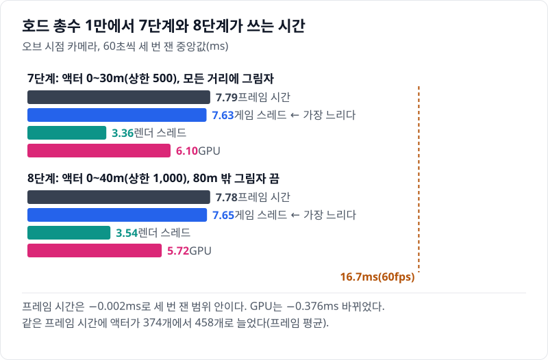
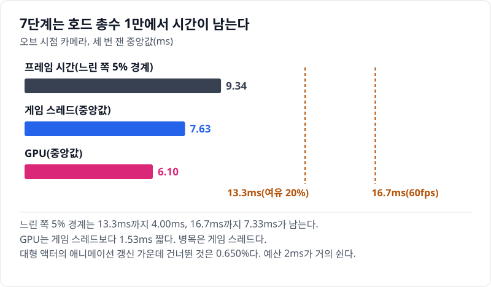
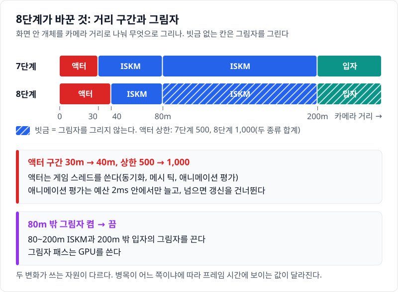
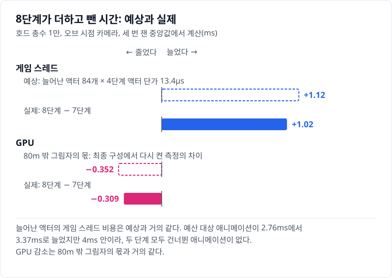
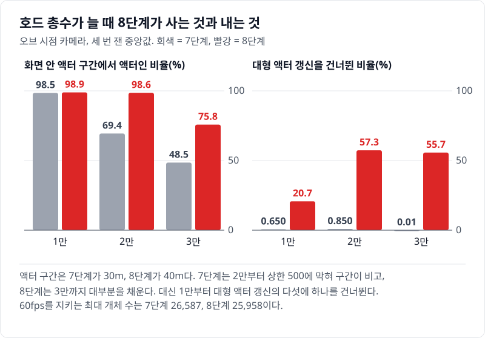
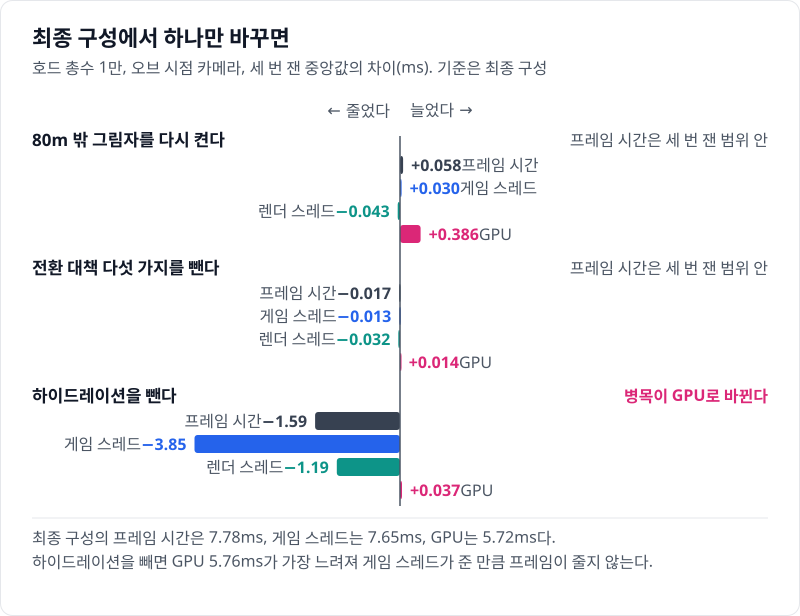

# 08 품질 올리기: 남은 예산을 액터 수와 전환 거리에 쓰기

## 요약

8단계는 7단계까지 번 시간을 품질에 쓴다. 화면 안에서 개체를 진짜 액터로 그리는 구간(액터 구간)을 30m에서 40m로, 액터 상한을 500에서 1,000으로 올리고, 80m 밖 미니언의 그림자를 껐다. 값은 모두 호드 총수 1만, 오브 시점 카메라에서 잰 것이다. 액터가 373개에서 457개로 늘었고, 늘어난 액터도 애니메이션을 하나도 건너뛰지 않는다. 그 값으로 프레임 시간이 8.73ms에서 9.75ms로 1.02ms 늘었다.



프레임 시간은 게임 스레드, 렌더 스레드, GPU 가운데 가장 느린 쪽이 정한다. 두 단계 모두 게임 스레드가 가장 느리다. 지표의 자세한 설명은 [00번 글](../00-goals-and-method/README.md)에 둔다.


수치의 근거는 [측정 기록](measurements.md)에 있다.

> **시나리오.** 플레이어는 움직이지 않는다. 맵 중앙의 오브(Orb)를 향해 개체가 사방에서 걸어오고, 오브는 가까운 개체를 지우고 먼 개체를 주기적으로 쏜다. 모든 거리에서 생성·피격·사망·표현 전환이 계속 일어나게 하는 벤치마크 장치다.

## 배경 지식

### 표현 LOD의 중요도

표현 LOD는 개체를 무엇으로 그릴지 정하는 거리 단계다. Mass는 개체마다 표현 LOD를 정하면서 중요도라는 실수도 함께 계산한다. 중요도는 LOD 번호에 그 구간 안의 위치(0 이상 1 미만)를 더한 값이다. High가 0, Medium이 1, Low가 2라서, 8단계에서는 중요도 1\~2가 40\~80m, 2\~3이 80\~200m다.

인스턴스 메시 설명자에는 그 메시를 쓸 중요도 범위를 적는 칸이 있다. 8단계에서는 이 범위로 ISKM(GPU에서 스키닝하는 인스턴스 스켈레탈 메시) 설명자를 80m에서 둘로 나눴다.

### 그림자는 컴포넌트 단위다

Mass는 인스턴스 메시 설명자 하나마다 인스턴스 컴포넌트 하나를 만든다. 그림자를 그릴지는 그 컴포넌트에 한 번 정한다. 인스턴스마다 정하는 칸은 없다. 거리마다 그림자를 다르게 하려면, 그림자만 다른 설명자 둘을 두고 중요도 범위로 나눠 맡긴다. 개체는 80m를 넘을 때 한 컴포넌트에서 다른 컴포넌트로 옮겨 간다.

## 문제: 7단계는 시간이 남는데 가까운 개체를 30m까지만 액터로 그린다

[07번 글](../07-niagara-crowd/README.md)의 7단계는 200m 밖을 입자로 채웠다. 호드 총수 1만에서 프레임 시간의 느린 쪽 5% 경계는 10.6ms다. 60fps의 16.7ms까지 6.09ms가 남는다.



애니메이션 예산도 남는다. 7단계의 예산 대상 애니메이션은 프레임당 2.76ms로, 예산 4ms까지 1.24ms가 남는다. 7단계는 애니메이션을 하나도 건너뛰지 않는다. GPU는 게임 스레드보다 2.51ms 짧다.

반대로 호드가 커지면 가까운 구간이 빈다. 7단계는 상한 500에 막혀, 호드 총수 2만에서 화면 안 30m 개체의 69.2%만 액터다. 나머지는 플레이어 바로 앞에서도 ISKM 인스턴스로 남는다.

## 원리: 남은 예산을 무엇에 쓸지 고르는 기준

8단계는 거리 구간의 경계 하나와 액터 상한, 그림자를 바꾼다. 아래 그림의 위쪽은 두 단계의 거리 구간이고, 아래쪽은 액터와 그림자가 쓰는 자원이다.



고르는 기준은 셋이다.

- 프레임 시간: 호드 총수 1만에서 느린 쪽 5% 경계가 60fps의 16.7ms 안이어야 한다. 남는 시간은 다 쓰지 않는다. 이 측정 장면에 없는 게임 로직과 이펙트의 몫이다.
- 애니메이션: 액터는 매 프레임 애니메이션을 갱신해야 쓸모가 있다. 액터의 애니메이션은 예산 4ms 안에서만 평가된다. 넘으면 Animation Budget Allocator가 화면에서 작은 액터부터 갱신을 건너뛴다. ISKM 인스턴스는 이 예산에 들지 않는다. 갱신을 건너뛴 액터는 옆의 ISKM보다 덜 부드러울 수 있다.
- 그림자: 그림자는 크게 보이는 곳에 쓴다. 80m 밖 미니언은 화면에서 작다.

전환 거리는 둘째 기준으로 골랐다. 거리를 80m 구간 끝 가까이까지 늘려 보면, 멀수록 건너뜀 비율이 빠르게 는다. 30m에서 한 걸음만 늘린 40m를 골랐다. 상한 1,000은 호드 총수 1만에서 닿지 않는 값이다. 2만부터 액터 수를 막는다.

**예상.** 4단계 액터는 하나에 게임 스레드 13.4µs를 썼다([04번 글](../04-hydration-anim-budget/README.md)). 그 단가면 늘어난 액터 84개가 1.12ms를 더한다. 7단계의 애니메이션 예산에는 1.24ms가 남아 있다. 늘어난 액터의 애니메이션은 이 안에 들어, 건너뛰지 않고 그대로 게임 스레드 시간이 될 것이다. GPU는 80m 밖 그림자 패스가 빠지는 만큼 준다.

## 바꾼 것: 변형 값 셋과 그림자 설명자

7단계에서 바꾼 값은 셋이다. 화면 안 전환 거리, 액터 상한, 80m 밖 그림자다. 한 비교에서 셋이 함께 바뀌었다. 그림자의 몫은 최종 구성에서 그림자만 다시 켠 측정과 탑뷰 카메라로 가른다. 전환 거리와 상한의 몫은 따로 가르지 않았다.

**전환 거리와 상한.** 최종 구성의 변형이 두 값을 정한다.

`Source/HordeOptLab/LabConfig.h`, `FLabQuality`

```cpp
static constexpr int32 DefaultActorCap = 500;
static constexpr float DefaultHydrateM = 30.f;
// ...
static constexpr int32 Q4FinalActorCap = 1000;
// ...
static constexpr float Q4FinalHydrateM = 40.f;
```

`Source/HordeOptLab/LabConfig.cpp`, `FLabConfig::Get`

```cpp
else if (C.Variant == ELabVariant::Q4Final) { C.ActorCap = FLabQuality::Q4FinalActorCap; C.HydrateM = FLabQuality::Q4FinalHydrateM; }
// ...
C.bFarShadow = C.Variant != ELabVariant::Q4Final;
```

두 값은 [04번 글](../04-hydration-anim-budget/README.md)에서 본 구간 배열의 High 칸으로 들어간다(`Bands`의 액터 구간 끝, `MaxCounts`의 상한). 마지막 줄은 최종 구성에서만 80m 밖 그림자를 끈다. 실행 인자 `-LabFarShadow=1`로 다시 켤 수 있다.

**그림자 설명자.** 엔진의 설명자와 컴포넌트는 이렇게 생겼다.

`Engine/Plugins/Runtime/MassGameplay/Source/MassRepresentation/Public/MassSkinnedMeshRepresentationTypes.h`, `FMassSkinnedMeshInstanceVisualizationMeshDesc`(앞 세 줄)와 같은 플러그인의 `MassVisualizationComponent.cpp`(마지막 줄)

```cpp
	float MinLODSignificance = float(EMassLOD::High);
	// ...
	float MaxLODSignificance = float(EMassLOD::Max);
	// ...
	bool bCastShadows = false;
// ...
				InstancedSkinnedMeshComponent->SetCastShadow(InstancedSkinnedMeshDesc.bCastShadows);
```

중요도 범위는 기본으로 전 구간이다. `bCastShadows`는 컴포넌트를 만들 때 한 번 `SetCastShadow`로 넘어간다. 이 레포는 설명자를 복사해 범위를 나눈다.

`Source/HordeOptLab/LabCrowdSubsystem.cpp`, `ULabCrowdSubsystem::BuildEntityConfig`

```cpp
if (bSplitFarShadow)
{
	FMassSkinnedMeshInstanceVisualizationMeshDesc FarDesc = SkinnedDesc;
	SkinnedDesc.SetSignificanceRange(EMassLOD::High, EMassLOD::Low);
	FarDesc.SetSignificanceRange(EMassLOD::Low, EMassLOD::Max);
	FarDesc.bCastShadows = false;
	Visual->SkinnedMeshInstanceDesc.Meshes.Add(SkinnedDesc);
	Visual->SkinnedMeshInstanceDesc.Meshes.Add(FarDesc);
}
```

앞의 설명자는 중요도 0\~2(80m 안)를 맡고 그림자를 그린다. 뒤의 설명자는 2부터(80m 밖)를 맡고 그림자를 그리지 않는다. 200m 밖 입자도 같은 스위치를 따른다.

`Source/HordeOptLab/LabGameMode.cpp`, `ALabGameMode::SetupCrowdFx`

```cpp
if (Config.bCrowdFxEntity)
{
	CrowdFx->SetCastShadow(Config.bFarShadow);
}
```

### 80m를 넘는 개체의 애니메이션 트랙

설명자를 나누면 ISKM 컴포넌트가 종류마다 둘이 된다. 애니메이션 트랙도 컴포넌트마다 따로다. 엔진은 트랙이 이미 있으면 클립 번호가 다를 때만 트랙을 다시 쓴다.

`Engine/Plugins/Runtime/MassGameplay/Source/MassRepresentation/Private/MassVisualizationComponent.cpp`(트랙이 이미 있을 때)

```cpp
										if (ASTPDI->GetSequenceIndex(TrackId, 0) != InstanceAnimationData[IDIndex].SequenceIndex)
										{
											ASTPDI->SetAutoPlayData(TrackId, 0, InstanceAnimationData[IDIndex]);
										}
```

개체가 전에 머물던 컴포넌트로 돌아오면, 같은 걷기 클립의 옛 트랙이 옛 시작 시각으로 남아 있다. 그대로 두면 80m를 넘는 순간 걷기 자세가 튈 수 있다. 이 동작을 다룬 공개 이슈는 찾지 못했다. 이 레포는 범위가 바뀐 프레임에 새 컴포넌트의 트랙을 직접 다시 쓴다.

`Source/HordeOptLab/LabIskmProcessor.cpp`, `ULabIskmProcessor::Execute`

```cpp
const bool bRangeChanged = Info.GetLODSignificanceRangesNum() > 1 && Representation.PrevLODSignificance >= 0.f
	&& Info.GetLODSignificanceRange(Representation.PrevLODSignificance) != Info.GetLODSignificanceRange(LODSignificance);
FLabIskmTrackFragment& Track = Tracks[EntityIt];
if (bRangeChanged || Track.AppliedState != int8(Anim.State) || Track.AppliedStartTime != Anim.StateStartTime)
```

개발 빌드의 로그로, 80m 안쪽으로 넘어오는 걷기의 재생 위치가 끊기지 않고 이어지는 것을 확인했다.

## 결과: 액터 84개를 더 그리고, 그 값으로 프레임이 1.02ms 길어진다



8단계는 프레임 평균 457개의 액터를 그렸다. 7단계보다 84개 많다. 게임 스레드는 1.02ms 늘어 예상 1.12ms와 거의 같다.

예산 대상 애니메이션은 2.76ms에서 3.37ms로 늘었지만 4ms 안이다. 두 단계 모두 건너뛴 애니메이션이 없고, 늘어난 액터의 비용이 그대로 게임 스레드에 남았다. 40m 안으로 들어온 개체만큼 ISKM 인스턴스가 준 몫도 섞여 있어, 둘을 가르지는 않았다.

병목이 게임 스레드라 프레임 시간도 1.02ms 늘었다. 8단계의 느린 쪽 5% 경계는 11.5ms로 16.7ms 안이다.

GPU는 0.309ms 줄었다. 최종 구성에서 80m 밖 그림자만 다시 켜면 GPU가 0.352ms 는다. GPU 감소는 거의 다 그림자의 몫이다. 렌더 스레드는 0.292ms 늘었다. 액터는 메시마다 따로 그려서 드로우 콜이 1,360에서 1,713이 됐다.

### 호드가 커지면



액터 상한의 값은 2만부터 보인다. 7단계는 2만에서 액터 492개로 상한에 막혀, 화면 안 30m 개체의 69.2%만 액터다. 8단계는 액터 928개로 40m 안의 98.4%를 액터로 그린다. 3만에서는 8단계도 상한에 닿아 75.6%다.

2만부터는 예산이 차서 8단계의 소형 액터 42.1%가 그 프레임에 자세를 멈춘다. 대형은 0.36%만 멈춘다. 할당기가 화면에서 큰 메시를 먼저 갱신하기 때문이다.

ISKM 인스턴스는 예산 밖이라, 렌더러가 매 프레임 재생 위치를 월드 시각에서 다시 구한다.

`Engine/Source/Runtime/Renderer/Private/Skinning/AnimSequenceTransformProvider.cpp`, ISKM 트랙의 샘플 쓰기

```cpp
const double WorldTime = Context.CurrentTime.GetWorldTimeSeconds() * GlobalTimeScale;
// ...
const double TimePosition = bPrevious ? RenderData.GetPreviousTimePosition() : PackedData.GetTimePosition(WorldTime);
```

`WorldTime`은 그 프레임의 월드 시각이고, `GetTimePosition(WorldTime)`이 재생 위치를 매번 새로 낸다. 그래서 호드가 커져도 ISKM 인스턴스는 건너뛰는 프레임이 없고, 자세를 멈추는 쪽은 가까운 액터뿐이다.

60fps를 지키는 최대 개체 수는 약 2만 2천에서 약 2만으로 줄었다. 프레임 시간의 느린 쪽 5% 경계가 16.7ms에 닿는 호드 총수다. 8단계는 2만에서 16.68ms다. 기준까지 0.02ms만 남는다. 2만과 3만 모두 두 단계의 차이가 세 번 잰 범위보다 크다.

품질을 지키려면 액터 상한을 예산이 감당하는 수에 맞춘다. 호드 총수 1만의 액터 457개는 하나도 건너뛰지 않았지만, 2만의 928개에서는 예산이 찼다. 예산을 올리면 더 많은 액터를 매 프레임 갱신하지만, 그 비용은 그대로 게임 스레드 시간이 된다.

### 최종 구성에서 하나씩 빼면

최종 구성에서 이 단계와 관련된 설정을 하나씩 빼거나 켜서 다시 쟀다.



80m 밖 그림자를 다시 켜면 GPU 시간이 0.352ms 는다. 병목이 게임 스레드라서 GPU에 3.84ms 여유가 있지만, 프레임 시간도 0.127ms 늘었다. 게임 스레드도 0.117ms 늘었기 때문이다. 최종 구성은 그림자를 끈 채로 둔다.

탑뷰 카메라에서는 그림자의 몫이 프레임 시간으로 보인다. 카메라가 100m 높이라 모든 개체가 80m 밖이다. 7단계와 8단계의 차이는 그림자 하나다. 탑뷰는 GPU가 병목이고, 프레임 시간이 5.25ms에서 4.83ms로 줄었다.

전환 대책 다섯 가지를 빼도 프레임 시간은 구별되지 않는다. 대책은 화면에서만 차이가 난다([04번 글](../04-hydration-anim-budget/README.md)). 화면에서는 40m 최종 구성에서도 대책을 끄면 눈에 띄는 전환이 늘어난다.

하이드레이션(가까운 개체를 액터로 바꾸는 일)을 빼면 게임 스레드가 5.84ms 준다. 그런데 프레임 시간은 3.57ms만 준다. GPU 5.74ms가 가장 느린 쪽이 되기 때문이다. 하이드레이션 액터의 게임 스레드 비용 가운데 38.8%는 프레임 시간에 보이지 않는다.

## 한 문장으로

8단계는 남은 애니메이션 예산 안에서 가까운 액터를 84개 늘렸고, 그 대가로 프레임 시간이 1.02ms 길어지고 60fps를 지키는 호드 총수가 약 2만으로 내려왔다.

- 무엇을 살지는 그 설정이 쓰는 자원과 지금의 병목으로 고른다. 같은 그림자 끔이 오브 시점에서는 주로 GPU 시간에, 탑뷰에서는 프레임 시간에 보인다.
- 예산 4ms는 호드 총수 1만에서 액터를 하나도 건너뛰지 않는다. 예산이 차는 2만부터는 소형 액터의 40% 넘게가 자세를 멈추고, 대형은 거의 멈추지 않는다.
- 한계: 전환 거리와 상한의 몫을 따로 재지 않았다. 전환 거리를 고른 측정은 예산이 지금보다 작을 때의 것이다. 건너뛴 액터가 화면에서 덜 부드러운지는 나란히 견줘 보지 않았다.

[다음 글](../09-summary/README.md)에서는 사다리 여덟 단계와 빼 보기를 한데 모아 본다.
