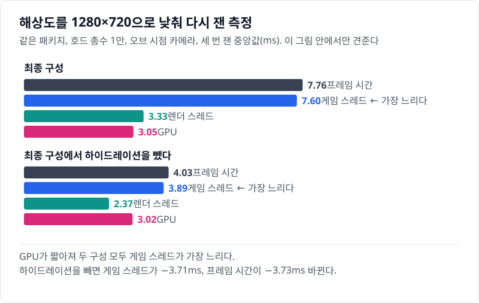

# 08 품질 올리기 — 남은 예산을 액터 수와 전환 거리에 쓰기

## 요약

8단계는 프레임 시간을 버는 단계가 아니다. 7단계까지 남긴 시간 안에서 무엇을 살지 고르는 단계다. 화면 안에서 개체를 진짜 액터로 그리는 구간(액터 구간)을 30m에서 40m로, 액터 상한을 500에서 1,000으로 올리고, 80m 밖 미니언의 그림자를 껐다. 값은 모두 호드 총수 1만, 오브 시점 카메라에서 잰 것이다. 프레임 시간은 7.79ms에서 7.78ms로, 세 번 잰 범위 안이다. 같은 프레임 시간에 액터가 374개에서 458개로 늘었다.


프레임 시간은 게임 스레드, 렌더 스레드, GPU 가운데 가장 느린 쪽이 정한다. 두 단계 모두 게임 스레드가 가장 느리다. 지표의 자세한 설명은 [00번 글](../00-goals-and-method/README.md)에 둔다.


수치의 근거는 [측정 기록](measurements.md)에 있다.

> **시나리오.** 플레이어는 움직이지 않는다. 맵 중앙의 오브(Orb)를 향해 개체가 사방에서 걸어오고, 오브는 가까운 개체를 지우고 먼 개체를 주기적으로 쏜다. 모든 거리에서 생성·피격·사망·표현 전환이 계속 일어나게 하는 벤치마크 장치다.

## 배경 지식

### 표현 LOD의 중요도

표현 LOD는 개체를 무엇으로 그릴지 정하는 거리 단계다. Mass는 개체마다 표현 LOD를 정하면서 중요도라는 실수도 함께 계산한다. 중요도는 LOD 번호에 그 구간 안의 위치(0 이상 1 미만)를 더한 값이다. High가 0, Medium이 1, Low가 2라서, 8단계에서는 중요도 1\~2가 40\~80m, 2\~3이 80\~200m다. 인스턴스 메시 설명자에는 그 메시를 쓸 중요도 범위를 적는 칸이 있다. 8단계에서는 이 범위로 ISKM(GPU에서 스키닝하는 인스턴스 스켈레탈 메시) 설명자를 80m에서 둘로 나눴다.

### 그림자는 컴포넌트 단위다

Mass는 인스턴스 메시 설명자 하나마다 인스턴스 컴포넌트 하나를 만든다. 그림자를 그릴지는 그 컴포넌트에 한 번 정한다. 인스턴스마다 정하는 칸은 없다. 그래서 거리마다 그림자를 다르게 하려면, 그림자만 다른 설명자 둘을 두고 중요도 범위로 나눠 맡긴다. 개체는 80m를 넘을 때 한 컴포넌트에서 다른 컴포넌트로 옮겨 간다.

## 문제: 7단계는 시간이 남는데 가까운 개체를 30m까지만 액터로 그린다

[07번 글](../07-niagara-crowd/README.md)의 7단계는 200m 밖을 입자로 채웠다. 호드 총수 1만에서 프레임 시간의 느린 쪽 5% 경계는 9.34ms다. 60fps의 16.7ms까지 7.36ms가 남는다.


애니메이션 쪽은 남는 것이 없다. 7단계에서 대형 액터의 애니메이션 갱신 가운데 건너뛴 것은 0.650%지만, 예산 대상 애니메이션은 이미 프레임당 약 2.01ms로 예산 2ms에 닿아 있다. GPU는 게임 스레드보다 1.53ms 짧다.

반대로 호드가 커지면 가까운 구간이 빈다. 7단계는 상한 500에 막혀, 호드 총수 2만에서 화면 안 30m 개체의 69.4%만 액터다. 나머지는 플레이어 바로 앞에서도 ISKM 인스턴스로 남는다.

## 원리: 남은 예산을 무엇에 쓸지 고르는 기준

8단계는 거리 구간의 경계 하나와 액터 상한, 그림자를 바꾼다. 아래 그림의 위쪽이 두 단계의 구간이고, 아래쪽이 두 변화가 쓰는 자원이다.


고르는 기준은 셋이다.

- **프레임 시간.** 호드 총수 1만에서 느린 쪽 5% 경계가 60fps의 16.7ms 안이어야 한다. 남는 시간은 다 쓰지 않는다. 이 측정 장면에 없는 게임 로직과 이펙트의 몫이다.
- **애니메이션.** 액터는 매 프레임 애니메이션될 때 값이 있다. 액터의 애니메이션은 예산 2ms 안에서만 평가된다. 넘으면 Animation Budget Allocator가 중요도가 낮은 액터의 갱신을 건너뛴다. ISKM 인스턴스는 이 예산에 들지 않는다. 그래서 갱신을 건너뛴 액터는 옆의 ISKM보다 덜 부드러울 수 있다.
- **그림자.** 그림자는 크게 보이는 곳에 쓴다. 80m 밖 미니언은 화면에서 작다.

전환 거리는 둘째 기준으로 골랐다. 거리를 80m 구간 끝 가까이까지 늘려 보니, 멀수록 건너뜀 비율이 빠르게 늘었다. 그래서 30m에서 한 걸음만 늘린 40m를 골랐다. 상한 1,000은 호드 총수 1만에서 닿지 않는 값이다. 2만부터 액터 수를 막는다.

**예상.** 4단계 액터는 하나에 게임 스레드 12.5µs를 썼다([04번 글](../04-hydration-anim-budget/README.md)). 그 단가면 늘어난 액터 84개가 1.05ms를 더한다. 4단계는 건너뜀이 1.29%뿐이던 구성이다. 예산이 차면 늘어난 몫의 일부를 갱신 건너뛰기로 갚으므로 실제는 그보다 작을 것이다. GPU는 80m 밖 그림자 패스가 빠지는 만큼 준다.

## 바꾼 것: 변형 값 셋과 그림자 설명자

7단계에서 바꾼 값은 셋이다. 화면 안 전환 거리, 액터 상한, 80m 밖 그림자다. 한 비교에서 셋이 함께 바뀌었다. 그림자의 몫은 최종 구성에서 그림자만 다시 켠 측정과 탑뷰 카메라로 가른다. 전환 거리와 상한의 몫은 따로 가르지 않았다.

**전환 거리와 상한.** 최종 구성의 변형이 두 값을 정한다.

`Source/HordeOptLab/LabConfig.h`, `FLabQuality`

```cpp
static constexpr int32 DefaultActorCap = 500;
static constexpr float DefaultHydrateM = 30.f;
// ...
static constexpr int32 Q4FinalActorCap = 1000;
// ...
static constexpr float Q4FinalHydrateM = 40.f;
```

`Source/HordeOptLab/LabConfig.cpp`, `FLabConfig::Get`

```cpp
else if (C.Variant == ELabVariant::Q4Final) { C.ActorCap = FLabQuality::Q4FinalActorCap; C.HydrateM = FLabQuality::Q4FinalHydrateM; }
// ...
C.bFarShadow = C.Variant != ELabVariant::Q4Final;
```

두 값은 [04번 글](../04-hydration-anim-budget/README.md)에서 본 구간 배열의 High 칸으로 들어간다(`Bands`의 액터 구간 끝, `MaxCounts`의 상한). 마지막 줄은 최종 구성에서만 80m 밖 그림자를 끈다. 실행 인자 `-LabFarShadow=1`로 다시 켤 수 있다.

**그림자 설명자.** 엔진의 설명자와 컴포넌트는 이렇게 생겼다.

`Engine/Plugins/Runtime/MassGameplay/Source/MassRepresentation/Public/MassSkinnedMeshRepresentationTypes.h`, `FMassSkinnedMeshInstanceVisualizationMeshDesc`(앞 세 줄)와 같은 플러그인의 `MassVisualizationComponent.cpp`(마지막 줄)

```cpp
	float MinLODSignificance = float(EMassLOD::High);
	// ...
	float MaxLODSignificance = float(EMassLOD::Max);
	// ...
	bool bCastShadows = false;
// ...
				InstancedSkinnedMeshComponent->SetCastShadow(InstancedSkinnedMeshDesc.bCastShadows);
```

중요도 범위는 기본으로 전 구간이다. `bCastShadows`는 컴포넌트를 만들 때 한 번 `SetCastShadow`로 넘어간다. 그래서 이 레포는 설명자를 복사해 범위를 나눈다.

`Source/HordeOptLab/LabCrowdSubsystem.cpp`, `ULabCrowdSubsystem::BuildEntityConfig`

```cpp
if (bSplitFarShadow)
{
	FMassSkinnedMeshInstanceVisualizationMeshDesc FarDesc = SkinnedDesc;
	SkinnedDesc.SetSignificanceRange(EMassLOD::High, EMassLOD::Low);
	FarDesc.SetSignificanceRange(EMassLOD::Low, EMassLOD::Max);
	FarDesc.bCastShadows = false;
	Visual->SkinnedMeshInstanceDesc.Meshes.Add(SkinnedDesc);
	Visual->SkinnedMeshInstanceDesc.Meshes.Add(FarDesc);
}
```

앞의 설명자는 중요도 0\~2(80m 안)를 맡고 그림자를 그린다. 뒤의 설명자는 2부터(80m 밖)를 맡고 그림자를 그리지 않는다. 200m 밖 입자도 같은 스위치를 따른다.

`Source/HordeOptLab/LabGameMode.cpp`, `ALabGameMode::SetupCrowdFx`

```cpp
if (Config.bCrowdFxEntity)
{
	CrowdFx->SetCastShadow(Config.bFarShadow);
}
```

### 80m를 넘는 개체의 애니메이션 트랙

설명자를 나누면 ISKM 컴포넌트가 종류마다 둘이 된다. 애니메이션 트랙도 컴포넌트마다 따로다. 엔진은 트랙이 이미 있으면 클립 번호가 다를 때만 트랙을 다시 쓴다.

`Engine/Plugins/Runtime/MassGameplay/Source/MassRepresentation/Private/MassVisualizationComponent.cpp`(트랙이 이미 있을 때)

```cpp
										if (ASTPDI->GetSequenceIndex(TrackId, 0) != InstanceAnimationData[IDIndex].SequenceIndex)
										{
											ASTPDI->SetAutoPlayData(TrackId, 0, InstanceAnimationData[IDIndex]);
										}
```

개체가 전에 머물던 컴포넌트로 돌아오면, 같은 걷기 클립의 옛 트랙이 옛 시작 시각으로 남아 있다. 그대로 두면 80m를 넘는 순간 걷기 자세가 튈 수 있다. 이 동작을 다룬 공개 이슈는 찾지 못했다. 이 레포는 범위가 바뀐 프레임에 새 컴포넌트의 트랙을 직접 다시 쓴다.

`Source/HordeOptLab/LabIskmProcessor.cpp`, `ULabIskmProcessor::Execute`

```cpp
const bool bRangeChanged = Info.GetLODSignificanceRangesNum() > 1 && Representation.PrevLODSignificance >= 0.f
	&& Info.GetLODSignificanceRange(Representation.PrevLODSignificance) != Info.GetLODSignificanceRange(LODSignificance);
FLabIskmTrackFragment& Track = Tracks[EntityIt];
if (bRangeChanged || Track.AppliedState != int8(Anim.State) || Track.AppliedStartTime != Anim.StateStartTime)
```

개발 빌드의 로그로, 80m 안쪽으로 넘어오는 걷기의 재생 위치가 끊기지 않고 이어지는 것을 확인했다.

## 결과: 프레임 시간은 그대로이고, 액터 84개를 더 그린다


8단계는 프레임 평균 458개의 액터를 그렸다. 7단계보다 84개 많다. 게임 스레드는 0.020ms 늘어 세 번 잰 범위 안이다. 대신 대형 액터의 애니메이션 갱신을 건너뛴 비율이 0.650%에서 20.7%로 뛰었다. 예산이 이미 차 있던 터라, 늘어난 액터의 애니메이션을 예산이 건너뛰기로 갚았다고 본다. 40m 안으로 들어온 개체만큼 ISKM 인스턴스가 준 몫도 섞여 있어, 둘을 가르지는 않았다.

GPU는 0.376ms 줄었다. 최종 구성에서 80m 밖 그림자만 다시 켜면 GPU가 0.386ms 는다. GPU 감소는 거의 다 그림자의 몫이다. 렌더 스레드는 0.176ms 늘었다. 액터는 메시마다 따로 그려서 드로우 콜이 1,360에서 1,716이 됐다. 8단계의 느린 쪽 5% 경계는 9.42ms로 16.7ms 안이다.

### 호드가 커지면


액터 상한의 값은 2만부터 보인다. 7단계는 2만에서 액터 492개로 상한에 막혀, 화면 안 30m 개체의 69.4%만 액터다. 8단계는 액터 929개로 40m 안의 98.6%를 액터로 그린다. 3만에서는 8단계도 상한에 닿아 75.8%다.

그 대가로 8단계는 2만에서 대형 액터 갱신의 57.3%를 건너뛴다. 액터 수가 거의 두 배인데 예산은 2ms 그대로라서다. 60fps를 지키는 최대 개체 수는 약 2만 6,600에서 약 2만 6,000으로 줄었다. 프레임 시간의 느린 쪽 5% 경계가 16.7ms에 닿는 호드 총수다. 다만 2만과 3만에서 두 단계의 느린 쪽 5% 경계 차이가 세 번 잰 범위 안이라, 이 차이는 구별되지 않는다.

### 최종 구성에서 하나씩 빼면

최종 구성에서 이 단계와 관련된 설정을 하나씩 빼거나 켜서 다시 쟀다.


80m 밖 그림자를 다시 켜면 GPU 시간이 0.386ms 늘고, 프레임 시간은 구별되지 않는다. 병목이 게임 스레드라서 GPU에 1.93ms 여유가 있다. 그래서 품질을 위해 그림자를 켜는 선택도 가능하다. 최종 구성은 끈 채로 둔다.

탑뷰 카메라에서는 그림자의 몫이 프레임 시간으로 보인다. 카메라가 100m 높이라 모든 개체가 80m 밖이다. 그래서 7단계와 8단계의 차이가 그림자 하나다. 탑뷰는 GPU가 병목이고, 프레임 시간이 5.26ms에서 4.92ms로 줄었다.

전환 대책 다섯 가지를 빼도 프레임 시간은 구별되지 않는다. 대책은 화면에서만 차이가 난다([04번 글](../04-hydration-anim-budget/README.md)). 화면 캡처로 낸 개발 빌드의 참고값으로, 40m 최종 구성에서도 대책을 끄면 눈에 띄는 전환이 두세 배가 된다. 이 값은 200m 밖 입자 메시를 바꾸기 전의 빌드에서 쟀다.

하이드레이션(가까운 개체를 액터로 바꾸는 일)을 빼면 게임 스레드가 3.85ms 준다. 그런데 프레임 시간은 1.59ms만 준다. GPU 5.76ms가 가장 느린 쪽이 되기 때문이다.

### 해상도를 낮추면 액터의 비용이 다 보인다

같은 패키지에서 창 해상도만 1280×720으로 낮춰, 빼 보기 행과 최종 구성을 다시 쟀다. GPU가 약 3ms로 짧아져 모든 행의 병목이 게임 스레드가 된다. 따로 잰 측정이라 그 안에서만 견준다.



이 해상도에서 하이드레이션을 빼면 프레임 시간이 3.73ms 준다. 게임 스레드가 준 3.71ms와 거의 같다. 2560×1440에서는 하이드레이션 액터의 게임 스레드 비용이 GPU에 가려 절반 넘게 보이지 않았다. 8단계가 사는 액터의 실제 비용은 프레임 시간에 보이는 것보다 크다.

## 한 문장으로

8단계는 프레임 시간을 그대로 두고 가까운 액터를 84개 늘렸고, 그 대가는 애니메이션 예산이 건너뜀으로 치렀다.

- 무엇을 살지는 그 설정이 쓰는 자원과 지금의 병목으로 고른다. 같은 그림자 끔이 오브 시점에서는 GPU 시간에만, 탑뷰에서는 프레임 시간에 보인다.
- 액터를 늘린 비용은 애니메이션 예산이 막고, 건너뜀 비율로 나온다. 호드 총수 1만에서도 대형 액터 갱신의 20.7%를 건너뛴다.
- 한계: 전환 거리와 상한의 몫을 따로 재지 않았다. 1만의 건너뜀 비율은 거리를 고를 때 본 값보다 크고, 원인은 확인하지 않았다. 건너뛴 액터가 화면에서 덜 부드러운지는 나란히 견줘 보지 않았다.

[다음 글](../09-summary/README.md)에서는 사다리 여덟 단계와 빼 보기를 한데 모아 본다.
