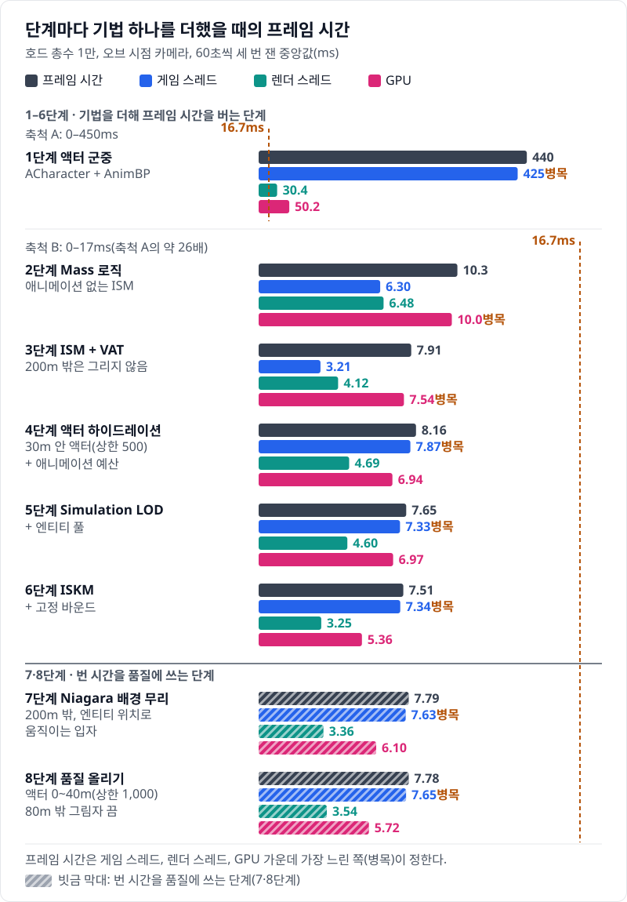
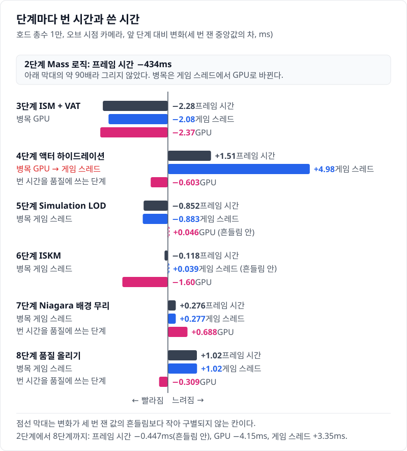
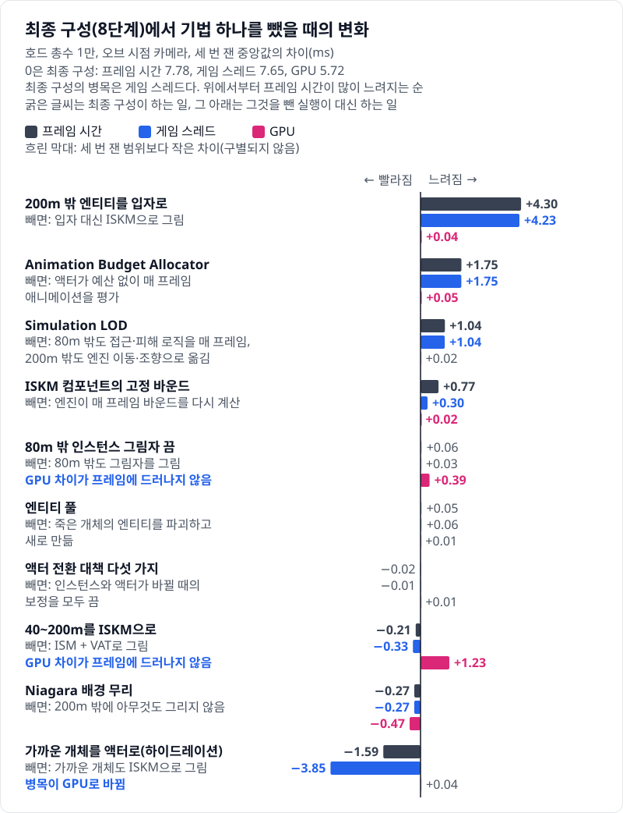
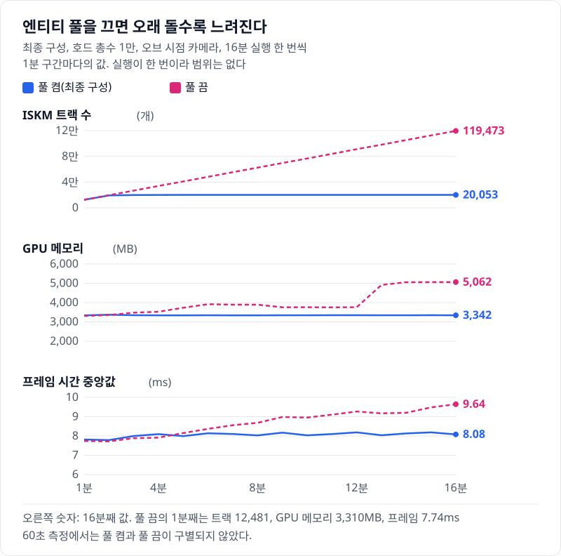
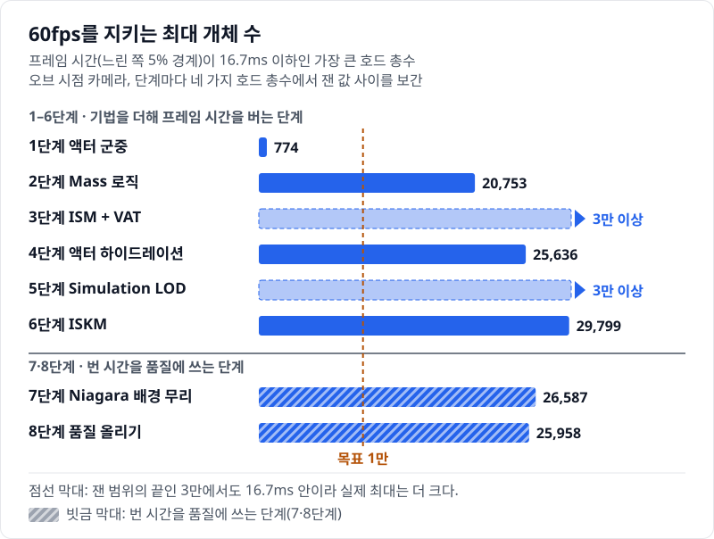
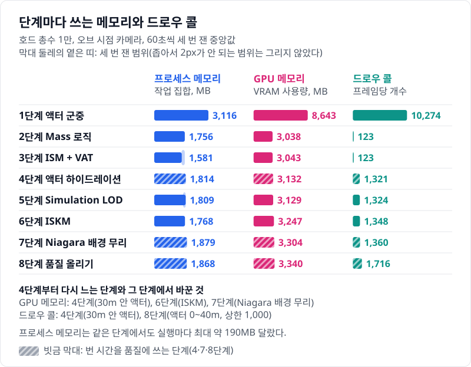
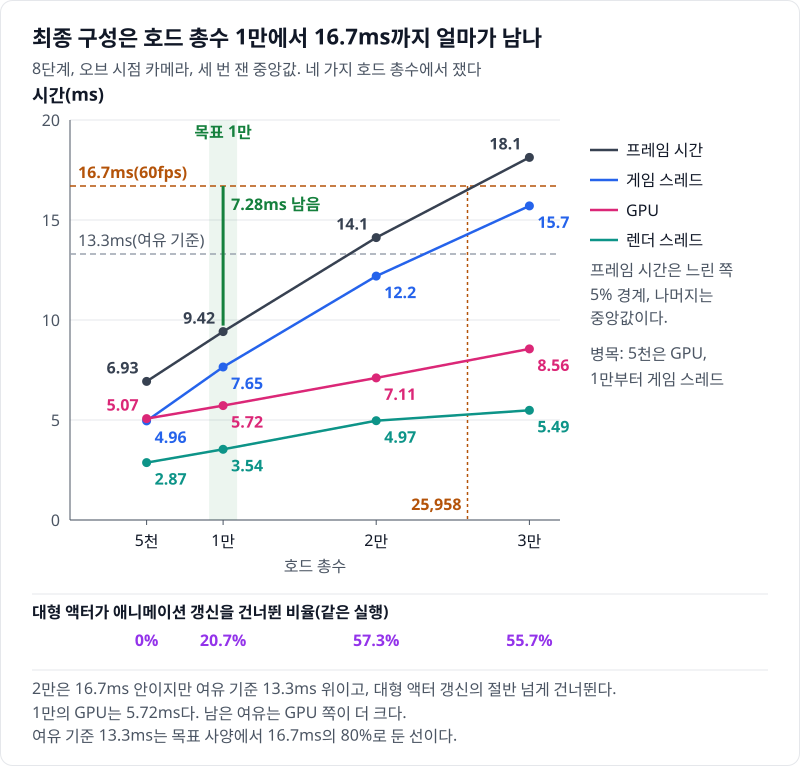

# 09 440ms에서 7.78ms로, 그리고 남은 7.28ms — 사다리, 빼 보기, 목표 총수

## 요약

여덟 단계를 거쳐 호드 총수 1만의 프레임 시간이 440ms에서 7.78ms가 됐다. 크게 번 것은 2·3단계이고, 4단계부터는 게임 스레드가 병목인 채로 번 시간을 가까운 개체의 품질과 배경 무리에 썼다. 최종 구성은 1만에서 프레임 시간의 느린 쪽 5% 경계가 9.42ms로, 60fps의 16.7ms까지 7.28ms가 남는다.

프레임 시간은 게임 스레드, 렌더 스레드, GPU 가운데 가장 느린 쪽이 정한다. 지표의 자세한 설명은 [00번 글](../00-goals-and-method/README.md)에 둔다.

수치의 근거는 [측정 기록](measurements.md)에 있다.

> **시나리오.** 플레이어는 움직이지 않는다. 맵 중앙의 오브를 향해 개체가 사방에서 걸어오고, 오브는 가까운 개체를 지우고 먼 개체를 주기적으로 쏜다. 모든 거리에서 생성·피격·사망·표현 전환이 계속 일어나게 하는 벤치마크 장치다.

## 사다리: 크게 번 것은 2·3단계이고, 4단계부터는 게임 스레드를 품질에 썼다

아래 그림은 단계마다 앞 단계보다 무엇이 줄고 무엇이 늘었는지를 보인다.

거의 모든 시간은 2단계에서 줄었다. 로직을 Mass로 옮기고 애니메이션 없는 ISM으로 그렸다. 액터마다 돌던 이동 컴포넌트와 틱이 사라져 프레임 시간이 430ms 줄었다([02번 글](../02-mass-logic/README.md)). 병목은 GPU로 넘어갔다. 3단계는 인스턴스에 애니메이션을 붙이고 200m 밖 개체를 지워, GPU를 2.49ms 줄였다([03번 글](../03-ism-vat/README.md)).

4단계는 시간을 썼다. 가까운 개체를 AnimBP 액터로 바꾸자 게임 스레드가 4.66ms 늘었다. 그런데 프레임 시간은 0.249ms만 늘었다. 여유가 있던 게임 스레드가 GPU를 앞질러 병목이 됐을 뿐이다([04번 글](../04-hydration-anim-budget/README.md)).

그 뒤로 병목은 줄곧 게임 스레드다. 5단계는 먼 개체를 엔진 이동에서 빼 게임 스레드를 0.536ms 줄였다([05번 글](../05-simulation-lod-entity-pool/README.md)). 6단계는 GPU를 1.62ms 줄였지만 프레임 시간은 0.148ms만 줄었다([06번 글](../06-iskm/README.md)).

7·8단계는 번 시간을 품질에 쓴다. 7단계의 배경 무리는 GPU 0.740ms와 게임 스레드 0.284ms를 쓴다([07번 글](../07-niagara-crowd/README.md)). 8단계는 액터 구간을 40m, 상한 1,000으로 넓히고 80m 밖 그림자를 껐다. 액터는 평균 374개에서 458개가 됐고, 프레임 시간은 구별되지 않았다([08번 글](../08-quality/README.md)).

2단계에서 8단계까지 프레임 시간은 2.52ms 줄었다. 같은 동안 GPU는 4.30ms 줄고, 게임 스레드는 1.35ms 늘었다. 병목이 게임 스레드로 넘어간 뒤로는 GPU에서 번 시간이 프레임 시간에 거의 나타나지 않는다.

## 빼 보기: 최종 구성의 기법은 대부분 게임 스레드에서 값이 보인다

최종 구성에서 기법을 하나씩 끄고 같은 조건으로 다시 쟀다. 막대는 최종 구성 대비 변화다.

가장 큰 행은 200m 밖이다. 200m 밖 엔티티를 입자 대신 ISKM으로 그리면 게임 스레드가 늘어 프레임 시간이 4.30ms 길어진다. 배경 무리를 아예 끄면 프레임 시간은 0.268ms 짧다. 200m 밖을 채우는 데 입자가 ISKM보다 게임 스레드를 훨씬 덜 쓴다.

게임 스레드의 일을 줄이는 기법은 빼면 그대로 프레임 시간이 된다. 애니메이션 예산을 빼면 1.75ms, Simulation LOD를 빼면 1.04ms 길어진다. 고정 바운드를 빼면 0.771ms 길어진다. 꺼 둔 액터의 캡슐 콜리전을 켜는 하위 실험은 2.01ms 길다.

하이드레이션은 반대 방향이다. 빼면 게임 스레드가 3.85ms 줄지만, 병목이 GPU로 바뀌어 프레임 시간은 1.59ms만 준다. 해상도를 1280×720으로 낮춰 GPU를 비운 참고 측정에서는 3.73ms 준다([08번 글](../08-quality/README.md)).

GPU만 바꾸는 기법은 프레임 시간에 보이지 않는다. ISKM을 VAT로 되돌리면 GPU 시간이 1.23ms 늘지만 프레임 시간은 0.206ms 짧다. ISKM을 남긴 이유는 GPU 시간, 굽는 단계가 없는 것, 원본 메시 LOD를 쓰는 것, 블렌딩을 쓸 수 있는 것이다. 이 프로젝트는 블렌딩을 쓰지 않는다. 80m 밖 그림자는 켜면 GPU 시간이 0.386ms 늘고, 프레임 시간은 구별되지 않는다.

전환 대책, 엔티티 풀, 80m 밖 그림자의 셋은 프레임 시간이 세 번 잰 범위 안이다. 전환 대책은 화면에서 차이가 난다([04번 글](../04-hydration-anim-budget/README.md)). 엔티티 풀은 오래 돌려야 차이가 난다.

풀을 끄고 16분을 돌리면 ISKM 트랙이 119,473개까지 쌓인다. GPU 메모리는 약 1.75GB 늘고, 프레임 시간 중앙값은 7.74ms에서 9.64ms가 된다. 풀을 켜면 트랙이 약 2만에서 멈춘다([05번 글](../05-simulation-lod-entity-pool/README.md)). 트랙이 왜 그 값에서 멈추는지는 확인하지 않았다. 풀을 끈 실행의 13분째에 GPU 메모리가 계단처럼 뛰는 이유도 확인하지 않았다.

## 최대 개체 수: 품질을 산 단계마다 조금씩 내려왔다

60fps를 지키는 최대 개체 수는 프레임 시간의 느린 쪽 5% 경계가 16.7ms를 넘기 직전의 호드 총수다.

액터 군중의 774가 Mass로 옮긴 2단계에서 20,753이 됐다. 26.8배다. 3단계와 5단계는 잰 가장 큰 3만에서도 16.7ms 안이다. 최종 구성은 25,958이다.

6·7단계는 1만의 프레임 시간을 거의 바꾸지 않고 최대 개체 수를 줄였다. 최대 개체 수는 2만\~3만에서 정해지기 때문이다. 6단계의 ISKM은 3만에서 게임 스레드를 1.13ms 늘렸다. 1만에서는 그 차이가 세 번 잰 범위 안이었다. 7단계의 입자는 3만에서 느린 쪽 5% 경계를 1.10ms 늘렸다.

8단계는 7단계보다 629개 적다. 다만 2만과 3만에서 두 단계의 느린 쪽 5% 경계 차이가 세 번 잰 범위 안이라, 이 차이는 구별되지 않는다.

## 자원: 메모리와 드로우 콜은 2단계에서 크게 줄고 조금씩 다시 늘었다

2단계에서 드로우 콜은 10,274에서 123이 됐다. GPU 메모리는 8,643MB에서 3,038MB가 됐다. 최종 구성의 드로우 콜은 1,716이다. 하이드레이션을 빼면 175로 주므로, 대부분은 가까운 액터의 몫이다.

## 목표 총수 재검토: 1만은 품질을 살 예산으로 맞았다

목표 사양은 호드 총수 1만, 60fps였다. 1만은 처음에 정한 값이라 최종 측정으로 다시 본다.

1만은 2단계에서 이미 지켰다. 그 단계의 느린 쪽 5% 경계는 10.9ms다. 그 뒤 여섯 단계는 1만이라는 고정된 크기 안에서 시간을 벌고 품질을 샀다. 1만은 도달할 목표라기보다, 품질에 쓸 시간을 정하는 예산 노릇을 했다.

최종 구성의 1만은 16.7ms까지 7.28ms가 남는다. 목표 사양에 잠정으로 둔 여유 기준은 16.7ms의 80%인 13.3ms이고, 그 기준까지도 3.88ms가 남는다. 이 기준으로 재면 최종 구성은 호드 총수 17,721까지 든다.

2만은 60fps 안이지만 같은 품질은 아니다. 느린 쪽 5% 경계는 14.1ms로 여유 기준을 넘는다. 대형 액터의 애니메이션 갱신은 57.3%를 건너뛴다. 1만에서도 20.7%를 건너뛰고, 이 값이 왜 이만큼인지는 확인하지 않았다. 3만은 18.1ms로 60fps를 넘는다.

남은 여유는 GPU 쪽이 크다. 1만의 GPU 시간은 5.72ms이고, 병목인 게임 스레드보다 1.93ms 짧다. 그래서 GPU만 쓰는 품질은 이 간격 안에서 프레임 시간에 거의 나타나지 않는다. 80m 밖 그림자가 그 예다. 반대로 게임 스레드에 일을 더하면 그만큼 프레임 시간이 된다. 애니메이션 예산을 빼면 게임 스레드와 프레임 시간이 함께 1.75ms 는다.

## 한 문장으로

호드 1만의 60fps는 2단계에서 이미 지켰고, 나머지 여섯 단계는 번 시간을 품질로 바꿨으며 그 값은 게임 스레드가 치렀다.

- 병목이 옮겨 가면 프레임 시간이 기법의 값을 숨긴다. 6단계와 ISKM의 이점은 GPU 시간으로, 하이드레이션의 비용은 게임 스레드 시간으로 읽는다.
- 60초 측정에 보이지 않는 비용이 있다. 엔티티 풀은 16분 실행에서만 갈렸다.
- 한계: 값은 측정 PC 한 대와 평지 시나리오 하나에서 나왔다. 대형 액터의 건너뜀 비율과 풀 켬 트랙 수의 원인은 확인하지 않았다.

연재는 여기서 끝난다. 최종 구성은 [Releases의 Test 패키지](https://github.com/hon454/unreal-horde-optimization-lab/releases/tag/test-package-08e45f2)로 직접 돌려 볼 수 있다.
