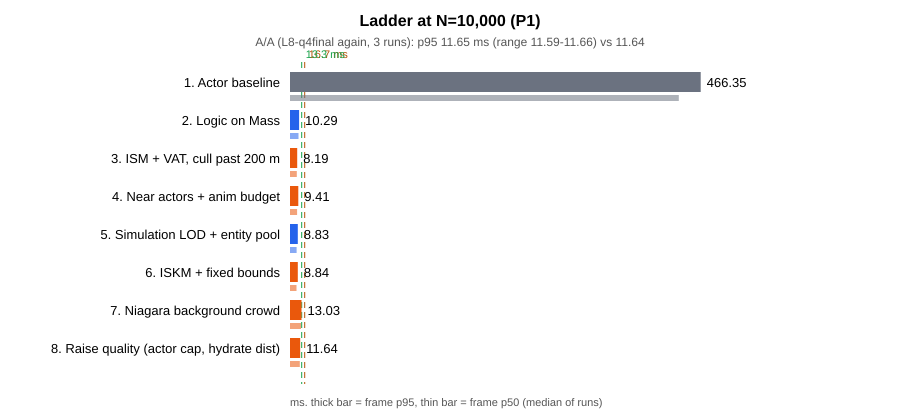

# Unreal 호드 최적화 실험실

`ACharacter` 액터로 만든 호드 1만은 한 프레임에 441ms가 걸린다. 이 프로젝트는 같은 호드를 Unreal Engine 5.8의 Mass Entity로 다시 짓고, 60fps의 한 프레임인 16.7ms 안에 들어올 때까지 거리별로 비용을 덜어내며 단계마다 잰 기록이다. 액터 군중에서 시작해 Mass 로직, ISM + VAT, 액터 하이드레이션과 애니메이션 예산, Simulation LOD, ISKM을 한 번에 하나씩 적용하고, 같은 시나리오를 같은 방법으로 다시 잰다.

- **대상**: 클라이언트 한 대에서 그리고 움직이는 군중의 비용. Game Thread, Render Thread, GPU, 메모리.
- **최적화**: Mass Entity(Fragment·Processor), Representation LOD(액터 / ISM+VAT / ISKM / 없음), 액터 하이드레이션과 풀링, Significance Manager → Animation Budget Allocator, URO, Simulation LOD(청크 단위 가변 틱), Niagara 배경 무리(엔티티 구동 입자).
- **측정 도구**: Test 구성 패키지에서 `csvprofile`과 Unreal Insights.

단계를 쌓은 뒤에는 목표 사양(호드 총수 1만, 60fps) 안에서 거리별 품질을 확보했다. 가까이는 액터 하이드레이션, 멀리는 ISKM, 그리는 끝(200m) 밖은 Niagara 배경 무리로 그리고, 그렇게 번 프레임 시간을 액터 수와 전환 거리에 쓴다. 최종 구성의 기법은 단계별 사다리와 "기법 하나를 뺀" 표로 이점을 확인했고, 이점이 보이지 않은 것도 그대로 적었다. 이 문서와 글의 수치는 마지막에 전 단계를 한 빌드에서 하루에 다시 잰 최종 측정의 값이다.

## 시나리오

플레이어는 움직이지 않는다. 맵 중앙의 오브를 향해 개체가 사방에서 걸어오고, 오브는 가까운 개체를 지우고 먼 개체를 주기적으로 쏜다. 모든 거리에서 생성·피격·사망·표현 전환이 계속 일어나게 하는 벤치마크 장치다. 개체는 Epic의 무료 에셋 Paragon: Minions의 근접 미니언(소형 90%)과 시즈 미니언(대형 10%) 두 종류이고, 체력은 개체마다 60\~240 사이에서 시드로 정한다. 카메라는 고정 프리셋 두 개(오브 뒤에서 바깥을 보며 도는 오브 시점, 탑뷰)로 잰다.

## 결과 한눈에 보기

| 1단계: 액터 군중 (프레임 약 440ms) | 8단계: 최종 구성 (프레임 약 11ms) |
| --- | --- |
|  |  |

같은 호드 총수 1만, 같은 오브 시점이다. 화면 왼쪽 위 HUD에 단계 이름, 프레임 시간, 거리별 개체 수가 나온다. 나머지 단계는 사다리 표의 "화면" 열에서 열 수 있다.



최종 측정의 값이다. 여덟 단계와 빼 보기 조건을 Test 패키지 하나(730ff18)에서 하루에 연달아 쟀다(2026-11-12). 호드 총수 1만, 오브 시점 카메라, 2560x1440 Epic, 3회 중앙값, 단위 ms다(`Measurements/Full1/summary.csv`). 사다리는 단계마다 기술 하나를 더한다. 프레임 시간은 게임 스레드, 렌더 스레드, GPU 가운데 가장 느린 쪽이 정한다. 가장 느린 쪽(병목)은 L1·L4\~L6이 게임 스레드, L2·L3·L7·L8이 GPU다.

| 단계 | 도입한 기술 | 프레임 시간(중앙값) | 프레임 시간(느린 쪽 5% 경계) | 게임 스레드 시간 | GPU 시간 | 60fps를 지키는 최대 개체 수 | 화면 |
| --- | --- | --- | --- | --- | --- | --- | --- |
| L1 | 액터 군중(`ACharacter` + AnimBP) | 441.46 | 466.35 | 426.93 | 50.52 | 797 | [보기](Docs/figures/steps/step1-L1-full.webp) |
| L2 | Mass 로직 + 애니 없는 ISM | 9.69 | 10.29 | 6.08 | 9.41 | 20,250 | [보기](Docs/figures/steps/step2-L2-mass.webp) |
| L3 | ISM + VAT, 200m 밖 그리지 않음 | 7.71 | 8.19 | 2.91 | 7.37 | 3만 안쪽 | [보기](Docs/figures/steps/step3-L3-vatcull.webp) |
| L4 | 30m 안 액터 하이드레이션(상한 500) + 애니메이션 예산 | 8.07 | 9.41 | 7.77 | 6.81 | 26,154 | [보기](Docs/figures/steps/step4-L4-mass.webp) |
| L5 | Simulation LOD + 엔티티 풀 | 7.51 | 8.83 | 7.20 | 6.83 | 3만 안쪽 | [보기](Docs/figures/steps/step5-L5-m4offpool.webp) |
| L6 | ISKM + 고정 바운드 | 7.38 | 8.84 | 7.20 | 5.28 | 3만 안쪽 | [보기](Docs/figures/steps/step6-L6-m5bounds.webp) |
| L7 | Niagara 배경 무리(200m 밖, 엔티티 위치 구동 입자) | 12.51 | 13.03 | 7.88 | 12.11 | 13,808 | [보기](Docs/figures/steps/step7-L7-q2crowd.webp) |
| L8 | 품질 올리기: 액터 0\~40m(상한 1,000), 80m 밖 그림자 끔 | 11.12 | 11.64 | 7.82 | 10.71 | 16,826 | [보기](Docs/figures/steps/step8-L8-q4final.webp) |

60fps를 지키는 최대 개체 수는 프레임 시간의 느린 쪽 5% 경계(p95)가 16.7ms 이하인 가장 큰 호드 총수다(`Docs/figures/full1/full-n-at-60fps.csv`의 보간값). 게임 스레드 시간과 GPU 시간은 중앙값이다. L3·L5·L6은 3만에서도 16.7ms 안이라 값을 적지 않았다. L2의 2만 P1은 세 회차가 17.98 / 14.63 / 15.71ms로 범위가 3.35ms다(다른 조건은 0.4ms 안). 첫 회차에서 렌더 스레드의 `PrepareDistanceFieldScene`이 6.5ms 길었기 때문이고, L2의 최대 개체 수는 이 흔들림을 안고 있다([Worklog/Q6.md](Docs/Worklog/Q6.md)의 후속 분석 절).

L7·L8은 앞 단계에서 번 프레임 시간을 배경 무리와 액터 수·전환 거리에 쓰는 품질 단계다. L8의 프레임 p95 11.64ms는 여유 기준 13.3ms(16.7ms의 80%) 안이다.

### 빼 보기: 최종 구성(L8)에서 기법 하나를 뺀 값

같은 조건(1만 P1)에서 `L8`의 기법을 하나씩 끈 실행이다. 병목이 GPU라 Game만 달라지는 행은 프레임 시간에 드러나지 않는다.

| 뺀 것 | 프레임 p50 | 프레임 p95 | Game p50 | GPU p50 |
| --- | --- | --- | --- | --- |
| 없음(L8) | 11.12 | 11.64 | 7.82 | 10.71 |
| 액터 하이드레이션 | 11.08 | 11.54 | 3.74 | 10.74 |
| 애니메이션 예산 | 11.17 | 11.68 | 8.64 | 10.75 |
| 전환 대책 | 11.15 | 11.65 | 7.78 | 10.72 |
| 엔티티 풀 | 11.14 | 11.65 | 7.81 | 10.72 |
| Simulation LOD | 11.15 | 11.71 | 8.45 | 10.73 |
| ISKM(VAT로 되돌림) | 12.40 | 12.83 | 7.80 | 12.00 |
| 고정 바운드 | 11.13 | 11.63 | 7.99 | 10.71 |
| 200m 밖을 입자 대신 ISKM으로 그림 | 11.82 | 13.29 | 11.60 | 7.70 |
| Niagara 배경 무리 | 7.46 | 8.90 | 7.32 | 5.19 |
| 80m 밖 그림자 끔을 되돌림(켬) | 12.52 | 13.01 | 8.08 | 12.12 |

배경 무리를 빼면 프레임 p50이 3.66ms 줄고(GPU p50 −5.53ms) 게임 스레드는 0.49ms만 줄어, 입자의 비용은 GPU에 실린다. 입자 대신 ISKM으로 그리면 병목이 Game으로 옮겨 가고 프레임 p95가 1.66ms 늘어난다. ISKM 끔(+1.28ms)과 80m 밖 그림자 켬(+1.40ms)도 GPU에서 난다. 하이드레이션(Game p50 −4.07ms), 애니메이션 예산(+0.82ms), Simulation LOD(+0.64ms)는 프레임 시간으로 구별되지 않지만 Game에서 갈린다.

### 전환이 티 나는 정도

개체가 인스턴스에서 액터로 바뀌는 순간, 그 자리 화면이 평소 움직임보다 얼마나 더 변했는지를 잰 값이다. 프레임 시간이 아니라 화면 캡처로 낸 값이라 Development 빌드에서 참고로 쟀다(최종 구성, 1만 P1, 시드 셋의 중앙값. `Measurements/Full1/transition-dev/runs.csv`).

| 조건 | 튐 평균(밝기 0\~255) | 시드 셋의 범위 | 눈에 띈 전환 |
| --- | --- | --- | --- |
| 최종 구성(ISKM, 전환 대책 켬) | 4.63 | 4.59\~4.82 | 3\~5% |
| VAT로 되돌림 | 5.22 | 4.71\~5.25 | 3% |
| 전환 대책 끔 | 7.46 | 7.13\~7.64 | 10\~11% |
| 둘 다 | 7.55 | 6.88\~7.58 | 9% |

전환 대책은 프레임 시간으로는 구별되지 않지만 끄면 눈에 띄는 전환이 두세 배가 된다. ISKM과 VAT의 전환 차이는 시드 사이 흔들림과 비슷한 크기라 ISKM의 이점은 프레임 시간(위 표의 +1.28ms)으로만 적는다. 엔티티 풀은 프레임, Game, 전환 어느 지표에서도 이점이 보이지 않았다.

## 글

| # | 제목 | 알게 된 것 |
| --- | --- | --- |
| | (작성 중) | |

## 측정 방법

- 측정 PC는 Ryzen 9 5950X, RTX 4090, 64GB, Windows 11, UE 5.8.4 소스 빌드다. 자세한 값은 [Docs/Reference/pc-specs.md](Docs/Reference/pc-specs.md)에 있다.
- 고정 시드로 초기 조건을 재현한다. 개체는 정상 상태 분포(밀도 ∝ 1/r)로 미리 놓고 15초 뒤 60초를 잰다. 궤적은 비결정적이라 3회 실행의 중앙값과 범위를 함께 적는다.
- 목표 총수 1만에서 사다리 전 단계(오브 시점·탑뷰)와 빼 보기 조건을 재고, 보조로 단계별 최대 개체 수를 잰다.
- 수치는 Test 구성 패키지에서 `csvprofile`로 얻는다. Development 빌드의 수치는 비교에 쓰지 않는다.
- 중앙값의 차이가 두 구성의 범위 중 큰 쪽보다 작으면 "구별되지 않았다"고 적는다.

규약 전체는 [Docs/Guides/measurement.md](Docs/Guides/measurement.md)에 있다.

## 측정의 한계

- PC 한 대, 해상도와 스케일러빌리티를 고정한 Test 패키지다. 다른 하드웨어의 절댓값은 다르다.
- Paragon 미니언은 실제 게임 캐릭터보다 가볍다. 상대 변화를 본다.
- Mass의 병렬 처리와 가변 프레임 시간 때문에 같은 시드도 궤적이 다르다. 범위를 함께 본다.

## 실행

단계는 한 빌드 안의 실행 모드다(`-LabStage=M0`\~`M5`). Test 패키지를 만들고 묶음 스크립트로 잰다.

```powershell
powershell -ExecutionPolicy Bypass -File Scripts/package.ps1
powershell -ExecutionPolicy Bypass -File Scripts/run-full.ps1 -DryRun
powershell -ExecutionPolicy Bypass -File Scripts/run-full.ps1
py -3 -I Scripts/summarize.py --batch Full1
py -3 -I Scripts/plot.py --batch Full1
```

Fab 에셋은 저장소에 없다. 준비와 나머지 명령은 [Docs/Guides/commands.md](Docs/Guides/commands.md)에 있다.

## 구조

| 경로 | 내용 |
| --- | --- |
| `Source/HordeOptLab/` | C++ 모듈. 클래스 접두사 `Lab` |
| `Content/Lab/` | 직접 만든 콘텐츠. Fab 에셋은 커밋하지 않는다 |
| `Scripts/` | 빌드, 패키징, 벤치마크, 그래프 |
| `Docs/` | 계획, 결정 기록(ADR), 측정 규약, 엔진 소스 확인 기록, 작업 기록(Worklog) |
| `Docs/figures/` | 그래프(SVG)와 그 수치(CSV), 단계별 화면(`steps/`) |
| `Posts/` | 글과 측정 기록 |
| `Measurements/` | 묶음별 수치와 대표 스크린샷. 최종 측정은 `Full1/`, 개발 중의 측정은 `M<N>/`·`Q<N>/` |
