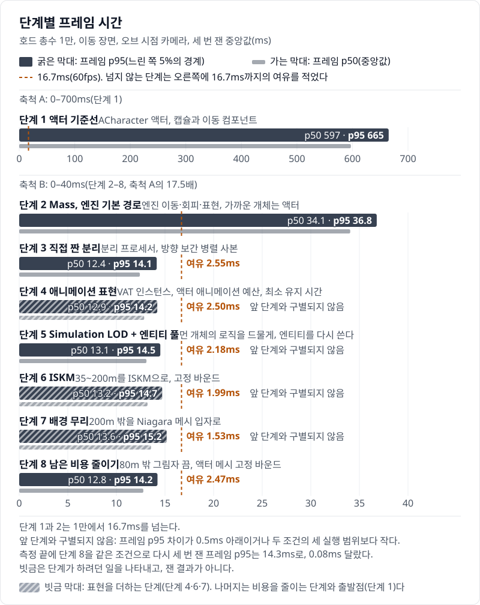
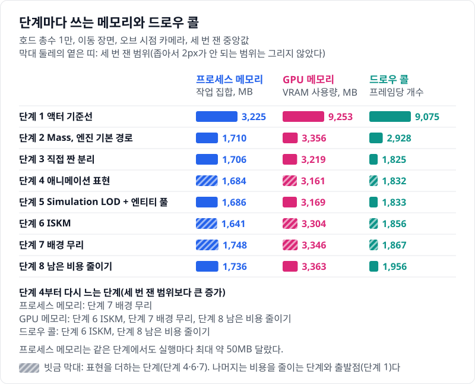
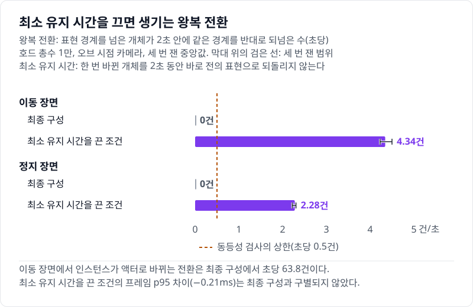
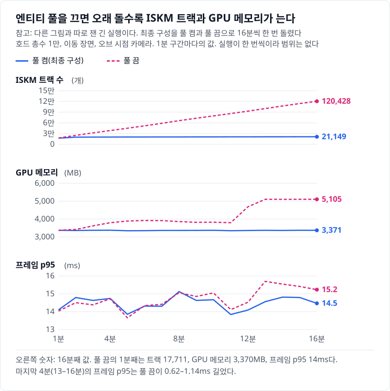

# Unreal 호드 최적화 실험실

## 한눈에

- `ACharacter` 액터로 호드 1만을 돌리면 프레임 p50(프레임 시간의 중앙값)이 597ms다. 60fps를 지키는 액터는 약 780개까지다.
- 같은 호드를 Unreal Engine 5.8의 Mass Entity로 다시 만들어 여덟 단계로 쟀다. 모든 단계가 같은 일 넷을 한다. 움직이는 오브(Orb)를 쫓고, 서로 겹치지 않고, 가까운 개체는 캡슐 콜리전을 갖고, 피해를 받고 죽는다.
- 엔진 기본 경로만 쓴 Mass 단계는 프레임 p50이 34.1ms였다. 엔진 회피를, 겹친 개체를 위치로 직접 떼어 놓는 분리 프로세서로 바꾸자 12.4ms가 됐다. 프레임 p95(느린 쪽 5%의 경계)도 14.1ms가 되어 처음 16.7ms 안에 들었다. 16.7ms는 60fps의 한 프레임이다.
- 단계 4는 35\~200m를 VAT 인스턴스로 걷게 했다. VAT(Vertex Animation Texture)는 애니메이션을 텍스처에 구워 정점 셰이더로 재생하는 기법이다. 단계 6은 같은 자리를 ISKM(Instanced Skinned Mesh, GPU에서 스키닝하는 인스턴스 스켈레탈 메시)으로 바꿨다. 단계 7은 그리지 않던 200m 밖을 Niagara 입자로 채웠다. 단계 3에서 7까지 표현 셋을 더하는 동안 프레임 p95가 1.02ms 늘었고, 단계 8이 0.94ms를 줄였다.
- 최종 구성의 프레임 p50은 12.8ms, 프레임 p95는 14.2ms다. 16.7ms까지의 여유는 2.47ms다. 최대 N은 프레임 p95가 16.7ms를 넘기 직전의 호드 총수다. 최종 구성이 60fps를 지키는 최대 N은 잰 두 총수의 프레임 p95를 이어 셈하면 약 1만 2천이다. 호드 2만에서는 겹침 방지가 제 기능을 하지 못해 이 셈에서 뺐다.
- 최종 구성에서 기법을 하나씩 끄면, 200m 밖을 그리지 않는 일이 시간을 가장 많이 줄였다. 이 일을 끄면 프레임 p95가 3.54ms 길어진다. 가장 큰 비용은 하이드레이션(Hydration, 가까운 엔티티에만 진짜 액터를 붙이는 일)이다. 이것을 끄면 액터 캡슐 등이 함께 빠지고, 프레임 p95가 6.98ms 짧아진다.
- 수치는 Test 패키지에서 같은 조건을 세 번 잰 중앙값이다. 오브는 반지름 57.3m 원을 2m/s로 돌고, 카메라가 오브를 따라간다. 호드 총수는 늘 1만이다.


단계를 고르면 화면과 측정값이 바뀌는 한 페이지 요약은 <https://hon454.github.io/unreal-horde-optimization-lab/>에 있다.

- **대상**: 클라이언트 한 대에서 그리고 움직이는 군중의 비용. 게임 스레드, 렌더 스레드, GPU, 메모리.
- **최적화**: Mass Entity(Fragment·Processor), 분리 프로세서와 방향 보간 병렬 사본, Representation LOD(액터 / VAT 인스턴스 / ISKM / 없음), 액터 하이드레이션, 화면 크기 중요도 → Animation Budget Allocator, Simulation LOD(먼 개체의 로직을 드물게), 엔티티 풀, Niagara 배경 무리(엔티티의 자리를 걷는 입자), 80m 밖 그림자 끄기, 고정 바운드.
- **측정 도구**: Test 구성 패키지에서 `csvprofile`과 Unreal Insights.

## 직접 만든 것과 엔진에서 찾은 문제

- **분리 프로세서.** 엔진 회피 대신 겹친 개체를 위치로 직접 떼어 놓는다. 이웃 계산을 작업자 스레드에 나눠, 한 스레드에 묶였던 프레임이 풀렸다([03번 글](Posts/03-separation/README.md)).
- **방향 보간 병렬 사본.** 한 스레드로 도는 엔진 방향 보간 프로세서를 같은 계산의 청크 병렬 사본으로 바꿨다. 결과는 엔진과 비트 단위로 같다([03번 글](Posts/03-separation/README.md)).
- **ISKM 애니메이션 트랙 누수와 엔티티 풀.** 움직이는 ISKM 엔티티가 파괴되면 엔진이 그 애니메이션 트랙을 돌려받지 않는다. 엔티티를 다시 쓰는 풀로 우회하고 16분 실행으로 확인했다([06번 글](Posts/06-engine-findings/README.md)).
- **ISKM 트랙이 늘 때의 번쩍임.** 트랙 수가 바뀌면 렌더러가 뼈대 버퍼의 옛 자리를 먼저 해제하고 새 자리를 잡아, 두 자리가 겹칠 수 있다. 트랙 풀을 처음에 용량까지 늘려 두어 피했다([06번 글](Posts/06-engine-findings/README.md)).
- **ISKM의 가산 클립.** ISKM 트랙 제공자는 가산 클립을 기준 자세에 더하지 않고 그대로 자세로 쓴다. 가산을 끈 복제 클립을 넣어 피했다([06번 글](Posts/06-engine-findings/README.md)).
- **위치 쓰기를 선언한 쿼리의 기다림.** 두 쿼리가 같은 Fragment를 읽기·쓰기로 선언하면 엔진이 둘을 전역 충돌로 묶는다. 위치를 쓰는 일을 따로 된 쿼리로 뺐다([06번 글](Posts/06-engine-findings/README.md)).
- **캡슐을 놓치는 Chaos 라인 트레이스.** 시작점이 캡슐의 정면 평면 위에 놓이면 트레이스가 캡슐을 놓친다. 정지 장면의 빗나감은 기능 실패로 세지 않고 보고만 한다([06번 글](Posts/06-engine-findings/README.md)).
- **설정한 틱 간격과 실제 주기의 차이.** Simulation LOD의 간격을 0.5초로 주었다. 실제 주기는 단계 5에서 0.137초, 단계 8에서 0.130초다. 엔티티가 드나든 청크는 간격과 상관없이 다음 프레임에 돈다([팁 문서](Docs/Guides/mass-crowd-tips.md#틱-간격을-늘리기보다-큰-몫의-프로세서를-쿼리에서-뺀다)).
- **VAT 인스턴스의 바운드와 그림자 잔상.** AnimToTexture의 Bone 방식 메시는 바운드를 정점 범위로 넓혀야 그림자가 남지 않는다([팁 문서](Docs/Guides/mass-crowd-tips.md#animtotexture-bone-방식-메시의-바운드는-정점-범위로-넓힌다)).
- **액터 전환 대책 다섯과 최소 유지 시간.** 액터의 포즈가 준비되기 전에 액터가 보이는 것, 엔티티와 액터의 원점 차이로 가라앉는 것 등을 고쳤다. 액터 경계를 2초 안에 되넘으려는 개체는 붙잡는다([04번 글](Posts/04-quality-by-distance/README.md)).
- **고정 바운드 둘.** ISKM 컴포넌트에는 카메라를 따라가는 고정 상자를, 액터 메시에는 메시 에셋의 고정 바운드를 넣었다. 엔진이 바운드를 다시 셈하는 일을 줄였다([04번 글](Posts/04-quality-by-distance/README.md), [05번 글](Posts/05-cost-cuts-and-contributions/README.md)).
- **엔티티가 움직이는 Niagara 배경 무리.** 200m 밖 엔티티의 자리를 GPU 입자로 그린다([04번 글](Posts/04-quality-by-distance/README.md)).
- **측정 러너.** 조건을 섞어 가며 세 번씩 재고, 창 포커스와 다른 프로그램을 확인하고, 같은 구성을 끝에 다시 잰다([00번 글](Posts/00-goals-and-method/README.md)).

## 시나리오


플레이어 대신 오브가 맵 중심 둘레의 원을 돌며 가까운 개체에 피해를 주고 먼 개체를 저격한다. 모든 거리에서 생성·피격·사망·표현 전환이 계속 일어나게 하는 벤치마크 장치다. 오브가 움직이면 개체가 거리 구간을 두 방향으로 넘나들어, 표현 전환도 두 방향으로 일어난다. 개체는 Epic의 무료 에셋 Paragon: Minions를 쓴다. 처음 배치와 다시 생기는 순서, 저격 대상, 개체마다 다른 체력(60\~240)은 고정 시드로 정한다.

이 시나리오가 재지 않는 것도 있다. 장애물과 경로 탐색이 없고, 지형은 평지다. 호드 총수 1만은 맵 반경 500m와 한 쌍인 값이다. 개체가 맵 중심에서 반지름 방향으로 고르게 퍼져 있어, 모든 거리 구간에 개체가 찬다.

## 결과 한눈에 보기

| 단계 1 액터 기준선(프레임 p95 665ms) | 단계 8 최종 구성(프레임 p95 14.2ms) |
| --- | --- |
|  |  |

같은 호드 총수 1만, 같은 오브 시점 카메라다. 화면 왼쪽 위 HUD의 숫자는 측정값이 아니다.

아래 값은 여덟 단계와 기법별 기여 조건을 Test 패키지 하나(de0e21b)에서 연달아 잰 것이다(2026-11-16\~17). 한 단계는 앞 단계에서 기법 한 벌만 바꾼다. 한 단계에서 둘 이상을 바꾼 곳은 기법별 기여로 몫을 가른다. 정확한 값은 [최종 측정의 표](Measurements/Full4/summary.csv)와 [그래프의 CSV](Docs/figures/full4/)에 있다.

| 단계 | 바꾼 것 | 글 |
| --- | --- | --- |
| [단계 1 액터 기준선](Docs/figures/steps/step1-actors.webp) | 모든 개체가 캡슐과 CharacterMovement를 가진 `ACharacter` 액터 | [01](Posts/01-actor-baseline/README.md) |
| [단계 2 Mass, 엔진 기본 경로](Docs/figures/steps/step2-mass-engine.webp) | 개체를 Mass 엔티티로. 엔진의 이동·회피·표현, 35m 안은 액터 | [02](Posts/02-mass-engine-path/README.md) |
| [단계 3 직접 짠 분리](Docs/figures/steps/step3-separation.webp) | 엔진 회피를 분리 프로세서로, 방향 보간을 병렬 사본으로 | [03](Posts/03-separation/README.md) |
| [단계 4 애니메이션 표현](Docs/figures/steps/step4-vat-budget.webp) | VAT 인스턴스, 액터 애니메이션 예산, 최소 유지 시간 | [04](Posts/04-quality-by-distance/README.md) |
| [단계 5 Simulation LOD + 엔티티 풀](Docs/figures/steps/step5-simlod-pool.webp) | 먼 개체의 로직을 드물게, 죽은 엔티티를 다시 쓴다 | [05](Posts/05-cost-cuts-and-contributions/README.md) |
| [단계 6 ISKM](Docs/figures/steps/step6-iskm.webp) | 35\~200m를 ISKM으로, ISKM 고정 바운드 | [04](Posts/04-quality-by-distance/README.md) |
| [단계 7 배경 무리](Docs/figures/steps/step7-crowd.webp) | 200m 밖을 Niagara 메시 입자로 | [04](Posts/04-quality-by-distance/README.md) |
| [단계 8 남은 비용 줄이기](Docs/figures/steps/step8-final.webp) | 80m 밖 그림자 끔, 액터 메시 고정 바운드 | [05](Posts/05-cost-cuts-and-contributions/README.md) |

단계 이름을 누르면 그 단계의 움직이는 화면이 열린다. 단계 4, 6, 7은 표현을 더하는 단계이고, 단계 2, 3, 5, 8은 비용을 줄이는 단계다. 단계 1은 출발점이고, 단계 8이 최종 구성이다.



단계 1과 2는 호드 총수 1만에서 같은 일을 하지 못해, 60fps를 지키는 최대 N으로 견준다. 단계 1은 약 780, 단계 2는 약 4,100이다. 단계 3에서 프레임 p95가 14.1ms가 되어 처음 16.7ms 안에 들었다. 단계 3부터는 1만에서의 프레임 p95와 16.7ms까지의 여유로 적는다.

단계 4에서 7까지는 하나씩 보면 앞 단계와 구별되지 않는다. 구별되지 않는다는 것은 중앙값의 차이가 0.5ms 아래이거나 두 조건의 범위보다 작다는 뜻이다. 단계 3에서 7까지 모으면 프레임 p95가 1.02ms 늘었고, 이 차이는 구별된다. 단계 8은 0.94ms를 줄였다. 최종 구성의 프레임 p95는 14.2ms이고 16.7ms까지의 여유는 2.47ms다.

프레임 시간은 게임 스레드, 렌더 스레드, GPU 가운데 가장 느린 쪽(병목)이 정한다. 단계 3부터 병목은 게임 스레드다. 목표 판정은 최종 구성의 프레임 p95에 0.6ms를 더해도 16.7ms 안인지 본다. 최종 구성은 14.8ms로 판정을 통과했다.



같은 실행에서 잰 메모리와 드로우 콜이다. 드로우 콜은 단계 1의 9,075에서 단계 3의 1,825로 줄었다. 표현을 더한 최종 구성은 1,956이다. GPU 메모리는 단계 1의 9,250MB에서 단계 2의 3,360MB로 줄었다. 그 뒤로는 3,160\~3,360MB 사이에 머물렀다.

### 기법별 기여(최종 구성에서 하나씩 껐을 때)

기법별 기여는 최종 구성에서 기법 하나만 끄고 같은 조건으로 잰 차이다(조건 표의 이름은 `ablation`). 끄면 프레임이 길어지는 기법은 시간을 줄이고, 짧아지는 기법은 시간을 쓴다. 기법을 끄면 그 자리에 다른 것이 들어간다.

- **하이드레이션을 끈 조건**: 가까운 개체도 액터 없이 ISKM으로 그린다. 액터 캡슐, 액터 애니메이션 예산, 액터 메시 고정 바운드도 함께 빠진다.
- **액터 애니메이션 예산을 끈 조건**: 액터 메시가 `USkeletalMeshComponentBudgeted` 대신 `USkeletalMeshComponent`다. 메시가 매 프레임 애니메이션을 평가한다.
- **전환 대책을 끈 조건**: 인스턴스와 액터가 바뀌는 프레임의 보정 다섯을 모두 끈다.
- **최소 유지 시간을 끈 조건**: 바뀐 개체가 2초 안에 바로 전의 표현으로 되돌아갈 수 있다.
- **엔티티 풀을 끈 조건**: 죽은 개체의 엔티티를 파괴하고 새로 만든다.
- **Simulation LOD를 끈 조건**: 80m 밖 개체도 접근·범위 피해 로직을 매 프레임 돌리고, 200m 밖 개체도 엔진의 이동·조향 프로세서로 옮긴다. 최종 구성은 80\~200m의 로직을 0.5초 간격으로 돌리고, 200m 밖은 자체 프로세서가 1초 간격으로 옮긴다.
- **ISKM을 끈 조건**: 35\~200m를 VAT 인스턴스로 그린다. ISKM 고정 바운드, 트랙 예약, 200m 밖에서 맞은 개체를 ISKM으로 그리는 규칙도 함께 빠진다.
- **ISKM 고정 바운드를 끈 조건**: 엔진이 ISKM 컴포넌트의 바운드를 셈할 때 인스턴스를 모두 돈다.
- **ISKM 바운드 상자 따라가기를 끈 조건**: 고정 바운드 상자를 카메라로 옮기지 않고 처음 오브 자리 둘레에 둔다.
- **ISKM 트랙 예약을 끈 조건**: 트랙 풀을 처음에 용량까지 늘려 두지 않는다.
- **200m 밖을 그리지 않는 일을 끈 조건**: 200m 밖 엔티티를 맵 끝까지 그림자를 끈 ISKM으로 그린다.
- **배경 무리를 끈 조건**: 200m 밖에 아무것도 그리지 않는다. 200m 밖에서 맞은 개체를 ISKM으로 그리는 규칙과 맵 밖 무리의 그리기도 함께 빠진다.
- **입자의 오브 따라가기를 끈 조건**: 입자가 향할 오브의 자리를 매 프레임 넣지 않고, 시작 전에 한 번만 넣는다.
- **80m 밖 그림자를 다시 켠 조건**: 80m 밖 ISKM 인스턴스와 200m 밖 입자도 그림자를 그린다. 끈 조건이 아니라 다시 켠 조건이다.
- **액터 메시 고정 바운드를 끈 조건**: 액터 메시가 애니메이션을 갱신할 때마다 피직스 에셋의 바디로 바운드를 다시 셈한다.
- **겹침 방지(분리 프로세서)를 끈 조건**: 개체를 서로 떼어 놓지 않는다. 겹친 쌍(몸통이 겹친 개체 쌍의 수)이 늘어 같은 일이 아니다.
- **액터 캡슐을 끈 조건**: 가까운 액터가 캡슐 콜리전 없이 그려진다.
- **하위 실험, 분리 프로세서 대신 엔진 회피를 쓴 조건**: 기법을 끈 것이 아니라 바꾼 조건이다.

최종 구성의 병목은 게임 스레드라서, GPU 시간의 변화는 프레임 시간에 그대로 드러나지 않는다.


가장 큰 비용은 가까운 개체의 액터다. 하이드레이션을 끈 조건은 프레임 p95가 6.98ms 짧다. 게임 스레드가 5.23ms로 줄어, 병목이 GPU(6.21ms)로 바뀐다. 이 조건은 함께 빠지는 것이 있어 참고 값이다. 액터 캡슐만 끈 조건도 1.86ms 짧지만, 캡슐 콜리전은 모든 단계가 하는 일이라 최종 구성은 켠 채 둔다.

가장 큰 절약은 200m 밖을 그리지 않는 일이다. 이 일을 끄면 프레임 p95가 3.54ms 길어진다. 게임 스레드가 11.9ms에서 15.1ms로 는다. 단계 8이 줄인 시간은 거의 액터 메시 고정 바운드의 몫이다. 이것을 끈 조건은 프레임 p95가 0.98ms 길다.

ISKM을 끈 조건은 프레임 p95가 0.67ms 짧지만, GPU 시간이 1.24ms 길다. 분리 프로세서를 엔진 회피로 바꾼 하위 실험은 프레임 p95가 8.57ms 길고, 겹친 쌍이 11,660이다. 나머지 열 조건은 구별되지 않는다. 그 가운데 최소 유지 시간과 엔티티 풀의 이점은 아래 두 그림의 왕복 전환과 ISKM 트랙 수에서 보인다.

### 최소 유지 시간과 왕복 전환



왕복 전환은 표현 경계를 넘은 개체가 2초 안에 같은 경계를 반대로 되넘은 수다. 엔진은 액터 구간의 경계에 여유를 두지 않아, 경계 근처의 개체가 액터와 인스턴스를 짧게 오갈 수 있다. 최소 유지 시간은 한 번 바뀐 개체를 2초 동안 바로 전의 표현으로 되돌리지 않는다. 이 규칙을 끄면 이동 장면에서 왕복 전환이 초당 4.34건 생기고, 모두 액터 경계에서 난다. 프레임 p95의 차이(−0.21ms)는 구별되지 않는다.

전환 대책 다섯이 막는 화면 튐을 세는 지표는 이 측정에 없다. 전환 대책을 끈 조건의 프레임 p95는 최종 구성과 같다.

### 엔티티 풀: 오래 돌 때의 차이

엔티티 풀은 죽은 개체의 엔티티를 파괴하지 않고 종류별 풀에 넣었다가, 재생성 때 다시 쓰는 방식이다. 엔진은 움직이는 ISKM 엔티티를 파괴할 때 그 애니메이션 트랙을 돌려받지 않는다. 풀은 엔티티 핸들을 그대로 두므로, 엔진이 트랙 맵에서 옛 트랙을 찾아 다시 쓴다.

문제의 코드는 엔진의 `MassVisualizationComponent.cpp`에 있다. 트랙을 잡고 인스턴스를 지우는 함수는 `UMassVisualizationComponent::EndVisualChanges`다. 이 함수는 갱신되지 않은 움직이는 인스턴스를 지울 때 트랙 맵을 비우지 않는다. 원인 코드와 우회는 [06번 글](Posts/06-engine-findings/README.md)에 있다.

워밍업과 측정을 합친 한 실행(240초)이 끝날 때, ISKM 트랙은 풀을 켜면 20,215개, 끄면 30,797개다. 그래도 프레임 p95의 차이(+0.01ms)는 구별되지 않는다. 그래서 같은 최종 구성을 풀 켬과 풀 끔으로 16분씩 한 번 더 돌렸다. 다른 그림과 따로 잰 참고 측정이다.



풀을 끄면 16분 동안 ISKM 트랙이 120,428개까지 늘고, GPU 메모리가 3,370MB에서 5,110MB로 는다. 풀을 켜면 트랙이 21,149개에서 거의 멈추고 GPU 메모리가 평평하다. 마지막 4분의 프레임 p95는 풀을 끈 쪽이 0.62\~1.14ms 길었다. 실행이 조건마다 한 번이라 범위는 없다.

## 글

| # | 제목 | 알게 된 것 |
| --- | --- | --- |
| 00 | [호드 1만을 60fps로: 목표 사양과 재는 법](Posts/00-goals-and-method/README.md) | 목표와 장면과 재는 법을 하나로 묶어 두면, 같은 일을 하는 기법 하나가 어느 스레드의 몇 ms를 바꾸는지가 드러난다. |
| 01 | [액터 기준선: 캡슐과 이동 컴포넌트를 가진 액터는 약 780에서 60fps를 넘는다](Posts/01-actor-baseline/README.md) | 액터 기준선의 게임 스레드는 CharacterMovement가 쓰고, Budget Allocator는 예산에 닿기 전에는 일을 줄이지 않는다. |
| 02 | [Mass, 엔진 기본 경로: 597ms가 34.1ms로, 남은 병목은 엔진 회피](Posts/02-mass-engine-path/README.md) | 액터를 Mass로 옮기면 이동 틱은 사라지지만, 한 스레드에서 도는 엔진 회피가 새 병목이 된다. |
| 03 | [직접 짠 분리: 엔진 회피를 분리 프로세서로 바꿔 처음으로 16.7ms 안에](Posts/03-separation/README.md) | 엔진 회피를 위치를 직접 미는 분리 프로세서로 바꾸자, 작업자 하나에 묶였던 프레임이 풀려 호드 1만이 처음으로 16.7ms 안에 들었다. |
| 04 | [거리별 품질: 표현 셋을 더하는 동안 프레임 p95가 1.02ms 늘었다](Posts/04-quality-by-distance/README.md) | 단계 3에서 7까지 표현 셋을 더하는 동안 프레임 p95는 1.02ms 늘었고, GPU 비용은 병목인 게임 스레드에 가려 거의 드러나지 않았다. |
| 05 | [비용을 줄이는 단계와 기법별 기여: 최종 구성의 큰 비용은 가까운 액터에 있다](Posts/05-cost-cuts-and-contributions/README.md) | 비용을 줄이는 두 단계에서 프레임 시간을 줄인 것은 액터 메시 고정 바운드이고, 엔티티 풀의 이점은 긴 실행에서 보인다. |
| 06 | [엔진을 고치지 않고 피한 문제 다섯: ISKM 트랙, Mass 쿼리, Chaos 트레이스](Posts/06-engine-findings/README.md) | 엔진에서 찾은 문제 다섯은 모두 엔진 소스를 고치지 않고 게임 코드, 에셋, 검사 규칙에서 피할 수 있었다. |
| 07 | [요약: 단계 3에서 16.7ms 안에 들고, 표현을 셋 더한 최종 구성도 2.47ms가 남는다](Posts/07-summary/README.md) | 엔진 회피를 직접 짠 분리로 바꾼 단계 3에서 호드 1만이 처음 16.7ms 안에 들었고, 단계 7까지 늘어난 시간은 단계 8이 거의 되돌렸다. |

## 측정 방법

- 측정 PC는 Ryzen 9 5950X, RTX 4090, 64GB, Windows 11, UE 5.8.4 소스 빌드다.
- 화면은 2560×1440 창 모드, 스케일러빌리티 Epic이다. 수직 동기화와 프레임 상한은 끄고(`r.VSync 0`, `t.MaxFPS 0`), 화면 비율은 100%로 두고 동적 해상도는 껐다. 그래서 프레임 시간은 모니터 주사율에 묶이지 않는다.
- 고정 시드로 초기 조건을 재현한다. 개체는 정상 상태 분포(밀도 ∝ 1/r)로 미리 놓는다. 오브가 원을 도는 이동 장면에서 워밍업 60초 뒤 180초를 잰다. 180초는 오브가 한 바퀴 도는 시간이다.
- 궤적은 비결정적이라 같은 조건을 세 번 재고, 중앙값과 범위를 함께 적는다. 실행마다 프로세스를 새로 띄운다.
- 호드 총수 1만, 오브 시점 카메라에서 여덟 단계와 기법별 기여 조건을 잰다. 보조로 단계 1과 2의 최대 N을 만드는 다른 총수, 오브가 서 있는 정지 장면, 탑뷰 카메라를 잰다. 엔티티 풀의 긴 실행은 최종 구성을 풀 켬·끔으로 16분씩 한 번 돌려 따로 쟀다.
- 동등성 검사가 단계 사이가 같은 일을 하는지 조건마다 확인한다. 살아 있는 총수, 초당 사망, 오브 30m 안 개체 수, 겹친 쌍, 캡슐 확인 트레이스, 왕복 전환을 본다. 단계 1과 2는 1만에서 이 검사를 통과하지 못해 값만 보고한다.
- 수치는 Test 구성 패키지에서 `csvprofile`로 얻는다.
- 중앙값의 차이가 두 조건 범위 가운데 큰 쪽보다 작거나 0.5ms 아래면 "구별되지 않는다"고 적는다.
- 측정 끝에 최종 구성을 같은 조건으로 세 번 더 잰다(같은 조건 다시 재기). 처음 값과의 차이는 프레임 p95 0.08ms였다.

규약 전체는 [Docs/Guides/measurement.md](Docs/Guides/measurement.md)에 있다. 이전 판은 태그 `v1`에 있고 겹침 방지와 캡슐이 없어 수치를 잇지 않는다.

Mass로 군중을 만들고 프로파일링할 때의 기술 팁은 [Mass 군중 최적화와 프로파일링 팁](Docs/Guides/mass-crowd-tips.md)에 모았다.

## 실행

빌드 없이 보려면 [Releases의 Test 패키지](https://github.com/hon454/unreal-horde-optimization-lab/releases/tag/test-package-08e45f2)를 받아 압축을 풀고 `run-final.bat`을 실행한다.

직접 빌드하고 재려면 먼저 세 가지를 갖춘다. 순서와 명령은 [Docs/Guides/setup.md](Docs/Guides/setup.md)에 있다.

1. UE 5.8.4 소스 빌드 엔진. `Scripts/common.ps1`이 `HordeOptLab.uproject`의 `EngineAssociation`으로 이 PC에 등록된 소스 빌드를 찾는다.
2. Fab의 [Paragon: Minions](https://www.fab.com/listings/039ea035-9360-4e76-ad06-5d3a92da6f65)와 [Niagara Examples Pack](https://www.fab.com/listings/0e188eca-4e54-4fb2-a9ed-d8b8a565e600). 런처 엔진의 빈 프로젝트에 받는다.
3. `Scripts/restore-assets.ps1` 한 번. 두 팩에서 쓰는 에셋을 옮기고 VAT·ISKM 같은 파생 에셋을 만든다.

단계는 한 빌드 안의 실행 모드다(`-LabStage=1`\~`8`). Test 패키지를 만들고 묶음 스크립트로 잰다. `<묶음>`은 새 측정의 이름이다(이미 쓴 이름은 다시 쓰지 않는다).

```powershell
powershell -ExecutionPolicy Bypass -File Scripts/package.ps1
powershell -ExecutionPolicy Bypass -File Scripts/run-full.ps1 -DryRun
powershell -ExecutionPolicy Bypass -File Scripts/run-full.ps1 -Batch <묶음>
py -3 -I Scripts/summarize.py --batch <묶음>
py -3 -I Scripts/plot.py --batch <묶음>
```

나머지 명령은 [Docs/Guides/commands.md](Docs/Guides/commands.md)에 있다.

## 구조

| 경로 | 내용 |
| --- | --- |
| `Source/HordeOptLab/` | C++ 모듈. 최종 구성에서 한 프레임에 도는 코드는 [코드 투어](Docs/Guides/code-tour.md) |
| `Content/Lab/` | 직접 만든 콘텐츠 |
| `Scripts/` | 빌드, 패키징, 벤치마크, 그래프 |
| `Docs/` | 계획, 결정 기록(ADR), 측정 규약, 엔진 소스 확인 기록, 작업 기록(Worklog) |
| `Docs/figures/` | 그래프(SVG)와 그 수치(CSV), 단계별 화면(`steps/`) |
| `Posts/` | 글과 측정 기록 |
| `Measurements/` | 묶음별 수치와 대표 스크린샷. [최종 측정](Measurements/Full4/), 나머지는 개발 중의 측정([설명](Measurements/README.md)) |

이 레포는 Claude Code 에이전트가 작업한다. 측정 규칙과 커밋 규칙은 훅이 강제한다([하네스](Docs/Guides/harness.md)).

## 참고 자료

- Unreal Engine 공식 문서
  - [Mass Entity](https://dev.epicgames.com/documentation/en-us/unreal-engine/overview-of-mass-entity-in-unreal-engine)
  - [MassGameplay](https://dev.epicgames.com/documentation/en-us/unreal-engine/overview-of-mass-gameplay-in-unreal-engine): Representation LOD, Simulation LOD
  - [Instanced Static Mesh(ISM)](https://dev.epicgames.com/documentation/en-us/unreal-engine/instanced-static-mesh-component-in-unreal-engine)
  - [AnimToTexture(VAT)](https://dev.epicgames.com/documentation/en-us/unreal-engine/API/Plugins/AnimToTexture?application_version=5.8)
  - [Instanced Skinned Mesh(ISKM)](https://dev.epicgames.com/documentation/en-us/unreal-engine/API/Runtime/Engine/UInstancedSkinnedMeshComponent?application_version=5.8)
  - [Animation Budget Allocator](https://dev.epicgames.com/documentation/en-us/unreal-engine/animation-budget-allocator-in-unreal-engine)
  - [Animation Optimization(URO)](https://dev.epicgames.com/documentation/en-us/unreal-engine/animation-optimization-in-unreal-engine)
  - [Niagara](https://dev.epicgames.com/documentation/en-us/unreal-engine/overview-of-niagara-effects-for-unreal-engine)
  - [Unreal Insights](https://dev.epicgames.com/documentation/en-us/unreal-engine/unreal-insights-in-unreal-engine)
- 강연과 영상
  - [Unlearning OOP: Data-Oriented Gameplay Design with ECS and Mass Entity](https://www.youtube.com/watch?v=UXA8axmAb-U&t=169s) — Jared Shabel, Unreal Fest Chicago 2026
  - [언리얼 엔진의 매스 프레임워크와 대규모 씬 처리를 위한 기능들](https://www.youtube.com/watch?v=yhtj9xuAu_c) — 윤준기, 언리얼 페스트 서울 2026
  - [언리얼 엔진 5의 대규모 매스 엔티티 | 기능 하이라이트 | State of Unreal 2022](https://www.youtube.com/watch?v=FTQ8wTldbsk) — Unreal Engine KR
  - [How to Build Scalable MetaHuman Crowds in Unreal Engine](https://www.youtube.com/watch?v=wQoa1j4Rgss) — Unreal Fest Chicago 2026
  - [Understand MASS with Unreal Engine](https://www.youtube.com/watch?v=eJR82WyIl_U) — Rogue Entity

## 라이선스

이 레포의 코드, 스크립트, 문서, 측정 결과는 [MIT 라이선스](LICENSE)를 따른다.

다음은 MIT 라이선스에 들어가지 않는다.

- **Unreal Engine**: 엔진과 엔진 소스는 [Unreal Engine EULA](https://www.unrealengine.com/eula)를 따른다. `Source/`에 엔진 소스의 식을 옮긴 곳은 주석에 원본 파일과 줄을 적었고, 그 부분은 EULA의 조건도 함께 따른다.
- **Fab 에셋**: [Paragon: Minions](https://www.fab.com/listings/039ea035-9360-4e76-ad06-5d3a92da6f65)와 [Niagara Examples Pack](https://www.fab.com/listings/0e188eca-4e54-4fb2-a9ed-d8b8a565e600)은 Fab 스탠다드 라이선스의 Epic 에셋이라 재배포할 수 없다. 레포에 넣지 않았고, 직접 받아 `Scripts/restore-assets.ps1`로 복구한다. 이 에셋에서 만든 VAT·ISKM 파생 에셋도 넣지 않았다.
- **상표**: Unreal, Unreal Engine, Paragon은 Epic Games, Inc.의 상표다. 이 프로젝트는 Epic Games와 관계가 없다.
