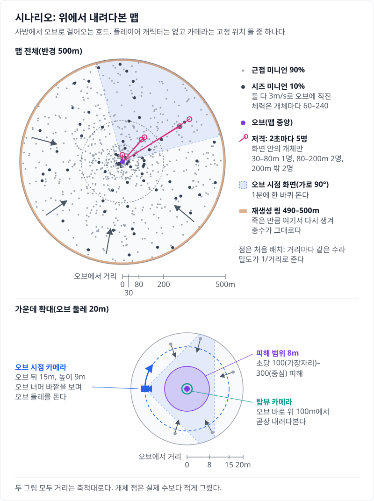
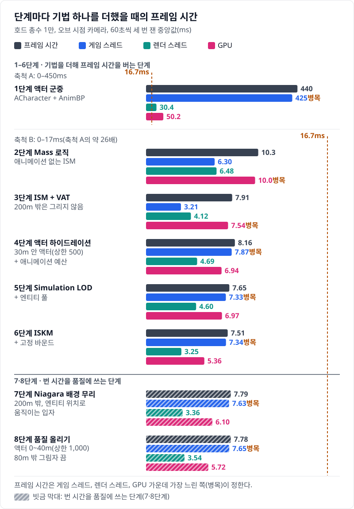
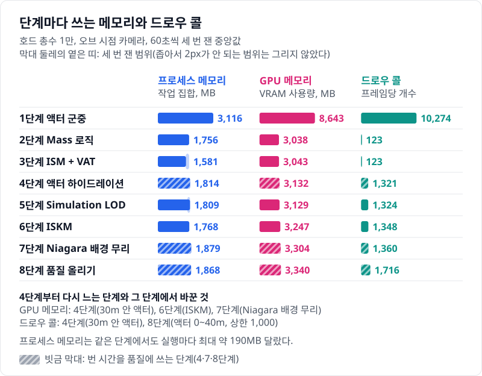
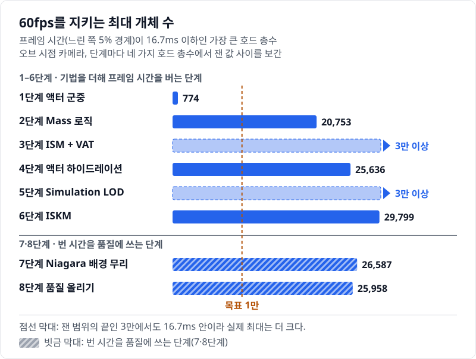
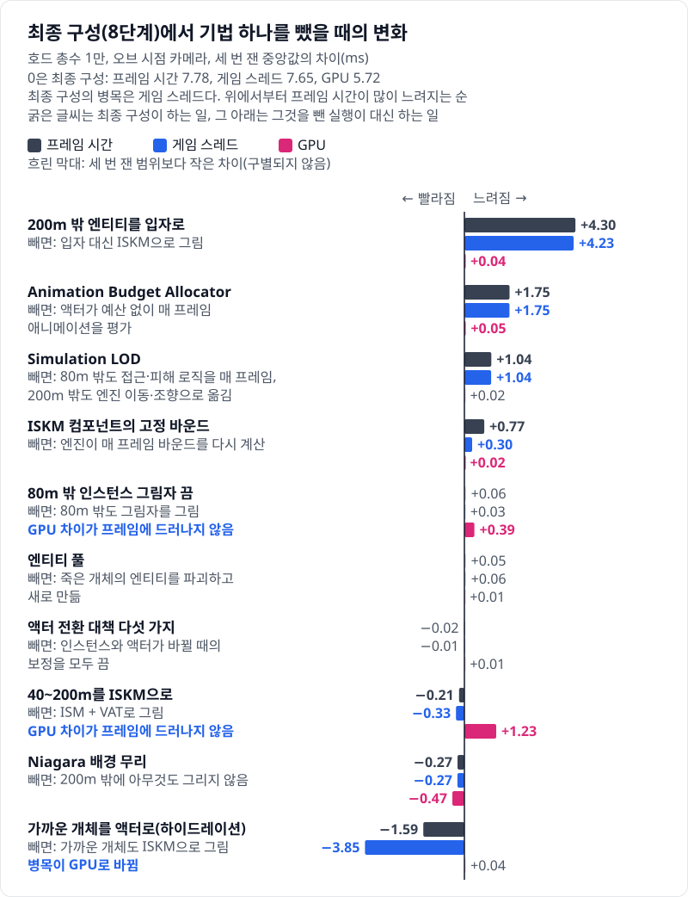
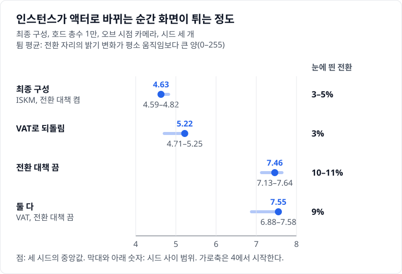
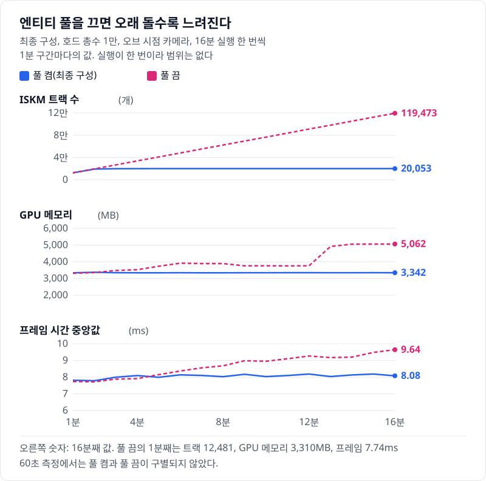

# Unreal 호드 최적화 실험실

`ACharacter` 액터로 호드 1만을 만들면 한 프레임에 440ms가 걸린다. 이 호드를 Unreal Engine 5.8의 Mass Entity로 다시 만들고, 60fps(한 프레임 16.7ms)가 나올 때까지 최적화 기법을 하나씩 적용했다. 순서는 Mass 로직, ISM + VAT, 액터 하이드레이션과 애니메이션 예산, Simulation LOD, ISKM이다. 기법을 하나 적용할 때마다 같은 시나리오를 같은 방법으로 다시 재서 얼마나 달라졌는지 확인했다.

- **대상**: 클라이언트 한 대에서 그리고 움직이는 군중의 비용. 게임 스레드, 렌더 스레드, GPU, 메모리.
- **최적화**: Mass Entity(Fragment·Processor), Representation LOD(액터 / ISM+VAT / ISKM / 없음), 액터 하이드레이션과 풀링, Significance Manager → Animation Budget Allocator, URO, Simulation LOD(청크 단위 가변 틱), Niagara 배경 무리(엔티티 구동 입자).
- **측정 도구**: Test 구성 패키지에서 `csvprofile`과 Unreal Insights.

단계를 쌓은 뒤에는 목표 사양(호드 총수 1만, 60fps) 안에서 거리별 품질을 확보했다. 가까이는 액터 하이드레이션, 멀리는 ISKM, 그리는 끝(200m) 밖은 Niagara 배경 무리로 그리고, 그렇게 번 프레임 시간을 액터 수와 전환 거리에 쓴다. 최종 구성의 기법은 단계별 사다리와 "기법 하나를 뺀" 그림으로 이점을 확인했고, 이점이 보이지 않은 것도 그대로 적었다.

## 시나리오



모든 거리에서 생성·피격·사망·표현 전환이 계속 일어나게 하는 벤치마크 장치다. 개체는 Epic의 무료 에셋 Paragon: Minions를 쓰고, 처음 배치와 다시 생기는 순서, 저격 대상, 개체마다 다른 체력(60\~240)을 고정 시드로 정한다.

## 결과 한눈에 보기

| 1단계: 액터 군중 (프레임 약 440ms) | 8단계: 최종 구성 (프레임 약 7.8ms) |
| --- | --- |
|  |  |

같은 호드 총수 1만, 같은 오브 시점 카메라다. 화면 왼쪽 위 HUD에 단계 이름, 프레임 시간, 거리별 개체 수가 나온다.

아래 값은 최종 측정이다. 여덟 단계와 빼 보기 조건을 Test 패키지 하나(08e45f2)에서 연달아 쟀다(2026-11-12\~13). 단계마다 기법 하나를 더한다. 정확한 값은 [최종 측정의 표](Measurements/Full2/summary.csv)와 [그래프의 CSV](Docs/figures/full2/)에 있다.



<table>
  <tr>
    <td width="33%" valign="top">1단계: 액터 군중<br></td>
    <td width="33%" valign="top">2단계: Mass 로직<br></td>
    <td width="33%" valign="top">3단계: ISM + VAT<br></td>
  </tr>
  <tr>
    <td width="33%" valign="top">4단계: 액터 하이드레이션<br></td>
    <td width="33%" valign="top">5단계: Simulation LOD<br></td>
    <td width="33%" valign="top">6단계: ISKM<br></td>
  </tr>
  <tr>
    <td width="33%" valign="top">7단계: Niagara 배경 무리<br></td>
    <td width="33%" valign="top">8단계: 품질 올리기<br></td>
    <td width="33%"></td>
  </tr>
</table>



같은 실행에서 잰 메모리와 드로우 콜이다. 2단계에서 크게 준 값이 4단계부터 조금씩 다시 는다. 늘어난 단계와 그 단계에서 바꾼 것은 그림 아래쪽에 적었다.



4단계부터는 게임 스레드가 병목이다. 7·8단계는 번 시간을 배경 무리와 액터 수, 전환 거리에 쓴다. 최종 구성(8단계)은 호드 총수 1만에서 프레임 시간 중앙값이 7.78ms이고, 60fps를 지키는 최대 개체 수는 약 2만 6천이다.

### 빼 보기: 최종 구성에서 기법 하나를 뺀 값

같은 조건에서 8단계의 기법을 하나씩 끈 실행이다. 8단계의 병목은 게임 스레드라서, GPU 시간만 달라지는 기법은 프레임 시간에 드러나지 않는다.



200m 밖을 입자 대신 ISKM으로 그리면 게임 스레드가 가장 크게 는다. 배경 무리를 아예 끄면 프레임 시간이 조금 짧아질 뿐이다. 액터 하이드레이션을 빼면 게임 스레드는 크게 줄지만 병목이 GPU로 바뀌어 프레임 시간은 그만큼 줄지 않는다.

ISKM의 이점은 프레임 시간이 아니라 GPU 시간이다. ISKM을 VAT로 되돌리면 GPU 시간이 1.23ms 늘고 게임 스레드는 0.33ms 줄어, 프레임 시간은 오히려 0.21ms 짧다. ISKM을 쓰는 이유는 GPU 시간 말고도 셋이 더 있다. 애니메이션을 텍스처로 굽는 단계(AnimToTexture)가 없고, 원본 스켈레탈 메시의 LOD를 그대로 쓰며, 애니메이션 블렌딩(`BlendTime` 크로스페이드, BlendSpace 트랙)을 쓸 수 있다. 이 프로젝트는 블렌딩을 쓰지 않는다.

80m 밖 그림자를 다시 켜면 GPU 시간만 0.39ms 늘고 프레임 시간은 구별되지 않는다.

### 전환이 티 나는 정도

개체가 인스턴스에서 액터로 바뀌는 순간, 그 자리 화면이 평소 움직임보다 얼마나 더 변했는지를 잰 값이다. 프레임 시간이 아니라 화면 캡처로 낸 값이라 Development 빌드에서 참고로 쟀다.



전환 대책은 프레임 시간으로는 구별되지 않지만, 끄면 눈에 띄는 전환이 두세 배가 된다. ISKM과 VAT의 전환 차이는 시드 사이 흔들림과 비슷한 크기다. 이 그림만 200m 밖 입자 메시를 바꾸기 전의 빌드에서 잰 값이다.

### 엔티티 풀: 오래 돌 때의 차이

60초 측정에서는 엔티티 풀을 꺼도 프레임 시간이 구별되지 않았다. 같은 최종 구성을 16분씩 돌리면 차이가 드러난다.



엔진은 움직이는 ISKM 인스턴스의 엔티티가 파괴될 때 그 애니메이션 트랙을 돌려받지 않는다(`MassVisualizationComponent.cpp`). 풀을 끄면 죽은 개체마다 엔티티를 파괴하므로 트랙이 샌다. 16분 동안 트랙이 약 12만까지 늘고, GPU 메모리가 약 1.75GB 늘며, 프레임 시간 중앙값이 7.74ms에서 9.64ms로 는다. 풀을 켜면 엔티티를 다시 쓰므로 트랙이 약 2만에서 멈추고 메모리와 프레임 시간이 평평하다. 실행이 한 번씩이라 범위는 없다.

## 글

| # | 제목 | 알게 된 것 |
| --- | --- | --- |
| | (작성 중) | |

## 측정 방법

- 측정 PC는 Ryzen 9 5950X, RTX 4090, 64GB, Windows 11, UE 5.8.4 소스 빌드다.
- 화면은 2560×1440 창 모드, 스케일러빌리티 Epic이다. 수직 동기화와 프레임 상한은 끄고(`r.VSync 0`, `t.MaxFPS 0`), 화면 비율은 100%로 두고 동적 해상도는 껐다. 그래서 프레임 시간은 모니터 주사율에 묶이지 않는다.
- 고정 시드로 초기 조건을 재현한다. 개체는 정상 상태 분포(밀도 ∝ 1/r)로 미리 놓고 15초 뒤 60초를 잰다. 궤적은 비결정적이라 3회 실행의 중앙값과 범위를 함께 적는다.
- 목표 총수 1만에서 사다리 전 단계(오브 시점·탑뷰)와 빼 보기 조건을 재고, 보조로 단계별 최대 개체 수를 잰다. 엔티티 풀의 장시간 비교는 최종 구성을 풀 켬·끔으로 16분씩 한 번 돌려 따로 쟀다.
- 수치는 Test 구성 패키지에서 `csvprofile`로 얻는다.
- 중앙값의 차이가 두 구성의 범위 중 큰 쪽보다 작으면 "구별되지 않았다"고 적는다.

규약 전체는 [Docs/Guides/measurement.md](Docs/Guides/measurement.md)에 있다.

## 실행

빌드 없이 보려면 [Releases의 Test 패키지](https://github.com/hon454/unreal-horde-optimization-lab/releases/tag/test-package-08e45f2)를 받아 압축을 풀고 `run-final.bat`을 실행한다. 결과를 잰 것과 같은 패키지다.

직접 빌드하고 재려면 먼저 세 가지를 갖춘다. 순서와 명령은 [Docs/Guides/setup.md](Docs/Guides/setup.md)에 있다.

1. UE 5.8.4 소스 빌드 엔진. `Scripts/common.ps1`이 `HordeOptLab.uproject`의 `EngineAssociation`으로 이 PC에 등록된 소스 빌드를 찾는다.
2. Fab의 [Paragon: Minions](https://www.fab.com/listings/039ea035-9360-4e76-ad06-5d3a92da6f65)와 [Niagara Examples Pack](https://www.fab.com/listings/0e188eca-4e54-4fb2-a9ed-d8b8a565e600). 런처 엔진의 빈 프로젝트에 받는다.
3. `Scripts/restore-assets.ps1` 한 번. 두 팩에서 쓰는 에셋을 옮기고 VAT·ISKM 같은 파생 에셋을 만든다.

단계는 한 빌드 안의 실행 모드다(`-LabStage=M0`\~`M5`). Test 패키지를 만들고 묶음 스크립트로 잰다. `<묶음>`은 새 측정의 이름이다(이미 쓴 이름은 다시 쓰지 않는다).

```powershell
powershell -ExecutionPolicy Bypass -File Scripts/package.ps1
powershell -ExecutionPolicy Bypass -File Scripts/run-full.ps1 -DryRun
powershell -ExecutionPolicy Bypass -File Scripts/run-full.ps1 -Batch <묶음>
py -3 -I Scripts/summarize.py --batch <묶음>
py -3 -I Scripts/plot.py --batch <묶음>
```

나머지 명령은 [Docs/Guides/commands.md](Docs/Guides/commands.md)에 있다.

## 구조

| 경로 | 내용 |
| --- | --- |
| `Source/HordeOptLab/` | C++ 모듈. 최종 구성에서 한 프레임에 도는 코드는 [코드 투어](Docs/Guides/code-tour.md) |
| `Content/Lab/` | 직접 만든 콘텐츠 |
| `Scripts/` | 빌드, 패키징, 벤치마크, 그래프 |
| `Docs/` | 계획, 결정 기록(ADR), 측정 규약, 엔진 소스 확인 기록, 작업 기록(Worklog) |
| `Docs/figures/` | 그래프(SVG)와 그 수치(CSV), 단계별 화면(`steps/`) |
| `Posts/` | 글과 측정 기록 |
| `Measurements/` | 묶음별 수치와 대표 스크린샷. [최종 측정](Measurements/Full2/), 개발 중의 측정은 `M<N>/`·`Q<N>/` |
