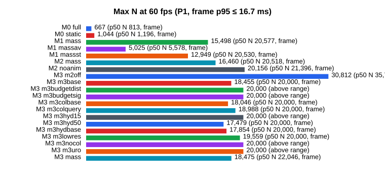

# Unreal 호드 최적화 실험실

Night of the Dead에서 측정 없이 액터로 했던 좀비 호드 최적화를, Unreal Engine 5.8 Mass Entity로 다시 지어 거리별로 비용을 덜어내며 단계마다 수치로 확인한 기록이다. 액터 군중에서 시작해 Mass 로직, ISM + VAT, 액터 하이드레이션과 애니메이션 예산, Simulation LOD, ISKM을 한 번에 하나씩 적용하고, 같은 시나리오를 같은 방법으로 다시 잰다.

- **대상**: 클라이언트 한 대에서 그리고 움직이는 군중의 비용. Game Thread, Render Thread, GPU, 메모리.
- **최적화**: Mass Entity(Fragment·Processor), Representation LOD(액터 / ISM+VAT / ISKM / 없음), 액터 하이드레이션과 풀링, Significance Manager → Animation Budget Allocator, URO, Simulation LOD(청크 단위 가변 틱), StateTree + Signal.
- **측정 도구**: Test 구성 패키지에서 `csvprofile`과 Unreal Insights.

형제 프로젝트 [UE5 Dedicated Server 최적화 실험실](https://github.com/hon454/ue-dedicated-server-optimization-lab)이 서버가 보내는 비용을 다루고, 이 프로젝트는 클라이언트가 그리고 움직이는 비용을 다룬다.

## 시나리오

플레이어는 움직이지 않는다. 맵 중앙의 오브를 향해 개체가 사방에서 걸어오고, 오브는 가까운 개체를 지우고 먼 개체를 주기적으로 쏜다. 모든 거리에서 생성·피격·사망·표현 전환이 계속 일어나게 하는 벤치마크 장치다. 개체는 Epic의 무료 에셋 Paragon: Minions의 근접 미니언 한 종류다. 카메라는 고정 프리셋 두 개(오브 뒤에서 바깥을 보며 도는 오브 시점, 탑뷰)로 잰다.

## 결과 한눈에 보기



60fps(프레임·Game·Render·GPU 중 가장 느린 것의 p50이 16.7ms 이하)를 지키는 최대 개체 수다. 오브 시점, 2560x1440 Epic, Test 패키지, 3회 중앙값(`Measurements/M<N>/summary.csv`). 줄마다 잰 묶음이 다르다. 같은 M1이 묶음에 따라 20k 16.0 / 15.2ms로 달랐으므로, 단계 사이 비교는 같은 묶음에서 잰 짝(M2 줄의 M1, M3 줄의 M2 + 200m 밖 Off)으로 한다.

| 단계 · 변형 | 1k | 2k | 5k | 20k | 50k | 60fps 최대 N |
| --- | --- | --- | --- | --- | --- | --- |
| M0 액터 + AnimBP | 19.5 | 40.6 | 156.9 | | | 813 |
| M0 Animation Budget Allocator | 17.4 | 32.3 | 118.3 | | | 1,000 미만 |
| M0 CharacterMovement 틱 끔 | 14.3 | 28.3 | 75.3 | | | 1,128 |
| M0 애니 없는 액터 | 13.1 | 27.0 | 104.0 | | | 1,196 |
| M1 Mass(애니 없는 ISM) | 5.9 | 6.5 | 8.0 | 16.0 | 39.2 | 약 20,600 |
| M2 VAT ISM(같은 묶음 M1 약 21,400) | 5.4 | | 7.5 | 16.1 | 38.8 | 약 20,500 |
| M3 M2 + 200m 밖 그리지 않음 | 5.2 | | 6.3 | 10.3 | 20.4 | 약 35,800 |
| M3 + 30m 안 액터 하이드레이션 | 5.2 | | 6.2 | 15.5 | 27.1 | 약 22,000 |

칸의 수치는 프레임 시간 p50(ms)이다. 액터는 무엇을 덧대도 1천 개 근처에서 막혔다. 같은 로직을 Mass로 옮기자 한계가 약 17배 올랐다. 이 배수에는 컨테이너 전환(액터 → Mass)과 이동 구현 변경(CharacterMovement → Mass 스티어링)이 함께 들어 있다. 비교 상대인 "애니 없는 액터"가 CharacterMovement와 캡슐을 그대로 두기 때문이다. 병렬 처리 끔과 켬은 구별되지 않았다(N=20k 16.1 / 16.0ms). N=20k는 GPU가 병목이라 프레임 시간으로는 병렬의 효과를 판단할 수 없다. 미니언끼리 비켜 가기(충돌 회피)를 켜면 N=20k에서 57.7ms로 크게 무거워진다. 먼 개체에 애니메이션을 입힌 VAT는 한계를 약 4% 낮췄다. 30m 안 개체를 액터로 바꾸자 한계가 약 38% 내려갔다. 액터 수는 상한 500에 고정되므로 이 비용은 N과 무관한 고정비(20k P1에서 Game Thread +7.3ms, 액터당 약 15µs)이고, 한계의 감소는 그 고정비가 Mass 비용 위에 얹힌 결과다.


| 단계 | 바꾼 것 | 태그 |
| --- | --- | --- |
| M0 기준선 | `ACharacter` + AnimBP 군중. 변형: 애니 없는 액터, CharacterMovement 틱 끔, URO, Animation Budget Allocator | `M0` |
| M1 Mass 코어 | 이동·피해·사망 로직을 Fragment와 Processor로. 표현은 애니 없는 ISM | `M1` |
| M2 ISM + VAT | 먼 개체를 AnimToTexture로 구운 애니메이션이 있는 ISM으로 | `M2` |
| M3 하이드레이션 + 예산 | 가까운 개체에 액터를 붙이고, 그 애니메이션 비용을 URO / Budget Allocator로 제한 | `M3` |
| M3b 새 기준선 | 큰 개체(시즈 미니언) 10%를 더하고 M0\~M3를 다시 잰다. 크기 보정 중요도 | |
| M4 Simulation LOD | 먼 개체의 로직 틱 간격을 청크 단위로 늘린다 | |
| M5 ISKM | 먼 개체 표현을 ISKM + AnimSequenceTransformProvider로 바꿔 VAT와 비교 | |

## 글

| # | 제목 | 알게 된 것 |
| --- | --- | --- |
| | (작성 중) | |

## 측정 방법

- 고정 시드로 초기 조건을 재현한다. 개체는 정상 상태 분포(밀도 ∝ 1/r)로 미리 놓고 15초 뒤 60초를 잰다. 궤적은 비결정적이라 3회 실행의 중앙값과 범위를 함께 적는다.
- 개체 수 N은 1k와 5k를 모든 단계에서 재고, 단계마다 범위를 넓힌다.
- 수치는 Test 구성 패키지에서 `csvprofile`로 얻는다. Development 빌드의 수치는 비교에 쓰지 않는다.
- 중앙값의 차이가 두 구성의 범위 중 큰 쪽보다 작으면 "구별되지 않았다"고 적는다.

규약 전체는 [Docs/Guides/measurement.md](Docs/Guides/measurement.md)에 있다.

## 측정의 한계

- PC 한 대, 해상도와 스케일러빌리티를 고정한 Test 패키지다. 다른 하드웨어의 절댓값은 다르다.
- Paragon 미니언은 실제 게임 캐릭터보다 가볍다. 상대 변화를 본다.
- Mass의 병렬 처리와 가변 프레임 시간 때문에 같은 시드도 궤적이 다르다. 범위를 함께 본다.

## 실행

단계는 한 빌드 안의 실행 모드다(`-LabStage=M0|M1`). Test 패키지를 만들고 묶음 스크립트로 잰다.

```powershell
powershell -ExecutionPolicy Bypass -File Scripts/package.ps1
powershell -ExecutionPolicy Bypass -File Scripts/run-e0.ps1
powershell -ExecutionPolicy Bypass -File Scripts/run-e1.ps1
py -3 Scripts/summarize.py --milestone M0
py -3 Scripts/plot.py
```

Fab 에셋은 저장소에 없다. 준비와 나머지 명령은 [Docs/Guides/commands.md](Docs/Guides/commands.md)에 있다.

## 구조

| 경로 | 내용 |
| --- | --- |
| `Source/HordeOptLab/` | C++ 모듈. 클래스 접두사 `Lab` |
| `Content/Lab/` | 직접 만든 콘텐츠. Fab 에셋은 커밋하지 않는다 |
| `Scripts/` | 빌드, 패키징, 벤치마크, 그래프 |
| `Docs/` | 계획, 결정 기록, 측정 규약, 엔진 소스 확인 기록 |
| `Posts/` | 글과 측정 기록 |
| `Measurements/M<N>/` | 마일스톤별 수치와 대표 스크린샷 |
